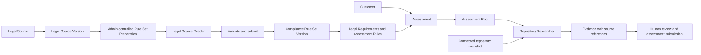
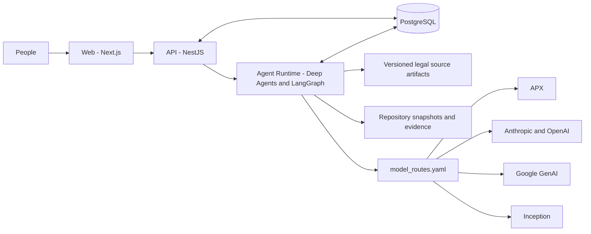

<h1 align="center">LCSP</h1>

<p align="center">
  <strong>Legal Compliance Support Platform</strong><br />
  Evidence-led software compliance assessment with traceable sources and human review.
</p>

<p align="center">
  <a href="https://github.com/khov4nfs/LCSP/actions/workflows/test.yml">
    
  </a>
</p>

LCSP helps software teams assess repository evidence against versioned legal requirements and assessment rules. It organizes source provenance, research activity, and assessment state so people can review findings and decide what to submit. LCSP supports compliance work; it does not make legal determinations or certify compliance.

## Overview

LCSP is used by software teams and compliance reviewers who need to connect requirements to evidence in a code repository. Legal sources and rule sets are versioned, assessments retain their references, and repository research produces traceable evidence for human review. Server-side lifecycle and authorization rules govern privileged transitions; model output remains subject to domain validation and human oversight.

## Product workflow



An administrator starts Rule Set Preparation for an eligible Legal Source Version. The agents read the pinned source and prepare structured requirements and rules; application validation and submission create a reusable `ComplianceRuleSetVersion`. An Assessment uses those rules to direct repository research. The Assessment Root coordinates the work and the Repository Researcher gathers evidence from the assessment's repository snapshot. People review the findings and control assessment completion.

## Capabilities

| Area                | Current capability                                                                                              |
| ------------------- | --------------------------------------------------------------------------------------------------------------- |
| Legal sources       | Ingest and version legal source material, then pin source references for preparation and assessment provenance. |
| Compliance rules    | Prepare reusable Compliance Rule Sets with administrator start, retry, and cancellation controls.               |
| Repository research | Connect supported repositories and derive evidence tied to repository context.                                  |
| Runtime visibility  | Stream validated agent activity and usage details to the application.                                           |
| Model operations    | Configure routes, provider credentials, fallback, and usage attribution independently.                          |
| Human oversight     | Keep assessment state, validation, and privileged transitions under server-side controls.                       |

## Agent architecture

The Python Agent Runtime uses Deep Agents and LangGraph for semantic reasoning and checkpointed work. The Assessment Root coordinates an assessment and delegates repository investigation to the Repository Researcher. Rule Set Preparation uses a Legal Source Reader with access to the pinned legal source; governed tools validate and submit the resulting rule set.

Agents interpret legal and repository content. The API owns authorization, persisted lifecycle state, validation, and state transitions. Runtime activity is validated before it is projected to the web client. A running model does not grant authority to change canonical assessment or rule-set state.

## Model routing

**Canonical provider and transport protocol are separate route fields.** `deepagents/config/model_routes.yaml` is the routing authority. Each route declares `provider`, `protocol`, `model`, and optional validated inference `options`; credentials and endpoints do not belong in model options.

| Canonical provider            | Protocol                                | Client family                   | Credential authority                 |
| ----------------------------- | --------------------------------------- | ------------------------------- | ------------------------------------ |
| APX (`apx`)                   | Anthropic or OpenAI, selected per route | `ChatAnthropic` or `ChatOpenAI` | `APX_API_KEY`                        |
| Anthropic (`anthropic`)       | Anthropic                               | `ChatAnthropic`                 | `ANTHROPIC_API_KEY`                  |
| OpenAI (`openai`)             | OpenAI                                  | `ChatOpenAI`                    | `OPENAI_API_KEY`                     |
| Google GenAI (`google_genai`) | Google GenAI                            | Native Google GenAI integration | `GOOGLE_API_KEY` or `GEMINI_API_KEY` |
| Inception (`inception`)       | OpenAI-compatible                       | `ChatOpenAI`                    | `INCEPTION_API_KEY`                  |

The checked-in primary route is APX over Anthropic protocol with `claude-sonnet-4-6-free`. APX can also use the OpenAI protocol for a GPT-family model when that protocol is selected explicitly in a route. In either case, the canonical provider remains APX for credential selection and usage identity.

## Reliability and fallback

`APX_API_KEY` may contain a comma-separated pool of APX credentials. LCSP uses one credential at a time, moves to another slot when an allowance is permanently exhausted, and applies cooldown handling to transient rate limits. Only after same-provider credential handling does routing proceed to the configured provider fallback. The current configured chain is **APX → Google GenAI → Inception**. Credential values and pools are secret material; only safe credential fingerprints may appear in operational logs.

## Architecture



## Repository structure

| Path                 | Purpose                                                                                       |
| -------------------- | --------------------------------------------------------------------------------------------- |
| `apps/web`           | Next.js application for customers and administrators.                                         |
| `apps/api`           | NestJS API, authorization, domain lifecycle, persistence, and Prisma migrations.              |
| `deepagents`         | Python Agent Runtime, assessment and rule-set agents, model policy, and runtime integrations. |
| `packages/contracts` | Shared API and runtime contracts.                                                             |
| `packages/i18n`      | Shared application copy and message catalogs.                                                 |
| `tests`              | Cross-package and release-gate verification.                                                  |
| `scripts`            | Development entry points and repository checks.                                               |
| `docs`               | Product, architecture, and operational documentation.                                         |
| `reports`            | Durable release, migration, and verification evidence.                                        |

## Getting started

### Requirements

- Node.js 22 for the standard JavaScript workflow.
- pnpm 12.3.4, pinned by the root `package.json`.
- Python 3.11–3.13 and `uv` for the Agent Runtime.
- PostgreSQL and RabbitMQ for a complete local stack. Docker is needed for the Docker Agent Runtime mode.

### Install and configure

```bash
pnpm install --frozen-lockfile
cd deepagents
uv sync --frozen --extra dev
cd ..
```

Create a private local `.env` from [`.env.example`](.env.example) if one does not already exist. Set `DATABASE_URL` and `RABBITMQ_URL` to local services and configure only the credentials required by the routes you enable. Keep production values outside the repository. The development dispatcher applies Prisma migrations to the database in `DATABASE_URL`, so use a local database.

### Start services

The root development dispatcher prepares runtime packages, generates the Prisma client, applies local migrations, and starts the selected mode:

```bash
pnpm run dev:local
```

Use `pnpm run dev:docker` when you want the Agent Runtime in Docker. The local Python worker mode is not supported on Windows; the Docker mode is available there. For individual services, the repository scripts include:

```bash
pnpm --filter @lcsp/api start:dev
pnpm --filter @lcsp/web dev
```

To start the Agent Runtime directly, from `deepagents` run:

```bash
uv run --extra dev langgraph dev --no-browser --no-reload --allow-blocking
```

To apply the checked-in migration history to a disposable local database outside the dispatcher:

```bash
pnpm --filter @lcsp/api prisma:generate
pnpm --filter @lcsp/api prisma:migrate:deploy
```

## Environment configuration

The complete local template is [`.env.example`](.env.example). The names below are configuration identifiers only; values belong in a local environment or approved secret store.

| Group                                     | Variable names                                                                                                                                                                                                           |
| ----------------------------------------- | ------------------------------------------------------------------------------------------------------------------------------------------------------------------------------------------------------------------------ |
| Database and infrastructure               | `DATABASE_URL`, `RABBITMQ_URL`, `PORT`, `NODE_ENV`                                                                                                                                                                       |
| Authentication and repository credentials | `MFA_SECRET_ENCRYPTION_KEY`, `OAUTH_GOOGLE_CLIENT_ID`, `OAUTH_GOOGLE_CLIENT_SECRET`, `OAUTH_ALLOWED_REDIRECT_ORIGINS`, `WORKER_API_KEY`, `GITHUB_CLI_CREDENTIAL_KEK_ACTIVE_VERSION`, `GITHUB_CLI_CREDENTIAL_KEK_KEYRING` |
| Provider credentials                      | `APX_API_KEY`, `ANTHROPIC_API_KEY`, `OPENAI_API_KEY`, `GOOGLE_API_KEY`, `GEMINI_API_KEY`, `INCEPTION_API_KEY`                                                                                                            |
| Agent Runtime                             | `LCSP_API_BASE_URL`, `NESTJS_API_BASE_URL`, `LCSP_AGENT_SERVER_URL`, `LCSP_MODEL_ROUTES_FILE`, `LANGGRAPH_CHECKPOINT_DATABASE_URL`, `USAGE_RECOVERY_STORE_PATH`                                                          |
| Optional observability                    | `LCSP_LANGSMITH_TRACING`, `PHOENIX_TRACING`, `PHOENIX_COLLECTOR_ENDPOINT`, `PHOENIX_PROJECT`                                                                                                                             |
| Email and payment integrations            | `SMTP_HOST`, `SMTP_USER`, `SMTP_PASS`, `SMTP_FROM`, `BILLING_SEPAY_BANK_NAME`, `BILLING_SEPAY_BANK_ACCOUNT_NUMBER`, `BILLING_SEPAY_ACCOUNT_HOLDER`, `BILLING_SEPAY_QR_URL_TEMPLATE`, `SEPAY_WEBHOOK_SECRET`              |

The APX credential pool is a list of secrets, even though it is comma-separated. Do not commit provider keys, repository tokens, encryption keys, webhook secrets, or production environment files.

## Database migrations

The Prisma schema is maintained in `apps/api/prisma/schema.prisma`, and the ordered migration history is in `apps/api/prisma/migrations`. The development dispatcher and API test workflow use Prisma migrations. Production schema changes belong to the reviewed release process; do not run a production migration from a developer shell.

The latest checked-in migration is `20261013132644_re_generate_db`. It reconciles schema constraints and indexes and removes the unused `WizardProfile` table and type. The table drop is destructive if rows remain; production retention eligibility and application status are **not verified**. See the [release report](reports/releases/2026-10-14-production-release.md) before treating this migration as production-ready.

## Testing and checks

Run the focused package checks or the full repository suites as appropriate:

```bash
pnpm run test:web
pnpm --filter @lcsp/api test
pnpm --filter @lcsp/api test:e2e
pnpm run typecheck
pnpm run lint
pnpm run check:contracts
```

For Python Agent Runtime tests, from `deepagents`:

```bash
uv sync --frozen --extra dev
uv run pytest
```

The API end-to-end test command provisions its project-managed disposable PostgreSQL target. The repository's pull-request checks are defined in [`.github/workflows/test.yml`](.github/workflows/test.yml). No Ruff check is configured in the current repository workflows.

## Production deployment

The declared production services are Web, API, and Agent Runtime, backed by PostgreSQL and RabbitMQ and deployed through the [Fogewise workflow](.github/workflows/fogewise-deploy.yml). PM2 scripts remain manual repair tooling for non-Fogewise hosts; they are not the current production deployment authority. The repository's [`Deploy Production` workflow](.github/workflows/deploy.yml) is manually dispatched, so merging to `develop` does not itself deploy application code.

Production changes must come from reviewed source and converge on an exact merged SHA. Prisma migrations are source-controlled and belong to the reviewed release process. Do not run a production migration from a developer shell. Deployment credentials remain outside Git; operational procedures belong in the maintained deployment controls, not in this README.

## Security and compliance posture

LCSP supports evidence-based assessment; it is not a legal authority, legal opinion, or compliance certification. Legal sources and repository evidence are versioned or referenced for traceability, while application code owns authorization and bounded lifecycle transitions. Model conclusions require domain validation and human review. External repository content and provider availability remain outside LCSP's control.

See [`SECURITY.md`](SECURITY.md) for reporting, credential isolation, route trust boundaries, and runtime security limits.

## Documentation

- [`docs/index.md`](docs/index.md) — current documentation map and architecture entry points.
- [`CHANGELOG.md`](CHANGELOG.md) — dated changes under the repository's `Unreleased` convention.
- [`SECURITY.md`](SECURITY.md) — security policy and reporting guidance.
- [`docs/releases/2026-10-14.md`](docs/releases/2026-10-14.md) — concise release notes for the current develop candidate.
- [`reports/releases/2026-10-14-production-release.md`](reports/releases/2026-10-14-production-release.md) — release identity, migration, verification, and residual risks.
- [`AGENTS.md`](AGENTS.md) — repository contributor guidance.
- [`apps/web/AGENTS.md`](apps/web/AGENTS.md) and [`apps/web/CLAUDE.md`](apps/web/CLAUDE.md) — web workspace agent guidance and its Claude entry point.

## Current release status

LCSP uses date-based promotion pull requests from `develop` to `main`; it has no published Git tags or GitHub Releases and no formal product SemVer support matrix. PR #381 and PR #382 are merged into `develop`, but the production-running SHA is not verified. The dated [release report](reports/releases/2026-10-14-production-release.md) distinguishes the latest main promotion from the current develop candidate and records the local migration status.
