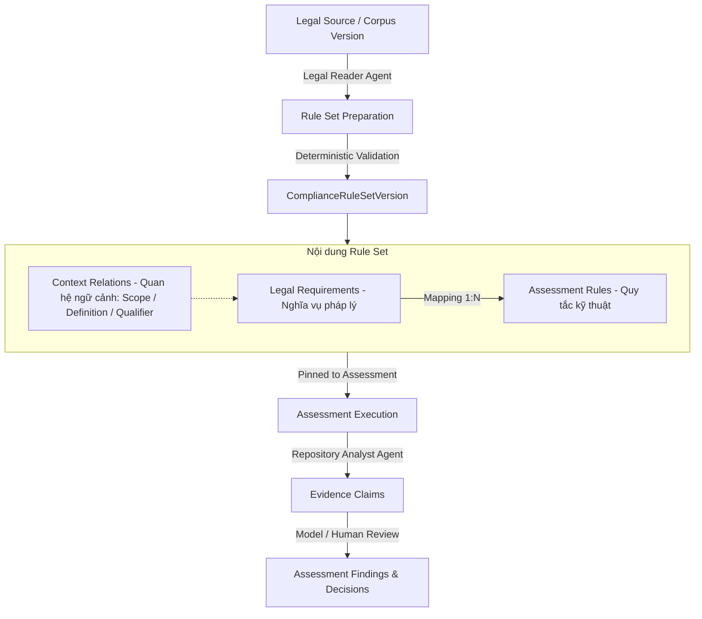

# LCSP Compliance Rule Sets — Tổng Hợp Toàn Bộ Danh Mục Quy Tắc Phục Vụ Review

> **HỒ SƠ LỊCH SỬ / REVIEW ONLY — KHÔNG PHẢI LEGAL GOLD, RULE SET ACTIVE HAY BẰNG CHỨNG PRODUCTION.** Các nhãn “verified/active” và số liệu trong tài liệu phản ánh các nguồn nghiên cứu lịch sử, có thể bao gồm mock/UI fixture. Chỉ sử dụng để điều tra; mọi kết luận pháp lý cần văn bản gốc đã pin, review độc lập và kiểm chứng trên hệ thống thực. Không dùng tài liệu này để tự approve hoặc activate Rule Set.

> **Mục đích tài liệu:** Tập hợp toàn diện và có cấu trúc tất cả các bộ quy tắc tuân thủ pháp lý (Legal Requirements), quy tắc đánh giá kỹ thuật (Assessment / Engineering Rules), kho quy chuẩn luật pháp thực tế (171 Legal Rules VN) và các quy tắc kiểm thử ngữ nghĩa trong nền tảng LCSP (Legal Compliance Support Platform).

---

## Mục Lục
1. [Tổng Quan Kiến Trúc Rule Set Trong LCSP](#1-tổng-quan-kiến-trúc-rule-set-trong-lcsp)
2. [Bộ Quy Tắc Chuẩn Đang Hoạt Động (Active Reference Rule Set - v2026.10.p1)](#2-bộ-quy-tắc-chuẩn-đang-hoạt-động-active-reference-rule-set---v202610p1)
3. [Bộ 14 Assessment Rules Đã Kiểm Định Ngữ Nghĩa Thực Tế (14 Verified Rules)](#3-bộ-14-assessment-rules-đã-kiểm-định-ngữ-nghĩa-thực-tế-14-verified-rules)
4. [Kho Dữ Liệu 171 Legal Rules Pháp Luật Việt Nam (Luật 134 & Luật 71)](#4-kho-dữ-liệu-171-legal-rules-pháp-luật-việt-nam-luật-134--luật-71)
5. [Danh Mục 20 Assessment Rules Cho Khách Hàng Chọn Đánh Giá (Customer-Selected Catalog)](#5-danh-mục-20-assessment-rules-cho-khách-hàng-chọn-đánh-giá-customer-selected-catalog)
6. [Bộ Quy Tắc Kiểm Thử Ngữ Nghĩa (Synthetic Semantic Stress Instruments)](#6-bộ-quy-tắc-kiểm-thử-ngữ-nghĩa-synthetic-semantic-stress-instruments)
7. [Bộ Quy Tắc Nghiệp Vụ Vận Hành Nền Tảng (Platform Business Rules BR-001..BR-095)](#7-bộ-quy-tắc-nghiệp-vụ-vận-hành-nền-tảng-platform-business-rules-br-001br-095)

---

## 1. Tổng Quan Kiến Trúc Rule Set Trong LCSP

Trong LCSP, một **Compliance Rule Set** là một đơn vị dữ liệu bất biến (immutable), có phiên bản xác định (`ComplianceRuleSetVersion`), phản ánh sự biên dịch từ **Văn bản pháp lý nguồn (Legal Source)** thành các **Yêu cầu pháp lý (Legal Requirements)** và các **Quy tắc đánh giá kỹ thuật (Assessment / Engineering Rules)**.

### Các thành phần chính của một Rule Set:
- **Legal Requirements (`legalRequirements`):** Đại diện cho các mệnh đề pháp lý chuẩn tắc (`operativePropositions`) gồm: Chủ thể (`actor`), Thể thức (`modality`: `DUTY` - Nghĩa vụ, `PROHIBITION` - Cấm, `RIGHT` - Quyền, `CONDITIONAL_DUTY` - Nghĩa vụ có điều kiện), Hành vi (`action`), Điều kiện áp dụng (`applicabilityConditions`), Giới hạn (`qualifiers`), Ngoại lệ (`exceptions`) và Nguồn trích dẫn (`sources` với `locator`, `contentSha256`).
- **Assessment Rules (`assessmentRules`):** Cụ thể hóa yêu cầu pháp lý thành kế hoạch điều tra mã nguồn kho lưu trữ (repository) với: Mục tiêu điều tra (`investigationGoals`), Tiêu chí đánh giá (`criteria`), Chỉ dẫn áp dụng (`applicabilityGuidance`), Bằng chứng yêu cầu (`requiredEvidence`), Bằng chứng hỗ trợ (`supportingEvidence`), Bằng chứng phủ định (`negativeEvidence`).
- **Context Relations (`contextRelations`):** Định nghĩa mối quan hệ ngữ cảnh giữa các điều khoản: `SCOPE` (phạm vi), `DEFINITION` (định nghĩa), `QUALIFIER` (điều kiện ràng buộc), `EXCEPTION` (ngoại lệ), `CROSS_REFERENCE` (dẫn chiếu chéo).
- **Vòng đời (Lifecycle State):** `DRAFT` ➔ `VALIDATED` ➔ `SUBMITTED` ➔ `ACTIVE` (chỉ có duy nhất 1 bộ Active tại 1 thời điểm) ➔ `SUPERSEDED` (khi có phiên bản mới kích hoạt).

---

## 2. Bộ Quy Tắc Chuẩn Đang Hoạt Động (Active Reference Rule Set - v2026.10.p1)

- **Rule Set Version ID:** `cccccccc-cccc-4ccc-8ccc-cccccccccccc`
- **Version:** `2026.10.p1`
- **Lifecycle State:** `ACTIVE`
- **Activated At:** `2026-10-13T00:10:00.000Z`
- **Rule Set Digest:** `ffffffffffffffffffffffffffffffffffffffffffffffffffffffffffffffff`
- **Legal Source Version ID:** `aaaaaaaa-aaaa-4aaa-8aaa-aaaaaaaaaaaa`

### 2.1. Yêu Cầu Pháp Lý (Legal Requirement)
#### `LAW-SEC-001`: Security safeguards
- **Mệnh đề pháp lý (Proposition):** An organization must protect personal data with appropriate safeguards.
- **Nhiệm vụ ngoài kho lưu trữ (Non-Repository Duty):** `Có`
- **Trạng thái bao phủ (Coverage State):** `COVERED_BY_ASSESSMENT_RULES`
- **Điều kiện áp dụng:**
  - The organization processes personal data.
- **Giới hạn (Qualifiers):**
  - Safeguards must be appropriate to the risk.
- **Ngoại lệ (Exceptions):**
  - This duty does not apply to data that has been irreversibly anonymized.
- **Nguồn trích dẫn (Legal Sources):**
  - Tài liệu: `LAW-2026-001`, Định vị: `Article 12(1)`, Hiệu lực: `EFFECTIVE` / `IN_FORCE`

### 2.2. Quy Tắc Đánh Giá Kỹ Thuật (Assessment Rule)
#### `RULE-SEC-001`: Personal data safeguards
- **Phiên bản:** `v1` | **Liên kết Legal Requirement:** `LAW-SEC-001`
- **Ý định pháp lý (Legal Intent):** Reduce the risk of unauthorized access to personal data.
- **Chỉ dẫn áp dụng (Applicability Guidance):** Check whether the organization processes personal data and whether the evidence describes safeguards proportionate to the processing risk.
- **Mục tiêu điều tra:** Inspect authorization controls.
- **Bằng chứng bắt buộc (Required Evidence):** Role-based access policy
- **Tiêu chí đánh giá (Criteria):**
  - **`CRITERION-SEC-001`:** Access to stored personal data is restricted to authorized identities.
- **Nguồn trích dẫn căn cứ:**
  - `LAW-2026-001` (Article 12(1)) — Hash: `sha256:11111111111111111...`

### 2.3. Quan Hệ Ngữ Cảnh (Context Relations)
- **Mã quan hệ:** `REL-SEC-001` | **Loại:** `SCOPE`
  - Từ Legal Requirement: `LAW-SEC-001`
  - Đến nguồn tham chiếu: `LAW-2026-001` (Article 12(2))

---

## 3. Bộ 14 Assessment Rules Đã Kiểm Định Ngữ Nghĩa Thực Tế (14 Verified Rules)

Bộ 14 quy tắc này được tác tạo bởi mô hình và đã trải qua kiểm định ngữ nghĩa native (`native-semantic-verification-14rules.json`) trên hệ thống phần mềm giám sát thi ứng dụng AI (**CheatShield**). Các quy tắc này căn cứ trên hệ thống pháp luật Việt Nam, bao gồm: **Luật Trí tuệ nhân tạo (Luật 134/2025/QH15)**, **Nghị định 142/2026/NĐ-CP**, **Luật An ninh mạng (Luật 116/2025/QH15)** và **Luật Bảo vệ dữ liệu cá nhân (Luật 91/2025/QH15)**.

### Bảng Tổng Hợp 14 Assessment Rules

| STT | Mã Assessment Rule | Văn Bản Pháp Luật Căn Cứ | Trạng Thái Áp Dụng | Kết Luận Tuân Thủ |
|:---:|:---|:---|:---:|:---:|
| 1 | `ANM-2025-Art23-Rule-Docs` | Luật An ninh mạng 116/2025 | Không áp dụng | N/A (Không áp dụng) |
| 2 | `ANM-2025-Art24-Rule-KyThuat` | Luật An ninh mạng 116/2025 | Không áp dụng | N/A (Không áp dụng) |
| 3 | `ar-06-provider-classification` | Nghị định 142/2026/NĐ-CP | **ÁP DỤNG** | **NON_COMPLIANT** |
| 4 | `ar-art24-dual-consent` | Luật 91/2025/QH15 (BV dữ liệu) | Không áp dụng | N/A (Không áp dụng) |
| 5 | `ar-c12-content` | Nghị định 142/2026/NĐ-CP | **ÁP DỤNG** | **NON_COMPLIANT** |
| 6 | `ar-c12-rec` | Nghị định 142/2026/NĐ-CP | **ÁP DỤNG** | **NON_COMPLIANT** |
| 7 | `ar-c12-storage` | Nghị định 142/2026/NĐ-CP | **ÁP DỤNG** | **NON_COMPLIANT** |
| 8 | `ar-luat134-art12-cl1-safety-security-reliability` | Luật 134/2025/QH15 | **ÁP DỤNG** | **NON_COMPLIANT** |
| 9 | `ar-luat134-art14-cl1-pt-a-risk-management-measures` | Luật 134/2025/QH15 | **ÁP DỤNG** | **NON_COMPLIANT** |
| 10 | `ar-luat134-art14-cl1-pt-b-data-governance` | Luật 134/2025/QH15 | **ÁP DỤNG** | **NON_COMPLIANT** |
| 11 | `ar-nd142-art11-cl1-review-reclassification` | Nghị định 142/2026/NĐ-CP | Không áp dụng | N/A (Không áp dụng) |
| 12 | `ar13-foreign-recognition` | Nghị định 142/2026/NĐ-CP | Không áp dụng | N/A (Không áp dụng) |
| 13 | `art20-cl1-assessment` | Nghị định 142/2026/NĐ-CP | Không áp dụng | N/A (Không áp dụng) |
| 14 | `luat134-art11-cl2-machine-readable-marking-impl` | Luật 134/2025/QH15 | **ÁP DỤNG** | **NON_COMPLIANT** |

### Chi Tiết Từng Quy Tắc Đánh Giá

### 3.1. Quy Tắc: `ANM-2025-Art23-Rule-Docs`
- **Mã Quyết Định (Decision ID):** `de926519-0891-469f-8702-736888695014` (Revision: 3, Case Revision: 5)
- **Tính Áp Dụng (Applicability):** `NOT_APPLICABLE`
- **Kết Luận Tuân Thủ (Compliance):** `N/A`
- **Lý Luận Đánh Giá (Rationale):**
  > Nghĩa vụ tại Điều 23 Luật 116/2025/QH15 về trách nhiệm của người đứng đầu cơ quan, tổ chức chỉ giới hạn trong phạm vi cơ quan nhà nước, tổ chức chính trị và tổ chức chính trị - xã hội ở trung ương và địa phương (Qualifier 1). Kho lưu trữ thể hiện hệ thống được đánh giá là phần mềm giám sát thi trực tuyến bằng AI (CheatShield) phục vụ mục đích học thuật, phân phối dưới dạng mã nguồn mở, và không chứa bất kỳ dấu hiệu nào về cơ quan nhà nước, tổ chức chính trị hoặc chính trị - xã hội vận hành hệ thống. Do đó phạm vi đối tượng điều chỉnh không bao gồm hệ thống này; nghĩa vụ không phát sinh.

- **Cơ sở xác định tính áp dụng (Applicability Basis):**
  - **[QUALIFIER] — Kết quả: `REFUTED`:** Qualifier giới hạn phạm vi áp dụng cho cơ quan nhà nước, tổ chức chính trị, tổ chức chính trị - xã hội. Sự kiện trường hợp sử dụng đã được chấp nhận và bằng chứng kho lưu trữ thể hiện CheatShield là phần mềm AI giám sát thi học thuật mã nguồn mở; kho lưu trữ không chứa dấu hiệu nào cho thấy hệ thống thuộc quyền quản lý của cơ quan nhà nước/tổ chức chính trị hoặc chính trị - xã hội, nên phạm vi đối tượng không được thiết lập.

---

### 3.2. Quy Tắc: `ANM-2025-Art24-Rule-KyThuat`
- **Mã Quyết Định (Decision ID):** `d9d6d647-1852-4943-9e1e-ebd5a5b9d718` (Revision: 3, Case Revision: 5)
- **Tính Áp Dụng (Applicability):** `NOT_APPLICABLE`
- **Kết Luận Tuân Thủ (Compliance):** `N/A`
- **Lý Luận Đánh Giá (Rationale):**
  > Nghĩa vụ tại Điều 24 khoản 2 điểm b Luật 116/2025/QH15 áp dụng cho cơ quan, tổ chức, cá nhân quản lý, khai thác cơ sở hạ tầng không gian mạng quốc gia hoặc cổng kết nối mạng quốc tế, khi có đề nghị của cơ quan nhà nước có thẩm quyền. CheatShield là phần mềm ứng dụng giám sát thi trực tuyến trên máy trạm, không phải đơn vị quản lý/khai thác hạ tầng không gian mạng quốc gia hay cổng kết nối quốc tế, và không có bằng chứng nào về đề nghị của cơ quan nhà nước có thẩm quyền trong kho lưu trữ. Điều kiện áp dụng không được thiết lập.

- **Cơ sở xác định tính áp dụng (Applicability Basis):**
  - **[APPLICABILITY_CONDITION] — Kết quả: `REFUTED`:** Điều kiện yêu cầu có đề nghị của cơ quan nhà nước có thẩm quyền; đồng thời chủ thể của nghĩa vụ là đơn vị quản lý/khai thác hạ tầng không gian mạng quốc gia hoặc cổng kết nối quốc tế. Kho lưu trữ chỉ chứa ứng dụng giám sát thi trên máy trạm; không có cơ chế, hồ sơ hay bằng chứng nào về đề nghị của cơ quan nhà nước hoặc vai trò quản lý hạ tầng không gian mạng quốc gia.

---

### 3.3. Quy Tắc: `ar-06-provider-classification`
- **Mã Quyết Định (Decision ID):** `2c1980f4-4dbd-41d5-9f0e-aecd1f680287` (Revision: 3, Case Revision: 5)
- **Tính Áp Dụng (Applicability):** `APPLICABLE`
- **Kết Luận Tuân Thủ (Compliance):** `NON_COMPLIANT`
- **Lý Luận Đánh Giá (Rationale):**
  > Điều 6 khoản 1 Nghị định 142/2026/NĐ-CP đặt nghĩa vụ vô điều kiện lên nhà cung cấp hệ thống AI phải tự thực hiện phân loại rủi ro trước khi đưa hệ thống vào sử dụng. CheatShield là hệ thống AI giám sát thi được cung cấp dưới tên của nhà cung cấp, do đó nhà cung cấp thuộc đối tượng điều chỉnh; quy tắc vô điều kiện, áp dụng.

- **Tiêu chí kỹ thuật và kết quả kiểm tra (Criteria & Findings):**
  - **Mã tiêu chí:** `criterion_8ae168409f9d5b2934496cac`
    - Kết quả: `NOT_MET`
    - Phân tích: Kho lưu trữ không chứa tài liệu thể hiện kết quả phân loại rủi ro của hệ thống trước khi đưa vào sử dụng (không có hồ sơ phân loại, tài liệu đối chiếu Danh mục hệ thống AI rủi ro cao hoặc các trường hợp quy định tại Điều 9 Nghị định 142/2026/NĐ-CP). Kho lưu trữ chỉ chứa mã nguồn ứng dụng và tài liệu mô tả.
    - Bằng chứng kiểm tra liên kết: 2 tham chiếu (`CONFIRMED_FACT:fcede1e4, ASSESSMENT_EVIDENCE:806c2331`)

---

### 3.4. Quy Tắc: `ar-art24-dual-consent`
- **Mã Quyết Định (Decision ID):** `529fa0a3-5539-4492-8054-373e4a01b545` (Revision: 2, Case Revision: 5)
- **Tính Áp Dụng (Applicability):** `NOT_APPLICABLE`
- **Kết Luận Tuân Thủ (Compliance):** `N/A`
- **Lý Luận Đánh Giá (Rationale):**
  > Điều 24 khoản 2 Luật 91/2025/QH15 yêu cầu sự đồng ý của trẻ em và người đại diện theo pháp luật khi xử lý dữ liệu cá nhân của trẻ em từ đủ 07 tuổi nhằm công bố, tiết lộ thông tin đời sống riêng tư, bí mật cá nhân. Khách hàng xác nhận hệ thống hoạt động hoàn toàn như ứng dụng máy tính để bàn ngoại tuyến giám sát hoạt động thi của thí sinh cục bộ và không công bố, tiết lộ, phát sóng, xuất hoặc truyền dữ liệu cá nhân, đoạn ghi hình hoặc nhật ký vi phạm của thí sinh cho bên thứ ba, nền tảng đám mây hoặc mạng công cộng. Do đó điều kiện áp dụng (xử lý nhằm công bố/tiết lộ thông tin đời sống riêng tư) bị bác bỏ; nghĩa vụ không phát sinh.

- **Cơ sở xác định tính áp dụng (Applicability Basis):**
  - **[APPLICABILITY_CONDITION] — Kết quả: `REFUTED`:** Điều kiện yêu cầu việc xử lý dữ liệu cá nhân của trẻ em từ đủ 07 tuổi nhằm công bố, tiết lộ thông tin đời sống riêng tư, bí mật cá nhân. Sự kiện do khách hàng cung cấp xác nhận hệ thống không công bố, tiết lộ, phát sóng, xuất hoặc truyền dữ liệu cá nhân của thí sinh ra bên ngoài; do đó mục đích công bố/tiết lộ không được thiết lập.

---

### 3.5. Quy Tắc: `ar-c12-content`
- **Mã Quyết Định (Decision ID):** `5cc1d2b8-677f-43ef-8069-16de15e30d06` (Revision: 3, Case Revision: 5)
- **Tính Áp Dụng (Applicability):** `APPLICABLE`
- **Kết Luận Tuân Thủ (Compliance):** `NON_COMPLIANT`
- **Lý Luận Đánh Giá (Rationale):**
  > Điều 12 khoản 2 Nghị định 142/2026/NĐ-CP yêu cầu hồ sơ phân loại rủi ro của hệ thống AI rủi ro cao/trung bình bao gồm bốn nhóm tài liệu (thông tin nhận diện hệ thống; mô tả hệ thống và bối cảnh sử dụng; thông tin về dữ liệu; nội dung quản lý rủi ro). CheatShield là hệ thống AI rủi ro cao, nên nghĩa vụ áp dụng.

- **Tiêu chí kỹ thuật và kết quả kiểm tra (Criteria & Findings):**
  - **Mã tiêu chí:** `criterion_f5624cce0a7c5d2b3e6526dd`
    - Kết quả: `NOT_MET`
    - Phân tích: Do không tồn tại hồ sơ phân loại rủi ro trong kho lưu trữ, cả bốn nhóm tài liệu bắt buộc (thông tin nhận diện hệ thống, mô tả hệ thống và bối cảnh sử dụng, thông tin về dữ liệu, nội dung quản lý rủi ro) đều không được bảo đảm.
    - Bằng chứng kiểm tra liên kết: 2 tham chiếu (`CONFIRMED_FACT:fcede1e4, ASSESSMENT_EVIDENCE:5c76a6b4`)

---

### 3.6. Quy Tắc: `ar-c12-rec`
- **Mã Quyết Định (Decision ID):** `96992495-8dba-4ceb-a796-7ae73920cc51` (Revision: 3, Case Revision: 5)
- **Tính Áp Dụng (Applicability):** `APPLICABLE`
- **Kết Luận Tuân Thủ (Compliance):** `NON_COMPLIANT`
- **Lý Luận Đánh Giá (Rationale):**
  > Điều 12 khoản 1 Nghị định 142/2026/NĐ-CP yêu cầu nhà cung cấp hệ thống AI rủi ro cao (hoặc trung bình) lập hồ sơ phân loại rủi ro trước khi đưa hệ thống vào sử dụng. CheatShield là hệ thống AI giám sát thi rủi ro cao được cung cấp bởi nhà cung cấp, nên nghĩa vụ áp dụng.

- **Tiêu chí kỹ thuật và kết quả kiểm tra (Criteria & Findings):**
  - **Mã tiêu chí:** `criterion_82be1370748059a876b640a9`
    - Kết quả: `NOT_MET`
    - Phân tích: Không tồn tại hồ sơ phân loại rủi ro được lập đối với CheatShield trước khi đưa vào sử dụng trong kho lưu trữ; kho lưu trữ chỉ chứa mã nguồn ứng dụng và tài liệu mô tả, không có hồ sơ phân loại hay tài liệu kỹ thuật liên quan.
    - Bằng chứng kiểm tra liên kết: 2 tham chiếu (`CONFIRMED_FACT:fcede1e4, ASSESSMENT_EVIDENCE:806c2331`)

---

### 3.7. Quy Tắc: `ar-c12-storage`
- **Mã Quyết Định (Decision ID):** `b0d72450-2a38-4819-a529-b7dadfb035b7` (Revision: 3, Case Revision: 5)
- **Tính Áp Dụng (Applicability):** `APPLICABLE`
- **Kết Luận Tuân Thủ (Compliance):** `NON_COMPLIANT`
- **Lý Luận Đánh Giá (Rationale):**
  > Điều 12 khoản 6 Nghị định 142/2026/NĐ-CP yêu cầu nhà cung cấp và bên triển khai lưu trữ hồ sơ phân loại rủi ro trong suốt thời gian hệ thống hoạt động. CheatShield là hệ thống AI rủi ro cao, nên nghĩa vụ áp dụng.

- **Tiêu chí kỹ thuật và kết quả kiểm tra (Criteria & Findings):**
  - **Mã tiêu chí:** `criterion_719d19c482f5a0970da4c2e4`
    - Kết quả: `NOT_MET`
    - Phân tích: Không có hồ sơ phân loại rủi ro nào được lưu trữ trong kho lưu trữ của nhà cung cấp/bên triển khai; kho lưu trữ chỉ chứa mã nguồn ứng dụng và tài liệu mô tả, không có hồ sơ phân loại nào tồn tại để lưu trữ theo yêu cầu.
    - Bằng chứng kiểm tra liên kết: 2 tham chiếu (`CONFIRMED_FACT:fcede1e4, ASSESSMENT_EVIDENCE:806c2331`)

---

### 3.8. Quy Tắc: `ar-luat134-art12-cl1-safety-security-reliability`
- **Mã Quyết Định (Decision ID):** `2e5e418a-5443-4ae7-97cd-a305da433f1c` (Revision: 3, Case Revision: 5)
- **Tính Áp Dụng (Applicability):** `APPLICABLE`
- **Kết Luận Tuân Thủ (Compliance):** `NON_COMPLIANT`
- **Lý Luận Đánh Giá (Rationale):**
  > Điều 12 khoản 1 Luật 134/2025/QH15 yêu cầu nhà phát triển, nhà cung cấp, bên triển khai và người sử dụng hệ thống AI bảo đảm an toàn, an ninh, độ tin cậy của hệ thống và kịp thời phát hiện, khắc phục sự cố có khả năng gây thiệt hại. CheatShield là hệ thống AI được phát triển/cung cấp/triển khai bởi đơn vị được đánh giá, nên nghĩa vụ áp dụng.

- **Tiêu chí kỹ thuật và kết quả kiểm tra (Criteria & Findings):**
  - **Mã tiêu chí:** `criterion_58c1a08b18aa2a6e18bf59bc`
    - Kết quả: `NOT_MET`
    - Phân tích: Kho lưu trữ không tài liệu hóa biện pháp bảo đảm an toàn/an ninh/độ tin cậy: kiểm soát truy cập chỉ là trình giữ chỗ mật khẩu được mã cứng (placeholder), không có thiết kế an ninh, mã hóa, kiểm soát truy cập, lưu trữ an toàn hoặc kế hoạch phản ứng sự cố được tài liệu hóa; chức năng phát hiện/cảnh báo vi phạm thi trong hệ thống chỉ phục vụ mục đích giám sát thi chứ không phải cơ chế khắc phục sự cố gây thiệt hại cho con người, tài sản, dữ liệu hoặc trật tự xã hội.
    - Bằng chứng kiểm tra liên kết: 2 tham chiếu (`CONFIRMED_FACT:fcede1e4, ASSESSMENT_EVIDENCE:564f7939`)

---

### 3.9. Quy Tắc: `ar-luat134-art14-cl1-pt-a-risk-management-measures`
- **Mã Quyết Định (Decision ID):** `344fb152-6cd7-4950-801e-42d712a88e0c` (Revision: 3, Case Revision: 5)
- **Tính Áp Dụng (Applicability):** `APPLICABLE`
- **Kết Luận Tuân Thủ (Compliance):** `NON_COMPLIANT`
- **Lý Luận Đánh Giá (Rationale):**
  > Điều 14 khoản 1 điểm a Luật 134/2025/QH15 yêu cầu nhà cung cấp hệ thống AI rủi ro cao thiết lập, duy trì biện pháp quản lý rủi ro và rà soát thường xuyên khi hệ thống có thay đổi đáng kể hoặc phát sinh rủi ro mới. CheatShield là hệ thống AI rủi ro cao do nhà cung cấp cung cấp, nên nghĩa vụ áp dụng.

- **Tiêu chí kỹ thuật và kết quả kiểm tra (Criteria & Findings):**
  - **Mã tiêu chí:** `criterion_bd1a9587bcf5bee857436794`
    - Kết quả: `NOT_MET`
    - Phân tích: Không tìm thấy biện pháp quản lý rủi ro được thiết lập và duy trì trong kho lưu trữ: không có hệ thống quản lý rủi ro, tài liệu xác định/đánh giá rủi ro, quy trình rà soát định kỳ hoặc cơ chế phản ứng với thay đổi đáng kể/phát sinh rủi ro mới.
    - Bằng chứng kiểm tra liên kết: 2 tham chiếu (`CONFIRMED_FACT:fcede1e4, ASSESSMENT_EVIDENCE:806c2331`)

---

### 3.10. Quy Tắc: `ar-luat134-art14-cl1-pt-b-data-governance`
- **Mã Quyết Định (Decision ID):** `d1a350dc-72a1-4de2-8940-a92b680f0e57` (Revision: 3, Case Revision: 5)
- **Tính Áp Dụng (Applicability):** `APPLICABLE`
- **Kết Luận Tuân Thủ (Compliance):** `NON_COMPLIANT`
- **Lý Luận Đánh Giá (Rationale):**
  > Điều 14 khoản 1 điểm b Luật 134/2025/QH15 yêu cầu nhà cung cấp hệ thống AI rủi ro cao quản lý dữ liệu huấn luyện, thử nghiệm và vận hành để bảo đảm chất lượng trong phạm vi năng lực kỹ thuật và phù hợp với mục đích sử dụng. CheatShield là hệ thống AI rủi ro cao do nhà cung cấp cung cấp, nên nghĩa vụ áp dụng.

- **Tiêu chí kỹ thuật và kết quả kiểm tra (Criteria & Findings):**
  - **Mã tiêu chí:** `criterion_a79f9c138ee6f24a92bdb4ca`
    - Kết quả: `NOT_MET`
    - Phân tích: Không tìm thấy biện pháp quản trị dữ liệu cho dữ liệu huấn luyện/thử nghiệm/vận hành trong kho lưu trữ: không có tài liệu về nguồn dữ liệu, chất lượng dữ liệu, sự phù hợp của dữ liệu với mục đích sử dụng, hoặc quy trình quản lý dữ liệu nào.
    - Bằng chứng kiểm tra liên kết: 2 tham chiếu (`CONFIRMED_FACT:fcede1e4, ASSESSMENT_EVIDENCE:806c2331`)

---

### 3.11. Quy Tắc: `ar-nd142-art11-cl1-review-reclassification`
- **Mã Quyết Định (Decision ID):** `3db98606-846f-4522-b828-2c5989af4fbf` (Revision: 3, Case Revision: 5)
- **Tính Áp Dụng (Applicability):** `NOT_APPLICABLE`
- **Kết Luận Tuân Thủ (Compliance):** `N/A`
- **Lý Luận Đánh Giá (Rationale):**
  > Nghĩa vụ rà soát và phân loại lại tại Điều 11 khoản 1 Nghị định 142/2026/NĐ-CP chỉ được kích hoạt khi phát sinh một trong bốn sự kiện pháp lý quy định. Không sự kiện nào được thiết lập trong kho lưu trữ: hệ thống chưa trải qua đánh giá phân loại nào, không có hồ sơ sự cố, không có tài liệu về quyết định của Thủ tướng Chính phủ hoặc yêu cầu bằng văn bản của cơ quan quản lý nhà nước. Tất cả bốn điều kiện bị bác bỏ.

- **Cơ sở xác định tính áp dụng (Applicability Basis):**
  - **[APPLICABILITY_CONDITION] — Kết quả: `REFUTED`:** Không có bằng chứng về sự thay đổi đáng kể chức năng, mục đích sử dụng hoặc ngữ cảnh triển khai làm ảnh hưởng tiêu chí phân loại rủi ro ban đầu của CheatShield; kho lưu trữ không chứa hồ sơ phân loại hay quy trình rà soát nào.
  - **[APPLICABILITY_CONDITION] — Kết quả: `REFUTED`:** Không có hồ sơ sự cố nào và không có căn cứ cho thấy hệ thống xảy ra sự cố nghiêm trọng chứng minh mức rủi ro thực tế cao hơn mức đã phân loại.
  - **[APPLICABILITY_CONDITION] — Kết quả: `REFUTED`:** Không có tài liệu nào trong kho lưu trữ về quyết định của Thủ tướng Chính phủ sửa đổi, bổ sung Danh mục hệ thống AI rủi ro cao làm thay đổi mức độ rủi ro của hệ thống.
  - **[APPLICABILITY_CONDITION] — Kết quả: `REFUTED`:** Không có hồ sơ hoặc bằng chứng nào về yêu cầu bằng văn bản của cơ quan quản lý nhà nước có thẩm quyền theo khoản 6 Điều 10 Luật Trí tuệ nhân tạo đối với hệ thống.

---

### 3.12. Quy Tắc: `ar13-foreign-recognition`
- **Mã Quyết Định (Decision ID):** `e35d648f-6ee4-4df3-b94a-38322ae3051c` (Revision: 3, Case Revision: 5)
- **Tính Áp Dụng (Applicability):** `NOT_APPLICABLE`
- **Kết Luận Tuân Thủ (Compliance):** `N/A`
- **Lý Luận Đánh Giá (Rationale):**
  > Điều 13 khoản 5 Nghị định 142/2026/NĐ-CP trao quyền cho nhà cung cấp sử dụng kết quả đánh giá sự phù hợp của nước ngoài đã được cơ quan nhà nước có thẩm quyền thừa nhận. Điều kiện áp dụng đòi hỏi tồn tại kết quả đánh giá đã được thừa nhận và được viện dẫn. Hệ thống chưa trải qua bất kỳ đánh giá sự phù hợp nào và kho lưu trữ không chứa tài liệu, chứng chỉ hoặc hồ sơ đánh giá sự phù hợp; do đó không tồn tại kết quả đánh giá nước ngoài được thừa nhận. Điều kiện bị bác bỏ, quyền không phát sinh.

- **Cơ sở xác định tính áp dụng (Applicability Basis):**
  - **[APPLICABILITY_CONDITION] — Kết quả: `REFUTED`:** Điều kiện yêu cầu kết quả đánh giá sự phù hợp do tổ chức đánh giá nước ngoài thực hiện đã được cơ quan nhà nước có thẩm quyền thừa nhận. Hệ thống chưa trải qua bất kỳ đánh giá sự phù hợp nào; kho lưu trữ chỉ chứa mã nguồn ứng dụng và tài liệu mô tả, không có hồ sơ, chứng chỉ hoặc tài liệu đánh giá sự phù hợp. Do đó không có kết quả đánh giá nước ngoài được thừa nhận để sử dụng.

---

### 3.13. Quy Tắc: `art20-cl1-assessment`
- **Mã Quyết Định (Decision ID):** `739fc81d-3279-4ae6-bc3e-a4aa9154a1b2` (Revision: 3, Case Revision: 5)
- **Tính Áp Dụng (Applicability):** `NOT_APPLICABLE`
- **Kết Luận Tuân Thủ (Compliance):** `N/A`
- **Lý Luận Đánh Giá (Rationale):**
  > Điều 20 khoản 1 Nghị định 142/2026/NĐ-CP đặt nghĩa vụ đánh giá tác động lên cơ quan nhà nước sử dụng hệ thống AI thuộc nhóm rủi ro cao hoặc thuộc khoản 7 Điều 20 mà kết quả được dùng làm căn cứ trực tiếp ban hành quyết định hành chính. Kho lưu trữ thể hiện CheatShield là phần mềm giám sát thi học thuật mã nguồn mở; không có bằng chứng nào về việc cơ quan nhà nước triển khai/sử dụng hệ thống hoặc sử dụng kết quả đầu ra làm căn cứ quyết định hành chính. Cả hai điều kiện áp dụng bị bác bỏ.

- **Cơ sở xác định tính áp dụng (Applicability Basis):**
  - **[APPLICABILITY_CONDITION] — Kết quả: `REFUTED`:** Điều kiện yêu cầu hệ thống AI thuộc nhóm rủi ro cao được cơ quan nhà nước sử dụng. CheatShield là hệ thống giám sát thi học thuật mã nguồn mở; không có bằng chứng về việc cơ quan nhà nước triển khai hoặc sử dụng hệ thống.
  - **[APPLICABILITY_CONDITION] — Kết quả: `REFUTED`:** Điều kiện yêu cầu kết quả hệ thống được sử dụng làm căn cứ trực tiếp để người có thẩm quyền ban hành quyết định hành chính. Không có bằng chứng về việc cơ quan nhà nước sử dụng CheatShield cho mục đích quản lý nhà nước hoặc ban hành quyết định hành chính.

---

### 3.14. Quy Tắc: `luat134-art11-cl2-machine-readable-marking-impl`
- **Mã Quyết Định (Decision ID):** `04519367-5f41-4651-b299-6d8ca7d765db` (Revision: 3, Case Revision: 5)
- **Tính Áp Dụng (Applicability):** `APPLICABLE`
- **Kết Luận Tuân Thủ (Compliance):** `NON_COMPLIANT`
- **Lý Luận Đánh Giá (Rationale):**
  > Điều 11 khoản 2 Luật 134/2025/QH15 yêu cầu nhà cung cấp bảo đảm nội dung âm thanh, hình ảnh, video do hệ thống AI tạo ra được đánh dấu ở định dạng máy đọc. CheatShield là hệ thống AI được cung cấp dưới tên nhà cung cấp và tạo ra nội dung đầu ra hình ảnh/video (khung hình webcam được chú thích, hiển thị trong giao diện), nên nghĩa vụ áp dụng.

- **Tiêu chí kỹ thuật và kết quả kiểm tra (Criteria & Findings):**
  - **Mã tiêu chí:** `criterion_791b5911c9a09220f4b9ed3c`
    - Kết quả: `NOT_MET`
    - Phân tích: Mặc dù hệ thống tạo ra nội dung đầu ra hình ảnh/video (khung hình được vẽ hộp phát hiện và nhãn, hiển thị qua giao diện PyQt), không tìm thấy cơ chế đánh dấu kỹ thuật ở định dạng máy đọc (nhúng siêu dữ liệu, dấu chìm/watermark) trong mã nguồn hoặc cấu hình hệ thống; tìm kiếm toàn kho lưu trữ không phát hiện giải pháp đánh dấu nào.
    - Bằng chứng kiểm tra liên kết: 2 tham chiếu (`CONFIRMED_FACT:fcede1e4, ASSESSMENT_EVIDENCE:9fe7e4d0`)

---

## 4. Kho Dữ Liệu 171 Legal Rules Pháp Luật Việt Nam (Luật 134 & Luật 71)

LCSP duy trì một kho dữ liệu trích xuất chính quy gồm **171 Legal Rules** từ hai văn bản quy phạm pháp luật cốt lõi về công nghệ và AI của Việt Nam. Mỗi rule được gắn định danh phân cấp chính xác theo Điều, Khoản, Điểm (`locator`).

### 4.1. Dự Thảo Luật Trí Tuệ Nhân Tạo (Mã văn bản: `AUTO-VN-LEGAL-2026-08-134-2025-QH15`) — 123 Quy Tắc

| Điều Khoản | Tiêu Đề Điều Khoản | Số Lượng Rules | Danh Sách Locator Trọng Yếu |
|:---|:---|:---:|:---|
| **art-10** | Phân loại và thông báo hệ thống trí tuệ nhân tạo | 9 | `art-10::cl-1, art-10::cl-2, art-10::cl-3, art-10::cl-5 (+5)` |
| **art-11** | Trách nhiệm minh bạch | 6 | `art-11::cl-1, art-11::cl-2, art-11::cl-3, art-11::cl-4 (+2)` |
| **art-12** | Trách nhiệm quản lý và xử lý sự cố trí tuệ nhân tạo | 7 | `art-12::cl-1, art-12::cl-2, art-12::cl-2::pt-a, art-12::cl-2::pt-b (+3)` |
| **art-13** | Đánh giá sự phù hợp đối với hệ thống trí tuệ nhân tạo có rủi ro cao | 7 | `art-13::cl-1, art-13::cl-2, art-13::cl-2::pt-a, art-13::cl-2::pt-b (+3)` |
| **art-14** | Quản lý hệ thống trí tuệ nhân tạo có rủi ro cao | 19 | `art-14::cl-1, art-14::cl-1::pt-đ, art-14::cl-1::pt-a, art-14::cl-1::pt-b (+15)` |
| **art-15** | Quản lý hệ thống trí tuệ nhân tạo có rủi ro trung bình và thấp | 8 | `art-15::cl-1, art-15::cl-1::pt-a, art-15::cl-1::pt-b, art-15::cl-1::pt-c (+4)` |
| **art-16** | Hạ tầng trí tuệ nhân tạo quốc gia | 4 | `art-16::cl-1, art-16::cl-2, art-16::cl-5, art-16::cl-6` |
| **art-17** | Cơ sở dữ liệu phục vụ trí tuệ nhân tạo | 5 | `art-17::cl-1, art-17::cl-2, art-17::cl-3, art-17::cl-4 (+1)` |
| **art-18** | Làm chủ công nghệ trí tuệ nhân tạo | 1 | `art-18::cl-5` |
| **art-19** | Chiến lược quốc gia về trí tuệ nhân tạo | 3 | `art-19::cl-1, art-19::cl-2, art-19::cl-3` |
| **art-20** | Phát triển hệ sinh thái và thị trường trí tuệ nhân tạo | 3 | `art-20::cl-2, art-20::cl-2::pt-c, art-20::cl-4` |
| **art-21** | Cơ chế thử nghiệm có kiểm soát đối với trí tuệ nhân tạo | 5 | `art-21::cl-1, art-21::cl-2, art-21::cl-2::pt-a, art-21::cl-2::pt-b (+1)` |
| **art-22** | Quỹ Phát triển trí tuệ nhân tạo quốc gia | 2 | `art-22::cl-4, art-22::cl-5` |
| **art-23** | Phát triển nguồn nhân lực trí tuệ nhân tạo | 3 | `art-23::cl-1, art-23::cl-5, art-23::cl-6` |
| **art-25** | Hỗ trợ doanh nghiệp trong lĩnh vực trí tuệ nhân tạo | 3 | `art-25::cl-1, art-25::cl-4, art-25::cl-5` |
| **art-26** | Khung đạo đức trí tuệ nhân tạo quốc gia | 5 | `art-26::cl-1, art-26::cl-1::pt-a, art-26::cl-1::pt-b, art-26::cl-3 (+1)` |
| **art-27** | Trách nhiệm đạo đức và đánh giá tác động khi ứng dụng trí tuệ nhân tạo trong quản lý nhà nước và cung cấp dịch vụ công | 4 | `art-27::cl-1, art-27::cl-3, art-27::cl-4, art-27::cl-5` |
| **art-28** | Thanh tra, kiểm tra | 3 | `art-28::cl-2, art-28::cl-3, art-28::cl-4` |
| **art-29** | Xử lý vi phạm và trách nhiệm bồi thường thiệt hại | 3 | `art-29::cl-1, art-29::cl-2, art-29::cl-4` |
| **art-30** | Nội dung và trách nhiệm quản lý nhà nước về trí tuệ nhân tạo | 4 | `art-30::cl-1, art-30::cl-1::pt-đ, art-30::cl-1::pt-d, art-30::cl-1::pt-e` |
| **art-31** | Nguyên tắc cung cấp thông tin, dữ liệu phục vụ quản lý nhà nước | 3 | `art-31::cl-1, art-31::cl-2, art-31::cl-3` |
| **art-32** | Hợp tác quốc tế | 1 | `art-32::cl-2` |
| **art-35** | Điều khoản chuyển tiếp | 1 | `art-35::cl-1` |
| **art-6** | Ứng dụng trí tuệ nhân tạo trong các ngành, lĩnh vực | 6 | `art-6::cl-1, art-6::cl-2, art-6::cl-2::pt-a, art-6::cl-2::pt-b (+2)` |
| **art-7** | Các hành vi bị nghiêm cấm | 5 | `art-7::cl-2, art-7::cl-2::pt-a, art-7::cl-4, art-7::cl-5 (+1)` |
| **art-8** | Cổng thông tin điện tử một cửa về trí tuệ nhân tạo và Cơ sở dữ liệu quốc gia về hệ thống trí tuệ nhân tạo | 3 | `art-8::cl-1, art-8::cl-2, art-8::cl-3` |

#### Các Điều Khoản Trọng Yếu Của Luật Trí Tuệ Nhân Tạo (Luật 134):

- **`art-10::cl-1` — Phân loại và thông báo hệ thống trí tuệ nhân tạo:**
  > 1. Nhà cung cấp tự phân loại hệ thống trí tuệ nhân tạo trước khi đưa vào sử dụng. Hệ thống được phân loại là rủi ro trung bình hoặc rủi ro cao phải có hồ sơ phân loại kèm theo.
- **`art-10::cl-2` — Phân loại và thông báo hệ thống trí tuệ nhân tạo:**
  > 2. Bên triển khai được kế thừa kết quả phân loại của nhà cung cấp và có trách nhiệm bảo đảm an toàn, nguyên vẹn của hệ thống trong quá trình sử dụng; trường hợp sửa đổi, tích hợp hoặc thay đổi chức năng làm phát sinh rủi ro mới hoặc rủi ro cao hơn thì phối hợp nhà cung cấp thực hiện phân loại lại.
- **`art-10::cl-3` — Phân loại và thông báo hệ thống trí tuệ nhân tạo:**
  > 3. Đối với hệ thống được phân loại là rủi ro trung bình hoặc rủi ro cao, nhà cung cấp phải thông báo kết quả phân loại cho Bộ Khoa học và Công nghệ thông qua Cổng thông tin điện tử một cửa về trí tuệ nhân tạo trước khi đưa vào sử dụng. Khuyến khích tổ chức, cá nhân phát triển hệ thống trí tuệ nhân tạo có rủi ro thấp công khai thông tin cơ bản của hệ thống nhằm tăng tính minh bạch.
- **`art-10::cl-5` — Phân loại và thông báo hệ thống trí tuệ nhân tạo:**
  > 5. Việc kiểm tra, giám sát được thực hiện theo mức độ rủi ro của hệ thống:
a) Hệ thống trí tuệ nhân tạo có rủi ro cao được kiểm tra định kỳ hoặc khi có dấu hiệu vi phạm;
b) Hệ thống trí tuệ nhân tạo có rủi ro trung bình được giám sát thông qua báo cáo, kiểm tra chọn mẫu hoặc đánh giá của tổ chức độc lập;
c) Hệ thống trí tuệ nhân tạo có rủi ro thấp được theo dõi, kiểm tra khi có sự cố, phản ánh hoặc khi cần bảo đảm an toàn, không làm phát sinh nghĩa vụ không cần thiết cho tổ chức, cá nhân.
- **`art-10::cl-6` — Phân loại và thông báo hệ thống trí tuệ nhân tạo:**
  > 6. Trên cơ sở kết quả kiểm tra, giám sát quy định tại khoản 5 Điều này, khi phát hiện sai lệch hoặc khai báo không trung thực, cơ quan có thẩm quyền yêu cầu tái phân loại, bổ sung hồ sơ hoặc tạm dừng việc sử dụng, đồng thời xử lý theo quy định của pháp luật.
- **`art-10::cl-7` — Phân loại và thông báo hệ thống trí tuệ nhân tạo:**
  > 7. Chính phủ quy định chi tiết về nội dung cần thông báo, trình tự, thủ tục thông báo và hướng dẫn kỹ thuật về phân loại rủi ro.
- **`art-11::cl-1` — Trách nhiệm minh bạch:**
  > 1. Nhà cung cấp bảo đảm hệ thống trí tuệ nhân tạo tương tác trực tiếp với con người được thiết kế và vận hành để người sử dụng nhận biết khi đang tương tác với hệ thống, trừ trường hợp pháp luật có quy định khác.
- **`art-11::cl-2` — Trách nhiệm minh bạch:**
  > 2. Nhà cung cấp bảo đảm các nội dung âm thanh, hình ảnh, video do hệ thống trí tuệ nhân tạo tạo ra được đánh dấu ở định dạng máy đọc theo quy định của Chính phủ.
- **`art-11::cl-3` — Trách nhiệm minh bạch:**
  > 3. Bên triển khai có trách nhiệm thông báo rõ ràng khi cung cấp ra công cộng văn bản, âm thanh, hình ảnh, video được tạo ra hoặc chỉnh sửa bằng hệ thống trí tuệ nhân tạo nếu nội dung đó có khả năng gây nhầm lẫn về tính xác thực của sự kiện, nhân vật, trừ trường hợp pháp luật có quy định khác.
- **`art-11::cl-4` — Trách nhiệm minh bạch:**
  > 4. Bên triển khai có trách nhiệm bảo đảm âm thanh, hình ảnh, video được tạo ra hoặc chỉnh sửa bằng hệ thống trí tuệ nhân tạo nhằm mô phỏng, giả lập ngoại hình, giọng nói của người thật hoặc tái hiện sự kiện thực tế phải được gắn nhãn dễ nhận biết để phân biệt với nội dung thật.
Đối với sản phẩm là tác phẩm điện ảnh, nghệ thuật hoặc sáng tạo, việc gắn nhãn quy định tại khoản này được thực hiện theo phương thức phù hợp, bảo đảm không làm cản trở việc hiển thị, trình diễn hoặc thưởng thức tác phẩm.
- **`art-11::cl-5` — Trách nhiệm minh bạch:**
  > 5. Nhà cung cấp và bên triển khai có trách nhiệm duy trì thông tin minh bạch theo quy định tại Điều này trong suốt quá trình cung cấp hệ thống, sản phẩm hoặc nội dung cho người sử dụng.
- **`art-11::cl-6` — Trách nhiệm minh bạch:**
  > 6. Chính phủ quy định chi tiết hình thức thông báo, gắn nhãn.
- **`art-12::cl-1` — Trách nhiệm quản lý và xử lý sự cố trí tuệ nhân tạo:**
  > 1. Nhà phát triển, nhà cung cấp, bên triển khai và người sử dụng hệ thống trí tuệ nhân tạo có trách nhiệm bảo đảm an toàn, an ninh, độ tin cậy và kịp thời phát hiện, khắc phục sự cố có khả năng gây tổn hại đến con người, tài sản, dữ liệu hoặc trật tự xã hội.
- **`art-12::cl-2` — Trách nhiệm quản lý và xử lý sự cố trí tuệ nhân tạo:**
  > 2. Khi hệ thống trí tuệ nhân tạo xảy ra sự cố nghiêm trọng, nhà phát triển, nhà cung cấp, bên triển khai, người sử dụng hệ thống trí tuệ nhân tạo có trách nhiệm sau đây:
a) Nhà phát triển, nhà cung cấp phải khẩn trương áp dụng biện pháp kỹ thuật để khắc phục, tạm dừng hoặc thu hồi hệ thống, đồng thời thông báo cho cơ quan có thẩm quyền;
b) Bên triển khai và người sử dụng có nghĩa vụ ghi nhận, thông báo kịp thời sự cố và phối hợp trong quá trình khắc phục.
- **`art-12::cl-3` — Trách nhiệm quản lý và xử lý sự cố trí tuệ nhân tạo:**
  > 3. Cơ quan quản lý nhà nước có thẩm quyền tiếp nhận, xác minh và hướng dẫn xử lý sự cố; khi cần thiết, có quyền yêu cầu tạm dừng, thu hồi hoặc đánh giá lại hệ thống trí tuệ nhân tạo.
- **`art-12::cl-4` — Trách nhiệm quản lý và xử lý sự cố trí tuệ nhân tạo:**
  > 4. Báo cáo và xử lý sự cố được thực hiện qua cổng thông tin điện tử một cửa về trí tuệ nhân tạo.
- **`art-12::cl-5` — Trách nhiệm quản lý và xử lý sự cố trí tuệ nhân tạo:**
  > 5. Chính phủ quy định việc báo cáo và trách nhiệm của các cơ quan, tổ chức, cá nhân có liên quan phù hợp với mức độ nghiêm trọng của sự cố và phạm vi ảnh hưởng của hệ thống trí tuệ nhân tạo.
- **`art-13::cl-1` — Đánh giá sự phù hợp đối với hệ thống trí tuệ nhân tạo có rủi ro cao:**
  > 1. Hệ thống trí tuệ nhân tạo có rủi ro cao phải được đánh giá sự phù hợp theo quy định của Luật này trước khi đưa vào sử dụng hoặc khi có thay đổi đáng kể trong quá trình sử dụng. Trường hợp có tiêu chuẩn, quy chuẩn kỹ thuật về hệ thống trí tuệ nhân tạo thì còn phải thực hiện đánh giá sự phù hợp theo quy định của pháp luật về tiêu chuẩn, quy chuẩn kỹ thuật.
- **`art-13::cl-2` — Đánh giá sự phù hợp đối với hệ thống trí tuệ nhân tạo có rủi ro cao:**
  > 2. Đánh giá sự phù hợp là việc xác nhận hệ thống trí tuệ nhân tạo đáp ứng các yêu cầu tại Điều 14 của Luật này và được thực hiện như sau:
a) Đối với hệ thống trí tuệ nhân tạo có rủi ro cao thuộc danh mục hệ thống trí tuệ nhân tạo phải chứng nhận sự phù hợp trước khi đưa vào sử dụng: việc đánh giá được thực hiện bởi tổ chức đánh giá sự phù hợp đã được đăng ký hoặc thừa nhận theo quy định của pháp luật;
b) Đối với các hệ thống trí tuệ nhân tạo có rủi ro cao khác: nhà cung cấp tự đánh giá sự phù hợp hoặc thuê tổ chức đánh giá sự phù hợp đã được đăng ký hoặc thừa nhận theo quy định của pháp luật.
- **`art-13::cl-3` — Đánh giá sự phù hợp đối với hệ thống trí tuệ nhân tạo có rủi ro cao:**
  > 3. Kết quả đánh giá sự phù hợp là điều kiện để hệ thống trí tuệ nhân tạo có rủi ro cao được phép đưa vào sử dụng; tổ chức, cá nhân có hệ thống đã được đánh giá sự phù hợp có trách nhiệm duy trì sự phù hợp và công khai thông tin theo quy định của Chính phủ, là căn cứ để thực hiện kiểm tra, giám sát việc tuân thủ quy định tại Điều 10 của Luật này.
- **`art-13::cl-4` — Đánh giá sự phù hợp đối với hệ thống trí tuệ nhân tạo có rủi ro cao:**
  > 4. Thủ tướng Chính phủ quy định Danh mục hệ thống trí tuệ nhân tạo có rủi ro cao, bao gồm danh mục hệ thống trí tuệ nhân tạo phải chứng nhận sự phù hợp trước khi đưa vào sử dụng.
- **`art-13::cl-5` — Đánh giá sự phù hợp đối với hệ thống trí tuệ nhân tạo có rủi ro cao:**
  > 5. Tổ chức đánh giá sự phù hợp, kiểm định hệ thống trí tuệ nhân tạo phải bảo đảm tính độc lập, có đủ năng lực kỹ thuật theo quy định và chịu sự giám sát định kỳ của cơ quan nhà nước có thẩm quyền.
- **`art-14::cl-1` — Quản lý hệ thống trí tuệ nhân tạo có rủi ro cao:**
  > 1. Nhà cung cấp hệ thống trí tuệ nhân tạo có rủi ro cao có trách nhiệm sau đây:
a) Thiết lập và duy trì biện pháp quản lý rủi ro và thường xuyên rà soát khi hệ thống có thay đổi đáng kể hoặc phát sinh rủi ro mới;
b) Quản trị dữ liệu huấn luyện, kiểm thử và vận hành bảo đảm chất lượng trong phạm vi khả năng kỹ thuật và phù hợp với mục đích sử dụng của hệ thống;
c) Lập, cập nhật, lưu giữ hồ sơ kỹ thuật và nhật ký hoạt động ở mức cần thiết cho việc đánh giá sự phù hợp và kiểm tra sau khi đưa vào sử dụng; cung cấp các thông tin này cho cơ quan nhà nước có thẩm quyền theo nguyên tắc cần thiết, tương xứng với mục đích kiểm tra và không làm lộ bí mật kinh doanh;
d) Thiết kế hệ thống bảo đảm khả năng giám sát và can thiệp của con người đối với hệ thống;
đ) Thực hiện nghĩa vụ minh bạch và xử lý sự cố theo quy định tại Điều 11 và Điều 12 của Luật này;
e) Thực hiện trách nhiệm giải trình đối với cơ quan nhà nước có thẩm quyền về mục đích sử dụng, nguyên lý hoạt động ở mức mô tả chức năng, loại dữ liệu đầu vào chủ yếu, biện pháp quản lý và kiểm soát rủi ro cùng các nội dung cần thiết phục vụ thanh tra, kiểm tra; cung cấp cho người sử dụng và người bị ảnh hưởng các thông tin công khai ở mức mô tả chức năng, cách thức vận hành và cảnh báo rủi ro để bảo đảm an toàn trong sử dụng. Việc giải trình và cung cấp thông tin không được yêu cầu tiết lộ mã nguồn, thuật toán chi tiết, bộ tham số hoặc thông tin thuộc bí mật kinh doanh, bí mật công nghệ;
g) Phối hợp với cơ quan nhà nước có thẩm quyền và bên triển khai trong kiểm tra, đánh giá, hậu kiểm và khắc phục sự cố liên quan đến hệ thống.
- **`art-14::cl-2` — Quản lý hệ thống trí tuệ nhân tạo có rủi ro cao:**
  > 2. Bên triển khai hệ thống trí tuệ nhân tạo có rủi ro cao có trách nhiệm sau đây:
a) Vận hành và giám sát hệ thống đúng mục đích, phạm vi và mức độ rủi ro đã được phân loại, không làm phát sinh rủi ro mới hoặc rủi ro cao hơn;
b) Bảo đảm an toàn, bảo mật dữ liệu và khả năng can thiệp của con người trong quá trình sử dụng;
c) Duy trì việc tuân thủ tiêu chuẩn, quy chuẩn kỹ thuật về trí tuệ nhân tạo trong quá trình vận hành hệ thống;
d) Thực hiện nghĩa vụ minh bạch và xử lý sự cố theo quy định tại Điều 11 và Điều 12 của Luật này;
đ) Thực hiện trách nhiệm giải trình đối với cơ quan nhà nước có thẩm quyền về việc vận hành hệ thống, biện pháp kiểm soát rủi ro, xử lý sự cố và các nội dung cần thiết phục vụ công tác thanh tra, kiểm tra; cung cấp cho người sử dụng và người bị ảnh hưởng các thông tin công khai ở mức mô tả chức năng, cách thức vận hành và cảnh báo rủi ro nhằm bảo đảm an toàn trong sử dụng;
e) Phối hợp với nhà cung cấp và cơ quan nhà nước có thẩm quyền trong kiểm tra, đánh giá, hậu kiểm và khắc phục sự cố.
- **`art-14::cl-3` — Quản lý hệ thống trí tuệ nhân tạo có rủi ro cao:**
  > 3. Người sử dụng hệ thống trí tuệ nhân tạo có rủi ro cao có trách nhiệm tuân thủ quy trình vận hành, hướng dẫn kỹ thuật và các biện pháp bảo đảm an toàn; không can thiệp trái phép làm thay đổi tính năng của hệ thống; thông báo kịp thời các sự cố phát sinh cho bên triển khai.
- **`art-14::cl-4` — Quản lý hệ thống trí tuệ nhân tạo có rủi ro cao:**
  > 4. Việc giải trình phải phù hợp với khả năng kỹ thuật của hệ thống, không làm lộ bí mật kinh doanh theo quy định của pháp luật.
- **`art-14::cl-5` — Quản lý hệ thống trí tuệ nhân tạo có rủi ro cao:**
  > 5. Khuyến khích nhà cung cấp, bên triển khai tham gia bảo hiểm trách nhiệm dân sự hoặc áp dụng biện pháp bảo đảm thực hiện nghĩa vụ phù hợp khác để kịp thời khắc phục sự cố và bồi thường thiệt hại.
- **`art-14::cl-6` — Quản lý hệ thống trí tuệ nhân tạo có rủi ro cao:**
  > 6. Nhà cung cấp nước ngoài có hệ thống trí tuệ nhân tạo có rủi ro cao được cung cấp tại Việt Nam phải có đầu mối liên hệ hợp pháp tại Việt Nam; trường hợp hệ thống thuộc diện bắt buộc chứng nhận sự phù hợp trước khi đưa vào sử dụng, phải có hiện diện thương mại hoặc đại diện được ủy quyền tại Việt Nam.
- **`art-15::cl-1` — Quản lý hệ thống trí tuệ nhân tạo có rủi ro trung bình và thấp:**
  > 1. Hệ thống trí tuệ nhân tạo có rủi ro trung bình được quản lý như sau:
a) Nhà cung cấp và bên triển khai phải bảo đảm minh bạch theo quy định tại Điều 11 của Luật này;
b) Nhà cung cấp có trách nhiệm giải trình về mục đích sử dụng, nguyên lý hoạt động ở mức mô tả chức năng, dữ liệu đầu vào chủ yếu và biện pháp quản lý rủi ro, an toàn của hệ thống khi có yêu cầu của cơ quan nhà nước trong thanh tra, kiểm tra hoặc khi có dấu hiệu rủi ro hoặc sự cố; việc giải trình không yêu cầu tiết lộ mã nguồn, thuật toán chi tiết, bộ tham số hoặc bí mật kinh doanh, bí mật công nghệ;
c) Bên triển khai có trách nhiệm giải trình về việc vận hành, kiểm soát rủi ro, xử lý sự cố và bảo vệ quyền, lợi ích hợp pháp của tổ chức, cá nhân khi có yêu cầu của cơ quan nhà nước có thẩm quyền trong quá trình thanh tra, kiểm tra hoặc xử lý sự cố;
d) Người sử dụng có trách nhiệm tuân thủ quy định về thông báo, gắn nhãn hệ thống trí tuệ nhân tạo.
- **`art-15::cl-2` — Quản lý hệ thống trí tuệ nhân tạo có rủi ro trung bình và thấp:**
  > 2. Hệ thống trí tuệ nhân tạo có rủi ro thấp được quản lý như sau:
a) Nhà cung cấp có trách nhiệm giải trình khi có yêu cầu của cơ quan nhà nước có thẩm quyền trong trường hợp có dấu hiệu vi phạm pháp luật hoặc ảnh hưởng đến quyền, lợi ích hợp pháp của tổ chức, cá nhân;
b) Bên triển khai có trách nhiệm giải trình khi có yêu cầu của cơ quan nhà nước có thẩm quyền trong trường hợp có dấu hiệu vi phạm pháp luật hoặc ảnh hưởng đến quyền, lợi ích hợp pháp của tổ chức, cá nhân;
c) Người sử dụng có quyền khai thác, sử dụng hệ thống cho các mục đích hợp pháp và tự chịu trách nhiệm trước pháp luật về hoạt động sử dụng của mình.
- **`art-21::cl-1` — Cơ chế thử nghiệm có kiểm soát đối với trí tuệ nhân tạo:**
  > 1. Cơ chế thử nghiệm có kiểm soát đối với trí tuệ nhân tạo thực hiện theo quy định của pháp luật về khoa học, công nghệ và đổi mới sáng tạo và quy định tại các khoản 2, 3 và 4 Điều này.
- **`art-21::cl-2` — Cơ chế thử nghiệm có kiểm soát đối với trí tuệ nhân tạo:**
  > 2. Kết quả thử nghiệm có kiểm soát là căn cứ để cơ quan nhà nước có thẩm quyền xem xét:
a) Công nhận kết quả đánh giá sự phù hợp theo quy định của Luật này;
b) Miễn, giảm hoặc điều chỉnh nghĩa vụ tuân thủ tương ứng của Luật này.
- **`art-21::cl-3` — Cơ chế thử nghiệm có kiểm soát đối với trí tuệ nhân tạo:**
  > 3. Cơ quan nhà nước có thẩm quyền chủ trì, phối hợp với cơ quan có liên quan tiếp nhận, thẩm định và xử lý hồ sơ theo quy trình thẩm định và phản hồi nhanh; giám sát quá trình thử nghiệm và quyết định tạm dừng hoặc chấm dứt thử nghiệm khi có rủi ro ảnh hưởng đến an toàn, an ninh hoặc quyền, lợi ích hợp pháp của tổ chức, cá nhân.
- **`art-26::cl-1` — Khung đạo đức trí tuệ nhân tạo quốc gia:**
  > 1. Khung đạo đức trí tuệ nhân tạo quốc gia được ban hành trên cơ sở các nguyên tắc sau đây:
a) Bảo đảm an toàn, độ tin cậy và không gây hại đến tính mạng, sức khỏe, danh dự, nhân phẩm và đời sống tinh thần của con người;
b) Tôn trọng quyền con người, quyền công dân, bảo đảm công bằng, minh bạch và không phân biệt đối xử trong phát triển và sử dụng trí tuệ nhân tạo;
c) Thúc đẩy hạnh phúc, thịnh vượng và sự phát triển bền vững của con người, cộng đồng và xã hội;
d) Khuyến khích đổi mới sáng tạo và trách nhiệm xã hội trong nghiên cứu, phát triển và ứng dụng trí tuệ nhân tạo.
- **`art-26::cl-3` — Khung đạo đức trí tuệ nhân tạo quốc gia:**
  > 3. Khung đạo đức trí tuệ nhân tạo quốc gia là căn cứ định hướng xây dựng tiêu chuẩn, quy chuẩn kỹ thuật, hướng dẫn chuyên ngành và chính sách khuyến khích phát triển trí tuệ nhân tạo an toàn, tin cậy và có trách nhiệm.
- **`art-26::cl-4` — Khung đạo đức trí tuệ nhân tạo quốc gia:**
  > 4. Nhà nước khuyến khích tổ chức, cá nhân áp dụng Khung đạo đức trí tuệ nhân tạo quốc gia trong quá trình nghiên cứu, phát triển, cung cấp, triển khai và sử dụng hệ thống trí tuệ nhân tạo nhằm bảo đảm tính minh bạch, công bằng, an toàn và tôn trọng quyền con người.

### 4.2. Luật Công Nghiệp Công Nghệ Số (Mã văn bản: `AUTO-VN-LEGAL-2026-08-LAW-71-2025-QH15`) — 48 Quy Tắc

| Điều Khoản | Tiêu Đề Điều Khoản | Số Lượng Rules | Danh Sách Locator Trọng Yếu |
|:---|:---|:---:|:---|
| **art-10** | Bảo đảm an toàn, an ninh mạng trong hoạt động công nghiệp công nghệ số | 1 | `art-10` |
| **art-12** | Các hành vi bị nghiêm cấm | 1 | `art-12::cl-4` |
| **art-13** | Hoạt động công nghiệp công nghệ số | 2 | `art-13::cl-2, art-13::cl-2::pt-c` |
| **art-18** | Phát triển nhân lực công nghiệp công nghệ số | 3 | `art-18::cl-2, art-18::cl-2::pt-a, art-18::cl-4` |
| **art-19** | Thu hút nguồn nhân lực công nghiệp công nghệ số chất lượng cao | 2 | `art-19::cl-4, art-19::cl-4::pt-c` |
| **art-21** | Đầu tư, thu hút nguồn lực phát triển hạ tầng công nghiệp công nghệ số | 2 | `art-21::cl-2, art-21::cl-2::pt-c` |
| **art-22** | Thành lập, mở rộng khu công nghệ số tập trung | 3 | `art-22::cl-1, art-22::cl-1::pt-c, art-22::cl-1::pt-d` |
| **art-25** | Quản lý, vận hành, sử dụng và khai thác tài sản kết cấu hạ tầng khu công nghệ số tập trung | 2 | `art-25::cl-1, art-25::cl-1::pt-a` |
| **art-26** | Quản lý, thúc đẩy phát triển dữ liệu số trong hoạt động công nghiệp công nghệ số | 1 | `art-26::cl-2` |
| **art-27** | Bảo đảm chất lượng dữ liệu số trong công nghiệp công nghệ số | 3 | `art-27::cl-1, art-27::cl-2, art-27::cl-3` |
| **art-32** | Phát triển bền vững trong công nghiệp công nghệ số | 2 | `art-32::cl-1, art-32::cl-2` |
| **art-34** | Hệ thống thông tin quốc gia, cơ sở dữ liệu công nghiệp công nghệ số | 5 | `art-34::cl-1, art-34::cl-2, art-34::cl-2::pt-a, art-34::cl-2::pt-c (+1)` |
| **art-35** | Trách nhiệm cung cấp, thu thập, cập nhật và quản lý cơ sở dữ liệu công nghiệp công nghệ số | 5 | `art-35::cl-1, art-35::cl-1::pt-a, art-35::cl-1::pt-b, art-35::cl-2 (+1)` |
| **art-36** | Nguyên tắc phát triển công nghiệp bán dẫn | 2 | `art-36::cl-2, art-36::cl-3` |
| **art-4** | Chính sách phát triển công nghiệp công nghệ số | 1 | `art-4::cl-3` |
| **art-40** | Hỗ trợ, ưu đãi doanh nghiệp tham gia chuỗi cung ứng bán dẫn | 1 | `art-40::cl-4` |
| **art-47** | Phân loại tài sản số | 2 | `art-47::cl-2, art-47::cl-2::pt-b` |
| **art-48** | Quản lý tài sản số | 5 | `art-48::cl-1, art-48::cl-1::pt-a, art-48::cl-1::pt-b, art-48::cl-1::pt-c (+1)` |
| **art-5** | Quản lý nhà nước về công nghiệp công nghệ số | 3 | `art-5::cl-1, art-5::cl-1::pt-b, art-5::cl-1::pt-h` |
| **art-7** | Quản lý chất lượng trong hoạt động công nghiệp công nghệ số | 1 | `art-7::cl-2` |
| **art-8** | Thử nghiệm có kiểm soát sản phẩm, dịch vụ ứng dụng công nghệ số | 1 | `art-8` |

#### Các Quy Định Trọng Yếu Của Luật Công Nghiệp Công Nghệ Số (Luật 71):

- **`art-10` — Bảo đảm an toàn, an ninh mạng trong hoạt động công nghiệp công nghệ số:**
  > Điều 10. Bảo đảm an toàn, an ninh mạng trong hoạt động công nghiệp công nghệ số
Cơ quan, tổ chức, cá nhân tham gia hoặc có liên quan đến hoạt động công nghiệp công nghệ số phải tuân thủ quy định của pháp luật về an toàn thông tin mạng, an ninh mạng, pháp luật về dữ liệu, dữ liệu cá nhân và pháp luật khác có liên quan.
- **`art-26::cl-2` — Quản lý, thúc đẩy phát triển dữ liệu số trong hoạt động công nghiệp công nghệ số:**
  > 2. Tổ chức, doanh nghiệp, cá nhân cung cấp sản phẩm, dịch vụ công nghệ số không được áp đặt, gây trở ngại thương mại, kỹ thuật và biện pháp khác nhằm ngăn cản khách hàng thực hiện lưu trữ dữ liệu số được tạo ra khi sử dụng sản phẩm, dịch vụ công nghệ số hoặc chuyển sang sử dụng trên sản phẩm, dịch vụ công nghệ số của tổ chức, doanh nghiệp, cá nhân khác.
- **`art-27::cl-1` — Bảo đảm chất lượng dữ liệu số trong công nghiệp công nghệ số:**
  > 1. Bảo đảm chất lượng dữ liệu số trong công nghiệp công nghệ số là bảo đảm tính chính xác, hợp lệ, toàn vẹn, đầy đủ, cập nhật kịp thời, thống nhất của dữ liệu số.
- **`art-27::cl-2` — Bảo đảm chất lượng dữ liệu số trong công nghiệp công nghệ số:**
  > 2. Khuyến khích tổ chức, doanh nghiệp, cá nhân tự đánh giá, công bố về chất lượng dữ liệu số trong hoạt động công nghiệp công nghệ số trước khi đưa sản phẩm, dịch vụ công nghệ số ra thị trường.
- **`art-27::cl-3` — Bảo đảm chất lượng dữ liệu số trong công nghiệp công nghệ số:**
  > 3. Bộ trưởng Bộ Khoa học và Công nghệ có trách nhiệm hướng dẫn việc áp dụng tiêu chuẩn, quy chuẩn kỹ thuật quốc gia về bảo đảm chất lượng dữ liệu số trong công nghiệp công nghệ số theo quy định của pháp luật về dữ liệu.
Mục 6
HỖ TRỢ, ƯU ĐÃI ĐẦU TƯ CHO HOẠT ĐỘNG CÔNG NGHIỆP CÔNG NGHỆ SỐ
- **`art-36::cl-2` — Nguyên tắc phát triển công nghiệp bán dẫn:**
  > 2. Phát triển công nghiệp bán dẫn phải đồng bộ với công nghiệp điện tử theo hướng tập trung vào thiết bị điện tử chuyên dụng trong các ngành, lĩnh vực.
- **`art-36::cl-3` — Nguyên tắc phát triển công nghiệp bán dẫn:**
  > 3. Phát triển nguồn nhân lực cho công nghiệp bán dẫn bảo đảm số lượng, chất lượng đáp ứng các yêu cầu phát triển.
- **`art-47::cl-2` — Phân loại tài sản số:**
  > 2. Tài sản số bao gồm:
a) Tài sản ảo trên môi trường điện tử là một loại tài sản số có thể được dùng cho mục đích trao đổi hoặc đầu tư. Tài sản ảo không bao gồm chứng khoán, các dạng số của tiền pháp định và tài sản tài chính khác theo quy định của pháp luật về dân sự; tài chính;
b) Tài sản mã hóa là một loại tài sản số sử dụng công nghệ mã hóa hoặc công nghệ số có chức năng tương tự để xác thực đối với tài sản trong quá trình tạo lập, phát hành, lưu trữ, chuyển giao. Tài sản mã hoá không bao gồm chứng khoán, các dạng số của tiền pháp định và tài sản tài chính khác theo quy định của pháp luật về dân sự; tài chính;
c) Tài sản số khác.
- **`art-47::cl-2::pt-b` — Phân loại tài sản số:**
  > b) Tài sản mã hóa là một loại tài sản số sử dụng công nghệ mã hóa hoặc công nghệ số có chức năng tương tự để xác thực đối với tài sản trong quá trình tạo lập, phát hành, lưu trữ, chuyển giao. Tài sản mã hoá không bao gồm chứng khoán, các dạng số của tiền pháp định và tài sản tài chính khác theo quy định của pháp luật về dân sự; tài chính;
- **`art-48::cl-1` — Quản lý tài sản số:**
  > 1. Nội dung quản lý tài sản số:
a) Việc tạo lập, phát hành, lưu trữ, chuyển giao, xác lập quyền sở hữu tài sản số;
b) Quyền, nghĩa vụ của các bên đối với hoạt động có liên quan đến tài sản số;
c) Biện pháp bảo đảm an toàn, an ninh mạng; phòng, chống rửa tiền; phòng, chống tài trợ khủng bố, tài trợ phổ biến vũ khí hủy diệt hàng loạt;
d) Thanh tra, kiểm tra, xử lý hành vi vi phạm pháp luật;
đ) Điều kiện kinh doanh đối với cung cấp dịch vụ tài sản mã hóa;
e) Nội dung quản lý khác.
- **`art-48::cl-1::pt-a` — Quản lý tài sản số:**
  > a) Việc tạo lập, phát hành, lưu trữ, chuyển giao, xác lập quyền sở hữu tài sản số;
- **`art-48::cl-1::pt-b` — Quản lý tài sản số:**
  > b) Quyền, nghĩa vụ của các bên đối với hoạt động có liên quan đến tài sản số;
- **`art-48::cl-1::pt-c` — Quản lý tài sản số:**
  > c) Biện pháp bảo đảm an toàn, an ninh mạng; phòng, chống rửa tiền; phòng, chống tài trợ khủng bố, tài trợ phổ biến vũ khí hủy diệt hàng loạt;
- **`art-48::cl-1::pt-d` — Quản lý tài sản số:**
  > d) Thanh tra, kiểm tra, xử lý hành vi vi phạm pháp luật;

---

## 5. Danh Mục 20 Assessment Rules Cho Khách Hàng Chọn Đánh Giá (Customer-Selected Catalog)

Đây là danh mục 20 quy tắc đánh giá được cung cấp trên giao diện quản trị để người dùng có thể kích hoạt audit độc lập từng phần (`selected-rule-audit-catalog.json`).

| Mã Assessment Rule | Phiên Bản | Khái Niệm (Concept) | Tóm Tắt (Summary) | Yêu Cầu Pháp Lý Tương Ứng |
|:---|:---:|:---|:---|:---|
| `Rule-1` | `v1` | Rule 1 | Assessment rule 1 summary | Legal-1 (Legal requirement 1) |
| `Rule-2` | `v1` | Rule 2 | Assessment rule 2 summary | Legal-2 (Legal requirement 2) |
| `Rule-3` | `v1` | Rule 3 | Assessment rule 3 summary | Legal-3 (Legal requirement 3) |
| `Rule-4` | `v1` | Rule 4 | Assessment rule 4 summary | Legal-4 (Legal requirement 4) |
| `Rule-5` | `v1` | Rule 5 | Assessment rule 5 summary | Legal-5 (Legal requirement 5) |
| `Rule-6` | `v1` | Rule 6 | Assessment rule 6 summary | Legal-6 (Legal requirement 6) |
| `Rule-7` | `v1` | Rule 7 | Assessment rule 7 summary | Legal-7 (Legal requirement 7) |
| `Rule-8` | `v1` | Rule 8 | Assessment rule 8 summary | Legal-8 (Legal requirement 8) |
| `Rule-9` | `v1` | Rule 9 | Assessment rule 9 summary | Legal-9 (Legal requirement 9) |
| `Rule-10` | `v1` | Rule 10 | Assessment rule 10 summary | Legal-10 (Legal requirement 10) |
| `Rule-11` | `v1` | Rule 11 | Assessment rule 11 summary | Legal-11 (Legal requirement 11) |
| `Rule-12` | `v1` | Rule 12 | Assessment rule 12 summary | Legal-12 (Legal requirement 12) |
| `Rule-13` | `v1` | Rule 13 | Assessment rule 13 summary | Legal-13 (Legal requirement 13) |
| `Rule-14` | `v1` | Rule 14 | Assessment rule 14 summary | Legal-14 (Legal requirement 14) |
| `Rule-15` | `v1` | Rule 15 | Assessment rule 15 summary | Legal-15 (Legal requirement 15) |
| `Rule-16` | `v1` | Rule 16 | Assessment rule 16 summary | Legal-16 (Legal requirement 16) |
| `Rule-17` | `v1` | Rule 17 | Assessment rule 17 summary | Legal-17 (Legal requirement 17) |
| `Rule-18` | `v1` | Rule 18 | Assessment rule 18 summary | Legal-18 (Legal requirement 18) |
| `Rule-19` | `v1` | Rule 19 | Assessment rule 19 summary | Legal-19 (Legal requirement 19) |
| `Rule-20` | `v1` | Rule 20 | Assessment rule 20 summary | Legal-20 (Legal requirement 20) |

---

## 6. Bộ Quy Tắc Kiểm Thử Ngữ Nghĩa (Synthetic Semantic Stress Instruments)

Bộ công cụ tổng hợp dùng để kiểm định giới hạn (stress-test) của bộ máy suy luận pháp lý và rule compiler trong LCSP.

### 6.1. Portable-Record Service Instrument (`SYNTHETIC-SEMANTIC-STRESS`)
- **Tiêu đề:** Synthetic portable-record service instrument - test material only
- **Mục đích:** LCSP-360 synthetic semantic regression; not a real government instrument

- **`SEM-001`:** Definitions. A covered service stores customer-created records and offers them to customers through a digital interface. The operator is the entity controlling that service. A portable copy contains all customer-created records in an interoperable machine-readable format. These definitions apply to SEM-002 through SEM-007.
- **`SEM-002`:** Direct duty. The operator of a covered service must provide a portable copy to a requesting customer within seven calendar days after receiving the request.
- **`SEM-003`:** Prohibition. The operator must not impose commercial charges or technical obstacles intended to prevent a customer moving their customer-created records to another service. The narrowly limited security exception in SEM-007 applies.
- **`SEM-004`:** Conditional remedy. If failure to perform SEM-002 causes a customer documented financial loss, the operator must compensate that customer for the documented loss within thirty calendar days after receiving notice of that loss. Maintaining a compensation policy alone does not perform this payment duty.
- **`SEM-005`:** Transition. This instrument takes effect on 1 January 2026. For covered services already operating before that date, the duties in SEM-002 and SEM-003 become applicable on 1 July 2026 after a six-month transition. For services first operating on or after 1 January 2026, those duties apply immediately on first operation.
- **`SEM-006`:** Incorporation. When an operator delegates fulfilment of export requests to an external export provider, that provider must perform the portable-copy duty in SEM-002, with the same seven-day period and the definitions in SEM-001. Delegation does not remove the operator's own duty. This provision incorporates the operative duty rather than merely referring to its citation.
- **`SEM-007`:** Limited exception. The operator may temporarily block a transfer prohibited from obstruction by SEM-003 only while a documented, specific security threat makes that transfer unsafe. The block must be proportionate to that threat and end when the threat ends. This exception does not remove or delay the portable-copy duty in SEM-002.

### 6.2. Synthetic Notice Instrument (`SYNTHETIC-NOTICE-INSTRUMENT` v1 & v2)
Bộ công cụ gồm 6 điều khoản chuẩn (`art-1` đến `art-6`) dùng trong kiểm thử vòng đời kích hoạt và tái kích hoạt Rule Set:
- `art-1` / `art-1::cl-1`: **Định nghĩa (Definition)** — Định nghĩa 'bản ghi' (record) gồm thông báo lưu trữ và mốc thời gian nhận.
- `art-2` / `art-2::cl-1`: **Nghĩa vụ trực tiếp (Direct Duty)** — Lưu trữ và bảo vệ bản ghi trong thời hạn quy định.
- `art-3` / `art-3::cl-1`: **Ngoại lệ (Exception)** — Các trường hợp khẩn cấp hoặc bảo trì hệ thống được miễn trừ lưu trữ tức thời.
- `art-4` / `art-4::cl-1` / `art-4::cl-1::pt-a`: **Dẫn chiếu chéo (Cross-Reference)** — Quy chuẩn áp dụng chéo định nghĩa Điều 1 và nghĩa vụ Điều 2.
- `art-5` / `art-5::cl-1` / `art-5::cl-1::pt-a` / `art-5::cl-1::pt-b`: **Điều kiện ràng buộc (Qualifier)** — Thay đổi thời hạn lưu giữ từ 7 ngày (v1) lên 14 ngày (v2) để kiểm thử phát hiện thay đổi hàm băm (hash diff).
- `art-6` / `art-6::cl-1`: **Nhiệm vụ ngoài kho lưu trữ (Non-Repository Duty)** — Nghĩa vụ thực hiện kiểm toán trực tiếp tại cơ sở.

---

## 7. Bộ Quy Tắc Nghiệp Vụ Vận Hành Nền Tảng (Platform Business Rules BR-001..BR-095)

Ngoài các quy tắc tuân thủ pháp lý của đối tượng đánh giá, LCSP áp dụng một tập hợp **95 Business Rules nền tảng** (`docs/product/business-rules.md`) để điều phối việc chuẩn bị, xác thực, phê duyệt và thực thi Rule Set.

### Bảng Phân Nhóm Business Rules Nền Tảng

| Nhóm Quy Tắc (Category) | Dải Rule ID | Trách Nhiệm Vận Hành |
|:---|:---|:---|
| **Account & Authentication** | BR-001..005, BR-074..076, BR-086..088 | Độ mạnh mật khẩu, khóa tài khoản, session |
| **MFA / Authenticator App** | BR-006..013 | Bắt buộc MFA, TOTP validation, khôi phục |
| **Organization & Membership** | BR-014..017 | Ranh giới tổ chức, tenant isolation |
| **RBAC / Role Attribute** | BR-018..022, BR-089..092 | Phân quyền truy cập tài nguyên |
| **Assessment Lifecycle** | BR-023..025 | Chuyển đổi trạng thái đánh giá, gắn pin Rule Set |
| **Wizard Rules** | BR-026..031 | Điều hướng luồng thiết lập đánh giá |
| **Evidence Collection** | BR-032..035, BR-077 | Thu thập bằng chứng tự động, xác thực nguồn |
| **Evidence Gate** | BR-036..040, BR-080..082 | Cổng kiểm tra tính hợp lệ và toàn vẹn của bằng chứng |
| **Reconciliation Rules** | BR-041..047, BR-078, 083, 093, 095 | Đối chiếu chéo bằng chứng với yêu cầu pháp lý |
| **Scoring & Risk Classification** | BR-048..049, BR-084..085 | Phân loại cấp độ rủi ro và tính điểm tuân thủ |
| **Legal Rule & Citation** | BR-050..051, BR-084 | Căn cứ pháp lý, tính bất biến của dẫn chiếu |
| **Report & Document** | BR-062..066, BR-079 | Tạo báo cáo tuân thủ, chữ ký số, khóa phiên bản |
| **Audit Trail** | BR-067..070, BR-094 | Ghi nhận nhật ký kiểm toán không thể xóa sửa |
| **Security & Privacy** | BR-057..061 | Bảo vệ bí mật mã nguồn và dữ liệu khách hàng |

### Các Business Rules Đặc Thù Về Chuẩn Bị & Quản Lý Rule Set
- **`BR-023` (Rule Set Pinning):** Mỗi đợt đánh giá (Assessment) khi bắt đầu bắt buộc phải gắn cố định (`pin`) một `ComplianceRuleSetVersion` duy nhất có trạng thái `ACTIVE`. Đánh giá không bị ảnh hưởng nếu sau đó có Rule Set mới được kích hoạt.
- **`BR-050` (Legal Source Authority):** Rule Set chỉ được phép biên dịch từ các văn bản pháp lý nguồn đã được phê duyệt (`APPROVED LegalCorpusVersion`) và còn hiệu lực pháp luật.
- **`BR-051` (Vectorless Citation Retrieval):** Việc truy xuất căn cứ pháp lý từ văn bản luật sang rule phải dựa trên vị trí chính xác (`exact locator`), không sử dụng tìm kiếm tương đồng vector (semantic similarity search) trong luồng tuân thủ trọng yếu.
- **`BR-084` (Rule Invariance & Non-repudiation):** Nội dung tiêu chuẩn đánh giá của một phiên bản Rule Set là bất biến sau khi kích hoạt (`ACTIVE`). Bất kỳ sự thay đổi nào về câu chữ luật hoặc tiêu chí kỹ thuật đều bắt buộc phải phát hành phiên bản Rule Set mới.

---

*(Tài liệu được kết xuất tự động từ cơ sở dữ liệu định nghĩa và đặc tả của dự án LCSP vào ngày 03/11/2026)*