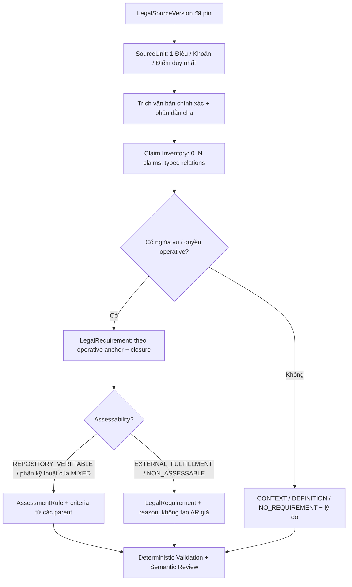

# LCSP — REVIEW CHẤT LƯỢNG RULE SET PREPARATION VÀ MAPPING ĐIỀU/KHOẢN/ĐIỂM (TIẾNG VIỆT)

> **DRAFT / REVIEW ONLY — không phải Rule Set đã được Preparation Agent hoàn thành, VALIDATED hoặc ACTIVE.** Báo cáo đối chiếu `RULE_SET_PREPARATION_RULES.md`, prompt & schema thực thi, dữ liệu corpus trích xuất 171 bản ghi và 20 diễn giải được lập để review. Dữ liệu hiện có không chứa đầy đủ Claim Inventory/Requirement/Assessment Rule đầu ra của Preparation Run nên không thể xác nhận chất lượng 171 rule production.

> **CẬP NHẬT PHẠM VI DEVELOPMENT_ONLY (03/11/2026):** Có bộ lọc riêng tại `docs/RULE_SET_PREPARATION_DEVELOPMENT_SCOPE_REVIEW_VI.md` (171 đơn vị), JSON triage `docs/RULE_SET_PREPARATION_DEVELOPMENT_SCOPE_TRIAGE_VI.json`, mẫu prompt `docs/RULE_SET_PREPARATION_DEVELOPMENT_PROMPT_PROFILE_VI.md` và 4 skills dưới `docs/preparation-development-skills/`. Đây là review-only projection chưa nối API/validator, không phải Rule Set ACTIVE. Mọi source unit vẫn phải được accounted; không dùng `NO_REQUIREMENT` để bỏ duty có thật chỉ vì ngoài development.

## A. Phạm vi, nguồn bằng chứng và khác biệt với báo cáo Assessment

| Nguồn | Vai trò | Có thể xác nhận | Chưa thể xác nhận |
|---|---|---|---|
| `docs/RULE_SET_PREPARATION_RULES.md` | Mô tả nguyên tắc Preparation | Các phase, invariants, rubric, boundary, lifecycle | Agent đã thực thi đúng trong từng Preparation Run |
| `deepagents/rule_set_preparation/instructions-common.md` | System prompt chung | Thứ bậc thẩm quyền, semantic preservation, isolation | Accuracy của kết quả model thực tế |
| `.../instructions-discovery.md` + `claim-file.schema.json` | Claim Discovery | Hợp đồng 12 claim types, relation closure, coverage | Danh sách claim được chấp nhận trong run thật |
| `.../instructions-authoring.md` | Rule Authoring | Nghĩa vụ -> LR -> AR, external fulfillment | Bản LR/AR hiện tại có bám source đúng không |
| `.../instructions-direct.md` + `direct-draft.schema.json` | Direct Draft | package, sourceUnits disposition, candidate/assessmentRule | Candidate được tạo và đã qua valid/activate |
| `.claude/triage/all-rules-ctx.json` | Dữ liệu source extraction | 171 mã LegalRule, 227 chunks, source text/locators | **Không** phải 171 LR/AR; thiếu nodeId, hash và versionId của run đã pin |
| `apps/web/src/public/assets/mocks/admin-compliance-rule-set-result.json` | Mock giao diện | Ví dụ contract shape | Không chứng minh Rule Set đang ACTIVE |
| `docs/implementation-artifacts/.../preparation-usage-reconciliation.json` | Telemetry một run | Lượt gọi, token, hoàn đối soát | Không chứa đủ nội dung semantic candidates |
| `native-semantic-verification-14rules.json` | Kết quả của **Assessment Runtime** lịch sử | 14 quyết định model-authored trên CheatShield, trạng thái CHANGES_REQUESTED | **Không** phải output Rule Set Preparation cần review |

**Nguồn luật được kiểm tra cấp metadata:** [Luật Trí tuệ nhân tạo 134/2025/QH15 — Chính phủ](https://vanban.chinhphu.vn/?classid=1&docid=216334&pageid=27160&typegr=), hiệu lực 01/03/2026; [Luật Công nghiệp công nghệ số 71/2025/QH15 — Chính phủ](https://vanban.chinhphu.vn/?classid=1&docid=214609&pageid=27160), hiệu lực 01/01/2026. Văn bản pháp lý chính thức chưa được kiểm chứng từng câu/từng version hash cho đủ 171 hàng. File 171 là **tập trích xuất chọn lọc**, không được nhận là toàn bộ điều khoản của hai đạo luật.

## B. Trạng thái dữ liệu đầu vào và chất lượng Preparation hiện tại

| Tiêu chí kiểm tra | Giá trị quan sát | Nhận định |
|---|---:|---|
| Số bản ghi legal rule trong nguồn đã xuất | **171** | 123 Luật 134, 48 Luật 71 |
| Số `chunks` nguồn/cha | **227** | 56 bản ghi có thêm một chunk ngữ cảnh cha; chunk cha không được đếm là duty độc lập |
| Đơn vị nguồn có ID legacy lệch locator chính | **3** | Ba trường hợp điểm chữ `đ` bị mất, tạo `pt-` rỗng |
| Khoản cũng có bản ghi điểm con riêng | **25** | Nguy cơ tạo nghĩa vụ trùng hoặc bỏ câu dẫn scope nếu đọc độc lập |
| Trích đoạn bị lẫn ranh giới section | **1 mẫu xác nhận** | Luật 71 Điều 27 khoản 3 dính tiêu đề Mục 6 |
| Đơn vị đã lập diễn giải Preparation để đối chứng | **20/171** | Chỉ là đề xuất review; không phải output model trong production |
| Claim/LegalRequirement/AssessmentRule thực tế đã đối soát được | **0/171** | **Chưa có artifact nội dung Preparation Run phù hợp để xác minh**, không có nghĩa runtime chưa sinh candidate |

**Đánh giá chất lượng theo bằng chứng có được:**

| Khía cạnh | Thiết kế hiện tại | Phần thiếu được phát hiện |
|---|---|---|
| Isolation Preparation ↔ Assessment | **Được mô tả rõ** | Không được phá isolation để đối chiếu với repo khách hàng; review dùng nguồn luật/prompt/schema |
| Pinning & provenance | **Có hợp đồng tốt** | `all-rules-ctx` chưa mang `sourceNodeId` 64 hex, `legalSourceVersionId` và hash thực của input run |
| Phân rã mệnh đề | **Có 12 claim types và normal form** | Thiếu chứng minh phân tích đúng một khoản nhiều hành vi, một điểm kế thừa câu dẫn |
| Định vị nguồn 1:1 | **Chưa đạt trên bản trích xuất** | 3 locator lỗi; 25 parent/child overlap; 1 text bleed |
| Quyền / khuyến khích / nghĩa vụ | **Prompt có nguyên tắc permission ≠ duty** | Rubric 6 chiều chưa kiểm tra riêng khuyến khích, thẩm quyền cơ quan nhà nước, mixed clause |
| Chính sách làm bằng chứng | **Có nguyên tắc non-repository duty** | Chưa có semantic acceptance tương ứng mọi source unit, chưa xác minh hiệu quả prompt |
| Kiểm định cơ học | **8 negative expectations + 35 mã lỗi** | Chưa có negative control chuyên cho tiếng Việt `đ`, overlap & nghĩa vụ chia nhỏ |
| Kích hoạt | **Fail-closed theo hợp đồng** | Không thể kết luận run sản xuất hợp lệ từ mocks/telemetry |

## C. Thiết kế mapping 1:1 chính xác trong Preparation

- **1:1 bắt buộc:** `(pinnedLegalSourceVersionId, canonicalLocator)` xác định duy nhất một `SourceUnit` **và một disposition có lý do** trong phạm vi package.
- **Không ép 1:1 ở tầng normative claim:** Một khoản có thể có PERMISSION, DUTY và CONDITION khác nhau; một nghĩa vụ có thể có nhiều đơn vị ngữ cảnh hợp lệ. Mỗi claim phải có `support` chính xác và liên kết `CONDITION_OF`, `QUALIFIES`, `DEFINED_BY`, `INCORPORATES`, ...
- **Không ép 1:1 ở tầng đánh giá:** Requirement ngoài repository vẫn tồn tại, nhưng `assessmentRule=null` nếu không có phần kỹ thuật có thể kiểm chứng. Với `MIXED`, giữ phần kỹ thuật và phần external trong cùng Requirement.
- **Không nhân đôi ở parent/child:** Khoản mở đầu “Nhà cung cấp hệ thống AI có rủi ro cao...” là SCOPE dùng chung cho các điểm; không tạo một duty riêng cho khoản nếu không có mệnh đề độc lập. Việc quyết định có nghĩa vụ độc lập phải do người/agent diễn giải có chứng cứ, không dùng regex.
- **Các mã `MULTI_CLAIM`, `STATE_AUTHORITY`, `CONTEXT_ENCOURAGEMENT`, `DUTY_CROSS_REFERENCE` trong *bản review* chỉ là **nhãn phân tích**, KHÔNG PHẢI enum hợp lệ của `claim-file.schema.json`. Khi triển khai thật, phải chuyển về các claim types hiện có và quan hệ theo schema.

## D. Các ví dụ đối chiếu sâu giữa luật và Preparation đề xuất

Bảng dưới thể hiện những mệnh đề được lập **để bạn review**, chưa khẳng định Preparation Agent hiện đã tạo ra chúng.

| Luật | Điều/Khoản/Điểm | Phân loại đề xuất | LegalRequirement / AssessmentRule nên xử lý thế nào | Cảnh báo |
|---|---|---|---|---|
| 134/2025/QH15 | `art-10::cl-1` | `DUTY` | LR có căn cứ; AR cho phần kỹ thuật nếu đủ closure | Cần tách 2 operative propositions cùng locator; không biến điều kiện có hồ sơ thành nghĩa vụ vô điều kiện |
| 134/2025/QH15 | `art-10::cl-2` | `MULTI_CLAIM` | LR có căn cứ; AR cho phần kỹ thuật nếu đủ closure | Phải giữ ba nhánh và điều kiện thay đổi; đây là test atomization |
| 134/2025/QH15 | `art-11::cl-2` | `DUTY` | LR có căn cứ; AR cho phần kỹ thuật nếu đủ closure | Cần giữ chính xác đối tượng nội dung và căn cứ luật chi tiết |
| 134/2025/QH15 | `art-14::cl-1` | `SCOPE` | **Không tạo LR/AR độc lập** | Cấp quan hệ CONDITION_OF/CONTEXT_FOR từ chủ thể rủi ro cao đến các điểm |
| 134/2025/QH15 | `art-14::cl-1::pt-đ` | `DUTY_CROSS_REFERENCE` | LR có căn cứ; AR cho phần kỹ thuật nếu đủ closure | Cần sửa locator tại parser và migration; không xử lý bằng đổi chữ prompt |
| 134/2025/QH15 | `art-14::cl-1::pt-a` | `DUTY` | LR có căn cứ; AR cho phần kỹ thuật nếu đủ closure | Không tự đặt yêu cầu cụ thể về framework/quy trình kiểm thử nếu luật không quy định |
| 134/2025/QH15 | `art-14::cl-1::pt-b` | `DUTY` | LR có căn cứ; AR cho phần kỹ thuật nếu đủ closure | Không chuyển thành các KPI hoặc công nghệ bắt buộc do model nghĩ ra |
| 134/2025/QH15 | `art-14::cl-2::pt-đ` | `DUTY` | LR có căn cứ; AR không được tự động tạo | Trong điều khoản có nhiều hành vi; giữ dưới cùng đơn vị nguồn nhưng atomize từng hành vi |
| 134/2025/QH15 | `art-21::cl-2::pt-a` | `CONTEXT` | **Không tạo LR/AR độc lập** | Không đổi quyền/cơ chế thành DUTY về technical certification |
| 134/2025/QH15 | `art-26::cl-4` | `CONTEXT_ENCOURAGEMENT` | **Không tạo LR/AR độc lập** | Giữ nguyên khuyến khích như context, không dùng làm điểm NOT_MET |
| 134/2025/QH15 | `art-30::cl-1::pt-đ` | `CONTEXT` | **Không tạo LR/AR độc lập** | Cần giữ thành context và loại khỏi customer-facing Assessment Rules |
| 134/2025/QH15 | `art-6::cl-2::pt-b` | `QUALIFIER` | LR có căn cứ; AR không được tự động tạo | Không tạo luật áp dụng chung cho mọi mô hình AI không phục vụ giáo dục |
| 71/2025/QH15 | `art-10` | `DUTY_CROSS_REFERENCE` | LR có căn cứ; AR cho phần kỹ thuật nếu đủ closure | Source có locator cấp Điều (không khoản) là hợp lệ |
| 71/2025/QH15 | `art-26::cl-2` | `PROHIBITION` | LR có căn cứ; AR cho phần kỹ thuật nếu đủ closure | Không ép mọi sản phẩm phải có API export cụ thể nếu luật không quy định |
| 71/2025/QH15 | `art-27::cl-1` | `DEFINITION` | **Không tạo LR/AR độc lập** | Nên dùng DEFINED_BY khi được luật liên quan viện dẫn |
| 71/2025/QH15 | `art-27::cl-2` | `CONTEXT_ENCOURAGEMENT` | **Không tạo LR/AR độc lập** | Nếu Preparation tạo DUTY ở đây sẽ là shadow law |
| 71/2025/QH15 | `art-27::cl-3` | `STATE_AUTHORITY` | **Không tạo LR/AR độc lập** | Cần tách heading 'Mục 6' khỏi khoản 3 |
| 71/2025/QH15 | `art-47::cl-2` | `DEFINITION` | **Không tạo LR/AR độc lập** | Các điểm con là định nghĩa bổ trợ |
| 71/2025/QH15 | `art-48::cl-1` | `CONTEXT` | **Không tạo LR/AR độc lập** | Đừng biến chữ 'biện pháp bảo đảm an ninh' thành requirement bảo mật chung |
| 71/2025/QH15 | `art-8` | `PERMISSION` | LR có căn cứ; AR không được tự động tạo | Đối tượng luật dẫn chéo cần pin mới giải thích điều kiện |

### D.1. Những ví dụ phải giữ nguyên ngữ nghĩa

**Luật 134 — Điều 10 khoản 2:** Một khoản vừa trao quyền cho bên triển khai kế thừa phân loại, vừa giao nghĩa vụ bảo đảm hệ thống, vừa đặt nghĩa vụ có điều kiện nếu thay đổi phát sinh rủi ro mới. Không thể tạo một DUTY chung rồi coi quyền kế thừa là hành vi bắt buộc.

**Luật 134 — Điều 14 khoản 1, điểm a/b/đ:** Câu dẫn của khoản là SCOPE: nhà cung cấp hệ thống AI rủi ro cao. Điểm a quản lý rủi ro; b quản trị dữ liệu với giới hạn phù hợp khả năng kỹ thuật; đ dẫn chiếu đến Điều 11 và 12. `pt-đ` bị lỗi thành `pt-` ở legacy ID, cần sửa bằng deterministic parser/versioned migration chứ không trông chờ prompt tự hiểu.

**Luật 71 — Điều 26 khoản 2:** Cấm gây trở ngại thương mại *và* kỹ thuật khi khách hàng lưu/chuyển dữ liệu. Repository scan chỉ quan sát được một phần trở ngại kỹ thuật, không chứng minh chính sách thương mại đã tuân thủ.

**Luật 71 — Điều 27 khoản 1, 2, 3:** Lần lượt là mô tả thuộc tính chất lượng dữ liệu, quy định khuyến khích và trách nhiệm hướng dẫn của Bộ trưởng. Không tạo ba Assessment Rule bắt buộc cho mọi doanh nghiệp. Chunk khoản 3 còn bị lẫn tiêu đề Mục 6, cần sửa ngay ở source extraction.

**Luật 71 — Điều 8:** Có quyền triển khai thử nghiệm theo pháp luật liên quan, không mặc định doanh nghiệp có DUTY phải thực hiện sandbox.

## E. Đối chiếu 171 SourceUnit ↔ hiện trạng Preparation ↔ bản review

**Quy ước bảng:** “Chưa truy xuất” = chưa có packet/candidate thực tế tương ứng trong các file đang review; **không có nghĩa server chắc chắn chưa tạo rule**. “Review 20” = nhận định dự kiến, không phải output từ model/production. Nội dung là trích nguyên văn rút gọn từ `all-rules-ctx.json`; JSON đi kèm giữ đầy đủ văn bản.

### E.1. 134/2025/QH15 — 123 đơn vị nguồn

| STT | Điều/Khoản/Điểm chính | Nguồn luật (trích) | Tình trạng review Preparation | Lỗi dữ liệu |
|---:|---|---|---|---|
| 1 | `art-10::cl-1` | 1. Nhà cung cấp tự phân loại hệ thống trí tuệ nhân tạo trước khi đưa vào sử dụng. Hệ thống được phân loại là rủi ro trung bình hoặc rủi ro cao phải có hồ sơ phân loại kèm theo. | DUTY (*đề xuất*) | — |
| 2 | `art-10::cl-2` | 2. Bên triển khai được kế thừa kết quả phân loại của nhà cung cấp và có trách nhiệm bảo đảm an toàn, nguyên vẹn của hệ thống trong quá trình sử dụng; trường hợp sửa đổi, tích hợp hoặc tha… | MULTI_CLAIM (*đề xuất*) | — |
| 3 | `art-10::cl-3` | 3. Đối với hệ thống được phân loại là rủi ro trung bình hoặc rủi ro cao, nhà cung cấp phải thông báo kết quả phân loại cho Bộ Khoa học và Công nghệ thông qua Cổng thông tin điện tử một cử… | Chưa diễn giải / chưa truy xuất | — |
| 4 | `art-10::cl-5` | 5. Việc kiểm tra, giám sát được thực hiện theo mức độ rủi ro của hệ thống: a) Hệ thống trí tuệ nhân tạo có rủi ro cao được kiểm tra định kỳ hoặc khi có dấu hiệu vi phạm; b) Hệ thống trí t… | Chưa diễn giải / chưa truy xuất | Khoản/điểm chồng nhau |
| 5 | `art-10::cl-5::pt-a` | a) Hệ thống trí tuệ nhân tạo có rủi ro cao được kiểm tra định kỳ hoặc khi có dấu hiệu vi phạm; | Chưa diễn giải / chưa truy xuất | Có context cha |
| 6 | `art-10::cl-5::pt-b` | b) Hệ thống trí tuệ nhân tạo có rủi ro trung bình được giám sát thông qua báo cáo, kiểm tra chọn mẫu hoặc đánh giá của tổ chức độc lập; | Chưa diễn giải / chưa truy xuất | Có context cha |
| 7 | `art-10::cl-5::pt-c` | c) Hệ thống trí tuệ nhân tạo có rủi ro thấp được theo dõi, kiểm tra khi có sự cố, phản ánh hoặc khi cần bảo đảm an toàn, không làm phát sinh nghĩa vụ không cần thiết cho tổ chức, cá nhân. | Chưa diễn giải / chưa truy xuất | Có context cha |
| 8 | `art-10::cl-6` | 6. Trên cơ sở kết quả kiểm tra, giám sát quy định tại khoản 5 Điều này, khi phát hiện sai lệch hoặc khai báo không trung thực, cơ quan có thẩm quyền yêu cầu tái phân loại, bổ sung hồ sơ h… | Chưa diễn giải / chưa truy xuất | — |
| 9 | `art-10::cl-7` | 7. Chính phủ quy định chi tiết về nội dung cần thông báo, trình tự, thủ tục thông báo và hướng dẫn kỹ thuật về phân loại rủi ro. | Chưa diễn giải / chưa truy xuất | — |
| 10 | `art-11::cl-1` | 1. Nhà cung cấp bảo đảm hệ thống trí tuệ nhân tạo tương tác trực tiếp với con người được thiết kế và vận hành để người sử dụng nhận biết khi đang tương tác với hệ thống, trừ trường hợp ph… | Chưa diễn giải / chưa truy xuất | — |
| 11 | `art-11::cl-2` | 2. Nhà cung cấp bảo đảm các nội dung âm thanh, hình ảnh, video do hệ thống trí tuệ nhân tạo tạo ra được đánh dấu ở định dạng máy đọc theo quy định của Chính phủ. | DUTY (*đề xuất*) | — |
| 12 | `art-11::cl-3` | 3. Bên triển khai có trách nhiệm thông báo rõ ràng khi cung cấp ra công cộng văn bản, âm thanh, hình ảnh, video được tạo ra hoặc chỉnh sửa bằng hệ thống trí tuệ nhân tạo nếu nội dung đó c… | Chưa diễn giải / chưa truy xuất | — |
| 13 | `art-11::cl-4` | 4. Bên triển khai có trách nhiệm bảo đảm âm thanh, hình ảnh, video được tạo ra hoặc chỉnh sửa bằng hệ thống trí tuệ nhân tạo nhằm mô phỏng, giả lập ngoại hình, giọng nói của người thật ho… | Chưa diễn giải / chưa truy xuất | — |
| 14 | `art-11::cl-5` | 5. Nhà cung cấp và bên triển khai có trách nhiệm duy trì thông tin minh bạch theo quy định tại Điều này trong suốt quá trình cung cấp hệ thống, sản phẩm hoặc nội dung cho người sử dụng. | Chưa diễn giải / chưa truy xuất | — |
| 15 | `art-11::cl-6` | 6. Chính phủ quy định chi tiết hình thức thông báo, gắn nhãn. | Chưa diễn giải / chưa truy xuất | — |
| 16 | `art-12::cl-1` | 1. Nhà phát triển, nhà cung cấp, bên triển khai và người sử dụng hệ thống trí tuệ nhân tạo có trách nhiệm bảo đảm an toàn, an ninh, độ tin cậy và kịp thời phát hiện, khắc phục sự cố có kh… | Chưa diễn giải / chưa truy xuất | — |
| 17 | `art-12::cl-2` | 2. Khi hệ thống trí tuệ nhân tạo xảy ra sự cố nghiêm trọng, nhà phát triển, nhà cung cấp, bên triển khai, người sử dụng hệ thống trí tuệ nhân tạo có trách nhiệm sau đây: a) Nhà phát triển… | Chưa diễn giải / chưa truy xuất | Khoản/điểm chồng nhau |
| 18 | `art-12::cl-2::pt-a` | a) Nhà phát triển, nhà cung cấp phải khẩn trương áp dụng biện pháp kỹ thuật để khắc phục, tạm dừng hoặc thu hồi hệ thống, đồng thời thông báo cho cơ quan có thẩm quyền; | Chưa diễn giải / chưa truy xuất | Có context cha |
| 19 | `art-12::cl-2::pt-b` | b) Bên triển khai và người sử dụng có nghĩa vụ ghi nhận, thông báo kịp thời sự cố và phối hợp trong quá trình khắc phục. | Chưa diễn giải / chưa truy xuất | Có context cha |
| 20 | `art-12::cl-3` | 3. Cơ quan quản lý nhà nước có thẩm quyền tiếp nhận, xác minh và hướng dẫn xử lý sự cố; khi cần thiết, có quyền yêu cầu tạm dừng, thu hồi hoặc đánh giá lại hệ thống trí tuệ nhân tạo. | Chưa diễn giải / chưa truy xuất | — |
| 21 | `art-12::cl-4` | 4. Báo cáo và xử lý sự cố được thực hiện qua cổng thông tin điện tử một cửa về trí tuệ nhân tạo. | Chưa diễn giải / chưa truy xuất | — |
| 22 | `art-12::cl-5` | 5. Chính phủ quy định việc báo cáo và trách nhiệm của các cơ quan, tổ chức, cá nhân có liên quan phù hợp với mức độ nghiêm trọng của sự cố và phạm vi ảnh hưởng của hệ thống trí tuệ nhân t… | Chưa diễn giải / chưa truy xuất | — |
| 23 | `art-13::cl-1` | 1. Hệ thống trí tuệ nhân tạo có rủi ro cao phải được đánh giá sự phù hợp theo quy định của Luật này trước khi đưa vào sử dụng hoặc khi có thay đổi đáng kể trong quá trình sử dụng. Trường … | Chưa diễn giải / chưa truy xuất | — |
| 24 | `art-13::cl-2` | 2. Đánh giá sự phù hợp là việc xác nhận hệ thống trí tuệ nhân tạo đáp ứng các yêu cầu tại Điều 14 của Luật này và được thực hiện như sau: a) Đối với hệ thống trí tuệ nhân tạo có rủi ro ca… | Chưa diễn giải / chưa truy xuất | Khoản/điểm chồng nhau |
| 25 | `art-13::cl-2::pt-a` | a) Đối với hệ thống trí tuệ nhân tạo có rủi ro cao thuộc danh mục hệ thống trí tuệ nhân tạo phải chứng nhận sự phù hợp trước khi đưa vào sử dụng: việc đánh giá được thực hiện bởi tổ chức … | Chưa diễn giải / chưa truy xuất | Có context cha |
| 26 | `art-13::cl-2::pt-b` | b) Đối với các hệ thống trí tuệ nhân tạo có rủi ro cao khác: nhà cung cấp tự đánh giá sự phù hợp hoặc thuê tổ chức đánh giá sự phù hợp đã được đăng ký hoặc thừa nhận theo quy định của phá… | Chưa diễn giải / chưa truy xuất | Có context cha |
| 27 | `art-13::cl-3` | 3. Kết quả đánh giá sự phù hợp là điều kiện để hệ thống trí tuệ nhân tạo có rủi ro cao được phép đưa vào sử dụng; tổ chức, cá nhân có hệ thống đã được đánh giá sự phù hợp có trách nhiệm d… | Chưa diễn giải / chưa truy xuất | — |
| 28 | `art-13::cl-4` | 4. Thủ tướng Chính phủ quy định Danh mục hệ thống trí tuệ nhân tạo có rủi ro cao, bao gồm danh mục hệ thống trí tuệ nhân tạo phải chứng nhận sự phù hợp trước khi đưa vào sử dụng. | Chưa diễn giải / chưa truy xuất | — |
| 29 | `art-13::cl-5` | 5. Tổ chức đánh giá sự phù hợp, kiểm định hệ thống trí tuệ nhân tạo phải bảo đảm tính độc lập, có đủ năng lực kỹ thuật theo quy định và chịu sự giám sát định kỳ của cơ quan nhà nước có th… | Chưa diễn giải / chưa truy xuất | — |
| 30 | `art-14::cl-1` | 1. Nhà cung cấp hệ thống trí tuệ nhân tạo có rủi ro cao có trách nhiệm sau đây: a) Thiết lập và duy trì biện pháp quản lý rủi ro và thường xuyên rà soát khi hệ thống có thay đổi đáng kể h… | SCOPE (*đề xuất*) | Khoản/điểm chồng nhau |
| 31 | `art-14::cl-1::pt-đ` | đ) Thực hiện nghĩa vụ minh bạch và xử lý sự cố theo quy định tại Điều 11 và Điều 12 của Luật này; | DUTY_CROSS_REFERENCE (*đề xuất*) | **SAI ID (pt-đ)**; Có context cha |
| 32 | `art-14::cl-1::pt-a` | a) Thiết lập và duy trì biện pháp quản lý rủi ro và thường xuyên rà soát khi hệ thống có thay đổi đáng kể hoặc phát sinh rủi ro mới; | DUTY (*đề xuất*) | Có context cha |
| 33 | `art-14::cl-1::pt-b` | b) Quản trị dữ liệu huấn luyện, kiểm thử và vận hành bảo đảm chất lượng trong phạm vi khả năng kỹ thuật và phù hợp với mục đích sử dụng của hệ thống; | DUTY (*đề xuất*) | Có context cha |
| 34 | `art-14::cl-1::pt-c` | c) Lập, cập nhật, lưu giữ hồ sơ kỹ thuật và nhật ký hoạt động ở mức cần thiết cho việc đánh giá sự phù hợp và kiểm tra sau khi đưa vào sử dụng; cung cấp các thông tin này cho cơ quan nhà … | Chưa diễn giải / chưa truy xuất | Có context cha |
| 35 | `art-14::cl-1::pt-d` | d) Thiết kế hệ thống bảo đảm khả năng giám sát và can thiệp của con người đối với hệ thống; | Chưa diễn giải / chưa truy xuất | Có context cha |
| 36 | `art-14::cl-1::pt-e` | e) Thực hiện trách nhiệm giải trình đối với cơ quan nhà nước có thẩm quyền về mục đích sử dụng, nguyên lý hoạt động ở mức mô tả chức năng, loại dữ liệu đầu vào chủ yếu, biện pháp quản lý … | Chưa diễn giải / chưa truy xuất | Có context cha |
| 37 | `art-14::cl-1::pt-g` | g) Phối hợp với cơ quan nhà nước có thẩm quyền và bên triển khai trong kiểm tra, đánh giá, hậu kiểm và khắc phục sự cố liên quan đến hệ thống. | Chưa diễn giải / chưa truy xuất | Có context cha |
| 38 | `art-14::cl-2` | 2. Bên triển khai hệ thống trí tuệ nhân tạo có rủi ro cao có trách nhiệm sau đây: a) Vận hành và giám sát hệ thống đúng mục đích, phạm vi và mức độ rủi ro đã được phân loại, không làm phá… | Chưa diễn giải / chưa truy xuất | Khoản/điểm chồng nhau |
| 39 | `art-14::cl-2::pt-đ` | đ) Thực hiện trách nhiệm giải trình đối với cơ quan nhà nước có thẩm quyền về việc vận hành hệ thống, biện pháp kiểm soát rủi ro, xử lý sự cố và các nội dung cần thiết phục vụ công tác th… | DUTY (*đề xuất*) | **SAI ID (pt-đ)**; Có context cha |
| 40 | `art-14::cl-2::pt-a` | a) Vận hành và giám sát hệ thống đúng mục đích, phạm vi và mức độ rủi ro đã được phân loại, không làm phát sinh rủi ro mới hoặc rủi ro cao hơn; | Chưa diễn giải / chưa truy xuất | Có context cha |
| 41 | `art-14::cl-2::pt-b` | b) Bảo đảm an toàn, bảo mật dữ liệu và khả năng can thiệp của con người trong quá trình sử dụng; | Chưa diễn giải / chưa truy xuất | Có context cha |
| 42 | `art-14::cl-2::pt-c` | c) Duy trì việc tuân thủ tiêu chuẩn, quy chuẩn kỹ thuật về trí tuệ nhân tạo trong quá trình vận hành hệ thống; | Chưa diễn giải / chưa truy xuất | Có context cha |
| 43 | `art-14::cl-2::pt-d` | d) Thực hiện nghĩa vụ minh bạch và xử lý sự cố theo quy định tại Điều 11 và Điều 12 của Luật này; | Chưa diễn giải / chưa truy xuất | Có context cha |
| 44 | `art-14::cl-2::pt-e` | e) Phối hợp với nhà cung cấp và cơ quan nhà nước có thẩm quyền trong kiểm tra, đánh giá, hậu kiểm và khắc phục sự cố. | Chưa diễn giải / chưa truy xuất | Có context cha |
| 45 | `art-14::cl-3` | 3. Người sử dụng hệ thống trí tuệ nhân tạo có rủi ro cao có trách nhiệm tuân thủ quy trình vận hành, hướng dẫn kỹ thuật và các biện pháp bảo đảm an toàn; không can thiệp trái phép làm tha… | Chưa diễn giải / chưa truy xuất | — |
| 46 | `art-14::cl-4` | 4. Việc giải trình phải phù hợp với khả năng kỹ thuật của hệ thống, không làm lộ bí mật kinh doanh theo quy định của pháp luật. | Chưa diễn giải / chưa truy xuất | — |
| 47 | `art-14::cl-5` | 5. Khuyến khích nhà cung cấp, bên triển khai tham gia bảo hiểm trách nhiệm dân sự hoặc áp dụng biện pháp bảo đảm thực hiện nghĩa vụ phù hợp khác để kịp thời khắc phục sự cố và bồi thường … | Chưa diễn giải / chưa truy xuất | — |
| 48 | `art-14::cl-6` | 6. Nhà cung cấp nước ngoài có hệ thống trí tuệ nhân tạo có rủi ro cao được cung cấp tại Việt Nam phải có đầu mối liên hệ hợp pháp tại Việt Nam; trường hợp hệ thống thuộc diện bắt buộc chứ… | Chưa diễn giải / chưa truy xuất | — |
| 49 | `art-15::cl-1` | 1. Hệ thống trí tuệ nhân tạo có rủi ro trung bình được quản lý như sau: a) Nhà cung cấp và bên triển khai phải bảo đảm minh bạch theo quy định tại Điều 11 của Luật này; b) Nhà cung cấp có… | Chưa diễn giải / chưa truy xuất | Khoản/điểm chồng nhau |
| 50 | `art-15::cl-1::pt-a` | a) Nhà cung cấp và bên triển khai phải bảo đảm minh bạch theo quy định tại Điều 11 của Luật này; | Chưa diễn giải / chưa truy xuất | Có context cha |
| 51 | `art-15::cl-1::pt-b` | b) Nhà cung cấp có trách nhiệm giải trình về mục đích sử dụng, nguyên lý hoạt động ở mức mô tả chức năng, dữ liệu đầu vào chủ yếu và biện pháp quản lý rủi ro, an toàn của hệ thống khi có … | Chưa diễn giải / chưa truy xuất | Có context cha |
| 52 | `art-15::cl-1::pt-c` | c) Bên triển khai có trách nhiệm giải trình về việc vận hành, kiểm soát rủi ro, xử lý sự cố và bảo vệ quyền, lợi ích hợp pháp của tổ chức, cá nhân khi có yêu cầu của cơ quan nhà nước có t… | Chưa diễn giải / chưa truy xuất | Có context cha |
| 53 | `art-15::cl-1::pt-d` | d) Người sử dụng có trách nhiệm tuân thủ quy định về thông báo, gắn nhãn hệ thống trí tuệ nhân tạo. | Chưa diễn giải / chưa truy xuất | Có context cha |
| 54 | `art-15::cl-2` | 2. Hệ thống trí tuệ nhân tạo có rủi ro thấp được quản lý như sau: a) Nhà cung cấp có trách nhiệm giải trình khi có yêu cầu của cơ quan nhà nước có thẩm quyền trong trường hợp có dấu hiệu … | Chưa diễn giải / chưa truy xuất | Khoản/điểm chồng nhau |
| 55 | `art-15::cl-2::pt-a` | a) Nhà cung cấp có trách nhiệm giải trình khi có yêu cầu của cơ quan nhà nước có thẩm quyền trong trường hợp có dấu hiệu vi phạm pháp luật hoặc ảnh hưởng đến quyền, lợi ích hợp pháp của t… | Chưa diễn giải / chưa truy xuất | Có context cha |
| 56 | `art-15::cl-2::pt-b` | b) Bên triển khai có trách nhiệm giải trình khi có yêu cầu của cơ quan nhà nước có thẩm quyền trong trường hợp có dấu hiệu vi phạm pháp luật hoặc ảnh hưởng đến quyền, lợi ích hợp pháp của… | Chưa diễn giải / chưa truy xuất | Có context cha |
| 57 | `art-16::cl-1` | 1. Hạ tầng trí tuệ nhân tạo quốc gia là hạ tầng chiến lược, bao gồm hạ tầng do Nhà nước, doanh nghiệp và tổ chức xã hội đầu tư; được phát triển như một hệ sinh thái thống nhất, mở, an toà… | Chưa diễn giải / chưa truy xuất | — |
| 58 | `art-16::cl-2` | 2. Nhà nước giữ vai trò định hướng, điều phối và bảo đảm năng lực hạ tầng phục vụ phát triển trí tuệ nhân tạo quốc gia; khuyến khích doanh nghiệp, viện nghiên cứu, trường đại học và tổ ch… | Chưa diễn giải / chưa truy xuất | — |
| 59 | `art-16::cl-5` | 5. Ứng dụng trí tuệ nhân tạo quan trọng trong các lĩnh vực thiết yếu theo danh mục do Thủ tướng Chính phủ ban hành phải được triển khai trên hạ tầng trí tuệ nhân tạo quốc gia để bảo đảm a… | Chưa diễn giải / chưa truy xuất | — |
| 60 | `art-16::cl-6` | 6. Chính phủ quy định chi tiết cơ chế điều phối, chia sẻ, ưu đãi và biện pháp thúc đẩy phát triển hạ tầng trí tuệ nhân tạo quốc gia, phù hợp từng giai đoạn và yêu cầu bảo đảm an toàn, an … | Chưa diễn giải / chưa truy xuất | — |
| 61 | `art-17::cl-1` | 1. Cơ sở dữ liệu phục vụ trí tuệ nhân tạo là thành phần quan trọng của hạ tầng trí tuệ nhân tạo quốc gia, bao gồm Cơ sở dữ liệu quốc gia, cơ sở dữ liệu của Bộ, cơ quan ngang Bộ, cơ quan t… | Chưa diễn giải / chưa truy xuất | — |
| 62 | `art-17::cl-2` | 2. Cơ sở dữ liệu quốc gia về trí tuệ nhân tạo do Nhà nước đầu tư, xây dựng và vận hành tại Trung tâm dữ liệu quốc gia; được tổ chức theo nguyên tắc mở, an toàn, có kiểm soát, đáp ứng yêu … | Chưa diễn giải / chưa truy xuất | — |
| 63 | `art-17::cl-3` | 3. Cơ sở dữ liệu phục vụ trí tuệ nhân tạo của Bộ, cơ quan ngang Bộ, cơ quan thuộc Chính phủ và Ủy ban nhân dân các cấp được xây dựng, cập nhật và kết nối thống nhất với Cơ sở dữ liệu quốc… | Chưa diễn giải / chưa truy xuất | — |
| 64 | `art-17::cl-4` | 4. Cơ sở dữ liệu của tổ chức, cá nhân phục vụ trí tuệ nhân tạo được khuyến khích chia sẻ với cơ quan nhà nước và tổ chức, cá nhân khác theo cơ chế thỏa thuận; việc chia sẻ phải tuân thủ p… | Chưa diễn giải / chưa truy xuất | — |
| 65 | `art-17::cl-6` | 6. Chính phủ quy định chi tiết về nguyên tắc kết nối, cơ chế chia sẻ, khai thác và bảo đảm an toàn dữ liệu trong cơ sở dữ liệu phục vụ trí tuệ nhân tạo. | Chưa diễn giải / chưa truy xuất | — |
| 66 | `art-18::cl-5` | 5. Chính phủ quy định chi tiết cơ chế, tiêu chí và biện pháp thúc đẩy làm chủ công nghệ trí tuệ nhân tạo, phù hợp từng giai đoạn phát triển và yêu cầu bảo đảm an toàn, an ninh quốc gia. | Chưa diễn giải / chưa truy xuất | — |
| 67 | `art-19::cl-1` | 1. Thủ tướng Chính phủ ban hành Chiến lược quốc gia về trí tuệ nhân tạo, rà soát, đánh giá và cập nhật định kỳ ít nhất 03 năm một lần hoặc khi có biến động lớn về công nghệ, thị trường. C… | Chưa diễn giải / chưa truy xuất | — |
| 68 | `art-19::cl-2` | 2. Chiến lược quốc gia về trí tuệ nhân tạo được xây dựng trên cơ sở các định hướng phát triển công nghệ, hạ tầng, dữ liệu và nhân lực; thúc đẩy nghiên cứu, làm chủ và ứng dụng trí tuệ nhâ… | Chưa diễn giải / chưa truy xuất | — |
| 69 | `art-19::cl-3` | 3. Nhà nước khuyến khích phát triển các nhóm công nghệ trí tuệ nhân tạo phù hợp với điều kiện Việt Nam, có tiềm năng tạo giá trị gia tăng, thân thiện môi trường, dễ ứng dụng rộng rãi và g… | Chưa diễn giải / chưa truy xuất | — |
| 70 | `art-20::cl-2` | 2. Nhà nước hỗ trợ phát triển hệ sinh thái và thị trường trí tuệ nhân tạo, bao gồm: a) Ưu tiên sử dụng sản phẩm, dịch vụ trí tuệ nhân tạo theo quy định của pháp luật về đấu thầu; b) Phát … | Chưa diễn giải / chưa truy xuất | Khoản/điểm chồng nhau |
| 71 | `art-20::cl-2::pt-c` | c) Bảo đảm khả năng tiếp cận công bằng, minh bạch đối với hạ tầng tính toán, dữ liệu và môi trường thử nghiệm có kiểm soát; | Chưa diễn giải / chưa truy xuất | Có context cha |
| 72 | `art-20::cl-4` | 4. Tổ chức, cá nhân, doanh nghiệp, cơ sở nghiên cứu và cơ quan nhà nước được khuyến khích khai thác, chia sẻ và tái sử dụng dữ liệu trong Cơ sở dữ liệu quốc gia về trí tuệ nhân tạo phục v… | Chưa diễn giải / chưa truy xuất | — |
| 73 | `art-21::cl-1` | 1. Cơ chế thử nghiệm có kiểm soát đối với trí tuệ nhân tạo thực hiện theo quy định của pháp luật về khoa học, công nghệ và đổi mới sáng tạo và quy định tại các khoản 2, 3 và 4 Điều này. | Chưa diễn giải / chưa truy xuất | — |
| 74 | `art-21::cl-2` | 2. Kết quả thử nghiệm có kiểm soát là căn cứ để cơ quan nhà nước có thẩm quyền xem xét: a) Công nhận kết quả đánh giá sự phù hợp theo quy định của Luật này; b) Miễn, giảm hoặc điều chỉnh … | Chưa diễn giải / chưa truy xuất | Khoản/điểm chồng nhau |
| 75 | `art-21::cl-2::pt-a` | a) Công nhận kết quả đánh giá sự phù hợp theo quy định của Luật này; | CONTEXT (*đề xuất*) | Có context cha |
| 76 | `art-21::cl-2::pt-b` | b) Miễn, giảm hoặc điều chỉnh nghĩa vụ tuân thủ tương ứng của Luật này. | Chưa diễn giải / chưa truy xuất | Có context cha |
| 77 | `art-21::cl-3` | 3. Cơ quan nhà nước có thẩm quyền chủ trì, phối hợp với cơ quan có liên quan tiếp nhận, thẩm định và xử lý hồ sơ theo quy trình thẩm định và phản hồi nhanh; giám sát quá trình thử nghiệm … | Chưa diễn giải / chưa truy xuất | — |
| 78 | `art-22::cl-4` | 4. Quỹ hoạt động theo nguyên tắc công khai, minh bạch, hiệu quả và đúng mục đích; bảo đảm phối hợp, không trùng lặp với các quỹ tài chính nhà nước khác. | Chưa diễn giải / chưa truy xuất | — |
| 79 | `art-22::cl-5` | 5. Chính phủ quy định chi tiết cơ chế tài chính đặc thù, tổ chức, quản lý, sử dụng và giám sát Quỹ. | Chưa diễn giải / chưa truy xuất | — |
| 80 | `art-23::cl-1` | 1. Nhà nước phát triển nguồn nhân lực trí tuệ nhân tạo theo hướng toàn diện, liên thông giữa các cấp học và trình độ đào tạo, bảo đảm hình thành đội ngũ nhân lực chất lượng cao phục vụ ng… | Chưa diễn giải / chưa truy xuất | — |
| 81 | `art-23::cl-5` | 5. Tổ chức, cơ sở đào tạo, viện nghiên cứu và doanh nghiệp tham gia phát triển nhân lực trí tuệ nhân tạo được hưởng cơ chế khuyến khích và ưu đãi theo quy định của pháp luật, đồng thời có… | Chưa diễn giải / chưa truy xuất | — |
| 82 | `art-23::cl-6` | 6. Cơ sở giáo dục đại học, viện nghiên cứu và trung tâm đổi mới sáng tạo có trách nhiệm hợp tác, chia sẻ tri thức và tham gia mạng lưới quốc gia, quốc tế về đào tạo, nghiên cứu và phát tr… | Chưa diễn giải / chưa truy xuất | — |
| 83 | `art-25::cl-1` | 1. Doanh nghiệp khởi nghiệp sáng tạo, doanh nghiệp nhỏ và vừa được hỗ trợ chi phí đánh giá sự phù hợp quy định tại Luật này; được cung cấp miễn phí hồ sơ mẫu, công cụ tự đánh giá, đào tạo… | Chưa diễn giải / chưa truy xuất | — |
| 84 | `art-25::cl-4` | 4. Doanh nghiệp tham gia thử nghiệm trí tuệ nhân tạo theo cơ chế thử nghiệm có kiểm soát được hỗ trợ tư vấn kỹ thuật, đánh giá rủi ro, kiểm thử an toàn và kết nối với cơ sở thử nghiệm, ki… | Chưa diễn giải / chưa truy xuất | — |
| 85 | `art-25::cl-5` | 5. Doanh nghiệp chia sẻ dữ liệu, mô hình, công cụ hoặc kết quả nghiên cứu phục vụ phát triển trí tuệ nhân tạo được hưởng ưu đãi hoặc hỗ trợ theo quy định của pháp luật, bảo đảm tuân thủ p… | Chưa diễn giải / chưa truy xuất | — |
| 86 | `art-26::cl-1` | 1. Khung đạo đức trí tuệ nhân tạo quốc gia được ban hành trên cơ sở các nguyên tắc sau đây: a) Bảo đảm an toàn, độ tin cậy và không gây hại đến tính mạng, sức khỏe, danh dự, nhân phẩm và … | Chưa diễn giải / chưa truy xuất | Khoản/điểm chồng nhau |
| 87 | `art-26::cl-1::pt-a` | a) Bảo đảm an toàn, độ tin cậy và không gây hại đến tính mạng, sức khỏe, danh dự, nhân phẩm và đời sống tinh thần của con người; | Chưa diễn giải / chưa truy xuất | Có context cha |
| 88 | `art-26::cl-1::pt-b` | b) Tôn trọng quyền con người, quyền công dân, bảo đảm công bằng, minh bạch và không phân biệt đối xử trong phát triển và sử dụng trí tuệ nhân tạo; | Chưa diễn giải / chưa truy xuất | Có context cha |
| 89 | `art-26::cl-3` | 3. Khung đạo đức trí tuệ nhân tạo quốc gia là căn cứ định hướng xây dựng tiêu chuẩn, quy chuẩn kỹ thuật, hướng dẫn chuyên ngành và chính sách khuyến khích phát triển trí tuệ nhân tạo an t… | Chưa diễn giải / chưa truy xuất | — |
| 90 | `art-26::cl-4` | 4. Nhà nước khuyến khích tổ chức, cá nhân áp dụng Khung đạo đức trí tuệ nhân tạo quốc gia trong quá trình nghiên cứu, phát triển, cung cấp, triển khai và sử dụng hệ thống trí tuệ nhân tạo… | CONTEXT_ENCOURAGEMENT (*đề xuất*) | — |
| 91 | `art-27::cl-1` | 1. Việc sử dụng hệ thống trí tuệ nhân tạo trong quản lý nhà nước và cung cấp dịch vụ công phải bảo đảm công khai, minh bạch và có trách nhiệm tuân thủ Khung đạo đức trí tuệ nhân tạo quốc … | Chưa diễn giải / chưa truy xuất | — |
| 92 | `art-27::cl-3` | 3. Cơ quan vận hành hệ thống trí tuệ nhân tạo có rủi ro cao hoặc có tác động đáng kể đến quyền con người, công bằng xã hội hoặc lợi ích công cộng phải lập báo cáo đánh giá tác động việc s… | Chưa diễn giải / chưa truy xuất | — |
| 93 | `art-27::cl-4` | 4. Cơ quan lập báo cáo đánh giá tác động chịu trách nhiệm về nội dung, tính trung thực và đầy đủ của báo cáo; báo cáo được công khai theo quy định của pháp luật, trừ nội dung thuộc bí mật… | Chưa diễn giải / chưa truy xuất | — |
| 94 | `art-27::cl-5` | 5. Chính phủ quy định chi tiết nội dung, quy trình và trách nhiệm đánh giá tác động, quản lý rủi ro và giám sát việc sử dụng hệ thống trí tuệ nhân tạo trong quản lý nhà nước và cung cấp d… | Chưa diễn giải / chưa truy xuất | — |
| 95 | `art-28::cl-2` | 2. Cơ quan, tổ chức được giao thực hiện chức năng quản lý nhà nước về trí tuệ nhân tạo có trách nhiệm kiểm tra việc tuân thủ pháp luật của tổ chức, cá nhân trong hoạt động trí tuệ nhân tạ… | Chưa diễn giải / chưa truy xuất | — |
| 96 | `art-28::cl-3` | 3. Trong quá trình thanh tra, kiểm tra, tổ chức, cá nhân liên quan có nghĩa vụ cung cấp hồ sơ kỹ thuật, nhật ký lưu vết, dữ liệu huấn luyện và thông tin cần thiết khác để xác định nguyên … | Chưa diễn giải / chưa truy xuất | — |
| 97 | `art-28::cl-4` | 4. Kết luận thanh tra, kiểm tra và quyết định xử phạt vi phạm hành chính phải được công khai theo quy định của pháp luật. | Chưa diễn giải / chưa truy xuất | — |
| 98 | `art-29::cl-1` | 1. Tổ chức, cá nhân có hành vi vi phạm quy định của Luật này và quy định khác của pháp luật có liên quan đến trí tuệ nhân tạo, tùy theo tính chất, mức độ, hậu quả của hành vi vi phạm thì … | Chưa diễn giải / chưa truy xuất | — |
| 99 | `art-29::cl-2` | 2. Trường hợp hệ thống trí tuệ nhân tạo có rủi ro cao được quản lý, vận hành và sử dụng đúng quy định nhưng vẫn phát sinh thiệt hại thì bên triển khai phải chịu trách nhiệm bồi thường cho… | Chưa diễn giải / chưa truy xuất | — |
| 100 | `art-29::cl-4` | 4. Trường hợp hệ thống trí tuệ nhân tạo bị bên thứ ba xâm nhập, chiếm quyền điều khiển hoặc can thiệp trái pháp luật thì bên thứ ba phải chịu trách nhiệm bồi thường thiệt hại. Trường hợp … | Chưa diễn giải / chưa truy xuất | — |
| 101 | `art-30::cl-1` | 1. Nội dung quản lý nhà nước về trí tuệ nhân tạo bao gồm: a) Xây dựng, ban hành, tổ chức thực hiện chiến lược, chính sách, chương trình, văn bản quy phạm pháp luật về trí tuệ nhân tạo; b)… | Chưa diễn giải / chưa truy xuất | Khoản/điểm chồng nhau |
| 102 | `art-30::cl-1::pt-đ` | đ) Tuyên truyền, phổ biến chính sách, pháp luật; thống kê, báo cáo, nghiên cứu khoa học, hợp tác quốc tế về trí tuệ nhân tạo; | CONTEXT (*đề xuất*) | **SAI ID (pt-đ)**; Có context cha |
| 103 | `art-30::cl-1::pt-d` | d) Quản lý, giám sát hoạt động trí tuệ nhân tạo; | Chưa diễn giải / chưa truy xuất | Có context cha |
| 104 | `art-30::cl-1::pt-e` | e) Thanh tra, kiểm tra, xử lý vi phạm, giải quyết tranh chấp, khiếu nại, tố cáo về trí tuệ nhân tạo. | Chưa diễn giải / chưa truy xuất | Có context cha |
| 105 | `art-31::cl-1` | 1. Cơ quan nhà nước có thẩm quyền, tổ chức, cá nhân được giao thực hiện hoạt động quản lý nhà nước theo quy định của Luật này có trách nhiệm bảo đảm bí mật thông tin và dữ liệu, bí mật ki… | Chưa diễn giải / chưa truy xuất | — |
| 106 | `art-31::cl-2` | 2. Việc yêu cầu tổ chức, cá nhân cung cấp thông tin, dữ liệu phải bảo đảm sự cần thiết, tương xứng, phù hợp với phạm vi, mục đích và nội dung của hoạt động quản lý nhà nước. | Chưa diễn giải / chưa truy xuất | — |
| 107 | `art-31::cl-3` | 3. Thông tin, dữ liệu cung cấp phải được bảo đảm an toàn, bảo mật theo quy định của pháp luật. | Chưa diễn giải / chưa truy xuất | — |
| 108 | `art-32::cl-2` | 2. Nhà nước khuyến khích hợp tác quốc tế về chia sẻ hạ tầng tính toán hiệu năng cao, dữ liệu, nhân lực, nghiên cứu khoa học và công nhận kết quả đánh giá sự phù hợp theo quy định của Luật… | Chưa diễn giải / chưa truy xuất | — |
| 109 | `art-35::cl-1` | 1. Đối với các hệ thống trí tuệ nhân tạo đã được đưa vào hoạt động trước ngày Luật này có hiệu lực thi hành, nhà cung cấp và bên triển khai có trách nhiệm thực hiện các nghĩa vụ tuân thủ … | Chưa diễn giải / chưa truy xuất | — |
| 110 | `art-6::cl-1` | 1. Việc ứng dụng trí tuệ nhân tạo trong các ngành, lĩnh vực phải tuân thủ nguyên tắc quản lý rủi ro theo quy định của Luật này và phù hợp với pháp luật có liên quan. | Chưa diễn giải / chưa truy xuất | — |
| 111 | `art-6::cl-2` | 2. Đối với các lĩnh vực thiết yếu có tác động trực tiếp đến tính mạng, sức khỏe, quyền và lợi ích hợp pháp của con người hoặc trật tự, an toàn xã hội, việc ứng dụng trí tuệ nhân tạo phải … | Chưa diễn giải / chưa truy xuất | Khoản/điểm chồng nhau |
| 112 | `art-6::cl-2::pt-a` | a) Lĩnh vực y tế: bảo đảm an toàn cho người bệnh; độ tin cậy trong điều kiện sử dụng thực tế; bảo vệ dữ liệu về sức khỏe theo quy định của pháp luật; | Chưa diễn giải / chưa truy xuất | Có context cha |
| 113 | `art-6::cl-2::pt-b` | b) Lĩnh vực giáo dục: bảo đảm phù hợp với đặc điểm lứa tuổi và sự phát triển của người học; phòng ngừa rủi ro trong đánh giá, phân loại và tác động đến người học; bảo đảm an toàn dữ liệu … | QUALIFIER (*đề xuất*) | Có context cha |
| 114 | `art-6::cl-3` | 3. Việc ứng dụng trí tuệ nhân tạo trong hoạt động nghiên cứu khoa học phải bảo đảm tuân thủ đạo đức nghiên cứu, liêm chính khoa học và phòng ngừa hành vi gian lận, đạo văn trong quá trình… | Chưa diễn giải / chưa truy xuất | — |
| 115 | `art-6::cl-4` | 4. Chính phủ, Bộ, cơ quan ngang Bộ trong phạm vi chức năng, nhiệm vụ và quyền hạn của mình quy định chi tiết yêu cầu về an toàn, quản lý rủi ro và điều kiện triển khai đối với việc ứng dụ… | Chưa diễn giải / chưa truy xuất | — |
| 116 | `art-7::cl-2` | 2. Phát triển, cung cấp, triển khai hoặc sử dụng các hệ thống trí tuệ nhân tạo nhằm mục đích sau đây: a) Thực hiện các hành vi bị nghiêm cấm theo quy định của luật; b) Sử dụng yếu tố giả … | Chưa diễn giải / chưa truy xuất | Khoản/điểm chồng nhau |
| 117 | `art-7::cl-2::pt-a` | a) Thực hiện các hành vi bị nghiêm cấm theo quy định của luật; | Chưa diễn giải / chưa truy xuất | Có context cha |
| 118 | `art-7::cl-4` | 4. Cản trở, vô hiệu hóa hoặc làm sai lệch cơ chế giám sát, can thiệp và kiểm soát của con người đối với hệ thống trí tuệ nhân tạo theo quy định của Luật này. | Chưa diễn giải / chưa truy xuất | — |
| 119 | `art-7::cl-5` | 5. Che giấu thông tin bắt buộc phải công khai, minh bạch hoặc giải trình; tẩy xóa, làm sai lệch các thông tin, nhãn, cảnh báo bắt buộc trong hoạt động trí tuệ nhân tạo. | Chưa diễn giải / chưa truy xuất | — |
| 120 | `art-7::cl-6` | 6. Lợi dụng hoạt động nghiên cứu, thử nghiệm, đánh giá hoặc kiểm định hệ thống trí tuệ nhân tạo để thực hiện hành vi trái quy định của luật. | Chưa diễn giải / chưa truy xuất | — |
| 121 | `art-8::cl-1` | 1. Cổng thông tin điện tử một cửa về trí tuệ nhân tạo là nền tảng số được thiết lập nhằm hỗ trợ việc tiếp nhận, đăng ký tham gia thử nghiệm có kiểm soát; tiếp nhận thông báo kết quả phân … | Chưa diễn giải / chưa truy xuất | — |
| 122 | `art-8::cl-2` | 2. Cơ sở dữ liệu quốc gia về hệ thống trí tuệ nhân tạo được xây dựng, quản lý thống nhất để phục vụ quản lý, giám sát và công khai thông tin về hệ thống trí tuệ nhân tạo theo quy định của… | Chưa diễn giải / chưa truy xuất | — |
| 123 | `art-8::cl-3` | 3. Việc công khai, kết nối và chia sẻ dữ liệu trên cổng thông tin điện tử một cửa về trí tuệ nhân tạo và Cơ sở dữ liệu quốc gia về hệ thống trí tuệ nhân tạo phải bảo đảm an toàn, an ninh … | Chưa diễn giải / chưa truy xuất | — |

### E.2. 71/2025/QH15 — 48 đơn vị nguồn

| STT | Điều/Khoản/Điểm chính | Nguồn luật (trích) | Tình trạng review Preparation | Lỗi dữ liệu |
|---:|---|---|---|---|
| 1 | `art-10` | Điều 10. Bảo đảm an toàn, an ninh mạng trong hoạt động công nghiệp công nghệ số Cơ quan, tổ chức, cá nhân tham gia hoặc có liên quan đến hoạt động công nghiệp công nghệ số phải tuân thủ q… | DUTY_CROSS_REFERENCE (*đề xuất*) | — |
| 2 | `art-12::cl-4` | 4. Giả mạo, gian dối để được hưởng chính sách ưu đãi, hỗ trợ của Nhà nước; để được loại trừ trách nhiệm trong thử nghiệm có kiểm soát sản phẩm, dịch vụ ứng dụng công nghệ số. | Chưa diễn giải / chưa truy xuất | — |
| 3 | `art-13::cl-2` | 2. Sản xuất sản phẩm công nghệ số là việc thực hiện một hoặc một số công việc nghiên cứu và phát triển, thiết kế, lắp ráp, chế tạo, thử nghiệm, kiểm thử sản phẩm công nghệ số và các công … | Chưa diễn giải / chưa truy xuất | Khoản/điểm chồng nhau |
| 4 | `art-13::cl-2::pt-c` | c) Sản phẩm nội dung số là thông tin được tạo ra, xử lý, lưu trữ và phân phối dưới dạng dữ liệu số, phục vụ mục đích giải trí, giáo dục, truyền thông, thương mại hoặc các nhu cầu xã hội k… | Chưa diễn giải / chưa truy xuất | Có context cha |
| 5 | `art-18::cl-2` | 2. Nhà nước có chính sách hỗ trợ phát triển nhân lực công nghiệp công nghệ số trong doanh nghiệp và cơ quan nhà nước như sau: a) Hỗ trợ đánh giá kỹ năng công nghệ số; b) Hỗ trợ hợp tác, k… | Chưa diễn giải / chưa truy xuất | Khoản/điểm chồng nhau |
| 6 | `art-18::cl-2::pt-a` | a) Hỗ trợ đánh giá kỹ năng công nghệ số; | Chưa diễn giải / chưa truy xuất | Có context cha |
| 7 | `art-18::cl-4` | 4. Khuyến khích các tổ chức, cá nhân đào tạo, đào tạo lại, bồi dưỡng, đánh giá, công nhận kỹ năng công nghệ số của người học theo các chuẩn quốc tế, chuẩn khu vực, chuẩn nước ngoài được c… | Chưa diễn giải / chưa truy xuất | — |
| 8 | `art-19::cl-4` | 4. Chính sách thu hút nhân lực công nghiệp công nghệ số trong cơ quan nhà nước: a) Nhân lực trong tổ chức, doanh nghiệp là công dân Việt Nam, có nguyện vọng, đáp ứng tiêu chí nhân lực côn… | Chưa diễn giải / chưa truy xuất | Khoản/điểm chồng nhau |
| 9 | `art-19::cl-4::pt-c` | c) Nhân lực công nghiệp công nghệ số chất lượng cao trong tổ chức, doanh nghiệp công nghệ số được tiếp nhận có thời hạn làm việc tại cơ quan nhà nước hoặc đơn vị sự nghiệp công lập trên c… | Chưa diễn giải / chưa truy xuất | Có context cha |
| 10 | `art-21::cl-2` | 2. Nhà nước ưu tiên bố trí nguồn vốn ngân sách để đầu tư xây dựng hạ tầng công nghiệp công nghệ số thiết yếu, dùng chung như sau: a) Cơ sở nghiên cứu, thiết kế, sản xuất thử nghiệm sản ph… | Chưa diễn giải / chưa truy xuất | Khoản/điểm chồng nhau |
| 11 | `art-21::cl-2::pt-c` | c) Cơ sở đo kiểm, thử nghiệm, đánh giá sản phẩm, dịch vụ công nghệ số; | Chưa diễn giải / chưa truy xuất | Có context cha |
| 12 | `art-22::cl-1` | 1. Điều kiện thành lập, mở rộng khu công nghệ số tập trung: a) Phù hợp với chính sách của Nhà nước về phát triển công nghệ số, công nghiệp công nghệ số; b) Phù hợp với định hướng, mục tiê… | Chưa diễn giải / chưa truy xuất | Khoản/điểm chồng nhau |
| 13 | `art-22::cl-1::pt-c` | c) Có quy mô diện tích, phân khu chức năng phù hợp bảo đảm điều kiện thuận lợi để phát triển công nghiệp công nghệ số; | Chưa diễn giải / chưa truy xuất | Có context cha |
| 14 | `art-22::cl-1::pt-d` | d) Có phương án thành lập, mở rộng phù hợp với chức năng của khu công nghệ số tập trung; đáp ứng quy định về bảo đảm quốc phòng, an ninh, bảo vệ môi trường và ứng phó với biến đổi khí hậu… | Chưa diễn giải / chưa truy xuất | Có context cha |
| 15 | `art-25::cl-1` | 1. Kết cấu hạ tầng khu công nghệ số tập trung bao gồm: a) Hạ tầng số gồm mạng viễn thông và Internet; hệ thống thông tin, trung tâm dữ liệu, hệ thống giám sát và bảo đảm an toàn thông tin… | Chưa diễn giải / chưa truy xuất | Khoản/điểm chồng nhau |
| 16 | `art-25::cl-1::pt-a` | a) Hạ tầng số gồm mạng viễn thông và Internet; hệ thống thông tin, trung tâm dữ liệu, hệ thống giám sát và bảo đảm an toàn thông tin; | Chưa diễn giải / chưa truy xuất | Có context cha |
| 17 | `art-26::cl-2` | 2. Tổ chức, doanh nghiệp, cá nhân cung cấp sản phẩm, dịch vụ công nghệ số không được áp đặt, gây trở ngại thương mại, kỹ thuật và biện pháp khác nhằm ngăn cản khách hàng thực hiện lưu trữ… | PROHIBITION (*đề xuất*) | — |
| 18 | `art-27::cl-1` | 1. Bảo đảm chất lượng dữ liệu số trong công nghiệp công nghệ số là bảo đảm tính chính xác, hợp lệ, toàn vẹn, đầy đủ, cập nhật kịp thời, thống nhất của dữ liệu số. | DEFINITION (*đề xuất*) | — |
| 19 | `art-27::cl-2` | 2. Khuyến khích tổ chức, doanh nghiệp, cá nhân tự đánh giá, công bố về chất lượng dữ liệu số trong hoạt động công nghiệp công nghệ số trước khi đưa sản phẩm, dịch vụ công nghệ số ra thị t… | CONTEXT_ENCOURAGEMENT (*đề xuất*) | — |
| 20 | `art-27::cl-3` | 3. Bộ trưởng Bộ Khoa học và Công nghệ có trách nhiệm hướng dẫn việc áp dụng tiêu chuẩn, quy chuẩn kỹ thuật quốc gia về bảo đảm chất lượng dữ liệu số trong công nghiệp công nghệ số theo qu… | STATE_AUTHORITY (*đề xuất*) | **Dính heading Mục 6** |
| 21 | `art-32::cl-1` | 1. Nhà nước có cơ chế hỗ trợ, ưu tiên thực hiện hoạt động tái sử dụng, tái chế, tái sản xuất, tân trang, sửa chữa và chia sẻ nguồn lực để hình thành chu trình khép kín trong công nghiệp c… | Chưa diễn giải / chưa truy xuất | — |
| 22 | `art-32::cl-2` | 2. Doanh nghiệp công nghệ số có trách nhiệm tuân thủ các quy định pháp luật về bảo vệ môi trường; thu hồi, xử lý sản phẩm thải bỏ trong công nghiệp công nghệ số; thực hiện nghĩa vụ thuế b… | Chưa diễn giải / chưa truy xuất | — |
| 23 | `art-34::cl-1` | 1. Hệ thống thông tin quốc gia về công nghiệp công nghệ số do Bộ Khoa học và Công nghệ xây dựng, duy trì, nâng cấp và quản lý phục vụ công tác quản lý nhà nước về công nghiệp công nghệ số… | Chưa diễn giải / chưa truy xuất | — |
| 24 | `art-34::cl-2` | 2. Cơ sở dữ liệu công nghiệp công nghệ số thuộc Hệ thống thông tin quốc gia về công nghiệp công nghệ số, bao gồm các thông tin sau: a) Thông tin chung, thông tin về nhân lực, sản phẩm, dị… | Chưa diễn giải / chưa truy xuất | Khoản/điểm chồng nhau |
| 25 | `art-34::cl-2::pt-a` | a) Thông tin chung, thông tin về nhân lực, sản phẩm, dịch vụ công nghệ số, báo cáo tài chính công khai của doanh nghiệp công nghệ số; | Chưa diễn giải / chưa truy xuất | Có context cha |
| 26 | `art-34::cl-2::pt-c` | c) Sản phẩm, dịch vụ công nghệ số; sản phẩm, dịch vụ công nghệ số trọng điểm; sản phẩm, dịch vụ công nghệ số hạn chế chuyển giao; sản phẩm công nghệ số đã qua sử dụng thuộc Danh mục hàng … | Chưa diễn giải / chưa truy xuất | Có context cha |
| 27 | `art-34::cl-3` | 3. Nhà nước bảo đảm một phần hoặc toàn bộ kinh phí đầu tư, mua sắm, thuê để xây dựng, duy trì, quản lý, vận hành, bảo trì, nâng cấp Hệ thống thông tin quốc gia về công nghiệp công nghệ số… | Chưa diễn giải / chưa truy xuất | — |
| 28 | `art-35::cl-1` | 1. Trách nhiệm cung cấp, thu thập, cập nhật cơ sở dữ liệu công nghiệp công nghệ số: a) Cơ quan, tổ chức, cá nhân, cơ sở nghiên cứu, cơ sở giáo dục đại học, cơ sở giáo dục nghề nghiệp có h… | Chưa diễn giải / chưa truy xuất | Khoản/điểm chồng nhau |
| 29 | `art-35::cl-1::pt-a` | a) Cơ quan, tổ chức, cá nhân, cơ sở nghiên cứu, cơ sở giáo dục đại học, cơ sở giáo dục nghề nghiệp có hoạt động liên quan đến công nghiệp công nghệ số có trách nhiệm cung cấp, cập nhật th… | Chưa diễn giải / chưa truy xuất | Có context cha |
| 30 | `art-35::cl-1::pt-b` | b) Cơ quan quản lý nhà nước về công nghiệp công nghệ số có trách nhiệm thu thập, cập nhật các thông tin trong cơ sở dữ liệu công nghiệp công nghệ số từ cơ sở dữ liệu dùng chung trong cơ q… | Chưa diễn giải / chưa truy xuất | Có context cha |
| 31 | `art-35::cl-2` | 2. Quản lý cơ sở dữ liệu công nghiệp công nghệ số: a) Cơ sở dữ liệu công nghiệp công nghệ số được kết nối, liên thông với các cơ sở dữ liệu quốc gia, cơ sở dữ liệu bộ, ngành, địa phương đ… | Chưa diễn giải / chưa truy xuất | Khoản/điểm chồng nhau |
| 32 | `art-35::cl-2::pt-b` | b) Việc xây dựng, cập nhật, duy trì và khai thác, sử dụng cơ sở dữ liệu công nghiệp công nghệ số; chia sẻ cơ sở dữ liệu công nghiệp công nghệ số với các cơ quan nhà nước và tổ chức, cá nh… | Chưa diễn giải / chưa truy xuất | Có context cha |
| 33 | `art-36::cl-2` | 2. Phát triển công nghiệp bán dẫn phải đồng bộ với công nghiệp điện tử theo hướng tập trung vào thiết bị điện tử chuyên dụng trong các ngành, lĩnh vực. | Chưa diễn giải / chưa truy xuất | — |
| 34 | `art-36::cl-3` | 3. Phát triển nguồn nhân lực cho công nghiệp bán dẫn bảo đảm số lượng, chất lượng đáp ứng các yêu cầu phát triển. | Chưa diễn giải / chưa truy xuất | — |
| 35 | `art-40::cl-4` | 4. Thủ tục xuất khẩu, nhập khẩu tại chỗ giữa các doanh nghiệp chế xuất thực hiện dự án sản xuất, đóng gói, kiểm thử sản phẩm chip bán dẫn, doanh nghiệp chế xuất thực hiện dự án sản xuất t… | Chưa diễn giải / chưa truy xuất | — |
| 36 | `art-47::cl-2` | 2. Tài sản số bao gồm: a) Tài sản ảo trên môi trường điện tử là một loại tài sản số có thể được dùng cho mục đích trao đổi hoặc đầu tư. Tài sản ảo không bao gồm chứng khoán, các dạng số c… | DEFINITION (*đề xuất*) | Khoản/điểm chồng nhau |
| 37 | `art-47::cl-2::pt-b` | b) Tài sản mã hóa là một loại tài sản số sử dụng công nghệ mã hóa hoặc công nghệ số có chức năng tương tự để xác thực đối với tài sản trong quá trình tạo lập, phát hành, lưu trữ, chuyển g… | Chưa diễn giải / chưa truy xuất | Có context cha |
| 38 | `art-48::cl-1` | 1. Nội dung quản lý tài sản số: a) Việc tạo lập, phát hành, lưu trữ, chuyển giao, xác lập quyền sở hữu tài sản số; b) Quyền, nghĩa vụ của các bên đối với hoạt động có liên quan đến tài sả… | CONTEXT (*đề xuất*) | Khoản/điểm chồng nhau |
| 39 | `art-48::cl-1::pt-a` | a) Việc tạo lập, phát hành, lưu trữ, chuyển giao, xác lập quyền sở hữu tài sản số; | Chưa diễn giải / chưa truy xuất | Có context cha |
| 40 | `art-48::cl-1::pt-b` | b) Quyền, nghĩa vụ của các bên đối với hoạt động có liên quan đến tài sản số; | Chưa diễn giải / chưa truy xuất | Có context cha |
| 41 | `art-48::cl-1::pt-c` | c) Biện pháp bảo đảm an toàn, an ninh mạng; phòng, chống rửa tiền; phòng, chống tài trợ khủng bố, tài trợ phổ biến vũ khí hủy diệt hàng loạt; | Chưa diễn giải / chưa truy xuất | Có context cha |
| 42 | `art-48::cl-1::pt-d` | d) Thanh tra, kiểm tra, xử lý hành vi vi phạm pháp luật; | Chưa diễn giải / chưa truy xuất | Có context cha |
| 43 | `art-4::cl-3` | 3. Có cơ chế thử nghiệm có kiểm soát đối với sản phẩm, dịch vụ ứng dụng công nghệ số trong các ngành, lĩnh vực, trong đó có cơ chế loại trừ trách nhiệm đối với cơ quan, tổ chức, doanh ngh… | Chưa diễn giải / chưa truy xuất | — |
| 44 | `art-5::cl-1` | 1. Nội dung quản lý nhà nước: a) Xây dựng, ban hành, tổ chức thi hành văn bản quy phạm pháp luật, chiến lược, quy hoạch, kế hoạch, chương trình, đề án, dự án và chính sách phát triển công… | Chưa diễn giải / chưa truy xuất | Khoản/điểm chồng nhau |
| 45 | `art-5::cl-1::pt-b` | b) Công tác thống kê, đo lường, báo cáo về công nghiệp công nghệ số; | Chưa diễn giải / chưa truy xuất | Có context cha |
| 46 | `art-5::cl-1::pt-h` | h) Thanh tra, kiểm tra, giải quyết khiếu nại, tố cáo và xử lý vi phạm pháp luật về công nghiệp công nghệ số. | Chưa diễn giải / chưa truy xuất | Có context cha |
| 47 | `art-7::cl-2` | 2. Bộ trưởng, Thủ trưởng cơ quan ngang Bộ xây dựng, ban hành quy chuẩn kỹ thuật, đề nghị công bố tiêu chuẩn quốc gia, hướng dẫn áp dụng tiêu chuẩn về công nghiệp công nghệ số đối với các … | Chưa diễn giải / chưa truy xuất | — |
| 48 | `art-8` | Điều 8. Thử nghiệm có kiểm soát sản phẩm, dịch vụ ứng dụng công nghệ số Tổ chức, doanh nghiệp được triển khai thử nghiệm có kiểm soát đối với sản phẩm, dịch vụ ứng dụng công nghệ số theo … | PERMISSION (*đề xuất*) | — |

### E.3. Đính chính quan trọng so với bản review trước

Bản `docs/COMPLIANCE_RULESET_1TO1_LEGAL_REVIEW_VI.md` trước đây đề xuất `UNIQUE(ruleSetVersionId, legalUnitId)` ở tầng Assessment Rule. Sau khi đọc đầy đủ `instructions-authoring.md` và `instructions-direct.md`, **ràng buộc đó quá cứng nếu áp dụng như một định luật cho LegalRequirement/AssessmentRule**: một khoản có thể chứa các operative acts độc lập và khác loại; cùng một mệnh đề có thể cần nhiều locator hỗ trợ.

**Đề xuất cập nhật:** chỉ bắt buộc unique tại tầng `SourceUnit`: `UNIQUE(pinnedLegalSourceVersionId, canonicalLocator, occurrenceId nếu có)`. Tầng `Claim`/Requirement cần danh tính hành vi chuẩn tắc và phép liên kết source, kèm kiểm tra chống duplicate **cùng một mệnh đề**. Tầng Assessment Rule được dẫn xuất theo nhóm Requirement thích hợp. Không biến “một vị trí luật” = “bắt buộc đúng một nghĩa vụ, một rule kỹ thuật”.

## F. Đánh giá cách Preparation hiện tại tạo Assessment Rule

### F.1. Ưu điểm cần giữ
- Hệ thống đọc duy nhất `/legal-source` được pin, không đọc mã nguồn hay assessment; không mang “bệnh” từ một repository vào rule set pháp luật.
- Với CLAIM_DISCOVERY, bắt buộc kiểm tra toàn bộ một Điều chứ không chỉ từng locator riêng; mô hình `claims[].support[]` và directed relations phù hợp bảo toàn điều kiện, ngoại lệ và dẫn chiếu.
- `author_legal_requirement` dựa operative claims và semantic closure; `author_assessment_rule` chỉ dựa Requirement đã tạo; `investigation_focus` không được biến thành luật.
- DIRECT_DRAFT có `sourceUnits[]` disposition và `correct_rule_set_draft_submission`; giữ được provenance ở mức source node khi server cung cấp pin.
- Fail-closed, layer schema/precondition và cơ chế `VALIDATED` trước kích hoạt giúp phòng sai sót cấu trúc.

### F.2. Rủi ro chất lượng bắt buộc sửa
1. **Trích xuất nguồn sai Unicode:** `pt-đ` bị biến thành `pt-` ở ba rule IDs. Yêu cầu kiểm tra đối chiếu `legalRuleId` với `chunks[0].locator`; bảo tồn NFC/đ tiếng Việt; không tự tạo alias im lặng trong ACTIVE.
2. **Double-count và thiếu ngữ cảnh:** 25 khoản có điểm con, 56 bản ghi có chunk parent. Cần một source-unit inventory canonical và kiểm tra không duplicate operative act, có đủ scope/trigger dẫn từ khoản.
3. **Mixed modalities:** Claim normal form có 12 loại, nhưng việc kiểm tra đầu ra phải phân biệt một khoản vừa PERMISSION, DUTY, CONDITIONAL DUTY. Rubric hiện không có negative controls cụ thể.
4. **Nhầm luật và evidence:** Không biến `khuyến khích`, quyền tùy chọn, nhiệm vụ của cơ quan nhà nước thành nghĩa vụ của doanh nghiệp; không tạo kỹ thuật bắt buộc chỉ vì repository có thể search.
5. **Source contamination:** `art-27::cl-3` Luật 71 chứa heading “Mục 6”; phải sửa khâu ingestion/AST segmentation và replay hash, không che bằng prompt.
6. **Missing generated artifacts:** Không có Claim Inventory, LR/AR accepted candidates và per-claim trace của một Preparation Run được cung cấp cùng export. Do đó hiện chưa thể chấm chính xác semantic quality của output từ agent.
7. **Rubric chưa đủ rộng:** 6 dimensions hiện không có kiểm riêng cho LOCATOR_EXACTNESS, PROPOSITION_ATOMICITY, ACTOR_AUTHORITY, REFERENCE_ONLY_SCOPE, PARENT_CHILD_DEDUP, TEMPORAL_BRANCH, COURT? (không thêm nhãn mới nếu luật không hỗ trợ). Cần mở rộng một cách có thể kiểm.
8. **Không thể submit từ 171 trích đoạn:** `direct-draft.schema.json` yêu cầu `packageId`, `sourceNodeId` SHA256 và support với `nodeId` SHA256, còn bản extract này chỉ có ID và text. Không giả tạo nodeId/hash bằng băm text riêng.

## G. Đề xuất cải thiện prompt — theo từng phase, không đổi quyền Agent

### G.1. `instructions-common.md` — quy tắc phân cấp đơn vị nguồn

> Trước khi diễn giải bất kỳ mệnh đề nào, phải xác định nguồn pháp lý đang pin, locator canonical và đầy đủ tổ tiên Điều/Khoản/Điểm. Mỗi SourceUnit được xử lý một lần cho mục đích kế toán coverage; semantic claims có thể nhiều trên một SourceUnit và dùng thêm context từ ancestor hoặc văn bản tham chiếu. Một SourceUnit có nhiều hành vi phải phân tách actor, modality, action, condition, qualifier, exception và temporal branch thành các claim nguyên tử có support chính xác. Không đếm lặp nguyên văn câu dẫn thành nghĩa vụ mới. Không sinh DUTY từ PERMISSION, từ từ ngữ khuyến khích hoặc từ quyền quản lý nhà nước của cơ quan có thẩm quyền. Nếu không đủ nguồn để xác định vai trò/hiệu lực, tạo công việc điều tra source có kiểm soát, không tự chế nội dung.

### G.2. `instructions-discovery.md` — xác minh từng điểm và câu dẫn

> Trước `commit_claims`, lập danh sách đầy đủ canonical locators trong assignment, không bỏ sót điểm “đ”, dấu câu hoặc số lần xuất hiện. Đối chiếu từng support locator với node in ra từ `/legal-source`; kiểm text quote chính xác và mệnh đề dẫn của khoản. Khi Điều chứa nhiều điểm, mỗi điểm phải được disposition riêng; scope chung gắn bằng relation đến từng claim chịu ảnh hưởng. Nếu một câu có nhiều hành vi chuẩn tắc, tách nhiều claims có cùng source support hợp lệ, không ép một câu = một claim. Kiểm tra claim type và assessability trên actor thực tế, không theo tên lĩnh vực. Trước finalize, báo cáo tỷ lệ có claims/noClaims theo source units và tất cả unresolved references.

### G.3. `instructions-authoring.md` — mệnh đề nguyên tử và không tạo luật ngầm

> `author_legal_requirement` phải bám operative claim và semantic closure. Một clause có nhiều operative claim khác actor, modality, assessability hoặc modifier thì không aggregate. Có thể gộp claim tương thích theo luật, nhưng phải giữ trace ngược từ từng nghĩa vụ về locator chính và các ancestor điều kiện. Chỉ tạo `author_assessment_rule` cho phần REPOSITORY_VERIFIABLE hoặc phần code của MIXED, không dùng tên hàm hay thư viện để phát sinh yêu cầu ngoài luật. Với EXTERNAL_FULFILLMENT, giữ LegalRequirement và lý do không kiểm chứng bằng source; không thay bằng tiêu chí “có tài liệu trong repo”. Mỗi criterion derived phải gắn đúng operative act và riêng phần evidenceBindings.

### G.4. `instructions-direct.md` — package và source-unit disposition

> Với mỗi package, kiểm đủ `sourceUnits[]` theo `sourceNodeId` và một disposition có lý do. Nếu sourceUnit chỉ cung cấp định nghĩa/câu dẫn, chọn `NO_REQUIREMENT` cho requirement độc lập nhưng bảo toàn ngữ nghĩa trong candidate context liên quan; không đánh rớt nguồn chỉ vì không sinh rule. Khi có một khoản nhiều nghĩa vụ, một candidate có thể giữ nhiều obligations tương thích và support của từng nghĩa vụ. Trường hợp mixed external+code phải giữ cả hai phần, assessmentRule chỉ phục vụ phần code. Nếu không xác minh được nguồn viện dẫn, dùng trạng thái unresolved hợp lệ của server, không tự tạo citation hoặc bỏ điều kiện.

### G.5. Không sửa system prompt bằng cách đưa ví dụ CheatShield làm quy luật chung

> Tất cả regression cases phải có ít nhất một ca ngoài AI và một ca chỉ có nghĩa vụ của cơ quan nhà nước. Không mặc định corpus nào cũng có Điều 14, khoản 1, điểm đ hay khung dữ liệu huấn luyện. Skills phải được chọn từ cấu trúc source đang xử lý, không từ tên repository sản phẩm.

## H. Skills đề xuất cho **Rule Set Preparation** (khác Assessment Root skills)

| Skill | Khi dùng | Input/Output bắt buộc | Không được làm |
|---|---|---|---|
| `preparation-locator-vietnamese` | Điều/Khoản/Điểm tiếng Việt | `canonicalLocator`, source range, parent chain, mismatch list | Không sửa hash/nodeId hay đổi nguồn ACTIVE |
| `preparation-atomic-legal-claims` | Một khoản nhiều nghĩa vụ/quyền | N danh sách typed claims + support, actor, modality, qualifiers | Không gộp permission vào duty |
| `preparation-semantic-closure` | Điều kiện, ngoại lệ, định nghĩa, dẫn chiếu | Đồ thị relations đầy đủ, không floating modifier | Không áp ngoại lệ cho duty khác |
| `preparation-temporal-effects` | Hiệu lực, bãi bỏ, chuyển tiếp | Targets EXACT/SUBTREE, ngày, điều kiện theo source | Không bãi bỏ cả văn bản do một khoản bị bãi bỏ |
| `preparation-assessability-boundary` | Nghĩa vụ external/mixed | LR đầy đủ, aspect code/external, AR scope hợp pháp | Không tạo shadow technical obligation |
| `preparation-review-negative-controls` | Trước validation/submission | Danh sách kiểm sai ID, role, modality, source version, overlap | Không phát hành VALIDATED chỉ vì schema PASS |

**Lưu ý kiến trúc:** Skills là phương pháp tùy chọn, không có thẩm quyền pháp lý cao hơn system prompt hoặc pinned source; chỉ đọc `/legal-source` và có thể ghi `/work`. Ở bước này tôi chưa tạo các file SKILL.md thực thi hay sửa agent runtime.

## I. Bổ sung tiêu chí chất lượng và negative controls

Giữ 6 chiều rubric đang có, thêm các chiều kiểm tra:

| Dimension đề xuất | Lỗi ngữ nghĩa cần phát hiện |
|---|---|
| `LEGAL_LOCATOR_EXACTNESS` | `pt-đ` bị biến thành `pt-`, ID ≠ locator/chunk |
| `SOURCE_UNIT_ACCOUNTING` | Bỏ một khoản/điểm hoặc disposition không có lý do |
| `PARENT_CHILD_SEMANTICS` | Bỏ actor trong câu dẫn, duplicate DUTY từ khoản và điểm |
| `OPERATIVE_CLAIM_ATOMICITY` | Một khoản vừa quyền vừa nghĩa vụ bị gộp thành một nghĩa vụ |
| `MODALITY_AND_ACTOR_INTEGRITY` | Khuyến khích thành bắt buộc; nghĩa vụ Bộ trưởng thành nghĩa vụ doanh nghiệp |
| `ASSESSABILITY_MIXED_SCOPE` | Biện pháp ngoài repo bị chấm từ source; bỏ phần external của mixed |
| `LEGAL_EFFECT_AND_TEMPORAL` | Lấy hiệu lực toàn văn thay hiệu lực khoản/điểm, bỏ điều kiện chuyển tiếp |
| `NO_SHADOW_CRITERIA` | Sinh criterion cụ thể mà nguồn pháp lý không đòi hỏi |
| `SEMANTIC_TRACEABILITY` | Không truy từ AR criterion đến claim operative và source locator chính |

Negative controls cần có: 3 trường hợp `đ` sai ID, khoản 1 Điều 14 Luật 134 và các điểm của nó, mixed PERMISSION/DUTY Điều 10 khoản 2, khuyến khích Điều 27 khoản 2 Luật 71, trách nhiệm Bộ trưởng ở khoản 3, source heading bleed, quyền sandbox Điều 8 Luật 71, bãi bỏ riêng một khoản, và NĐ142/2026 chưa được import pin vào phiên bản nguồn hiện tại.

## J. Điều kiện trước khi phát hành một Rule Set Preparation mới

1. Có **LegalSourceVersion** được pin thật, `sourceNodeId`/hash hợp lệ cho từng SourceUnit, không có locator sai hoặc text bleed.
2. Có Claim Inventory/Direct Draft accepted cùng `preparationRunId`, revision và provenance; đối chiếu **mỗi claim/requirement/assessmentRule được tạo thực tế** với source.
3. Mỗi unit có disposition và mọi operative claim được accounted, các quan hệ đúng chiều; parent–child không double count.
4. Không còn shadow duty, sai actor, sai permission, thiếu điều kiện, sai temporal applicability, hoặc ngoại lệ mở rộng.
5. Rubric/negative controls trên nhiều văn bản và cả Việt ngữ đạt mức semantic acceptance; không suy PASS từ bộ test schema hay 14 quyết định Assessment `CHANGES_REQUESTED`.
6. Chỉ sau human review và deterministic validation mới xét `SUBMISSION_READY`/ACTIVATION, không sửa trực tiếp Rule Set `ACTIVE`.

## K. Tệp dữ liệu chi tiết

- `docs/RULE_SET_PREPARATION_1TO1_MAPPING_DRAFT_VI.json`: 171 nguồn, đầy đủ source text, context, mã cũ/mới, flags, chỗ thiếu real candidate, 20 nhận định mẫu; **không phải packet hợp lệ của API** vì source pins/node IDs chưa có.
- Tệp Markdown này: bản review tiếng Việt + bảng đọc được của toàn bộ 171 đơn vị.
- Không thay đổi `deepagents/rule_set_preparation/*.md` hoặc `SKILL.md`, không trigger Preparation Agent, không động vào ACTIVE Rule Set.
