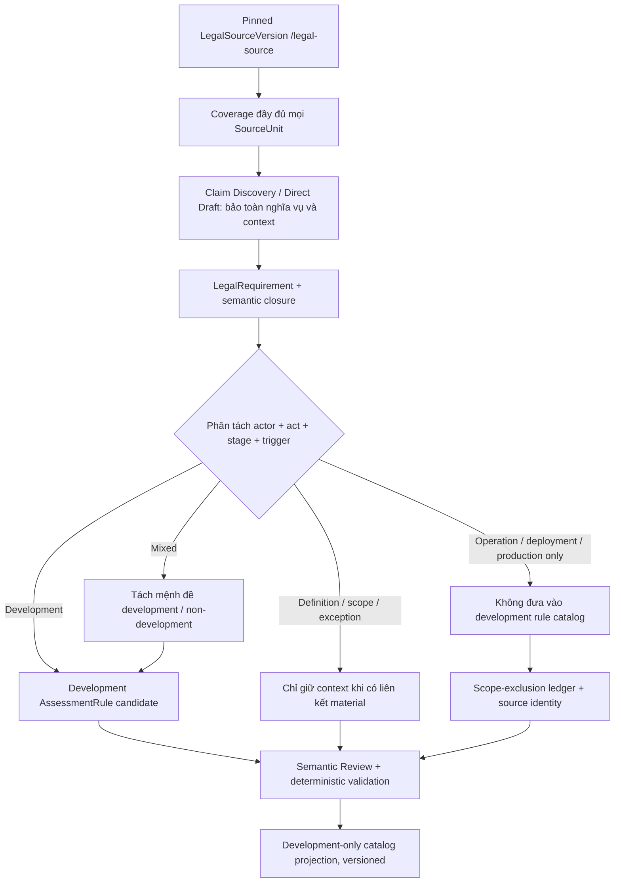

# LCSP — Rule Set Preparation theo phạm vi DEVELOPMENT (BẢN REVIEW TIẾNG VIỆT)

> **Trạng thái: DỰ THẢO CHÍNH SÁCH LỌC, CHƯA ÁP DỤNG RUNTIME / CHƯA KÍCH HOẠT RULE SET.** Các nhận định liên quan 171 đơn vị điều khoản chỉ dựa trên `.claude/triage/all-rules-ctx.json`, tài liệu `RULE_SET_PREPARATION_RULES.md` và hệ thống prompt/schema. Không gán trạng thái `NOT_APPLICABLE` cho luật chỉ vì ngoài phạm vi sản phẩm; đây là **scope selection**, không phải verdict pháp lý.

## 1. Mục tiêu và định nghĩa vận hành

Mục tiêu: đầu ra Rule Set phục vụ kiểm tra **việc phát triển hệ thống/phần mềm/AI**: thiết kế, kiến trúc, lập trình và tích hợp, lựa chọn/huấn luyện mô hình, chuẩn bị dữ liệu, kiểm thử, kiểm tra chất lượng, bảo vệ/an toàn tích hợp theo pháp luật, khả năng giám sát và dấu/nhãn **được thiết kế trong sản phẩm**, quản lý rủi ro trong quá trình xây dựng.

Không sinh **Assessment Rule development** cho các nghĩa vụ **chỉ** về: đưa vào khai thác, vận hành runtime/production, công bố hoặc sử dụng đầu ra bởi bên triển khai, vận hành cơ sở hạ tầng, chính sách thương mại sau đưa ra thị trường, sản xuất công nghiệp thương mại, thủ tục quản lý nhà nước, thanh tra/giám sát bởi cơ quan có thẩm quyền, hỗ trợ chính sách/quỹ, hoặc trách nhiệm chỉ thuộc người sử dụng.

**Không thể lọc bằng từ khóa đơn thuần:** `phát triển` có thể xuất hiện trong “phát triển nguồn nhân lực quốc gia” nhưng không tạo duty cho developer; `ứng dụng` có thể xuất hiện trong tiêu đề sản phẩm nhưng điều khoản vẫn yêu cầu **thiết kế** safeguard; `sản xuất` có thể là một hành vi được bao phủ trong điều luật đa chủ thể. Phân loại bằng cặp **(chủ thể bắt buộc, hành vi được quy định, giai đoạn trách nhiệm, điều kiện nguồn)**.

### Cần phân biệt các vai trò

| Vai trò pháp lý trong nguồn | Khi xét DEVELOPMENT_ONLY |
|---|---|
| `Nhà phát triển` | Ưu tiên giữ nghĩa vụ gắn với phát triển, nhưng không tự giữ mọi nghĩa vụ xử lý sự cố vận hành |
| `Nhà cung cấp` | Giữ phần **thiết kế, chuẩn bị hệ thống, bảo đảm chất lượng do nhà cung cấp chịu trách nhiệm**, kể cả khi điều kiện thực hiện nêu “trước khi đưa vào sử dụng” |
| `Bên triển khai` | Không sinh rule development từ hành vi vận hành/công bố/sử dụng; giữ thông tin dạng context khi là tiền đề cho developer |
| `Người sử dụng` | Loại khỏi development rule output, trừ khi nguồn đồng thời quy định trách nhiệm thiết kế cho nhà phát triển |
| `Cơ quan quản lý nhà nước` | Không tạo customer-facing development rule từ quyền hạn/công tác quản lý nhà nước |
| `Tổ chức sản xuất công nghiệp` | Không giữ theo chữ “sản xuất”; nếu có nghĩa vụ **thiết kế/chế tạo kỹ thuật** đúng đối tượng dev thì review riêng |

## 2. Sơ đồ bộ lọc đúng kiến trúc LCSP

**Điều kiện an toàn tối thiểu:** nguồn luật không bị xóa, các nghĩa vụ ngoài phạm vi không bị khai sai là `NO_REQUIREMENT`. Từng đơn vị vẫn có accounting và nguồn pin. Catalog development là **một phép chiếu có provenance** trên Rule Set đã được tạo/duyệt; không âm thầm thay đổi `ComplianceRuleSetVersion` toàn luật.

## 3. Điểm nghẽn runtime hiện tại — KHÔNG NÊN ĐƯA PROMPT SKIP THẲNG VÀO PRODUCTION

- `instructions-common.md` yêu cầu bảo toàn **mọi** DUTY, PROHIBITION, PERMISSION, scope, điều kiện, ngoại lệ.
- `instructions-discovery.md` và `claim_files.py` yêu cầu mọi source unit được accounted; `LOCATOR_UNACCOUNTED` nếu không có claim hoặc `noClaims` xác thực.
- `instructions-authoring.md` yêu cầu anchor và các requirement assessable có AssessmentRule; bỏ rule vì ngoài target có thể tạo coverage gap.
- `instructions-direct.md`, `direct-draft.schema.json` chỉ chấp nhận `ANALYZED`, `NO_REQUIREMENT`, `BLOCKED` tại `sourceUnits[].disposition`. Không có enum `OUT_OF_SCOPE`. Dùng `NO_REQUIREMENT` cho nghĩa vụ luật có thật chỉ vì không phục vụ development là **sai ngữ nghĩa**.
- `runner.py` hiện lấy `executionContract` và `targetDate`, **chưa có trường scope/targetActivity server-authoritative** để kích hoạt development-only một cách an toàn.
- `author_assessment_rule` tự derive legalIntent/criteria/evidence từ Requirement; chỉ thay prompt không bảo đảm lọc được AR mà vẫn qua deterministic gate.

**Cách thực thi an toàn ngắn hạn:** Giữ Preparation đủ nguồn, tạo **development-only scoped projection** có nhãn `OUT_OF_SCOPE_FOR_TARGET` và reason trong metadata downstream/review. Không xóa candidate, không sửa trạng thái luật, không dùng `NOT_APPLICABLE` hay `NO_REQUIREMENT` thay nghĩa vụ.

**Cách triển khai chính thức trong Preparation về sau:** Thêm `targetActivityScope=DEVELOPMENT_ONLY` vào contract máy chủ + persisted run + tool result, binding vào version/digest; thêm `sourceScopeDecisions` hoặc disposition scoped riêng `OUT_OF_SCOPE_TARGET`; validator phải vẫn bảo đảm source completeness và all duties preserved. Phải bổ sung phục hồi resume/rollback và negative controls trước khi bật, không chỉ thêm một câu trong system prompt.

## 4. Kết quả lọc sơ bộ 171 đơn vị nguồn (CHƯA PHÊ DUYỆT)

| Trạng thái lọc | Số bản ghi | Cách dùng |
|---|---:|---|
| `DEVELOPMENT_CANDIDATE` | **5** | Có hành vi development rõ; review trước khi sinh AR |
| `SPLIT_DEV_AND_NONDEV` | **15** | Có nhiều giai đoạn/chủ thể; bắt buộc tách claim |
| `CONTEXT_ONLY_IF_LINKED` | **31** | Chỉ giữ nếu là ngữ cảnh pháp lý cần thiết cho development |
| `EXCLUDE_FROM_DEV_CATALOG` | **99** | Tạm đề xuất loại khỏi AR development; vẫn account đầy đủ trong source |
| `LEGAL_REVIEW_REQUIRED` | **21** | Chưa đủ căn cứ để loại/giữ; phải review |
| **Tổng** | **171** | Không phải 171 nghĩa vụ; không phải final Rule Set |

**Không có kết quả nào trong bảng này được xác nhận qua source pin/Claim Inventory của một Preparation Run thực tế.** Việc loại trừ 99 bản ghi là **đề xuất triage theo nhóm điều luật**, không phải phán quyết cuối cùng hay xóa dữ liệu.

## 5. Ví dụ lọc đúng/sai theo corpus

| Nguồn trong bản trích xuất | Đề xuất | Vì sao |
|---|---|---|
| Luật 134, Điều 11 khoản 1 | GIỮ — dev candidate | Thiết kế minh bạch tương tác giữa hệ thống AI và người |
| Luật 134, Điều 11 khoản 2 | GIỮ — dev candidate | Thiết kế khả năng đánh dấu nội dung máy đọc, nhưng chỉ đối với nội dung thuộc phạm vi nguồn |
| Luật 134, Điều 11 khoản 3–4 | LOẠI khỏi AR development | Quy định chủ yếu cho bên triển khai về công khai/công bố/đầu ra |
| Luật 134, Điều 12 khoản 1 | TÁCH | Có cả nhà phát triển, nhà cung cấp, triển khai và người sử dụng; không bỏ phần developer |
| Luật 134, Điều 14 khoản 1 | CONTEXT | Câu dẫn về nhà cung cấp AI rủi ro cao, áp dụng cho các điểm con |
| Luật 134, Điều 14 khoản 1 điểm a | GIỮ — dev candidate | Quản lý rủi ro và rà soát trong vòng đời thiết kế hệ thống |
| Luật 134, Điều 14 khoản 1 điểm b | GIỮ — dev candidate | Quản trị dữ liệu huấn luyện/kiểm thử/vận hành; không bỏ giới hạn kỹ thuật |
| Luật 134, Điều 14 khoản 1 điểm d | GIỮ — dev candidate | **Thiết kế** khả năng giám sát và can thiệp của con người |
| Luật 134, Điều 14 khoản 2 | LOẠI khỏi AR development | Giao trách nhiệm vận hành cho bên triển khai |
| Luật 134, Điều 10 khoản 2 | TÁCH | Có quyền kế thừa phân loại và nghĩa vụ của bên triển khai, cần giữ đúng vai trò |
| Luật 134, Điều 26 khoản 4 | LOẠI khỏi AR bắt buộc | Chính sách khuyến khích, không tạo DUTY |
| Luật 71, Điều 26 khoản 2 | TÁCH | Thiết kế không được gây cản trở kỹ thuật; chính sách thương mại ngoài kiểm tra code |
| Luật 71, Điều 27 khoản 2–3 | CONTEXT/LOẠI rule | Khuyến khích tự đánh giá chất lượng, trách nhiệm của Bộ trưởng, không phải duty dev độc lập |
| Luật 71, Điều 8 | LOẠI khỏi AR bắt buộc | Trao quyền thử nghiệm có kiểm soát, không yêu cầu mọi developer phải vào sandbox |
| Luật 71, Điều 47–48 | CONTEXT khi có liên quan | Định nghĩa tài sản số / nội dung quản lý, không tự động là nghĩa vụ dev |

## 6. Nâng cấp prompt Preparation — đề xuất đủ 4 phase

### 6.1. Thêm khối chỉ dẫn chung khi và chỉ khi server sở hữu `targetActivityScope=DEVELOPMENT_ONLY`

> Bạn đang chuẩn bị **catalog đánh giá DEVELOPMENT_ONLY**. Đây là phạm vi sản phẩm, không phải ngoại lệ hoặc miễn trừ pháp luật. Phải đọc và account đủ source, không xóa claim có thật; giữ nguyên thứ bậc nguồn, trích dẫn và hiệu lực. Sau khi diễn giải từng mệnh đề, phân biệt chủ thể và hành động phát triển với phần triển khai, vận hành, sử dụng và sản xuất thương mại. Chỉ đề xuất AssessmentRule development cho hành vi thiết kế, xây dựng, lựa chọn/huấn luyện/kiểm thử, chất lượng, kiểm soát rủi ro và năng lực an toàn được quy định cho developer/provider. Một điều khoản mixed phải tách các operative claims; phần non-development có reason và reference, không nhập vào dev catalog. Dẫn chiếu, định nghĩa, điều kiện, ngoại lệ thuộc non-development chỉ giữ nếu có liên kết material trực tiếp với nghĩa vụ dev được giữ. Không coi outside target là NOT_APPLICABLE, NO_REQUIREMENT, REPEALED hay NON_COMPLIANT.

### 6.2. Discovery prompt — stage và context filter

> Với mỗi Điều, đọc đầy đủ khoản/điểm để bảo đảm coverage. Cho mỗi operative claim, lập metadata review `actorClass`, `regulatedActivity`, `dutyStage`, `scopeDecision` và nguồn hỗ trợ; metadata không được trộn vào `claim-file.schema.json` khi API chưa hỗ trợ. Không được loại một DUTY vì chữ “triển khai” nằm trong cùng câu với “phát triển”. Không được giữ một câu “phát triển hạ tầng quốc gia” chỉ vì chứa chữ “phát triển”. Quan hệ SCOPE/CONDITION/EXCEPTION/DEFINED_BY bảo toàn cho mọi claim dev được giữ. Tất cả nguồn khác vẫn được accounted, không giả là noClaims.

### 6.3. Authoring prompt — scoped rule synthesis

> Ghi nhận legal requirements chính xác của toàn văn, sau đó chỉ chọn các mệnh đề development đã được legal scope review làm đầu vào sinh `AssessmentRule` trong target catalog. Một requirement nhiều giai đoạn phải chứng minh ranh giới bằng actor+action+trigger; không đánh đồng permission với DUTY. Không lấy criterion về deployment, operation, policy thương mại, báo cáo/đăng ký vận hành hay tiêu chuẩn không ghi trong luật để kiểm tra source. Với duty `MIXED`, tiêu chí chỉ gắn phần development; external fulfillment được lưu là giới hạn. Không bỏ scope rủi ro cao, ngoại lệ, điều kiện phát sinh và context pháp lý cần thiết.

### 6.4. Direct Draft — source dispositions vẫn chuẩn

> Do `sourceUnits[].disposition` hiện chưa có `OUT_OF_SCOPE_TARGET`, không được tự gán `NO_REQUIREMENT` cho một nghĩa vụ pháp lý nằm ngoài development. Phân tích mọi source unit theo schema đang có; lưu scope selection ở versioned projection/review ledger được hệ thống cấp sau khi authoring/validation. Nếu muốn tạo development-only ngay tại Direct Draft, phải có contract và validator mới được server phê duyệt; thiếu thì giữ chế độ hiện tại, không tự bẻ schema.

## 7. Kỹ năng cần xây theo phạm vi này

1. **Actor & regulated-stage classifier:** phân biệt nhà phát triển, nhà cung cấp, bên triển khai, người dùng và Nhà nước; chia nhóm DESIGN/DEVELOPMENT/TRAINING/TESTING với DEPLOYMENT/OPERATION/COMMERCIAL_PRODUCTION; xuất nguồn và lý do.
2. **Mixed-clause atomizer:** tách quyền, nghĩa vụ, điều kiện của một khoản có nhiều chủ thể hoặc giai đoạn, giữ hướng quan hệ và trích dẫn từng mệnh đề.
3. **Material-context pruner:** giữ đúng context theo dependency từ development obligation (scope, condition, definition, exception, temporal), loại context không dẫn tới nghĩa vụ nào trong target catalog mà vẫn bảo toàn source ledger.
4. **Scoped-rule quality gate:** bắt lỗi dev rule giả, loại nhầm duty developer, actor drift, điều kiện mất, bãi bỏ nhầm, sai locator tiếng Việt, duplicate parent/child và disclosure của source ngoài pin.

Skills chỉ là phương pháp nghiệp vụ, KHÔNG đổi LegalSourceVersion, target scope hay validator. Các bản kỹ năng review được lưu riêng, chưa nối vào Agent runtime.

## 8. Checklist acceptance bắt buộc

- [ ] Server persist và pin chính xác target scope cho từng Preparation Run; không đoán từ prompt/user text.
- [ ] Input corpus hash và các source IDs đúng pin, stage assignment không thay đổi provenance.
- [ ] 171/171 nguồn trong test corpus được accounted; out-of-scope ghi reason, không biến nghĩa vụ có thật thành `NO_REQUIREMENT`.
- [ ] Luật 134 Điều 14 khoản 1 điểm a/b/d được giữ nếu tiền đề source đúng; khoản 2 không sinh AR dev.
- [ ] Luật 134 Điều 12 khoản 1 vẫn giữ phần nhà phát triển, không loại vì có bên triển khai/người dùng.
- [ ] Luật 71 Điều 26 khoản 2 giữ phần chống cản trở kỹ thuật; không ép policy kinh doanh thành code-level DUTY.
- [ ] Điều khoản khuyến khích/quyền/state management không sinh AR development.
- [ ] Context giữ theo material dependency, không nạp cả corpus vào prompt mỗi rule.
- [ ] Negative controls chạy qua cả CLAIM_DISCOVERY và DIRECT_DRAFT; kết quả có provenance và counters before/after.
- [ ] Không active catalog dev-only nếu validator/server không hỗ trợ scope contract.
- [ ] Có review và phê duyệt bộ 171 triage; chỉ sau đó mới đề xuất commit sản phẩm.

## 9. Bảng triage đủ 171 đơn vị nguồn (sơ bộ, không phải kết luận luật)

| STT | Luật | Điều/Khoản/Điểm | Nhóm | Nguồn pháp lý trích | Lý do / lưu ý |
|---:|---|---|---|---|---|
| 1 | 134/2025/QH15 | `art-10::cl-1` | **TÁCH mixed** | 1. Nhà cung cấp tự phân loại hệ thống trí tuệ nhân tạo trước khi đưa vào sử dụng. Hệ thống được phân loại là rủi ro trung bình hoặc rủi ro cao phải có hồ sơ phân l… | Phân loại trước đưa vào sử dụng và trách nhiệm của nhà cung cấp/bên triển khai cùng nằm trong khoản; cần giữ phần phát triển/thiết kế, tách phần triển khai. |
| 2 | 134/2025/QH15 | `art-10::cl-2` | **TÁCH mixed** | 2. Bên triển khai được kế thừa kết quả phân loại của nhà cung cấp và có trách nhiệm bảo đảm an toàn, nguyên vẹn của hệ thống trong quá trình sử dụng; trường hợp sử… | Phân loại trước đưa vào sử dụng và trách nhiệm của nhà cung cấp/bên triển khai cùng nằm trong khoản; cần giữ phần phát triển/thiết kế, tách phần triển khai. |
| 3 | 134/2025/QH15 | `art-10::cl-3` | **CHỜ REVIEW** | 3. Đối với hệ thống được phân loại là rủi ro trung bình hoặc rủi ro cao, nhà cung cấp phải thông báo kết quả phân loại cho Bộ Khoa học và Công nghệ thông qua Cổng … | Điều có thể giao nghĩa vụ cho nhiều vai trò hoặc nhiều giai đoạn; phải tách mệnh đề và xác minh điều kiện nguồn trước khi quyết định đưa vào development. |
| 4 | 134/2025/QH15 | `art-10::cl-5` | **CHỜ REVIEW** | 5. Việc kiểm tra, giám sát được thực hiện theo mức độ rủi ro của hệ thống: a) Hệ thống trí tuệ nhân tạo có rủi ro cao được kiểm tra định kỳ hoặc khi có dấu hiệu vi… | Điều có thể giao nghĩa vụ cho nhiều vai trò hoặc nhiều giai đoạn; phải tách mệnh đề và xác minh điều kiện nguồn trước khi quyết định đưa vào development. |
| 5 | 134/2025/QH15 | `art-10::cl-5::pt-a` | **CHỜ REVIEW** | a) Hệ thống trí tuệ nhân tạo có rủi ro cao được kiểm tra định kỳ hoặc khi có dấu hiệu vi phạm; | Điều có thể giao nghĩa vụ cho nhiều vai trò hoặc nhiều giai đoạn; phải tách mệnh đề và xác minh điều kiện nguồn trước khi quyết định đưa vào development. |
| 6 | 134/2025/QH15 | `art-10::cl-5::pt-b` | **CHỜ REVIEW** | b) Hệ thống trí tuệ nhân tạo có rủi ro trung bình được giám sát thông qua báo cáo, kiểm tra chọn mẫu hoặc đánh giá của tổ chức độc lập; | Điều có thể giao nghĩa vụ cho nhiều vai trò hoặc nhiều giai đoạn; phải tách mệnh đề và xác minh điều kiện nguồn trước khi quyết định đưa vào development. |
| 7 | 134/2025/QH15 | `art-10::cl-5::pt-c` | **CHỜ REVIEW** | c) Hệ thống trí tuệ nhân tạo có rủi ro thấp được theo dõi, kiểm tra khi có sự cố, phản ánh hoặc khi cần bảo đảm an toàn, không làm phát sinh nghĩa vụ không cần thi… | Điều có thể giao nghĩa vụ cho nhiều vai trò hoặc nhiều giai đoạn; phải tách mệnh đề và xác minh điều kiện nguồn trước khi quyết định đưa vào development. |
| 8 | 134/2025/QH15 | `art-10::cl-6` | **CHỜ REVIEW** | 6. Trên cơ sở kết quả kiểm tra, giám sát quy định tại khoản 5 Điều này, khi phát hiện sai lệch hoặc khai báo không trung thực, cơ quan có thẩm quyền yêu cầu tái ph… | Điều có thể giao nghĩa vụ cho nhiều vai trò hoặc nhiều giai đoạn; phải tách mệnh đề và xác minh điều kiện nguồn trước khi quyết định đưa vào development. |
| 9 | 134/2025/QH15 | `art-10::cl-7` | **CHỜ REVIEW** | 7. Chính phủ quy định chi tiết về nội dung cần thông báo, trình tự, thủ tục thông báo và hướng dẫn kỹ thuật về phân loại rủi ro. | Điều có thể giao nghĩa vụ cho nhiều vai trò hoặc nhiều giai đoạn; phải tách mệnh đề và xác minh điều kiện nguồn trước khi quyết định đưa vào development. |
| 10 | 134/2025/QH15 | `art-11::cl-1` | **GIỮ dev** | 1. Nhà cung cấp bảo đảm hệ thống trí tuệ nhân tạo tương tác trực tiếp với con người được thiết kế và vận hành để người sử dụng nhận biết khi đang tương tác với hệ … | Nghĩa vụ nhà cung cấp có phần thiết kế/tạo khả năng minh bạch hoặc đánh dấu đầu ra; kiểm tra đúng đối tượng và tiền đề pháp lý. |
| 11 | 134/2025/QH15 | `art-11::cl-2` | **GIỮ dev** | 2. Nhà cung cấp bảo đảm các nội dung âm thanh, hình ảnh, video do hệ thống trí tuệ nhân tạo tạo ra được đánh dấu ở định dạng máy đọc theo quy định của Chính phủ. | Nghĩa vụ nhà cung cấp có phần thiết kế/tạo khả năng minh bạch hoặc đánh dấu đầu ra; kiểm tra đúng đối tượng và tiền đề pháp lý. |
| 12 | 134/2025/QH15 | `art-11::cl-3` | **LOẠI khỏi catalog dev** | 3. Bên triển khai có trách nhiệm thông báo rõ ràng khi cung cấp ra công cộng văn bản, âm thanh, hình ảnh, video được tạo ra hoặc chỉnh sửa bằng hệ thống trí tuệ nh… | Quy định trực tiếp cho bên triển khai khi công bố/cung cấp đầu ra; không phải nghĩa vụ development độc lập. |
| 13 | 134/2025/QH15 | `art-11::cl-4` | **LOẠI khỏi catalog dev** | 4. Bên triển khai có trách nhiệm bảo đảm âm thanh, hình ảnh, video được tạo ra hoặc chỉnh sửa bằng hệ thống trí tuệ nhân tạo nhằm mô phỏng, giả lập ngoại hình, giọ… | Quy định trực tiếp cho bên triển khai khi công bố/cung cấp đầu ra; không phải nghĩa vụ development độc lập. |
| 14 | 134/2025/QH15 | `art-11::cl-5` | **TÁCH mixed** | 5. Nhà cung cấp và bên triển khai có trách nhiệm duy trì thông tin minh bạch theo quy định tại Điều này trong suốt quá trình cung cấp hệ thống, sản phẩm hoặc nội d… | Chủ thể nhà cung cấp và bên triển khai trộn lẫn, nghĩa vụ duy trì thông tin có thể có thành phần product-development; cần tách. |
| 15 | 134/2025/QH15 | `art-11::cl-6` | **CONTEXT có điều kiện** | 6. Chính phủ quy định chi tiết hình thức thông báo, gắn nhãn. | Giao Chính phủ quy định chi tiết; không tự tạo AR cho development, giữ nguồn dẫn khi cần. |
| 16 | 134/2025/QH15 | `art-12::cl-1` | **TÁCH mixed** | 1. Nhà phát triển, nhà cung cấp, bên triển khai và người sử dụng hệ thống trí tuệ nhân tạo có trách nhiệm bảo đảm an toàn, an ninh, độ tin cậy và kịp thời phát hiệ… | Chủ thể gồm nhà phát triển, nhà cung cấp, bên triển khai, người sử dụng; chỉ giữ các hành vi/điều kiện thực sự gắn giai đoạn phát triển. |
| 17 | 134/2025/QH15 | `art-12::cl-2` | **CONTEXT có điều kiện** | 2. Khi hệ thống trí tuệ nhân tạo xảy ra sự cố nghiêm trọng, nhà phát triển, nhà cung cấp, bên triển khai, người sử dụng hệ thống trí tuệ nhân tạo có trách nhiệm sa… | Điều khoản điều phối xử lý sự cố/quy định chi tiết, chỉ làm ngữ cảnh nếu liên quan nghĩa vụ development. |
| 18 | 134/2025/QH15 | `art-12::cl-2::pt-a` | **TÁCH mixed** | a) Nhà phát triển, nhà cung cấp phải khẩn trương áp dụng biện pháp kỹ thuật để khắc phục, tạm dừng hoặc thu hồi hệ thống, đồng thời thông báo cho cơ quan có thẩm q… | Nhà phát triển/nhà cung cấp có nghĩa vụ xử lý sự cố sau vận hành; yêu cầu này gắn với vòng đời hệ thống, cần review trước khi lọc. |
| 19 | 134/2025/QH15 | `art-12::cl-2::pt-b` | **LOẠI khỏi catalog dev** | b) Bên triển khai và người sử dụng có nghĩa vụ ghi nhận, thông báo kịp thời sự cố và phối hợp trong quá trình khắc phục. | Chủ thể bên triển khai/người sử dụng về ghi nhận và báo cáo sự cố vận hành, ngoài catalog dev-only. |
| 20 | 134/2025/QH15 | `art-12::cl-3` | **CONTEXT có điều kiện** | 3. Cơ quan quản lý nhà nước có thẩm quyền tiếp nhận, xác minh và hướng dẫn xử lý sự cố; khi cần thiết, có quyền yêu cầu tạm dừng, thu hồi hoặc đánh giá lại hệ thốn… | Điều khoản điều phối xử lý sự cố/quy định chi tiết, chỉ làm ngữ cảnh nếu liên quan nghĩa vụ development. |
| 21 | 134/2025/QH15 | `art-12::cl-4` | **CONTEXT có điều kiện** | 4. Báo cáo và xử lý sự cố được thực hiện qua cổng thông tin điện tử một cửa về trí tuệ nhân tạo. | Điều khoản điều phối xử lý sự cố/quy định chi tiết, chỉ làm ngữ cảnh nếu liên quan nghĩa vụ development. |
| 22 | 134/2025/QH15 | `art-12::cl-5` | **CONTEXT có điều kiện** | 5. Chính phủ quy định việc báo cáo và trách nhiệm của các cơ quan, tổ chức, cá nhân có liên quan phù hợp với mức độ nghiêm trọng của sự cố và phạm vi ảnh hưởng của… | Điều khoản điều phối xử lý sự cố/quy định chi tiết, chỉ làm ngữ cảnh nếu liên quan nghĩa vụ development. |
| 23 | 134/2025/QH15 | `art-13::cl-1` | **CHỜ REVIEW** | 1. Hệ thống trí tuệ nhân tạo có rủi ro cao phải được đánh giá sự phù hợp theo quy định của Luật này trước khi đưa vào sử dụng hoặc khi có thay đổi đáng kể trong qu… | Điều có thể giao nghĩa vụ cho nhiều vai trò hoặc nhiều giai đoạn; phải tách mệnh đề và xác minh điều kiện nguồn trước khi quyết định đưa vào development. |
| 24 | 134/2025/QH15 | `art-13::cl-2` | **CHỜ REVIEW** | 2. Đánh giá sự phù hợp là việc xác nhận hệ thống trí tuệ nhân tạo đáp ứng các yêu cầu tại Điều 14 của Luật này và được thực hiện như sau: a) Đối với hệ thống trí t… | Điều có thể giao nghĩa vụ cho nhiều vai trò hoặc nhiều giai đoạn; phải tách mệnh đề và xác minh điều kiện nguồn trước khi quyết định đưa vào development. |
| 25 | 134/2025/QH15 | `art-13::cl-2::pt-a` | **CHỜ REVIEW** | a) Đối với hệ thống trí tuệ nhân tạo có rủi ro cao thuộc danh mục hệ thống trí tuệ nhân tạo phải chứng nhận sự phù hợp trước khi đưa vào sử dụng: việc đánh giá đượ… | Điều có thể giao nghĩa vụ cho nhiều vai trò hoặc nhiều giai đoạn; phải tách mệnh đề và xác minh điều kiện nguồn trước khi quyết định đưa vào development. |
| 26 | 134/2025/QH15 | `art-13::cl-2::pt-b` | **CHỜ REVIEW** | b) Đối với các hệ thống trí tuệ nhân tạo có rủi ro cao khác: nhà cung cấp tự đánh giá sự phù hợp hoặc thuê tổ chức đánh giá sự phù hợp đã được đăng ký hoặc thừa nh… | Điều có thể giao nghĩa vụ cho nhiều vai trò hoặc nhiều giai đoạn; phải tách mệnh đề và xác minh điều kiện nguồn trước khi quyết định đưa vào development. |
| 27 | 134/2025/QH15 | `art-13::cl-3` | **CHỜ REVIEW** | 3. Kết quả đánh giá sự phù hợp là điều kiện để hệ thống trí tuệ nhân tạo có rủi ro cao được phép đưa vào sử dụng; tổ chức, cá nhân có hệ thống đã được đánh giá sự … | Điều có thể giao nghĩa vụ cho nhiều vai trò hoặc nhiều giai đoạn; phải tách mệnh đề và xác minh điều kiện nguồn trước khi quyết định đưa vào development. |
| 28 | 134/2025/QH15 | `art-13::cl-4` | **CONTEXT có điều kiện** | 4. Thủ tướng Chính phủ quy định Danh mục hệ thống trí tuệ nhân tạo có rủi ro cao, bao gồm danh mục hệ thống trí tuệ nhân tạo phải chứng nhận sự phù hợp trước khi đ… | Danh mục hệ thống rủi ro cao do Thủ tướng quy định là căn cứ điều kiện áp dụng cho developer, không phải rule trực tiếp. |
| 29 | 134/2025/QH15 | `art-13::cl-5` | **CHỜ REVIEW** | 5. Tổ chức đánh giá sự phù hợp, kiểm định hệ thống trí tuệ nhân tạo phải bảo đảm tính độc lập, có đủ năng lực kỹ thuật theo quy định và chịu sự giám sát định kỳ củ… | Điều có thể giao nghĩa vụ cho nhiều vai trò hoặc nhiều giai đoạn; phải tách mệnh đề và xác minh điều kiện nguồn trước khi quyết định đưa vào development. |
| 30 | 134/2025/QH15 | `art-14::cl-1` | **CONTEXT có điều kiện** | 1. Nhà cung cấp hệ thống trí tuệ nhân tạo có rủi ro cao có trách nhiệm sau đây: a) Thiết lập và duy trì biện pháp quản lý rủi ro và thường xuyên rà soát khi hệ thố… | Câu dẫn khoản đặt actor và điều kiện hệ thống AI rủi ro cao cho các điểm; không tạo một AR tổng hợp trùng các điểm. |
| 31 | 134/2025/QH15 | `art-14::cl-1::pt-đ` | **TÁCH mixed** | đ) Thực hiện nghĩa vụ minh bạch và xử lý sự cố theo quy định tại Điều 11 và Điều 12 của Luật này; | Nghĩa vụ nhà cung cấp có phần hồ sơ/giải trình/giám sát sau phát hành và phần có thể được thiết kế trong development; cần tách hành vi. |
| 32 | 134/2025/QH15 | `art-14::cl-1::pt-a` | **GIỮ dev** | a) Thiết lập và duy trì biện pháp quản lý rủi ro và thường xuyên rà soát khi hệ thống có thay đổi đáng kể hoặc phát sinh rủi ro mới; | Nghĩa vụ phía nhà cung cấp về quản lý rủi ro, dữ liệu hoặc thiết kế giám sát con người; gắn development, giữ đầy đủ scope rủi ro cao. |
| 33 | 134/2025/QH15 | `art-14::cl-1::pt-b` | **GIỮ dev** | b) Quản trị dữ liệu huấn luyện, kiểm thử và vận hành bảo đảm chất lượng trong phạm vi khả năng kỹ thuật và phù hợp với mục đích sử dụng của hệ thống; | Nghĩa vụ phía nhà cung cấp về quản lý rủi ro, dữ liệu hoặc thiết kế giám sát con người; gắn development, giữ đầy đủ scope rủi ro cao. |
| 34 | 134/2025/QH15 | `art-14::cl-1::pt-c` | **TÁCH mixed** | c) Lập, cập nhật, lưu giữ hồ sơ kỹ thuật và nhật ký hoạt động ở mức cần thiết cho việc đánh giá sự phù hợp và kiểm tra sau khi đưa vào sử dụng; cung cấp các thông … | Nghĩa vụ nhà cung cấp có phần hồ sơ/giải trình/giám sát sau phát hành và phần có thể được thiết kế trong development; cần tách hành vi. |
| 35 | 134/2025/QH15 | `art-14::cl-1::pt-d` | **GIỮ dev** | d) Thiết kế hệ thống bảo đảm khả năng giám sát và can thiệp của con người đối với hệ thống; | Nghĩa vụ phía nhà cung cấp về quản lý rủi ro, dữ liệu hoặc thiết kế giám sát con người; gắn development, giữ đầy đủ scope rủi ro cao. |
| 36 | 134/2025/QH15 | `art-14::cl-1::pt-e` | **TÁCH mixed** | e) Thực hiện trách nhiệm giải trình đối với cơ quan nhà nước có thẩm quyền về mục đích sử dụng, nguyên lý hoạt động ở mức mô tả chức năng, loại dữ liệu đầu vào chủ… | Nghĩa vụ nhà cung cấp có phần hồ sơ/giải trình/giám sát sau phát hành và phần có thể được thiết kế trong development; cần tách hành vi. |
| 37 | 134/2025/QH15 | `art-14::cl-1::pt-g` | **TÁCH mixed** | g) Phối hợp với cơ quan nhà nước có thẩm quyền và bên triển khai trong kiểm tra, đánh giá, hậu kiểm và khắc phục sự cố liên quan đến hệ thống. | Nghĩa vụ nhà cung cấp có phần hồ sơ/giải trình/giám sát sau phát hành và phần có thể được thiết kế trong development; cần tách hành vi. |
| 38 | 134/2025/QH15 | `art-14::cl-2` | **LOẠI khỏi catalog dev** | 2. Bên triển khai hệ thống trí tuệ nhân tạo có rủi ro cao có trách nhiệm sau đây: a) Vận hành và giám sát hệ thống đúng mục đích, phạm vi và mức độ rủi ro đã được … | Chủ thể bên triển khai/người sử dụng, gắn vận hành; không được tạo AR development trực tiếp. |
| 39 | 134/2025/QH15 | `art-14::cl-2::pt-đ` | **LOẠI khỏi catalog dev** | đ) Thực hiện trách nhiệm giải trình đối với cơ quan nhà nước có thẩm quyền về việc vận hành hệ thống, biện pháp kiểm soát rủi ro, xử lý sự cố và các nội dung cần t… | Chủ thể bên triển khai/người sử dụng, gắn vận hành; không được tạo AR development trực tiếp. |
| 40 | 134/2025/QH15 | `art-14::cl-2::pt-a` | **LOẠI khỏi catalog dev** | a) Vận hành và giám sát hệ thống đúng mục đích, phạm vi và mức độ rủi ro đã được phân loại, không làm phát sinh rủi ro mới hoặc rủi ro cao hơn; | Chủ thể bên triển khai/người sử dụng, gắn vận hành; không được tạo AR development trực tiếp. |
| 41 | 134/2025/QH15 | `art-14::cl-2::pt-b` | **LOẠI khỏi catalog dev** | b) Bảo đảm an toàn, bảo mật dữ liệu và khả năng can thiệp của con người trong quá trình sử dụng; | Chủ thể bên triển khai/người sử dụng, gắn vận hành; không được tạo AR development trực tiếp. |
| 42 | 134/2025/QH15 | `art-14::cl-2::pt-c` | **LOẠI khỏi catalog dev** | c) Duy trì việc tuân thủ tiêu chuẩn, quy chuẩn kỹ thuật về trí tuệ nhân tạo trong quá trình vận hành hệ thống; | Chủ thể bên triển khai/người sử dụng, gắn vận hành; không được tạo AR development trực tiếp. |
| 43 | 134/2025/QH15 | `art-14::cl-2::pt-d` | **LOẠI khỏi catalog dev** | d) Thực hiện nghĩa vụ minh bạch và xử lý sự cố theo quy định tại Điều 11 và Điều 12 của Luật này; | Chủ thể bên triển khai/người sử dụng, gắn vận hành; không được tạo AR development trực tiếp. |
| 44 | 134/2025/QH15 | `art-14::cl-2::pt-e` | **LOẠI khỏi catalog dev** | e) Phối hợp với nhà cung cấp và cơ quan nhà nước có thẩm quyền trong kiểm tra, đánh giá, hậu kiểm và khắc phục sự cố. | Chủ thể bên triển khai/người sử dụng, gắn vận hành; không được tạo AR development trực tiếp. |
| 45 | 134/2025/QH15 | `art-14::cl-3` | **LOẠI khỏi catalog dev** | 3. Người sử dụng hệ thống trí tuệ nhân tạo có rủi ro cao có trách nhiệm tuân thủ quy trình vận hành, hướng dẫn kỹ thuật và các biện pháp bảo đảm an toàn; không can… | Chủ thể bên triển khai/người sử dụng, gắn vận hành; không được tạo AR development trực tiếp. |
| 46 | 134/2025/QH15 | `art-14::cl-4` | **CONTEXT có điều kiện** | 4. Việc giải trình phải phù hợp với khả năng kỹ thuật của hệ thống, không làm lộ bí mật kinh doanh theo quy định của pháp luật. | Điều khoản ngoại lệ, khuyến khích hoặc trách nhiệm cung cấp xuyên biên giới; làm ngữ cảnh nếu ảnh hưởng nghĩa vụ development. |
| 47 | 134/2025/QH15 | `art-14::cl-5` | **CONTEXT có điều kiện** | 5. Khuyến khích nhà cung cấp, bên triển khai tham gia bảo hiểm trách nhiệm dân sự hoặc áp dụng biện pháp bảo đảm thực hiện nghĩa vụ phù hợp khác để kịp thời khắc p… | Điều khoản ngoại lệ, khuyến khích hoặc trách nhiệm cung cấp xuyên biên giới; làm ngữ cảnh nếu ảnh hưởng nghĩa vụ development. |
| 48 | 134/2025/QH15 | `art-14::cl-6` | **CONTEXT có điều kiện** | 6. Nhà cung cấp nước ngoài có hệ thống trí tuệ nhân tạo có rủi ro cao được cung cấp tại Việt Nam phải có đầu mối liên hệ hợp pháp tại Việt Nam; trường hợp hệ thống… | Điều khoản ngoại lệ, khuyến khích hoặc trách nhiệm cung cấp xuyên biên giới; làm ngữ cảnh nếu ảnh hưởng nghĩa vụ development. |
| 49 | 134/2025/QH15 | `art-15::cl-1` | **CHỜ REVIEW** | 1. Hệ thống trí tuệ nhân tạo có rủi ro trung bình được quản lý như sau: a) Nhà cung cấp và bên triển khai phải bảo đảm minh bạch theo quy định tại Điều 11 của Luật… | Điều có thể giao nghĩa vụ cho nhiều vai trò hoặc nhiều giai đoạn; phải tách mệnh đề và xác minh điều kiện nguồn trước khi quyết định đưa vào development. |
| 50 | 134/2025/QH15 | `art-15::cl-1::pt-a` | **CHỜ REVIEW** | a) Nhà cung cấp và bên triển khai phải bảo đảm minh bạch theo quy định tại Điều 11 của Luật này; | Điều có thể giao nghĩa vụ cho nhiều vai trò hoặc nhiều giai đoạn; phải tách mệnh đề và xác minh điều kiện nguồn trước khi quyết định đưa vào development. |
| 51 | 134/2025/QH15 | `art-15::cl-1::pt-b` | **CHỜ REVIEW** | b) Nhà cung cấp có trách nhiệm giải trình về mục đích sử dụng, nguyên lý hoạt động ở mức mô tả chức năng, dữ liệu đầu vào chủ yếu và biện pháp quản lý rủi ro, an t… | Điều có thể giao nghĩa vụ cho nhiều vai trò hoặc nhiều giai đoạn; phải tách mệnh đề và xác minh điều kiện nguồn trước khi quyết định đưa vào development. |
| 52 | 134/2025/QH15 | `art-15::cl-1::pt-c` | **CHỜ REVIEW** | c) Bên triển khai có trách nhiệm giải trình về việc vận hành, kiểm soát rủi ro, xử lý sự cố và bảo vệ quyền, lợi ích hợp pháp của tổ chức, cá nhân khi có yêu cầu c… | Điều có thể giao nghĩa vụ cho nhiều vai trò hoặc nhiều giai đoạn; phải tách mệnh đề và xác minh điều kiện nguồn trước khi quyết định đưa vào development. |
| 53 | 134/2025/QH15 | `art-15::cl-1::pt-d` | **CHỜ REVIEW** | d) Người sử dụng có trách nhiệm tuân thủ quy định về thông báo, gắn nhãn hệ thống trí tuệ nhân tạo. | Điều có thể giao nghĩa vụ cho nhiều vai trò hoặc nhiều giai đoạn; phải tách mệnh đề và xác minh điều kiện nguồn trước khi quyết định đưa vào development. |
| 54 | 134/2025/QH15 | `art-15::cl-2` | **CHỜ REVIEW** | 2. Hệ thống trí tuệ nhân tạo có rủi ro thấp được quản lý như sau: a) Nhà cung cấp có trách nhiệm giải trình khi có yêu cầu của cơ quan nhà nước có thẩm quyền trong… | Điều có thể giao nghĩa vụ cho nhiều vai trò hoặc nhiều giai đoạn; phải tách mệnh đề và xác minh điều kiện nguồn trước khi quyết định đưa vào development. |
| 55 | 134/2025/QH15 | `art-15::cl-2::pt-a` | **CHỜ REVIEW** | a) Nhà cung cấp có trách nhiệm giải trình khi có yêu cầu của cơ quan nhà nước có thẩm quyền trong trường hợp có dấu hiệu vi phạm pháp luật hoặc ảnh hưởng đến quyền… | Điều có thể giao nghĩa vụ cho nhiều vai trò hoặc nhiều giai đoạn; phải tách mệnh đề và xác minh điều kiện nguồn trước khi quyết định đưa vào development. |
| 56 | 134/2025/QH15 | `art-15::cl-2::pt-b` | **CHỜ REVIEW** | b) Bên triển khai có trách nhiệm giải trình khi có yêu cầu của cơ quan nhà nước có thẩm quyền trong trường hợp có dấu hiệu vi phạm pháp luật hoặc ảnh hưởng đến quy… | Điều có thể giao nghĩa vụ cho nhiều vai trò hoặc nhiều giai đoạn; phải tách mệnh đề và xác minh điều kiện nguồn trước khi quyết định đưa vào development. |
| 57 | 134/2025/QH15 | `art-16::cl-1` | **LOẠI khỏi catalog dev** | 1. Hạ tầng trí tuệ nhân tạo quốc gia là hạ tầng chiến lược, bao gồm hạ tầng do Nhà nước, doanh nghiệp và tổ chức xã hội đầu tư; được phát triển như một hệ sinh thá… | Điều chủ yếu điều chỉnh hoạt động áp dụng/vận hành, tổ chức sản xuất, thủ tục quản lý nhà nước, hỗ trợ chính sách hoặc hoạt động sau phát triển; không tạo AR d… |
| 58 | 134/2025/QH15 | `art-16::cl-2` | **LOẠI khỏi catalog dev** | 2. Nhà nước giữ vai trò định hướng, điều phối và bảo đảm năng lực hạ tầng phục vụ phát triển trí tuệ nhân tạo quốc gia; khuyến khích doanh nghiệp, viện nghiên cứu,… | Điều chủ yếu điều chỉnh hoạt động áp dụng/vận hành, tổ chức sản xuất, thủ tục quản lý nhà nước, hỗ trợ chính sách hoặc hoạt động sau phát triển; không tạo AR d… |
| 59 | 134/2025/QH15 | `art-16::cl-5` | **LOẠI khỏi catalog dev** | 5. Ứng dụng trí tuệ nhân tạo quan trọng trong các lĩnh vực thiết yếu theo danh mục do Thủ tướng Chính phủ ban hành phải được triển khai trên hạ tầng trí tuệ nhân t… | Điều chủ yếu điều chỉnh hoạt động áp dụng/vận hành, tổ chức sản xuất, thủ tục quản lý nhà nước, hỗ trợ chính sách hoặc hoạt động sau phát triển; không tạo AR d… |
| 60 | 134/2025/QH15 | `art-16::cl-6` | **LOẠI khỏi catalog dev** | 6. Chính phủ quy định chi tiết cơ chế điều phối, chia sẻ, ưu đãi và biện pháp thúc đẩy phát triển hạ tầng trí tuệ nhân tạo quốc gia, phù hợp từng giai đoạn và yêu … | Điều chủ yếu điều chỉnh hoạt động áp dụng/vận hành, tổ chức sản xuất, thủ tục quản lý nhà nước, hỗ trợ chính sách hoặc hoạt động sau phát triển; không tạo AR d… |
| 61 | 134/2025/QH15 | `art-17::cl-1` | **LOẠI khỏi catalog dev** | 1. Cơ sở dữ liệu phục vụ trí tuệ nhân tạo là thành phần quan trọng của hạ tầng trí tuệ nhân tạo quốc gia, bao gồm Cơ sở dữ liệu quốc gia, cơ sở dữ liệu của Bộ, cơ … | Điều chủ yếu điều chỉnh hoạt động áp dụng/vận hành, tổ chức sản xuất, thủ tục quản lý nhà nước, hỗ trợ chính sách hoặc hoạt động sau phát triển; không tạo AR d… |
| 62 | 134/2025/QH15 | `art-17::cl-2` | **LOẠI khỏi catalog dev** | 2. Cơ sở dữ liệu quốc gia về trí tuệ nhân tạo do Nhà nước đầu tư, xây dựng và vận hành tại Trung tâm dữ liệu quốc gia; được tổ chức theo nguyên tắc mở, an toàn, có… | Điều chủ yếu điều chỉnh hoạt động áp dụng/vận hành, tổ chức sản xuất, thủ tục quản lý nhà nước, hỗ trợ chính sách hoặc hoạt động sau phát triển; không tạo AR d… |
| 63 | 134/2025/QH15 | `art-17::cl-3` | **LOẠI khỏi catalog dev** | 3. Cơ sở dữ liệu phục vụ trí tuệ nhân tạo của Bộ, cơ quan ngang Bộ, cơ quan thuộc Chính phủ và Ủy ban nhân dân các cấp được xây dựng, cập nhật và kết nối thống nhấ… | Điều chủ yếu điều chỉnh hoạt động áp dụng/vận hành, tổ chức sản xuất, thủ tục quản lý nhà nước, hỗ trợ chính sách hoặc hoạt động sau phát triển; không tạo AR d… |
| 64 | 134/2025/QH15 | `art-17::cl-4` | **LOẠI khỏi catalog dev** | 4. Cơ sở dữ liệu của tổ chức, cá nhân phục vụ trí tuệ nhân tạo được khuyến khích chia sẻ với cơ quan nhà nước và tổ chức, cá nhân khác theo cơ chế thỏa thuận; việc… | Điều chủ yếu điều chỉnh hoạt động áp dụng/vận hành, tổ chức sản xuất, thủ tục quản lý nhà nước, hỗ trợ chính sách hoặc hoạt động sau phát triển; không tạo AR d… |
| 65 | 134/2025/QH15 | `art-17::cl-6` | **LOẠI khỏi catalog dev** | 6. Chính phủ quy định chi tiết về nguyên tắc kết nối, cơ chế chia sẻ, khai thác và bảo đảm an toàn dữ liệu trong cơ sở dữ liệu phục vụ trí tuệ nhân tạo. | Điều chủ yếu điều chỉnh hoạt động áp dụng/vận hành, tổ chức sản xuất, thủ tục quản lý nhà nước, hỗ trợ chính sách hoặc hoạt động sau phát triển; không tạo AR d… |
| 66 | 134/2025/QH15 | `art-18::cl-5` | **LOẠI khỏi catalog dev** | 5. Chính phủ quy định chi tiết cơ chế, tiêu chí và biện pháp thúc đẩy làm chủ công nghệ trí tuệ nhân tạo, phù hợp từng giai đoạn phát triển và yêu cầu bảo đảm an t… | Điều chủ yếu điều chỉnh hoạt động áp dụng/vận hành, tổ chức sản xuất, thủ tục quản lý nhà nước, hỗ trợ chính sách hoặc hoạt động sau phát triển; không tạo AR d… |
| 67 | 134/2025/QH15 | `art-19::cl-1` | **LOẠI khỏi catalog dev** | 1. Thủ tướng Chính phủ ban hành Chiến lược quốc gia về trí tuệ nhân tạo, rà soát, đánh giá và cập nhật định kỳ ít nhất 03 năm một lần hoặc khi có biến động lớn về … | Điều chủ yếu điều chỉnh hoạt động áp dụng/vận hành, tổ chức sản xuất, thủ tục quản lý nhà nước, hỗ trợ chính sách hoặc hoạt động sau phát triển; không tạo AR d… |
| 68 | 134/2025/QH15 | `art-19::cl-2` | **LOẠI khỏi catalog dev** | 2. Chiến lược quốc gia về trí tuệ nhân tạo được xây dựng trên cơ sở các định hướng phát triển công nghệ, hạ tầng, dữ liệu và nhân lực; thúc đẩy nghiên cứu, làm chủ… | Điều chủ yếu điều chỉnh hoạt động áp dụng/vận hành, tổ chức sản xuất, thủ tục quản lý nhà nước, hỗ trợ chính sách hoặc hoạt động sau phát triển; không tạo AR d… |
| 69 | 134/2025/QH15 | `art-19::cl-3` | **LOẠI khỏi catalog dev** | 3. Nhà nước khuyến khích phát triển các nhóm công nghệ trí tuệ nhân tạo phù hợp với điều kiện Việt Nam, có tiềm năng tạo giá trị gia tăng, thân thiện môi trường, d… | Điều chủ yếu điều chỉnh hoạt động áp dụng/vận hành, tổ chức sản xuất, thủ tục quản lý nhà nước, hỗ trợ chính sách hoặc hoạt động sau phát triển; không tạo AR d… |
| 70 | 134/2025/QH15 | `art-20::cl-2` | **LOẠI khỏi catalog dev** | 2. Nhà nước hỗ trợ phát triển hệ sinh thái và thị trường trí tuệ nhân tạo, bao gồm: a) Ưu tiên sử dụng sản phẩm, dịch vụ trí tuệ nhân tạo theo quy định của pháp lu… | Điều chủ yếu điều chỉnh hoạt động áp dụng/vận hành, tổ chức sản xuất, thủ tục quản lý nhà nước, hỗ trợ chính sách hoặc hoạt động sau phát triển; không tạo AR d… |
| 71 | 134/2025/QH15 | `art-20::cl-2::pt-c` | **LOẠI khỏi catalog dev** | c) Bảo đảm khả năng tiếp cận công bằng, minh bạch đối với hạ tầng tính toán, dữ liệu và môi trường thử nghiệm có kiểm soát; | Điều chủ yếu điều chỉnh hoạt động áp dụng/vận hành, tổ chức sản xuất, thủ tục quản lý nhà nước, hỗ trợ chính sách hoặc hoạt động sau phát triển; không tạo AR d… |
| 72 | 134/2025/QH15 | `art-20::cl-4` | **LOẠI khỏi catalog dev** | 4. Tổ chức, cá nhân, doanh nghiệp, cơ sở nghiên cứu và cơ quan nhà nước được khuyến khích khai thác, chia sẻ và tái sử dụng dữ liệu trong Cơ sở dữ liệu quốc gia về… | Điều chủ yếu điều chỉnh hoạt động áp dụng/vận hành, tổ chức sản xuất, thủ tục quản lý nhà nước, hỗ trợ chính sách hoặc hoạt động sau phát triển; không tạo AR d… |
| 73 | 134/2025/QH15 | `art-21::cl-1` | **LOẠI khỏi catalog dev** | 1. Cơ chế thử nghiệm có kiểm soát đối với trí tuệ nhân tạo thực hiện theo quy định của pháp luật về khoa học, công nghệ và đổi mới sáng tạo và quy định tại các kho… | Điều chủ yếu điều chỉnh hoạt động áp dụng/vận hành, tổ chức sản xuất, thủ tục quản lý nhà nước, hỗ trợ chính sách hoặc hoạt động sau phát triển; không tạo AR d… |
| 74 | 134/2025/QH15 | `art-21::cl-2` | **LOẠI khỏi catalog dev** | 2. Kết quả thử nghiệm có kiểm soát là căn cứ để cơ quan nhà nước có thẩm quyền xem xét: a) Công nhận kết quả đánh giá sự phù hợp theo quy định của Luật này; b) Miễ… | Điều chủ yếu điều chỉnh hoạt động áp dụng/vận hành, tổ chức sản xuất, thủ tục quản lý nhà nước, hỗ trợ chính sách hoặc hoạt động sau phát triển; không tạo AR d… |
| 75 | 134/2025/QH15 | `art-21::cl-2::pt-a` | **LOẠI khỏi catalog dev** | a) Công nhận kết quả đánh giá sự phù hợp theo quy định của Luật này; | Điều chủ yếu điều chỉnh hoạt động áp dụng/vận hành, tổ chức sản xuất, thủ tục quản lý nhà nước, hỗ trợ chính sách hoặc hoạt động sau phát triển; không tạo AR d… |
| 76 | 134/2025/QH15 | `art-21::cl-2::pt-b` | **LOẠI khỏi catalog dev** | b) Miễn, giảm hoặc điều chỉnh nghĩa vụ tuân thủ tương ứng của Luật này. | Điều chủ yếu điều chỉnh hoạt động áp dụng/vận hành, tổ chức sản xuất, thủ tục quản lý nhà nước, hỗ trợ chính sách hoặc hoạt động sau phát triển; không tạo AR d… |
| 77 | 134/2025/QH15 | `art-21::cl-3` | **LOẠI khỏi catalog dev** | 3. Cơ quan nhà nước có thẩm quyền chủ trì, phối hợp với cơ quan có liên quan tiếp nhận, thẩm định và xử lý hồ sơ theo quy trình thẩm định và phản hồi nhanh; giám s… | Điều chủ yếu điều chỉnh hoạt động áp dụng/vận hành, tổ chức sản xuất, thủ tục quản lý nhà nước, hỗ trợ chính sách hoặc hoạt động sau phát triển; không tạo AR d… |
| 78 | 134/2025/QH15 | `art-22::cl-4` | **LOẠI khỏi catalog dev** | 4. Quỹ hoạt động theo nguyên tắc công khai, minh bạch, hiệu quả và đúng mục đích; bảo đảm phối hợp, không trùng lặp với các quỹ tài chính nhà nước khác. | Điều chủ yếu điều chỉnh hoạt động áp dụng/vận hành, tổ chức sản xuất, thủ tục quản lý nhà nước, hỗ trợ chính sách hoặc hoạt động sau phát triển; không tạo AR d… |
| 79 | 134/2025/QH15 | `art-22::cl-5` | **LOẠI khỏi catalog dev** | 5. Chính phủ quy định chi tiết cơ chế tài chính đặc thù, tổ chức, quản lý, sử dụng và giám sát Quỹ. | Điều chủ yếu điều chỉnh hoạt động áp dụng/vận hành, tổ chức sản xuất, thủ tục quản lý nhà nước, hỗ trợ chính sách hoặc hoạt động sau phát triển; không tạo AR d… |
| 80 | 134/2025/QH15 | `art-23::cl-1` | **LOẠI khỏi catalog dev** | 1. Nhà nước phát triển nguồn nhân lực trí tuệ nhân tạo theo hướng toàn diện, liên thông giữa các cấp học và trình độ đào tạo, bảo đảm hình thành đội ngũ nhân lực c… | Điều chủ yếu điều chỉnh hoạt động áp dụng/vận hành, tổ chức sản xuất, thủ tục quản lý nhà nước, hỗ trợ chính sách hoặc hoạt động sau phát triển; không tạo AR d… |
| 81 | 134/2025/QH15 | `art-23::cl-5` | **LOẠI khỏi catalog dev** | 5. Tổ chức, cơ sở đào tạo, viện nghiên cứu và doanh nghiệp tham gia phát triển nhân lực trí tuệ nhân tạo được hưởng cơ chế khuyến khích và ưu đãi theo quy định của… | Điều chủ yếu điều chỉnh hoạt động áp dụng/vận hành, tổ chức sản xuất, thủ tục quản lý nhà nước, hỗ trợ chính sách hoặc hoạt động sau phát triển; không tạo AR d… |
| 82 | 134/2025/QH15 | `art-23::cl-6` | **LOẠI khỏi catalog dev** | 6. Cơ sở giáo dục đại học, viện nghiên cứu và trung tâm đổi mới sáng tạo có trách nhiệm hợp tác, chia sẻ tri thức và tham gia mạng lưới quốc gia, quốc tế về đào tạ… | Điều chủ yếu điều chỉnh hoạt động áp dụng/vận hành, tổ chức sản xuất, thủ tục quản lý nhà nước, hỗ trợ chính sách hoặc hoạt động sau phát triển; không tạo AR d… |
| 83 | 134/2025/QH15 | `art-25::cl-1` | **LOẠI khỏi catalog dev** | 1. Doanh nghiệp khởi nghiệp sáng tạo, doanh nghiệp nhỏ và vừa được hỗ trợ chi phí đánh giá sự phù hợp quy định tại Luật này; được cung cấp miễn phí hồ sơ mẫu, công… | Điều chủ yếu điều chỉnh hoạt động áp dụng/vận hành, tổ chức sản xuất, thủ tục quản lý nhà nước, hỗ trợ chính sách hoặc hoạt động sau phát triển; không tạo AR d… |
| 84 | 134/2025/QH15 | `art-25::cl-4` | **LOẠI khỏi catalog dev** | 4. Doanh nghiệp tham gia thử nghiệm trí tuệ nhân tạo theo cơ chế thử nghiệm có kiểm soát được hỗ trợ tư vấn kỹ thuật, đánh giá rủi ro, kiểm thử an toàn và kết nối … | Điều chủ yếu điều chỉnh hoạt động áp dụng/vận hành, tổ chức sản xuất, thủ tục quản lý nhà nước, hỗ trợ chính sách hoặc hoạt động sau phát triển; không tạo AR d… |
| 85 | 134/2025/QH15 | `art-25::cl-5` | **LOẠI khỏi catalog dev** | 5. Doanh nghiệp chia sẻ dữ liệu, mô hình, công cụ hoặc kết quả nghiên cứu phục vụ phát triển trí tuệ nhân tạo được hưởng ưu đãi hoặc hỗ trợ theo quy định của pháp … | Điều chủ yếu điều chỉnh hoạt động áp dụng/vận hành, tổ chức sản xuất, thủ tục quản lý nhà nước, hỗ trợ chính sách hoặc hoạt động sau phát triển; không tạo AR d… |
| 86 | 134/2025/QH15 | `art-26::cl-1` | **CONTEXT có điều kiện** | 1. Khung đạo đức trí tuệ nhân tạo quốc gia được ban hành trên cơ sở các nguyên tắc sau đây: a) Bảo đảm an toàn, độ tin cậy và không gây hại đến tính mạng, sức khỏe… | Nguồn mang tính bối cảnh/khái niệm/chính sách, chế tài hoặc hiệu lực chuyển tiếp; chỉ nạp nếu có liên kết pháp lý trọng yếu với nghĩa vụ development. |
| 87 | 134/2025/QH15 | `art-26::cl-1::pt-a` | **CONTEXT có điều kiện** | a) Bảo đảm an toàn, độ tin cậy và không gây hại đến tính mạng, sức khỏe, danh dự, nhân phẩm và đời sống tinh thần của con người; | Nguồn mang tính bối cảnh/khái niệm/chính sách, chế tài hoặc hiệu lực chuyển tiếp; chỉ nạp nếu có liên kết pháp lý trọng yếu với nghĩa vụ development. |
| 88 | 134/2025/QH15 | `art-26::cl-1::pt-b` | **CONTEXT có điều kiện** | b) Tôn trọng quyền con người, quyền công dân, bảo đảm công bằng, minh bạch và không phân biệt đối xử trong phát triển và sử dụng trí tuệ nhân tạo; | Nguồn mang tính bối cảnh/khái niệm/chính sách, chế tài hoặc hiệu lực chuyển tiếp; chỉ nạp nếu có liên kết pháp lý trọng yếu với nghĩa vụ development. |
| 89 | 134/2025/QH15 | `art-26::cl-3` | **CONTEXT có điều kiện** | 3. Khung đạo đức trí tuệ nhân tạo quốc gia là căn cứ định hướng xây dựng tiêu chuẩn, quy chuẩn kỹ thuật, hướng dẫn chuyên ngành và chính sách khuyến khích phát tri… | Nguồn mang tính bối cảnh/khái niệm/chính sách, chế tài hoặc hiệu lực chuyển tiếp; chỉ nạp nếu có liên kết pháp lý trọng yếu với nghĩa vụ development. |
| 90 | 134/2025/QH15 | `art-26::cl-4` | **LOẠI khỏi catalog dev** | 4. Nhà nước khuyến khích tổ chức, cá nhân áp dụng Khung đạo đức trí tuệ nhân tạo quốc gia trong quá trình nghiên cứu, phát triển, cung cấp, triển khai và sử dụng h… | Ngôn ngữ khuyến khích áp dụng Khung đạo đức, không có DUTY bắt buộc để sinh AR. |
| 91 | 134/2025/QH15 | `art-27::cl-1` | **LOẠI khỏi catalog dev** | 1. Việc sử dụng hệ thống trí tuệ nhân tạo trong quản lý nhà nước và cung cấp dịch vụ công phải bảo đảm công khai, minh bạch và có trách nhiệm tuân thủ Khung đạo đứ… | Điều chủ yếu điều chỉnh hoạt động áp dụng/vận hành, tổ chức sản xuất, thủ tục quản lý nhà nước, hỗ trợ chính sách hoặc hoạt động sau phát triển; không tạo AR d… |
| 92 | 134/2025/QH15 | `art-27::cl-3` | **LOẠI khỏi catalog dev** | 3. Cơ quan vận hành hệ thống trí tuệ nhân tạo có rủi ro cao hoặc có tác động đáng kể đến quyền con người, công bằng xã hội hoặc lợi ích công cộng phải lập báo cáo … | Điều chủ yếu điều chỉnh hoạt động áp dụng/vận hành, tổ chức sản xuất, thủ tục quản lý nhà nước, hỗ trợ chính sách hoặc hoạt động sau phát triển; không tạo AR d… |
| 93 | 134/2025/QH15 | `art-27::cl-4` | **LOẠI khỏi catalog dev** | 4. Cơ quan lập báo cáo đánh giá tác động chịu trách nhiệm về nội dung, tính trung thực và đầy đủ của báo cáo; báo cáo được công khai theo quy định của pháp luật, t… | Điều chủ yếu điều chỉnh hoạt động áp dụng/vận hành, tổ chức sản xuất, thủ tục quản lý nhà nước, hỗ trợ chính sách hoặc hoạt động sau phát triển; không tạo AR d… |
| 94 | 134/2025/QH15 | `art-27::cl-5` | **LOẠI khỏi catalog dev** | 5. Chính phủ quy định chi tiết nội dung, quy trình và trách nhiệm đánh giá tác động, quản lý rủi ro và giám sát việc sử dụng hệ thống trí tuệ nhân tạo trong quản l… | Điều chủ yếu điều chỉnh hoạt động áp dụng/vận hành, tổ chức sản xuất, thủ tục quản lý nhà nước, hỗ trợ chính sách hoặc hoạt động sau phát triển; không tạo AR d… |
| 95 | 134/2025/QH15 | `art-28::cl-2` | **LOẠI khỏi catalog dev** | 2. Cơ quan, tổ chức được giao thực hiện chức năng quản lý nhà nước về trí tuệ nhân tạo có trách nhiệm kiểm tra việc tuân thủ pháp luật của tổ chức, cá nhân trong h… | Điều chủ yếu điều chỉnh hoạt động áp dụng/vận hành, tổ chức sản xuất, thủ tục quản lý nhà nước, hỗ trợ chính sách hoặc hoạt động sau phát triển; không tạo AR d… |
| 96 | 134/2025/QH15 | `art-28::cl-3` | **LOẠI khỏi catalog dev** | 3. Trong quá trình thanh tra, kiểm tra, tổ chức, cá nhân liên quan có nghĩa vụ cung cấp hồ sơ kỹ thuật, nhật ký lưu vết, dữ liệu huấn luyện và thông tin cần thiết … | Điều chủ yếu điều chỉnh hoạt động áp dụng/vận hành, tổ chức sản xuất, thủ tục quản lý nhà nước, hỗ trợ chính sách hoặc hoạt động sau phát triển; không tạo AR d… |
| 97 | 134/2025/QH15 | `art-28::cl-4` | **LOẠI khỏi catalog dev** | 4. Kết luận thanh tra, kiểm tra và quyết định xử phạt vi phạm hành chính phải được công khai theo quy định của pháp luật. | Điều chủ yếu điều chỉnh hoạt động áp dụng/vận hành, tổ chức sản xuất, thủ tục quản lý nhà nước, hỗ trợ chính sách hoặc hoạt động sau phát triển; không tạo AR d… |
| 98 | 134/2025/QH15 | `art-29::cl-1` | **CONTEXT có điều kiện** | 1. Tổ chức, cá nhân có hành vi vi phạm quy định của Luật này và quy định khác của pháp luật có liên quan đến trí tuệ nhân tạo, tùy theo tính chất, mức độ, hậu quả … | Nguồn mang tính bối cảnh/khái niệm/chính sách, chế tài hoặc hiệu lực chuyển tiếp; chỉ nạp nếu có liên kết pháp lý trọng yếu với nghĩa vụ development. |
| 99 | 134/2025/QH15 | `art-29::cl-2` | **CONTEXT có điều kiện** | 2. Trường hợp hệ thống trí tuệ nhân tạo có rủi ro cao được quản lý, vận hành và sử dụng đúng quy định nhưng vẫn phát sinh thiệt hại thì bên triển khai phải chịu tr… | Nguồn mang tính bối cảnh/khái niệm/chính sách, chế tài hoặc hiệu lực chuyển tiếp; chỉ nạp nếu có liên kết pháp lý trọng yếu với nghĩa vụ development. |
| 100 | 134/2025/QH15 | `art-29::cl-4` | **CONTEXT có điều kiện** | 4. Trường hợp hệ thống trí tuệ nhân tạo bị bên thứ ba xâm nhập, chiếm quyền điều khiển hoặc can thiệp trái pháp luật thì bên thứ ba phải chịu trách nhiệm bồi thườn… | Nguồn mang tính bối cảnh/khái niệm/chính sách, chế tài hoặc hiệu lực chuyển tiếp; chỉ nạp nếu có liên kết pháp lý trọng yếu với nghĩa vụ development. |
| 101 | 134/2025/QH15 | `art-30::cl-1` | **LOẠI khỏi catalog dev** | 1. Nội dung quản lý nhà nước về trí tuệ nhân tạo bao gồm: a) Xây dựng, ban hành, tổ chức thực hiện chiến lược, chính sách, chương trình, văn bản quy phạm pháp luật… | Điều chủ yếu điều chỉnh hoạt động áp dụng/vận hành, tổ chức sản xuất, thủ tục quản lý nhà nước, hỗ trợ chính sách hoặc hoạt động sau phát triển; không tạo AR d… |
| 102 | 134/2025/QH15 | `art-30::cl-1::pt-đ` | **LOẠI khỏi catalog dev** | đ) Tuyên truyền, phổ biến chính sách, pháp luật; thống kê, báo cáo, nghiên cứu khoa học, hợp tác quốc tế về trí tuệ nhân tạo; | Điều chủ yếu điều chỉnh hoạt động áp dụng/vận hành, tổ chức sản xuất, thủ tục quản lý nhà nước, hỗ trợ chính sách hoặc hoạt động sau phát triển; không tạo AR d… |
| 103 | 134/2025/QH15 | `art-30::cl-1::pt-d` | **LOẠI khỏi catalog dev** | d) Quản lý, giám sát hoạt động trí tuệ nhân tạo; | Điều chủ yếu điều chỉnh hoạt động áp dụng/vận hành, tổ chức sản xuất, thủ tục quản lý nhà nước, hỗ trợ chính sách hoặc hoạt động sau phát triển; không tạo AR d… |
| 104 | 134/2025/QH15 | `art-30::cl-1::pt-e` | **LOẠI khỏi catalog dev** | e) Thanh tra, kiểm tra, xử lý vi phạm, giải quyết tranh chấp, khiếu nại, tố cáo về trí tuệ nhân tạo. | Điều chủ yếu điều chỉnh hoạt động áp dụng/vận hành, tổ chức sản xuất, thủ tục quản lý nhà nước, hỗ trợ chính sách hoặc hoạt động sau phát triển; không tạo AR d… |
| 105 | 134/2025/QH15 | `art-31::cl-1` | **LOẠI khỏi catalog dev** | 1. Cơ quan nhà nước có thẩm quyền, tổ chức, cá nhân được giao thực hiện hoạt động quản lý nhà nước theo quy định của Luật này có trách nhiệm bảo đảm bí mật thông t… | Điều chủ yếu điều chỉnh hoạt động áp dụng/vận hành, tổ chức sản xuất, thủ tục quản lý nhà nước, hỗ trợ chính sách hoặc hoạt động sau phát triển; không tạo AR d… |
| 106 | 134/2025/QH15 | `art-31::cl-2` | **LOẠI khỏi catalog dev** | 2. Việc yêu cầu tổ chức, cá nhân cung cấp thông tin, dữ liệu phải bảo đảm sự cần thiết, tương xứng, phù hợp với phạm vi, mục đích và nội dung của hoạt động quản lý… | Điều chủ yếu điều chỉnh hoạt động áp dụng/vận hành, tổ chức sản xuất, thủ tục quản lý nhà nước, hỗ trợ chính sách hoặc hoạt động sau phát triển; không tạo AR d… |
| 107 | 134/2025/QH15 | `art-31::cl-3` | **LOẠI khỏi catalog dev** | 3. Thông tin, dữ liệu cung cấp phải được bảo đảm an toàn, bảo mật theo quy định của pháp luật. | Điều chủ yếu điều chỉnh hoạt động áp dụng/vận hành, tổ chức sản xuất, thủ tục quản lý nhà nước, hỗ trợ chính sách hoặc hoạt động sau phát triển; không tạo AR d… |
| 108 | 134/2025/QH15 | `art-32::cl-2` | **LOẠI khỏi catalog dev** | 2. Nhà nước khuyến khích hợp tác quốc tế về chia sẻ hạ tầng tính toán hiệu năng cao, dữ liệu, nhân lực, nghiên cứu khoa học và công nhận kết quả đánh giá sự phù hợ… | Điều chủ yếu điều chỉnh hoạt động áp dụng/vận hành, tổ chức sản xuất, thủ tục quản lý nhà nước, hỗ trợ chính sách hoặc hoạt động sau phát triển; không tạo AR d… |
| 109 | 134/2025/QH15 | `art-35::cl-1` | **CONTEXT có điều kiện** | 1. Đối với các hệ thống trí tuệ nhân tạo đã được đưa vào hoạt động trước ngày Luật này có hiệu lực thi hành, nhà cung cấp và bên triển khai có trách nhiệm thực hiệ… | Điều khoản chuyển tiếp; phải tham chiếu khi xác định đối tượng/thời điểm của rule development, không tạo AR độc lập. |
| 110 | 134/2025/QH15 | `art-6::cl-1` | **LOẠI khỏi catalog dev** | 1. Việc ứng dụng trí tuệ nhân tạo trong các ngành, lĩnh vực phải tuân thủ nguyên tắc quản lý rủi ro theo quy định của Luật này và phù hợp với pháp luật có liên qua… | Điều chủ yếu điều chỉnh hoạt động áp dụng/vận hành, tổ chức sản xuất, thủ tục quản lý nhà nước, hỗ trợ chính sách hoặc hoạt động sau phát triển; không tạo AR d… |
| 111 | 134/2025/QH15 | `art-6::cl-2` | **LOẠI khỏi catalog dev** | 2. Đối với các lĩnh vực thiết yếu có tác động trực tiếp đến tính mạng, sức khỏe, quyền và lợi ích hợp pháp của con người hoặc trật tự, an toàn xã hội, việc ứng dụn… | Điều chủ yếu điều chỉnh hoạt động áp dụng/vận hành, tổ chức sản xuất, thủ tục quản lý nhà nước, hỗ trợ chính sách hoặc hoạt động sau phát triển; không tạo AR d… |
| 112 | 134/2025/QH15 | `art-6::cl-2::pt-a` | **LOẠI khỏi catalog dev** | a) Lĩnh vực y tế: bảo đảm an toàn cho người bệnh; độ tin cậy trong điều kiện sử dụng thực tế; bảo vệ dữ liệu về sức khỏe theo quy định của pháp luật; | Điều chủ yếu điều chỉnh hoạt động áp dụng/vận hành, tổ chức sản xuất, thủ tục quản lý nhà nước, hỗ trợ chính sách hoặc hoạt động sau phát triển; không tạo AR d… |
| 113 | 134/2025/QH15 | `art-6::cl-2::pt-b` | **LOẠI khỏi catalog dev** | b) Lĩnh vực giáo dục: bảo đảm phù hợp với đặc điểm lứa tuổi và sự phát triển của người học; phòng ngừa rủi ro trong đánh giá, phân loại và tác động đến người học; … | Điều chủ yếu điều chỉnh hoạt động áp dụng/vận hành, tổ chức sản xuất, thủ tục quản lý nhà nước, hỗ trợ chính sách hoặc hoạt động sau phát triển; không tạo AR d… |
| 114 | 134/2025/QH15 | `art-6::cl-3` | **LOẠI khỏi catalog dev** | 3. Việc ứng dụng trí tuệ nhân tạo trong hoạt động nghiên cứu khoa học phải bảo đảm tuân thủ đạo đức nghiên cứu, liêm chính khoa học và phòng ngừa hành vi gian lận,… | Điều chủ yếu điều chỉnh hoạt động áp dụng/vận hành, tổ chức sản xuất, thủ tục quản lý nhà nước, hỗ trợ chính sách hoặc hoạt động sau phát triển; không tạo AR d… |
| 115 | 134/2025/QH15 | `art-6::cl-4` | **LOẠI khỏi catalog dev** | 4. Chính phủ, Bộ, cơ quan ngang Bộ trong phạm vi chức năng, nhiệm vụ và quyền hạn của mình quy định chi tiết yêu cầu về an toàn, quản lý rủi ro và điều kiện triển … | Điều chủ yếu điều chỉnh hoạt động áp dụng/vận hành, tổ chức sản xuất, thủ tục quản lý nhà nước, hỗ trợ chính sách hoặc hoạt động sau phát triển; không tạo AR d… |
| 116 | 134/2025/QH15 | `art-7::cl-2` | **TÁCH mixed** | 2. Phát triển, cung cấp, triển khai hoặc sử dụng các hệ thống trí tuệ nhân tạo nhằm mục đích sau đây: a) Thực hiện các hành vi bị nghiêm cấm theo quy định của luật… | Hành vi có thể bao gồm 'phát triển' bên cạnh cung cấp/triển khai/sử dụng; chỉ xét nhánh phát triển nếu quy định thực sự bao trùm hành vi đó. |
| 117 | 134/2025/QH15 | `art-7::cl-2::pt-a` | **TÁCH mixed** | a) Thực hiện các hành vi bị nghiêm cấm theo quy định của luật; | Hành vi có thể bao gồm 'phát triển' bên cạnh cung cấp/triển khai/sử dụng; chỉ xét nhánh phát triển nếu quy định thực sự bao trùm hành vi đó. |
| 118 | 134/2025/QH15 | `art-7::cl-4` | **TÁCH mixed** | 4. Cản trở, vô hiệu hóa hoặc làm sai lệch cơ chế giám sát, can thiệp và kiểm soát của con người đối với hệ thống trí tuệ nhân tạo theo quy định của Luật này. | Hành vi có thể bao gồm 'phát triển' bên cạnh cung cấp/triển khai/sử dụng; chỉ xét nhánh phát triển nếu quy định thực sự bao trùm hành vi đó. |
| 119 | 134/2025/QH15 | `art-7::cl-5` | **TÁCH mixed** | 5. Che giấu thông tin bắt buộc phải công khai, minh bạch hoặc giải trình; tẩy xóa, làm sai lệch các thông tin, nhãn, cảnh báo bắt buộc trong hoạt động trí tuệ nhân… | Hành vi có thể bao gồm 'phát triển' bên cạnh cung cấp/triển khai/sử dụng; chỉ xét nhánh phát triển nếu quy định thực sự bao trùm hành vi đó. |
| 120 | 134/2025/QH15 | `art-7::cl-6` | **TÁCH mixed** | 6. Lợi dụng hoạt động nghiên cứu, thử nghiệm, đánh giá hoặc kiểm định hệ thống trí tuệ nhân tạo để thực hiện hành vi trái quy định của luật. | Hành vi có thể bao gồm 'phát triển' bên cạnh cung cấp/triển khai/sử dụng; chỉ xét nhánh phát triển nếu quy định thực sự bao trùm hành vi đó. |
| 121 | 134/2025/QH15 | `art-8::cl-1` | **LOẠI khỏi catalog dev** | 1. Cổng thông tin điện tử một cửa về trí tuệ nhân tạo là nền tảng số được thiết lập nhằm hỗ trợ việc tiếp nhận, đăng ký tham gia thử nghiệm có kiểm soát; tiếp nhận… | Điều chủ yếu điều chỉnh hoạt động áp dụng/vận hành, tổ chức sản xuất, thủ tục quản lý nhà nước, hỗ trợ chính sách hoặc hoạt động sau phát triển; không tạo AR d… |
| 122 | 134/2025/QH15 | `art-8::cl-2` | **LOẠI khỏi catalog dev** | 2. Cơ sở dữ liệu quốc gia về hệ thống trí tuệ nhân tạo được xây dựng, quản lý thống nhất để phục vụ quản lý, giám sát và công khai thông tin về hệ thống trí tuệ nh… | Điều chủ yếu điều chỉnh hoạt động áp dụng/vận hành, tổ chức sản xuất, thủ tục quản lý nhà nước, hỗ trợ chính sách hoặc hoạt động sau phát triển; không tạo AR d… |
| 123 | 134/2025/QH15 | `art-8::cl-3` | **LOẠI khỏi catalog dev** | 3. Việc công khai, kết nối và chia sẻ dữ liệu trên cổng thông tin điện tử một cửa về trí tuệ nhân tạo và Cơ sở dữ liệu quốc gia về hệ thống trí tuệ nhân tạo phải b… | Điều chủ yếu điều chỉnh hoạt động áp dụng/vận hành, tổ chức sản xuất, thủ tục quản lý nhà nước, hỗ trợ chính sách hoặc hoạt động sau phát triển; không tạo AR d… |
| 124 | 71/2025/QH15 | `art-10` | **CONTEXT có điều kiện** | Điều 10. Bảo đảm an toàn, an ninh mạng trong hoạt động công nghiệp công nghệ số Cơ quan, tổ chức, cá nhân tham gia hoặc có liên quan đến hoạt động công nghiệp công… | Nghĩa vụ dẫn chiếu pháp luật khác; không tự phát minh AR development nếu chưa có văn bản được viện dẫn và quy định cụ thể. |
| 125 | 71/2025/QH15 | `art-12::cl-4` | **LOẠI khỏi catalog dev** | 4. Giả mạo, gian dối để được hưởng chính sách ưu đãi, hỗ trợ của Nhà nước; để được loại trừ trách nhiệm trong thử nghiệm có kiểm soát sản phẩm, dịch vụ ứng dụng cô… | Điều chủ yếu điều chỉnh hoạt động áp dụng/vận hành, tổ chức sản xuất, thủ tục quản lý nhà nước, hỗ trợ chính sách hoặc hoạt động sau phát triển; không tạo AR d… |
| 126 | 71/2025/QH15 | `art-13::cl-2` | **CONTEXT có điều kiện** | 2. Sản xuất sản phẩm công nghệ số là việc thực hiện một hoặc một số công việc nghiên cứu và phát triển, thiết kế, lắp ráp, chế tạo, thử nghiệm, kiểm thử sản phẩm c… | Định nghĩa/khái niệm sản phẩm số, chỉ giữ nếu gắn trực tiếp với claim development khác. |
| 127 | 71/2025/QH15 | `art-13::cl-2::pt-c` | **CONTEXT có điều kiện** | c) Sản phẩm nội dung số là thông tin được tạo ra, xử lý, lưu trữ và phân phối dưới dạng dữ liệu số, phục vụ mục đích giải trí, giáo dục, truyền thông, thương mại h… | Định nghĩa/khái niệm sản phẩm số, chỉ giữ nếu gắn trực tiếp với claim development khác. |
| 128 | 71/2025/QH15 | `art-18::cl-2` | **LOẠI khỏi catalog dev** | 2. Nhà nước có chính sách hỗ trợ phát triển nhân lực công nghiệp công nghệ số trong doanh nghiệp và cơ quan nhà nước như sau: a) Hỗ trợ đánh giá kỹ năng công nghệ … | Điều chủ yếu điều chỉnh hoạt động áp dụng/vận hành, tổ chức sản xuất, thủ tục quản lý nhà nước, hỗ trợ chính sách hoặc hoạt động sau phát triển; không tạo AR d… |
| 129 | 71/2025/QH15 | `art-18::cl-2::pt-a` | **LOẠI khỏi catalog dev** | a) Hỗ trợ đánh giá kỹ năng công nghệ số; | Điều chủ yếu điều chỉnh hoạt động áp dụng/vận hành, tổ chức sản xuất, thủ tục quản lý nhà nước, hỗ trợ chính sách hoặc hoạt động sau phát triển; không tạo AR d… |
| 130 | 71/2025/QH15 | `art-18::cl-4` | **LOẠI khỏi catalog dev** | 4. Khuyến khích các tổ chức, cá nhân đào tạo, đào tạo lại, bồi dưỡng, đánh giá, công nhận kỹ năng công nghệ số của người học theo các chuẩn quốc tế, chuẩn khu vực,… | Điều chủ yếu điều chỉnh hoạt động áp dụng/vận hành, tổ chức sản xuất, thủ tục quản lý nhà nước, hỗ trợ chính sách hoặc hoạt động sau phát triển; không tạo AR d… |
| 131 | 71/2025/QH15 | `art-19::cl-4` | **LOẠI khỏi catalog dev** | 4. Chính sách thu hút nhân lực công nghiệp công nghệ số trong cơ quan nhà nước: a) Nhân lực trong tổ chức, doanh nghiệp là công dân Việt Nam, có nguyện vọng, đáp ứ… | Điều chủ yếu điều chỉnh hoạt động áp dụng/vận hành, tổ chức sản xuất, thủ tục quản lý nhà nước, hỗ trợ chính sách hoặc hoạt động sau phát triển; không tạo AR d… |
| 132 | 71/2025/QH15 | `art-19::cl-4::pt-c` | **LOẠI khỏi catalog dev** | c) Nhân lực công nghiệp công nghệ số chất lượng cao trong tổ chức, doanh nghiệp công nghệ số được tiếp nhận có thời hạn làm việc tại cơ quan nhà nước hoặc đơn vị s… | Điều chủ yếu điều chỉnh hoạt động áp dụng/vận hành, tổ chức sản xuất, thủ tục quản lý nhà nước, hỗ trợ chính sách hoặc hoạt động sau phát triển; không tạo AR d… |
| 133 | 71/2025/QH15 | `art-21::cl-2` | **LOẠI khỏi catalog dev** | 2. Nhà nước ưu tiên bố trí nguồn vốn ngân sách để đầu tư xây dựng hạ tầng công nghiệp công nghệ số thiết yếu, dùng chung như sau: a) Cơ sở nghiên cứu, thiết kế, sả… | Điều chủ yếu điều chỉnh hoạt động áp dụng/vận hành, tổ chức sản xuất, thủ tục quản lý nhà nước, hỗ trợ chính sách hoặc hoạt động sau phát triển; không tạo AR d… |
| 134 | 71/2025/QH15 | `art-21::cl-2::pt-c` | **LOẠI khỏi catalog dev** | c) Cơ sở đo kiểm, thử nghiệm, đánh giá sản phẩm, dịch vụ công nghệ số; | Điều chủ yếu điều chỉnh hoạt động áp dụng/vận hành, tổ chức sản xuất, thủ tục quản lý nhà nước, hỗ trợ chính sách hoặc hoạt động sau phát triển; không tạo AR d… |
| 135 | 71/2025/QH15 | `art-22::cl-1` | **LOẠI khỏi catalog dev** | 1. Điều kiện thành lập, mở rộng khu công nghệ số tập trung: a) Phù hợp với chính sách của Nhà nước về phát triển công nghệ số, công nghiệp công nghệ số; b) Phù hợp… | Điều chủ yếu điều chỉnh hoạt động áp dụng/vận hành, tổ chức sản xuất, thủ tục quản lý nhà nước, hỗ trợ chính sách hoặc hoạt động sau phát triển; không tạo AR d… |
| 136 | 71/2025/QH15 | `art-22::cl-1::pt-c` | **LOẠI khỏi catalog dev** | c) Có quy mô diện tích, phân khu chức năng phù hợp bảo đảm điều kiện thuận lợi để phát triển công nghiệp công nghệ số; | Điều chủ yếu điều chỉnh hoạt động áp dụng/vận hành, tổ chức sản xuất, thủ tục quản lý nhà nước, hỗ trợ chính sách hoặc hoạt động sau phát triển; không tạo AR d… |
| 137 | 71/2025/QH15 | `art-22::cl-1::pt-d` | **LOẠI khỏi catalog dev** | d) Có phương án thành lập, mở rộng phù hợp với chức năng của khu công nghệ số tập trung; đáp ứng quy định về bảo đảm quốc phòng, an ninh, bảo vệ môi trường và ứng … | Điều chủ yếu điều chỉnh hoạt động áp dụng/vận hành, tổ chức sản xuất, thủ tục quản lý nhà nước, hỗ trợ chính sách hoặc hoạt động sau phát triển; không tạo AR d… |
| 138 | 71/2025/QH15 | `art-25::cl-1` | **LOẠI khỏi catalog dev** | 1. Kết cấu hạ tầng khu công nghệ số tập trung bao gồm: a) Hạ tầng số gồm mạng viễn thông và Internet; hệ thống thông tin, trung tâm dữ liệu, hệ thống giám sát và b… | Điều chủ yếu điều chỉnh hoạt động áp dụng/vận hành, tổ chức sản xuất, thủ tục quản lý nhà nước, hỗ trợ chính sách hoặc hoạt động sau phát triển; không tạo AR d… |
| 139 | 71/2025/QH15 | `art-25::cl-1::pt-a` | **LOẠI khỏi catalog dev** | a) Hạ tầng số gồm mạng viễn thông và Internet; hệ thống thông tin, trung tâm dữ liệu, hệ thống giám sát và bảo đảm an toàn thông tin; | Điều chủ yếu điều chỉnh hoạt động áp dụng/vận hành, tổ chức sản xuất, thủ tục quản lý nhà nước, hỗ trợ chính sách hoặc hoạt động sau phát triển; không tạo AR d… |
| 140 | 71/2025/QH15 | `art-26::cl-2` | **TÁCH mixed** | 2. Tổ chức, doanh nghiệp, cá nhân cung cấp sản phẩm, dịch vụ công nghệ số không được áp đặt, gây trở ngại thương mại, kỹ thuật và biện pháp khác nhằm ngăn cản khác… | Cấm cản trở kỹ thuật/thương mại đối với khả năng lưu/chuyển dữ liệu; phần tạo rào cản kỹ thuật có thể do thiết kế hệ thống, phần chính sách thương mại ngoài de… |
| 141 | 71/2025/QH15 | `art-27::cl-1` | **CONTEXT có điều kiện** | 1. Bảo đảm chất lượng dữ liệu số trong công nghiệp công nghệ số là bảo đảm tính chính xác, hợp lệ, toàn vẹn, đầy đủ, cập nhật kịp thời, thống nhất của dữ liệu số. | Điều khoản định nghĩa/khuyến khích/giao trách nhiệm Bộ trưởng; không tạo requirement development bắt buộc. |
| 142 | 71/2025/QH15 | `art-27::cl-2` | **CONTEXT có điều kiện** | 2. Khuyến khích tổ chức, doanh nghiệp, cá nhân tự đánh giá, công bố về chất lượng dữ liệu số trong hoạt động công nghiệp công nghệ số trước khi đưa sản phẩm, dịch … | Điều khoản định nghĩa/khuyến khích/giao trách nhiệm Bộ trưởng; không tạo requirement development bắt buộc. |
| 143 | 71/2025/QH15 | `art-27::cl-3` | **CONTEXT có điều kiện** | 3. Bộ trưởng Bộ Khoa học và Công nghệ có trách nhiệm hướng dẫn việc áp dụng tiêu chuẩn, quy chuẩn kỹ thuật quốc gia về bảo đảm chất lượng dữ liệu số trong công ngh… | Điều khoản định nghĩa/khuyến khích/giao trách nhiệm Bộ trưởng; không tạo requirement development bắt buộc. Source extraction đang dính tiêu đề Mục 6. |
| 144 | 71/2025/QH15 | `art-32::cl-1` | **LOẠI khỏi catalog dev** | 1. Nhà nước có cơ chế hỗ trợ, ưu tiên thực hiện hoạt động tái sử dụng, tái chế, tái sản xuất, tân trang, sửa chữa và chia sẻ nguồn lực để hình thành chu trình khép… | Điều chủ yếu điều chỉnh hoạt động áp dụng/vận hành, tổ chức sản xuất, thủ tục quản lý nhà nước, hỗ trợ chính sách hoặc hoạt động sau phát triển; không tạo AR d… |
| 145 | 71/2025/QH15 | `art-32::cl-2` | **LOẠI khỏi catalog dev** | 2. Doanh nghiệp công nghệ số có trách nhiệm tuân thủ các quy định pháp luật về bảo vệ môi trường; thu hồi, xử lý sản phẩm thải bỏ trong công nghiệp công nghệ số; t… | Điều chủ yếu điều chỉnh hoạt động áp dụng/vận hành, tổ chức sản xuất, thủ tục quản lý nhà nước, hỗ trợ chính sách hoặc hoạt động sau phát triển; không tạo AR d… |
| 146 | 71/2025/QH15 | `art-34::cl-1` | **LOẠI khỏi catalog dev** | 1. Hệ thống thông tin quốc gia về công nghiệp công nghệ số do Bộ Khoa học và Công nghệ xây dựng, duy trì, nâng cấp và quản lý phục vụ công tác quản lý nhà nước về … | Điều chủ yếu điều chỉnh hoạt động áp dụng/vận hành, tổ chức sản xuất, thủ tục quản lý nhà nước, hỗ trợ chính sách hoặc hoạt động sau phát triển; không tạo AR d… |
| 147 | 71/2025/QH15 | `art-34::cl-2` | **LOẠI khỏi catalog dev** | 2. Cơ sở dữ liệu công nghiệp công nghệ số thuộc Hệ thống thông tin quốc gia về công nghiệp công nghệ số, bao gồm các thông tin sau: a) Thông tin chung, thông tin v… | Điều chủ yếu điều chỉnh hoạt động áp dụng/vận hành, tổ chức sản xuất, thủ tục quản lý nhà nước, hỗ trợ chính sách hoặc hoạt động sau phát triển; không tạo AR d… |
| 148 | 71/2025/QH15 | `art-34::cl-2::pt-a` | **LOẠI khỏi catalog dev** | a) Thông tin chung, thông tin về nhân lực, sản phẩm, dịch vụ công nghệ số, báo cáo tài chính công khai của doanh nghiệp công nghệ số; | Điều chủ yếu điều chỉnh hoạt động áp dụng/vận hành, tổ chức sản xuất, thủ tục quản lý nhà nước, hỗ trợ chính sách hoặc hoạt động sau phát triển; không tạo AR d… |
| 149 | 71/2025/QH15 | `art-34::cl-2::pt-c` | **LOẠI khỏi catalog dev** | c) Sản phẩm, dịch vụ công nghệ số; sản phẩm, dịch vụ công nghệ số trọng điểm; sản phẩm, dịch vụ công nghệ số hạn chế chuyển giao; sản phẩm công nghệ số đã qua sử d… | Điều chủ yếu điều chỉnh hoạt động áp dụng/vận hành, tổ chức sản xuất, thủ tục quản lý nhà nước, hỗ trợ chính sách hoặc hoạt động sau phát triển; không tạo AR d… |
| 150 | 71/2025/QH15 | `art-34::cl-3` | **LOẠI khỏi catalog dev** | 3. Nhà nước bảo đảm một phần hoặc toàn bộ kinh phí đầu tư, mua sắm, thuê để xây dựng, duy trì, quản lý, vận hành, bảo trì, nâng cấp Hệ thống thông tin quốc gia về … | Điều chủ yếu điều chỉnh hoạt động áp dụng/vận hành, tổ chức sản xuất, thủ tục quản lý nhà nước, hỗ trợ chính sách hoặc hoạt động sau phát triển; không tạo AR d… |
| 151 | 71/2025/QH15 | `art-35::cl-1` | **LOẠI khỏi catalog dev** | 1. Trách nhiệm cung cấp, thu thập, cập nhật cơ sở dữ liệu công nghiệp công nghệ số: a) Cơ quan, tổ chức, cá nhân, cơ sở nghiên cứu, cơ sở giáo dục đại học, cơ sở g… | Điều chủ yếu điều chỉnh hoạt động áp dụng/vận hành, tổ chức sản xuất, thủ tục quản lý nhà nước, hỗ trợ chính sách hoặc hoạt động sau phát triển; không tạo AR d… |
| 152 | 71/2025/QH15 | `art-35::cl-1::pt-a` | **LOẠI khỏi catalog dev** | a) Cơ quan, tổ chức, cá nhân, cơ sở nghiên cứu, cơ sở giáo dục đại học, cơ sở giáo dục nghề nghiệp có hoạt động liên quan đến công nghiệp công nghệ số có trách nhi… | Điều chủ yếu điều chỉnh hoạt động áp dụng/vận hành, tổ chức sản xuất, thủ tục quản lý nhà nước, hỗ trợ chính sách hoặc hoạt động sau phát triển; không tạo AR d… |
| 153 | 71/2025/QH15 | `art-35::cl-1::pt-b` | **LOẠI khỏi catalog dev** | b) Cơ quan quản lý nhà nước về công nghiệp công nghệ số có trách nhiệm thu thập, cập nhật các thông tin trong cơ sở dữ liệu công nghiệp công nghệ số từ cơ sở dữ li… | Điều chủ yếu điều chỉnh hoạt động áp dụng/vận hành, tổ chức sản xuất, thủ tục quản lý nhà nước, hỗ trợ chính sách hoặc hoạt động sau phát triển; không tạo AR d… |
| 154 | 71/2025/QH15 | `art-35::cl-2` | **LOẠI khỏi catalog dev** | 2. Quản lý cơ sở dữ liệu công nghiệp công nghệ số: a) Cơ sở dữ liệu công nghiệp công nghệ số được kết nối, liên thông với các cơ sở dữ liệu quốc gia, cơ sở dữ liệu… | Điều chủ yếu điều chỉnh hoạt động áp dụng/vận hành, tổ chức sản xuất, thủ tục quản lý nhà nước, hỗ trợ chính sách hoặc hoạt động sau phát triển; không tạo AR d… |
| 155 | 71/2025/QH15 | `art-35::cl-2::pt-b` | **LOẠI khỏi catalog dev** | b) Việc xây dựng, cập nhật, duy trì và khai thác, sử dụng cơ sở dữ liệu công nghiệp công nghệ số; chia sẻ cơ sở dữ liệu công nghiệp công nghệ số với các cơ quan nh… | Điều chủ yếu điều chỉnh hoạt động áp dụng/vận hành, tổ chức sản xuất, thủ tục quản lý nhà nước, hỗ trợ chính sách hoặc hoạt động sau phát triển; không tạo AR d… |
| 156 | 71/2025/QH15 | `art-36::cl-2` | **LOẠI khỏi catalog dev** | 2. Phát triển công nghiệp bán dẫn phải đồng bộ với công nghiệp điện tử theo hướng tập trung vào thiết bị điện tử chuyên dụng trong các ngành, lĩnh vực. | Điều chủ yếu điều chỉnh hoạt động áp dụng/vận hành, tổ chức sản xuất, thủ tục quản lý nhà nước, hỗ trợ chính sách hoặc hoạt động sau phát triển; không tạo AR d… |
| 157 | 71/2025/QH15 | `art-36::cl-3` | **LOẠI khỏi catalog dev** | 3. Phát triển nguồn nhân lực cho công nghiệp bán dẫn bảo đảm số lượng, chất lượng đáp ứng các yêu cầu phát triển. | Điều chủ yếu điều chỉnh hoạt động áp dụng/vận hành, tổ chức sản xuất, thủ tục quản lý nhà nước, hỗ trợ chính sách hoặc hoạt động sau phát triển; không tạo AR d… |
| 158 | 71/2025/QH15 | `art-40::cl-4` | **LOẠI khỏi catalog dev** | 4. Thủ tục xuất khẩu, nhập khẩu tại chỗ giữa các doanh nghiệp chế xuất thực hiện dự án sản xuất, đóng gói, kiểm thử sản phẩm chip bán dẫn, doanh nghiệp chế xuất th… | Điều chủ yếu điều chỉnh hoạt động áp dụng/vận hành, tổ chức sản xuất, thủ tục quản lý nhà nước, hỗ trợ chính sách hoặc hoạt động sau phát triển; không tạo AR d… |
| 159 | 71/2025/QH15 | `art-47::cl-2` | **CONTEXT có điều kiện** | 2. Tài sản số bao gồm: a) Tài sản ảo trên môi trường điện tử là một loại tài sản số có thể được dùng cho mục đích trao đổi hoặc đầu tư. Tài sản ảo không bao gồm ch… | Định nghĩa tài sản số hoặc nội dung quản lý nhà nước; chỉ nạp nếu nghĩa vụ development khác viện dẫn trực tiếp. |
| 160 | 71/2025/QH15 | `art-47::cl-2::pt-b` | **CONTEXT có điều kiện** | b) Tài sản mã hóa là một loại tài sản số sử dụng công nghệ mã hóa hoặc công nghệ số có chức năng tương tự để xác thực đối với tài sản trong quá trình tạo lập, phát… | Định nghĩa tài sản số hoặc nội dung quản lý nhà nước; chỉ nạp nếu nghĩa vụ development khác viện dẫn trực tiếp. |
| 161 | 71/2025/QH15 | `art-48::cl-1` | **CONTEXT có điều kiện** | 1. Nội dung quản lý tài sản số: a) Việc tạo lập, phát hành, lưu trữ, chuyển giao, xác lập quyền sở hữu tài sản số; b) Quyền, nghĩa vụ của các bên đối với hoạt động… | Định nghĩa tài sản số hoặc nội dung quản lý nhà nước; chỉ nạp nếu nghĩa vụ development khác viện dẫn trực tiếp. |
| 162 | 71/2025/QH15 | `art-48::cl-1::pt-a` | **CONTEXT có điều kiện** | a) Việc tạo lập, phát hành, lưu trữ, chuyển giao, xác lập quyền sở hữu tài sản số; | Định nghĩa tài sản số hoặc nội dung quản lý nhà nước; chỉ nạp nếu nghĩa vụ development khác viện dẫn trực tiếp. |
| 163 | 71/2025/QH15 | `art-48::cl-1::pt-b` | **CONTEXT có điều kiện** | b) Quyền, nghĩa vụ của các bên đối với hoạt động có liên quan đến tài sản số; | Định nghĩa tài sản số hoặc nội dung quản lý nhà nước; chỉ nạp nếu nghĩa vụ development khác viện dẫn trực tiếp. |
| 164 | 71/2025/QH15 | `art-48::cl-1::pt-c` | **CONTEXT có điều kiện** | c) Biện pháp bảo đảm an toàn, an ninh mạng; phòng, chống rửa tiền; phòng, chống tài trợ khủng bố, tài trợ phổ biến vũ khí hủy diệt hàng loạt; | Định nghĩa tài sản số hoặc nội dung quản lý nhà nước; chỉ nạp nếu nghĩa vụ development khác viện dẫn trực tiếp. |
| 165 | 71/2025/QH15 | `art-48::cl-1::pt-d` | **CONTEXT có điều kiện** | d) Thanh tra, kiểm tra, xử lý hành vi vi phạm pháp luật; | Định nghĩa tài sản số hoặc nội dung quản lý nhà nước; chỉ nạp nếu nghĩa vụ development khác viện dẫn trực tiếp. |
| 166 | 71/2025/QH15 | `art-4::cl-3` | **LOẠI khỏi catalog dev** | 3. Có cơ chế thử nghiệm có kiểm soát đối với sản phẩm, dịch vụ ứng dụng công nghệ số trong các ngành, lĩnh vực, trong đó có cơ chế loại trừ trách nhiệm đối với cơ … | Điều chủ yếu điều chỉnh hoạt động áp dụng/vận hành, tổ chức sản xuất, thủ tục quản lý nhà nước, hỗ trợ chính sách hoặc hoạt động sau phát triển; không tạo AR d… |
| 167 | 71/2025/QH15 | `art-5::cl-1` | **LOẠI khỏi catalog dev** | 1. Nội dung quản lý nhà nước: a) Xây dựng, ban hành, tổ chức thi hành văn bản quy phạm pháp luật, chiến lược, quy hoạch, kế hoạch, chương trình, đề án, dự án và ch… | Điều chủ yếu điều chỉnh hoạt động áp dụng/vận hành, tổ chức sản xuất, thủ tục quản lý nhà nước, hỗ trợ chính sách hoặc hoạt động sau phát triển; không tạo AR d… |
| 168 | 71/2025/QH15 | `art-5::cl-1::pt-b` | **LOẠI khỏi catalog dev** | b) Công tác thống kê, đo lường, báo cáo về công nghiệp công nghệ số; | Điều chủ yếu điều chỉnh hoạt động áp dụng/vận hành, tổ chức sản xuất, thủ tục quản lý nhà nước, hỗ trợ chính sách hoặc hoạt động sau phát triển; không tạo AR d… |
| 169 | 71/2025/QH15 | `art-5::cl-1::pt-h` | **LOẠI khỏi catalog dev** | h) Thanh tra, kiểm tra, giải quyết khiếu nại, tố cáo và xử lý vi phạm pháp luật về công nghiệp công nghệ số. | Điều chủ yếu điều chỉnh hoạt động áp dụng/vận hành, tổ chức sản xuất, thủ tục quản lý nhà nước, hỗ trợ chính sách hoặc hoạt động sau phát triển; không tạo AR d… |
| 170 | 71/2025/QH15 | `art-7::cl-2` | **LOẠI khỏi catalog dev** | 2. Bộ trưởng, Thủ trưởng cơ quan ngang Bộ xây dựng, ban hành quy chuẩn kỹ thuật, đề nghị công bố tiêu chuẩn quốc gia, hướng dẫn áp dụng tiêu chuẩn về công nghiệp c… | Điều chủ yếu điều chỉnh hoạt động áp dụng/vận hành, tổ chức sản xuất, thủ tục quản lý nhà nước, hỗ trợ chính sách hoặc hoạt động sau phát triển; không tạo AR d… |
| 171 | 71/2025/QH15 | `art-8` | **LOẠI khỏi catalog dev** | Điều 8. Thử nghiệm có kiểm soát sản phẩm, dịch vụ ứng dụng công nghệ số Tổ chức, doanh nghiệp được triển khai thử nghiệm có kiểm soát đối với sản phẩm, dịch vụ ứng… | Quyền triển khai thử nghiệm có kiểm soát, không phải nghĩa vụ developer bắt buộc. |

## 10. Dữ liệu và giới hạn

- Dữ liệu đầy đủ và 171 quyết định có trạng thái chưa phê duyệt: `docs/RULE_SET_PREPARATION_DEVELOPMENT_SCOPE_TRIAGE_VI.json`.
- Các bản kỹ năng review riêng: `docs/preparation-development-skills/*/SKILL.md`.
- Bản review trước đây `docs/RULE_SET_PREPARATION_1TO1_QUALITY_REVIEW_VI.md` vẫn mô tả toàn bộ phạm vi pháp lý; báo cáo này giới hạn **catalog development**.
- Chưa thay đổi runtime prompts `deepagents/rule_set_preparation/instructions-*.md`, schema, DB, mock, ACTIVE Rule Set. Một yêu cầu product scope không tự thu hẹp nghĩa vụ pháp luật có hiệu lực.
