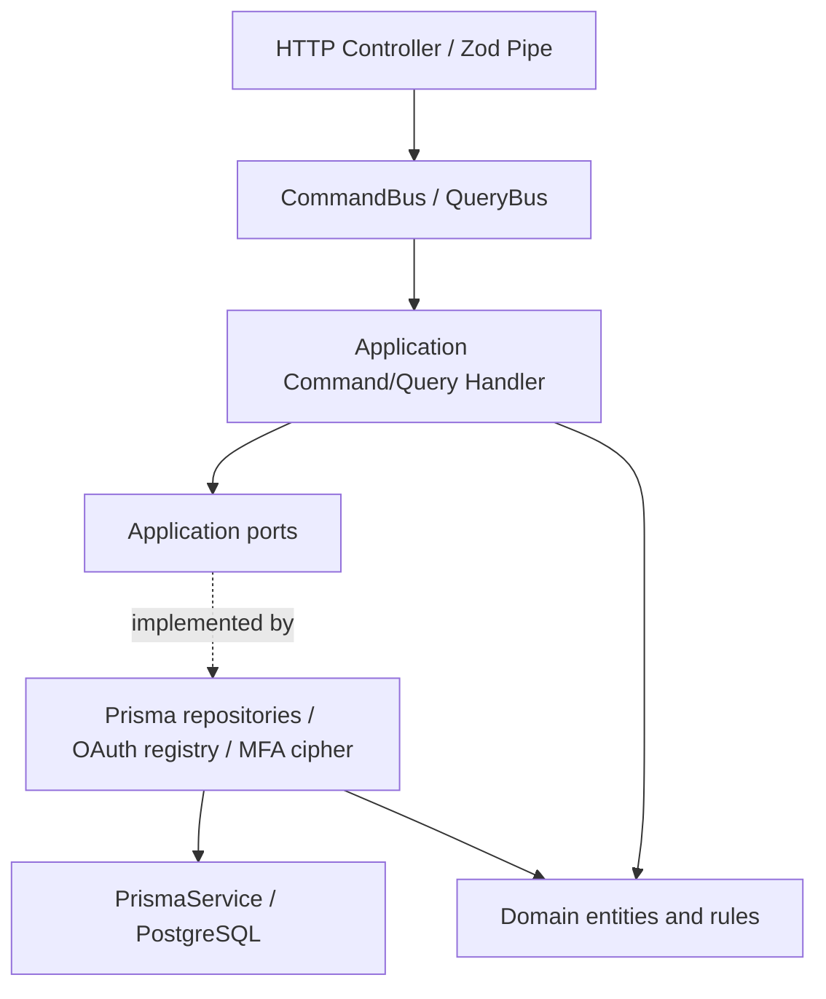
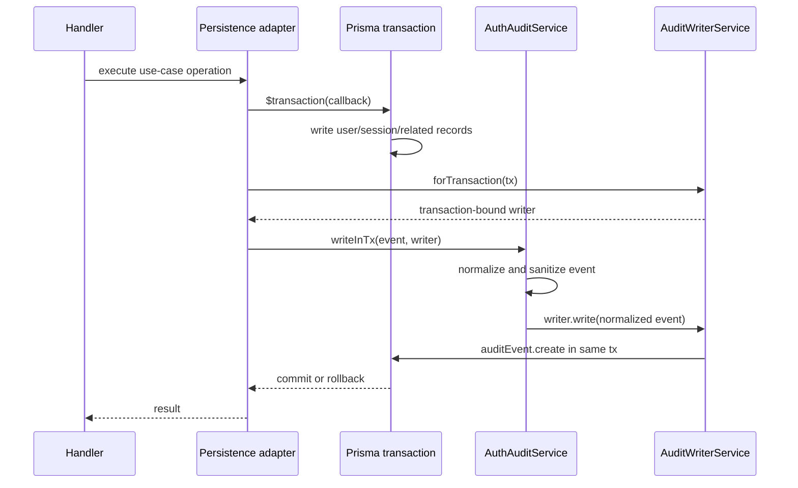

# LCSP Auth — Ports and Adapters

**Scope:** Authentication module and the Admin Account Lifecycle integration.

**Baseline for MFA transactional follow-up:** commit `341b8051a` (2026-10-24).

**Baseline for Auth Error Boundary:** commit `6c82e008a` (2026-10-24).

**Baseline for E2E stabilization:** commit `e80ae0c72` (2026-10-24).

**Status:** implementation in the LCSP-999 refactor branch; not an approval to merge or deploy.

## Architecture

The Auth API continues to use NestJS modules, CQRS command/query handlers,
Domain Entities, and Prisma persistence. Commands and queries depend on
application-facing ports rather than feature-specific infrastructure classes.

### Main ports

| Port                             | Implementation                  | Responsibility                                                              |
| -------------------------------- | ------------------------------- | --------------------------------------------------------------------------- |
| `AUTH_USER_REPOSITORY`           | `PrismaUserRepository`          | User access and scoped account updates                                      |
| `AUTH_SESSION_REPOSITORY`        | `PrismaSessionRepository`       | Session state and owner-checked revocation                                  |
| `AUTH_READ_REPOSITORY`           | `PrismaAuthReadRepository`      | Auth profile, session lists, step-up metadata                               |
| `AUTH_SIGN_UP_PERSISTENCE`       | `PrismaSignUpPersistence`       | Atomic create of user, initial session and audit                            |
| `AUTH_SECURITY_PERSISTENCE`      | `PrismaAuthSecurityPersistence` | Atomic recovery and MFA-disable commands                                    |
| `AUTH_MFA_LIFECYCLE_PERSISTENCE` | `PrismaMfaLifecyclePersistence` | Atomic MFA enrollment, code rotation, OTP/recovery proof and business audit |
| `AUTH_AUDIT_EVENT_WRITER`        | `AuditWriterService`            | Normalized, sanitized event writes                                          |
| `AUTH_MFA_SECRET_CIPHER`         | `MfaSecretCipherService`        | Encryption/decryption of MFA secret; keys remain in infrastructure          |
| `AUTH_OAUTH_PROVIDER_RESOLVER`   | `OAuthProviderRegistry`         | Resolve configured OAuth providers                                          |

Provider tokens are registered in `auth.module.ts` or the auth persistence
provider collection. The application does not import `PrismaService`,
`@prisma/client`, or feature-specific implementation paths.

### Transactional audit boundary

The application audit service does **not** receive `Prisma.TransactionClient`.
The infrastructure writer binds the audit write to the already opened
transaction. A failed audit write rejects the same transaction, preventing
partial success for atomic flows.

### MFA lifecycle transaction and concurrency

The MFA lifecycle port owns these atomic operations:

1. **Enrollment:** Account status and session/access-version are revalidated
   inside a transaction after row locks. TOTP enrollment, failed-attempt reset,
   used-OTP cleanup, conditional first backup batch, and all corresponding
   business audit events commit or roll back together. A stale enrollment
   ciphertext is rejected rather than overwritten.
2. **Recovery-code rotation:** Requires a currently verified session and
   matching verified enrollment. Invalidating old codes, issuing replacements
   and both generation/view audit events share one transaction.
3. **OTP or backup-code verification:** Consumes the OTP (unique lookup key) or
   backup code (conditional one-time update) together with session step-up,
   account MFA flags, rate-limit reset and success audit. Audit failure causes
   the consumed proof and all related state updates to roll back.

Database row lock order is **User → Session**, matching Disable MFA. The
cryptographic verification and code generation work occur before opening a
transaction. API/HTTP failure telemetry may still be recorded separately
after rollback; business audit atomicity does not suppress error logging.

### Repository modules

The compatibility barrel `infrastructure/persistence/prisma-auth.repositories.ts`
continues to re-export the same 10 concrete repository classes. Implementations
are separated into:

- `prisma-user.repository.ts`
- `prisma-session.repository.ts`
- `prisma-mfa.repositories.ts`
- `prisma-recovery.repository.ts`
- `prisma-oauth.repositories.ts`
- `prisma-audit-event.repository.ts`

### Security and OAuth boundaries

- Pure TOTP functions are in `platform/security/totp.utils.ts`.
- Recovery-code generation/normalization is in
  `auth/application/security/mfa-recovery-code.utils.ts`.
- MFA secret encryption and key access remain in infrastructure behind
  `MfaSecretCipher`.
- OAuth handlers use `OAuthProviderResolver`; the Google OAuth implementation
  is unchanged in infrastructure.
- Previous feature-infrastructure utility/module paths remain as compatibility
  exports where required by existing imports and tests.

## Application failure → HTTP boundary

Production files in `auth/application` throw `AuthApplicationError` from
`application/errors/auth-application.error.ts`. This is a framework-free
application error derived from the reusable
`common/errors/application.error.ts` class. It carries a stable shared
error `code`, `correlationId`, optional `requiredAction` and safe `meta`,
and, only when the default shared catalog is insufficient, a semantic
`reason` (not an HTTP status).

The global `HttpExceptionFilter` is the single HTTP adapter for these
errors. It calls the same `problemResult` factory used for existing NestJS
exceptions, keeps the standard `{ ok: false, problem: ... }` envelope and
copies the response correlation metadata for HTTP logging.

| Application reason / default                       | HTTP mapping                                         | Behavior preserved                                     |
| -------------------------------------------------- | ---------------------------------------------------- | ------------------------------------------------------ |
| `resourceAlreadyExists` (duplicate sign-up email)  | 409                                                  | `EMAIL_ALREADY_EXISTS`                                 |
| `resourceNotFound` (owned session missing)         | 404                                                  | `SESSION_INVALID`                                      |
| `authenticationRequired` (profile session missing) | 401                                                  | `SESSION_INVALID`                                      |
| `accessDenied` (suspended account session)         | 403                                                  | `ACCOUNT_SUSPENDED`                                    |
| No explicit reason                                 | Status from shared `PROBLEM_DEFAULTS`, otherwise 400 | Existing auth error catalog                            |
| `TEMPORARY_LOCKED` with metadata                   | 429                                                  | Retry timestamp, retry-after seconds, `wait_and_retry` |

The filter also preserves explicit `requiredAction` overrides and fills an
empty correlation ID using the authenticated request/header/fallback rule.
Zod validation continues to use the existing HTTP pipe and factory.
Other modules' NestJS exceptions and the generic 500 fail-safe are not
converted into Auth application errors.

## Import dependency gate

`scripts/check-import-policy.mjs` rejects production files under
`apps/api/src/modules/auth/application` that import Auth infrastructure,
the Prisma infrastructure directory, the HTTP transport package or
`@prisma/client`, and also prohibits importing NestJS HTTP status/exception
classes into Auth Application code. NestJS DI decorators remain allowed. Test
fixtures are excluded from this additional scoped boundary rule. Intentional
invalid-import probes verified both categories are blocked.

## Cross-module regression: Outbox retry timezones

The repository-wide E2E check exposed a separate bug in
`platform/outbox/outbox.repository.ts`. Prisma stores
`OutboxMessage.nextAttemptAt` as a UTC-valued PostgreSQL
`timestamp without time zone`. Comparing this directly against the
`timestamptz` returned by `NOW()` can make a future retry appear
overdue when PostgreSQL uses a non-UTC timezone.

The pending-batch query now compares against `NOW() AT TIME ZONE 'UTC'`
so both operands have the same timestamp-without-zone interpretation.
An Outbox integration regression test explicitly sets the session timezone
to `Pacific/Auckland`, independent of the test runner's default timezone.

This is a separate Outbox fix, not a change to the Auth API or error contract.

## E2E finalization and regression evidence — 2026-10-24

The investigation used disposable local PostgreSQL databases, not production:

| Validation                                                           | Latest result                                              |
| -------------------------------------------------------------------- | ---------------------------------------------------------- |
| API E2E combined in one Jest process (22 normal suites)              | **187/187 passed**, 3 skipped in the separate opt-in suite |
| Canonical Assessment Read Isolation on its required dedicated target | **3/3 passed**                                             |
| Auth + Sign Up after transport-neutral session persistence error     | **54/54 passed**                                           |
| Account Lifecycle + Admin Role Retirement                            | **18/18 passed**                                           |
| Complete API Jest unit/integration suite (after new session tests)   | **1,030 passed**, 34 skipped; 152 suites passed, 8 skipped |
| Web tests                                                            | **324/324 passed**                                         |
| Outbox retry UTC regression                                          | **5/5 passed**                                             |
| TypeScript, ESLint, Prettier, import/contract checks                 | Passed                                                     |

### Canonical Assessment read-isolation test modernization

`assessment-canonical-read-isolation.e2e-spec.ts` previously expected
`workspace.agent-stream` HTTP SSE messages and the retired
`/workspace/runtime-events/agent-stream-history` HTTP endpoint. The deployed
controller only implements canonical `workspace.runtime` SSE. The modernized
test now verifies:

- The canonical SSE payload only includes data belonging to the authenticated
  owner, even if old query parameters are sent.
- `AssessmentRuntimeEventService.getAgentStreamHistoryPage()` only returns
  persisted agent events for the supplied owner and assessment ID. Cross-owner
  requests return an empty page.
- The retired history URL continues to return 404; it must not be silently
  reintroduced to make the old test pass.
- Unauthorized reads leave authoritative ALS/AES and runtime-event rows
  unchanged.

The same dedicated PostgreSQL database was reached on
`127.0.0.1:55441/lcsp_canonical_read_isolation` and the 3 tests passed.

### Combined-suite stability

Earlier combined E2E runs showed intermittent failures in
`admin-release-gate` (revoking an admin session) and `assessment-list`
(the test expected 8 created assessments but got 7). Both suites passed when
run independently. A subsequent combined run on the disposable database
passed **22/22 suites, 187/187 active tests**. That combined run preceded
the small follow-up change to `PrismaSessionRepository`, which was then
verified independently by Auth + Sign Up (54/54), Account Lifecycle + Role
Retirement (18/18), Admin Release Gate + Assessment List (17/17), and the
complete API unit suite. The whole combined E2E suite has **not been rerun
since** that final session repository change.

Test diagnostics were hardened, without changing API behavior:

- Assessment fixture creation now requires **201 Created** for every seeded
  assessment; failures include the upstream response body rather than
  silently producing a smaller total.
- Admin revocation failure assertions preserve the safe problem response for
  diagnosis. Test-only session tokens now use UUIDs rather than millisecond
  timestamps to prevent avoidable token collisions between runs.

The exact historical intermittent failure was **not reproduced in the final
combined run**; the team should still monitor this in CI. No unverified
backend behavior change was made for these two symptoms.

### Transport-neutral session persistence failure

`PrismaSessionRepository.save()` no longer imports NestJS HTTP status or
`problemException`. Invalid owner and stale/revoked session conditional
writes now throw the shared transport-neutral `ApplicationError` with
`SESSION_INVALID` / `authenticationRequired` semantics. The existing HTTP
exception filter maps it to the same **401** problem contract. Two new unit
tests verify rejection without stale writes, while Auth and Account Lifecycle
E2E pass.

### Test runner maintenance and deliberately skipped tests

- Both API Jest configurations now exclude `<rootDir>/.cache/` and
  `<rootDir>/dist/` from module indexing. This removes the false Haste
  collision from multiple cached Corepack/pnpm package manifests.
- The API unit run included **34 deliberately skipped tests** across **8
  suites**. The codebase uses opt-in environment guards for external provider
  tests and some isolated database integration tests. These are not counted
  as passes; each has to be enabled in a suitable CI/integration environment.
- The full API unit runner was executed with `--forceExit` following
  previously observed Jest non-termination. A diagnostic run using
  `--detectOpenHandles --forceExit` did not enumerate a specific open handle.
  The underlying resource-shutdown issue is not proven resolved.
- Main E2E intentionally skips the dedicated canonical isolation suite due to
  its exact fresh-target guard; it was executed separately and passed.

**Deployment/load verification and remote CI on the final pushed branch have
not been performed in this local refactor.** Treat these as separate release
requirements.

## PR LCSP-999 security remediation — MFA generation and stale session proof (2026-10-24)

**Review basis:** PR exact head `2828d9436`, reviewer decision
`REQUEST_CHANGES`. Two P1 findings described S1 recovery codes accepted after
rotating the TOTP secret to S2, and old S1 MFA/sensitive-action timestamps
remaining active on secondary sessions. Local changes in this section are
**uncommitted** until reviewed; these receipts do not assert PR/CI merge
approval.

### Root cause

- `PrismaMfaLifecyclePersistence.enroll()` previously kept unused backup codes
  when `activeCodeCount > 0`; proof consumption did not bind a recovery code
  to the active TOTP generation. An old C1 credential could authenticate a
  newly issued S2 secret, even before the account verified S2.
- MFA rotation cleared only `User.mfaVerifiedAt`. Session records retained
  `mfaVerifiedAt` and `sensitiveActionVerifiedAt` metadata; the profile,
  sensitive-route and RBAC reads trusted old proof timestamps.
- The RBAC condition required MFA only if the enrollment had a non-null
  `verifiedAt`, allowing password-only access while S2 was pending despite
  the account-level `mfaRequired` policy.
- A ciphertext encrypted with an unavailable key could formerly be overwritten
  from a password-only session. This is not sufficient second-factor recovery
  evidence.

### Fix

- **Version authority:** `User.mfaGenerationId` is a persisted, non-null
  random UUID. It is rotated on each new TOTP enrollment and MFA disable,
  including when MFA becomes disabled, to prevent late writes from resurrecting
  pre-disable sensitive-action proofs.
- **Atomic mutation:** the User row is locked first. The same transaction
  advances generation, replaces TOTP secret, clears OTP replay history,
  revokes the _entire_ previous unused backup-code batch, writes the new
  recovery batch with `metadata.mfaGenerationId`, invalidates all sessions'
  MFA and sensitive-action timestamps using one JSONB update, and commits
  the security audit. The API only returns actually committed backup codes.
- **Proof consumption:** recovery codes are accepted only when both the code's
  generation matches the user and the current TOTP generation has been verified
  with OTP at least once. Successful OTP/recovery writes session metadata with
  its current `mfaGenerationId` atomically; replay protection remains.
- **Read and authorization:** RBAC checks `User.mfaRequired` even when
  enrollment is pending; only explicit `@AllowPendingMfa` endpoints are
  exempt. Profile, session list, sensitive route, guard, and application
  handlers use active-generation proof identity. `SessionRepository.save()`
  refuses stale proof writes after the generation changes; session revocation
  can still succeed without overwriting newer proof metadata.
- **Disable:** all sessions lose MFA and sensitive-action proofs when MFA is
  disabled, not just the caller. Sessions themselves remain active so a user
  can complete login/re-authentication safely with MFA no longer enabled.
- **Single write authority:** removed unused direct MFA enrollment, OTP-use
  and recovery-code mutator ports/adapters. Credential lifecycle writes go
  through the locked transactional MFA port.
- **Fail closed for key loss:** a password-only session may not replace an
  undecryptable existing MFA ciphertext. Account recovery under key loss
  requires a separately authorized, audited support process; the former
  automatic fallback must not be reinstated.

### Database rollout

Migration:
`apps/api/prisma/migrations/20261024220000_auth_mfa_proof_generation/migration.sql`

It adds the non-null User generation with a database-side
`gen_random_uuid()::text` default and backfills generation metadata to
existing SESSION/MFA_RECOVERY_CODE AuthRecord rows. This retains the proof
generation of existing users during rollout, rather than immediately invalidating
all their current sessions/codes. PostgreSQL 13+ provides
`gen_random_uuid()`. The schema must be migrated **before** serving code
that requires the new column; coordinate rollout so older application
instances do not issue new unversioned proofs after migration. Production
migration duration/locking on large AuthRecord tables has not been
benchmarked.

A dedicated disposable PostgreSQL clone was created, the generated column
was removed to simulate the pre-migration schema, an active User + SESSION +
MFA_RECOVERY_CODE fixture was inserted, and the migration executed. The result
was `UPDATE 2` with both records mapped to the new User generation and the
old code batchId preserved. No production data was touched.

### Regression and acceptance evidence

- Auth E2E: **53/53 passed**, including multi-session A/B/C proof invalidation,
  C1 rejection after S1→S2, new C2 usability only after S2 TOTP verification,
  pending MFA RBAC fail-closed, read-model and sensitive-route authorization,
  concurrent rotation (one winner), disable across all sessions, and rotation
  audit-failure rollback.
- Complete API Jest suite: **1,035 passed**, 34 skipped (8 suites), including
  new stale session proof/reauthentication writes and safe revocation tests.
- Repository-wide E2E combined: **192 passed**, 3 intentionally skipped in
  the separately configured Canonical Read Isolation suite (23 suites pass).
  This includes the new migration backfill E2E test.
- Typecheck, import policy, contract policy and business logic docs checker
  pass on the local branch. CI/CodeQL have not yet run on the uncommitted
  remediation.
- Intentional negative-path audit injection tests emit expected `500`
  logs while verifying transaction rollback; their assertions pass.

**Policy change:** backup recovery codes are issued at enrollment but unusable
until a TOTP OTP for that generation is successfully verified. This disallows
using a newly issued backup code as the _first_ proof of the new authenticator.
The separate audited recovery process for an irrecoverably lost/undecryptable
factor is an availability follow-up, not grounds to weaken MFA rotation.

### Additional release-gate stabilization receipt

These checks were performed on the same uncommitted MFA remediation working
tree on 2026-10-24, against **disposable loopback PostgreSQL only**:

- **Clean installation:** created an empty task-owned
  `lcsp_mfa_release_gate_20261024` database on `127.0.0.1:55439` and
  successfully ran `prisma migrate deploy` across all **110** migrations.
  `prisma migrate status` reports the schema up to date, and
  `prisma validate` passes. No application or production database was reset.
- **Legacy account upgrade:** seeded three pre-generation AuthRecord fixtures
  (two sessions and one recovery code), removed the new generation column
  **only in the task-owned test database**, reran the new migration SQL, and
  verified all three rows acquired their owner's generation without losing
  the prior timestamps, code batch or unrelated session metadata.
- **Permanent regression:** added
  `test/mfa-generation-migration.e2e-spec.ts`, which executes the actual
  migration SQL against transaction-local TEMP tables. It asserts unique
  generation IDs for separate owners, verifies older verified/pending session
  and recovery-code backfill, and confirms an unrelated
  `RECOVERY_REQUEST` remains untouched. The test transaction rolls back
  without modifying persistent application tables.
- **Assessment test determinism:** the SQL-parity test previously reported
  51 changes instead of 52. PostgreSQL default timestamps can have
  sub-millisecond precision while JavaScript's `Date` is millisecond-granular,
  allowing a supposed newer snapshot to sort before its pinned predecessor.
  Its fixture now makes the pinned snapshot explicitly older; the full
  SQL-parity suite passes **24/24**. No Assessment production query was
  modified.
- **E2E teardown hygiene:** removed a duplicated `afterAll` in the
  Legal Source E2E and restored the worker key after the test suite. Added
  failure-body diagnostics to Billing and Legal HTTP status assertions.
  These changes improve isolation/diagnostics but do not prove the precise
  historical intermittent HTTP failures were caused by those test fixtures.
- **Latest full runs:** API E2E **192/192 active tests**, 3 opt-in skipped
  (23 suites passed); complete API unit/integration **1,035/1,035 active
  tests**, 34 skipped (152 suites passed); Web tests **324/324 passed**.
  TypeScript, ESLint on changed API source/tests, Prettier, Prisma
  validation, import/contract/legacy checks, and business-docs gate pass.

**Still pending:** push a focused commit, run CI checks on that exact new
commit, request security reviewer re-evaluation, validate staged deployment
and rollback behavior, and independently investigate the pre-existing
`pg` concurrent-query deprecation and Jest open handles. Passing local
checks does not by itself close the external `REQUEST_CHANGES` review.

## PR LCSP-999 sign-up generation parity P1 — re-review remediation (2026-10-25)

**Review basis:** commit `65efae5d7fecc099304d82987d57f1e858d2aaaf`.
Reviewer confirmed the two earlier MFA rotation security findings and the
generation migration as fixed, but reported **REQUEST_CHANGES** because the
initial sign-up session could not complete password reauthentication.

### Root cause

- `SignUpHandler.execute()` constructs a `User` with a freshly generated
  `mfaGenerationId`, then creates the initial `Session` without that field.
- `PrismaSignUpPersistence.createWithSessionAndAudit()` left the User
  `mfaGenerationId` to PostgreSQL's separate `gen_random_uuid()` default
  and omitted generation metadata from its session `AuthRecord` insert.
- `ReauthenticatePasswordHandler.execute()` correctly creates sensitive-action
  proof only after password verification, but
  `PrismaSessionRepository.save()` correctly rejects an elevated session if
  its generation is missing or mismatched. Thus a freshly signed-up session
  received `SESSION_INVALID` even with the correct password.

### Fix

- The sign-up handler now constructs the first `Session` using the exact
  `user.mfaGenerationId` created by its new `User` entity.
- The sign-up persistence adapter explicitly writes
  `mfaGenerationId: user.mfaGenerationId` to the new User row and
  `mfaGenerationId: session.mfaGenerationId` to session metadata in the
  **existing atomic User + Session + security audit transaction**.
- The persistence adapter checks both session ownership and generation
  equality before opening a transaction. Invalid input cannot create a
  mismatched account/session pair; it does not weaken existing stale-generation
  rejection in `PrismaSessionRepository`, RBAC or MFA proof verification.
- All touched business functions have the shared five-section business logic
  documentation immediately before the implementation.

### Regression evidence

The new database-backed tests were verified **red before the production fix**
(two sign-up E2E failures: missing session generation and valid-password
reauthentication returning HTTP 401) and **green after the fix**:

- Existing sign-up persistence E2E now checks that the initial AuthRecord
  metadata generation equals the freshly persisted User generation.
- New real-HTTP sign-up E2E follows sign-up → profile → forbidden sensitive
  action before step-up → password re-authentication → sensitive-route check
  → authorized sensitive GitHub repository-discovery route (HTTP 200).
  Only the external GitHub provider is mocked; RBAC, sensitive-action
  policy, actual command execution and audit writes are exercised.
- Two focused persistence unit tests reject mismatched account/session
  generation and a wrong session owner **before any transaction starts**.
- Focused Auth + Sign Up E2E **59/59 passed**, covering the existing S1→S2
  stale-session-proof and recovery-code generation security scenarios.
- Full API Jest unit/integration **1,037 passed**, 34 opt-in skipped,
  including both new repository-invariant unit tests.
- Web regression tests **324/324 passed**; TypeScript, changed-source
  ESLint/Prettier, import, contract and business-documentation checks passed.
- Initial combined API E2E had **192 passed, 1 failed, 3 opt-in skipped**:
  the unrelated Billing Admin seven-day trend reported zero although its
  settled-revenue aggregate returned 100000. This failure was reproducible in
  isolation. **This was the historical result before the follow-up Billing
  fix described below; it is no longer the latest full E2E outcome.**

**Remaining merge conditions:** commit and push the focused sign-up and Billing
fixes (prefer separate commits), run exact-head CI, and request security
reviewer approval. Passing local tests does not supersede PR review.

## Billing Admin UTC daily revenue regression — 2026-10-25

### Root cause

The Billing Admin dashboard's daily trend SQL used
`date_trunc('day', "creditedAt" AT TIME ZONE 'UTC')`, although
`BillingOrder.creditedAt` is already a UTC-valued PostgreSQL
`timestamp without time zone`. The extra conversion changes the
expression into a `timestamptz` that is grouped using the
**PostgreSQL session timezone**, not the intended UTC calendar date.
The `@prisma/adapter-pg` date decoder then exposes the shifted day
to JavaScript. At `2026-10-24T17:51Z` on a server with
`Asia/Ho_Chi_Minh` timezone, the existing SQL returned an ISO
date of `2026-10-25`. The dashboard's current seven-day UTC window
ended on October 24, causing all daily buckets to report zero despite
the correct settled total of 100000 minor units.

### Fix

`GetBillingAdminDashboardHandler.getSettledTopUpTrend()` now groups
using `("creditedAt"::date)::text`. This reads the UTC calendar
date already stored in the column as stable `YYYY-MM-DD` text,
without creating a time-zone-aware instant or relying on a driver
timestamp conversion. The status filter, time bounds, sum of
`amountMinorUnits` and seven-day zero-filled response remain
unchanged. Both `execute()` and the internal trend query are
documented using the repository's five-section business-logic
comment convention.

### Regression and release evidence

- **Red before fix:** the real Billing E2E expected 100000 settled
  credits in the seven-day trend but observed zero. An isolated
  diagnostic confirmed the row was present and assigned to the
  wrong calendar date by the old `AT TIME ZONE` query.
- **Green after fix:** all **7/7 Billing Admin E2E** tests pass,
  including a new transaction-scoped regression test that sets
  PostgreSQL's timezone to `Asia/Ho_Chi_Minh`,
  `America/Los_Angeles` and `UTC`. Fixtures deliberately
  exercise both sides of midnight UTC and verify the _exact_
  nonzero day as well as the aggregate. `SET LOCAL` is scoped
  to the test transaction, not shared server state.
- **Full API E2E:** **194 active tests passed, 3 opt-in skipped**
  (23 suites pass). Includes the new Billing scenario and
  existing Auth MFA-generation, sign-up, migration, Legal,
  Assessment and Outbox tests. A separate streaming-process run
  stalled with no completed result; the bounded direct rerun
  completed successfully. Do not count the stalled run as a pass.
- **Full API unit/integration:** **1,037 active tests passed,
  34 opt-in skipped** (153 suites pass). A subsequent
  `--detectOpenHandles` run completed **without** `--forceExit`,
  with no open handles reported; the earlier force-exit warning
  is not currently reproducible as a resource leak.
- **Web:** **324/324 tests passed**.
- **Checks:** TypeScript build, changed Billing source/test ESLint,
  Prettier, import/contract policy, documentation policy and
  `git diff --check` passed.

A separate `pg` deprecation warning remains: tracing it in the
Assessment Create E2E shows it originates at
`pg@8.22.0 Client.query` via
`@prisma/adapter-pg@7.8.0 PgTransaction.performIO`.
It does not represent a test assertion failure; changing the
vendor adapter/driver inside an Auth/Billing safety patch is
not justified without its own upgrade/regression testing.
Monitor it before adopting `pg@9`, which removes support
for concurrent queries on a busy client.

**External acceptance still pending:** commit/push the fixes,
run remote CI on the exact commit and request an updated PR
security review. This section reports local execution only.

## Remaining technical considerations

1. Auth Application and session persistence no longer import the HTTP problem
   factory. Validate the same error contract in the deployment CI pipeline
   before merging the branch.
2. Failed MFA attempts intentionally update rate limits and emit rejection
   audit events outside a successful proof transaction. Their failure-path
   policy should be reviewed separately for availability under audit outages,
   rather than resetting security controls as part of this change.
3. Deprecated import facades should remain until all consuming modules are
   migrated and tests prove they can be removed safely.

## PR #430 follow-up: MFA reauthentication proof semantics and lost-MFA UX resolution (2026-10-28)

**Review baseline:** merge commit `c828878eb8dd32c75c8866285b2774a58f9a6c03` / PR #430 (`LCSP-999`).

### Product and security policy decision

**Strict 2FA policy:**
1. A pending-MFA session (e.g. after password sign-in or Google OAuth login) cannot reset or rebind MFA using password reauthentication alone. Allowing password-only rebind for pending-MFA sessions would enable an attacker with a compromised password to bypass the second factor entirely.
2. A user who loses their primary authenticator (TOTP) must use an issued recovery code to verify their second factor, or have an existing active session with verified second factor (`mfaVerifiedAt`).
3. For already-MFA-verified sessions, sensitive operations (re-enrolling/replacing MFA via `POST /auth/mfa/enroll` or disabling MFA via `DELETE /auth/mfa`) require fresh password re-authentication (`@ReAuthForSensitiveRoute`, TTL 5 minutes) to protect against unattended session hijacking.
4. Abandoned initial/replacement enrollments (`mfaVerifiedAt === null`) are safe to restart without prior factor proof, preventing accounts from being stranded when setup is interrupted before the first OTP is verified.

### Root causes and remediation

1. **RC-1 (Inconsistent proof semantics between password re-auth and MFA replacement):**
   - *Problem:* `POST /auth/re-auth/password` wrote `sensitiveActionVerifiedAt` to session metadata, but `EnrollMfaHandler` and `PrismaMfaLifecyclePersistence.enroll` only checked `mfaVerifiedAt` and exact generation. Conversely, `DELETE /auth/mfa` and `POST /auth/mfa/enroll` lacked sensitive route protection, allowing replacement without fresh password proof.
   - *Resolution:* Added `Session.isSensitiveActionVerified(now, currentGenerationId)` checking fresh password re-auth (5-minute TTL). Both `EnrollMfaHandler` and the database transaction in `PrismaMfaLifecyclePersistence.enroll` enforce that replacing an existing verified MFA factor requires BOTH active MFA verification (`isMfaVerified`) AND fresh password reauthentication (`isSensitiveActionVerified`). If missing/expired, returns `AUTH_ERROR_CODES.reauthRequired` with `REQUIRED_ACTIONS.reauthRequired`. Added `@ReAuthForSensitiveRoute` to `DELETE /auth/mfa` and enforced fresh sensitive proof in `disableMfa` transaction.

2. **RC-2 (Verify ↔ enroll bounce and stranded setups):**
   - *Problem:* `VerifyMfaOtpHandler` threw `mfaRequired` on secret decryption failure, causing web verify to navigate to `/mfa/enroll`, while web enroll redirected back to `/mfa/verify` on `mfaRequired`. Furthermore, `PrismaMfaLifecyclePersistence.enroll` rejected any enrollment if `user.mfaVerifiedAt === null`, permanently locking abandoned setups.
   - *Resolution:* `VerifyMfaOtpHandler` returns `AUTH_ERROR_CODES.mfaInvalid` with `REQUIRED_ACTIONS.retryRecovery` when ciphertext decryption fails, prompting the user directly to use a recovery code instead of bouncing. `EnrollMfaHandler` and `PrismaMfaLifecyclePersistence.enroll` permit unverified/abandoned enrollments (`user.mfaVerifiedAt === null`) to restart without requiring factor proof. On the web frontend (`mfa-verify-form.tsx`), interactive state allows toggling between TOTP and recovery code in place on the same screen, and error outcomes render actionable inline alerts rather than redirect bounces.

3. **RC-3 (OAuth MFA funnel unification):**
   - *Problem:* Google OAuth sign-in projects `mfa_required: true` and routes to `/mfa/verify`, but provided no unified factor recovery path if the authenticator was lost.
   - *Resolution:* Preserved invariant that OAuth claims do not satisfy second factor possession. Unified the recovery path on the `/mfa/verify` screen, enabling users to switch directly to recovery code entry or access actionable support guidance without dead ends.

4. **RC-4 (Auth HTTP error boundary simplification):**
   - *Problem:* Duplicate `ApplicationError` hierarchy bypassed canonical `problemException` options and status overrides outside the configured HTTP filter.
   - *Resolution:* Simplified `AuthApplicationError` to extend `HttpException` directly wrapping `problemException` while preserving reason-to-status resolution (e.g., `resourceNotFound` -> 404). Aligned import policy in `scripts/check-import-policy.mjs` and verified standard problem envelopes, error codes, and correlation IDs across all Auth endpoints.
