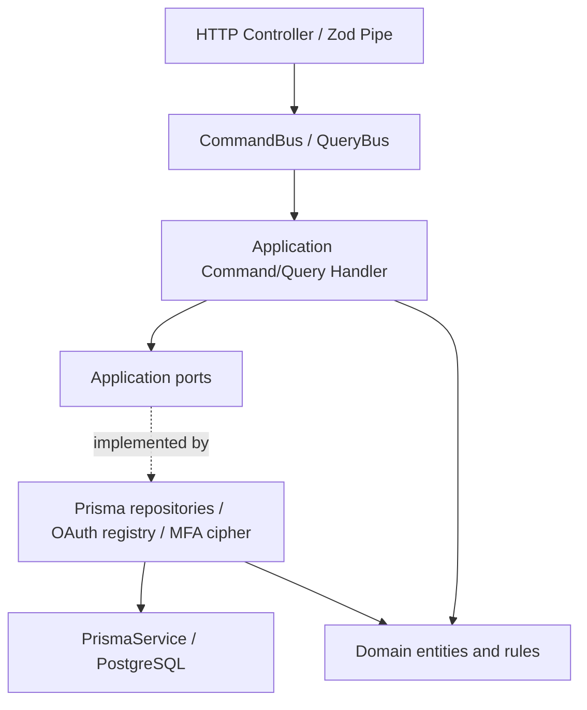
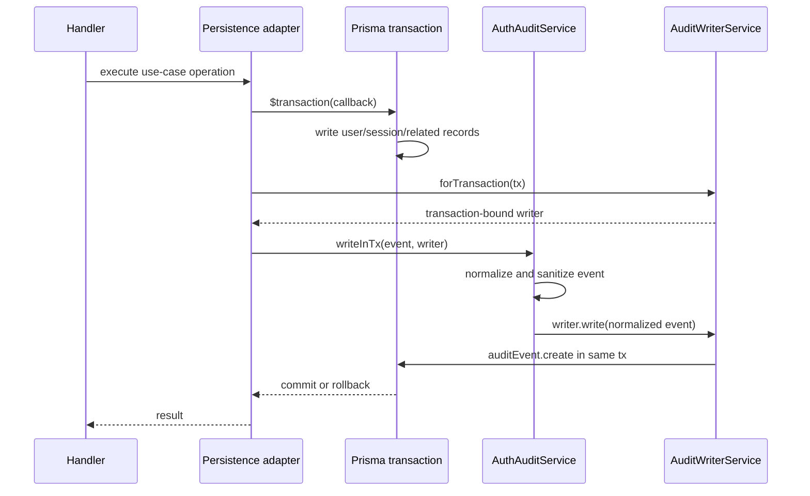

# LCSP Auth — Ports and Adapters

**Scope:** Authentication module and the Admin Account Lifecycle integration.

**Baseline for MFA transactional follow-up:** commit `341b8051a` (2026-10-24).

**Baseline for Auth Error Boundary:** commit `6c82e008a` (2026-10-24).

**Baseline for E2E stabilization:** commit `e80ae0c72` (2026-10-24).

**Status:** implementation in the LCSP-999 refactor branch; not an approval to merge or deploy.

## Architecture

The Auth API continues to use NestJS modules, CQRS command/query handlers,
Domain Entities, and Prisma persistence. Commands and queries depend on
application-facing ports rather than feature-specific infrastructure classes.

### Main ports

| Port                             | Implementation                  | Responsibility                                                              |
| -------------------------------- | ------------------------------- | --------------------------------------------------------------------------- |
| `AUTH_USER_REPOSITORY`           | `PrismaUserRepository`          | User access and scoped account updates                                      |
| `AUTH_SESSION_REPOSITORY`        | `PrismaSessionRepository`       | Session state and owner-checked revocation                                  |
| `AUTH_READ_REPOSITORY`           | `PrismaAuthReadRepository`      | Auth profile, session lists, step-up metadata                               |
| `AUTH_SIGN_UP_PERSISTENCE`       | `PrismaSignUpPersistence`       | Atomic create of user, initial session and audit                            |
| `AUTH_SECURITY_PERSISTENCE`      | `PrismaAuthSecurityPersistence` | Atomic recovery and MFA-disable commands                                    |
| `AUTH_MFA_LIFECYCLE_PERSISTENCE` | `PrismaMfaLifecyclePersistence` | Atomic MFA enrollment, code rotation, OTP/recovery proof and business audit |
| `AUTH_AUDIT_EVENT_WRITER`        | `AuditWriterService`            | Normalized, sanitized event writes                                          |
| `AUTH_MFA_SECRET_CIPHER`         | `MfaSecretCipherService`        | Encryption/decryption of MFA secret; keys remain in infrastructure          |
| `AUTH_OAUTH_PROVIDER_RESOLVER`   | `OAuthProviderRegistry`         | Resolve configured OAuth providers                                          |

Provider tokens are registered in `auth.module.ts` or the auth persistence
provider collection. The application does not import `PrismaService`,
`@prisma/client`, or feature-specific implementation paths.

### Transactional audit boundary

The application audit service does **not** receive `Prisma.TransactionClient`.
The infrastructure writer binds the audit write to the already opened
transaction. A failed audit write rejects the same transaction, preventing
partial success for atomic flows.

### MFA lifecycle transaction and concurrency

The MFA lifecycle port owns these atomic operations:

1. **Enrollment:** Account status and session/access-version are revalidated
   inside a transaction after row locks. TOTP enrollment, failed-attempt reset,
   used-OTP cleanup, conditional first backup batch, and all corresponding
   business audit events commit or roll back together. A stale enrollment
   ciphertext is rejected rather than overwritten.
2. **Recovery-code rotation:** Requires a currently verified session and
   matching verified enrollment. Invalidating old codes, issuing replacements
   and both generation/view audit events share one transaction.
3. **OTP or backup-code verification:** Consumes the OTP (unique lookup key) or
   backup code (conditional one-time update) together with session step-up,
   account MFA flags, rate-limit reset and success audit. Audit failure causes
   the consumed proof and all related state updates to roll back.

Database row lock order is **User → Session**, matching Disable MFA. The
cryptographic verification and code generation work occur before opening a
transaction. API/HTTP failure telemetry may still be recorded separately
after rollback; business audit atomicity does not suppress error logging.

### Repository modules

The compatibility barrel `infrastructure/persistence/prisma-auth.repositories.ts`
continues to re-export the same 10 concrete repository classes. Implementations
are separated into:

- `prisma-user.repository.ts`
- `prisma-session.repository.ts`
- `prisma-mfa.repositories.ts`
- `prisma-recovery.repository.ts`
- `prisma-oauth.repositories.ts`
- `prisma-audit-event.repository.ts`

### Security and OAuth boundaries

- Pure TOTP functions are in `platform/security/totp.utils.ts`.
- Recovery-code generation/normalization is in
  `auth/application/security/mfa-recovery-code.utils.ts`.
- MFA secret encryption and key access remain in infrastructure behind
  `MfaSecretCipher`.
- OAuth handlers use `OAuthProviderResolver`; the Google OAuth implementation
  is unchanged in infrastructure.
- Previous feature-infrastructure utility/module paths remain as compatibility
  exports where required by existing imports and tests.

## Application failure → HTTP boundary

Production files in `auth/application` throw `AuthApplicationError` from
`application/errors/auth-application.error.ts`. This is a framework-free
application error derived from the reusable
`common/errors/application.error.ts` class. It carries a stable shared
error `code`, `correlationId`, optional `requiredAction` and safe `meta`,
and, only when the default shared catalog is insufficient, a semantic
`reason` (not an HTTP status).

The global `HttpExceptionFilter` is the single HTTP adapter for these
errors. It calls the same `problemResult` factory used for existing NestJS
exceptions, keeps the standard `{ ok: false, problem: ... }` envelope and
copies the response correlation metadata for HTTP logging.

| Application reason / default                       | HTTP mapping                                         | Behavior preserved                                     |
| -------------------------------------------------- | ---------------------------------------------------- | ------------------------------------------------------ |
| `resourceAlreadyExists` (duplicate sign-up email)  | 409                                                  | `EMAIL_ALREADY_EXISTS`                                 |
| `resourceNotFound` (owned session missing)         | 404                                                  | `SESSION_INVALID`                                      |
| `authenticationRequired` (profile session missing) | 401                                                  | `SESSION_INVALID`                                      |
| `accessDenied` (suspended account session)         | 403                                                  | `ACCOUNT_SUSPENDED`                                    |
| No explicit reason                                 | Status from shared `PROBLEM_DEFAULTS`, otherwise 400 | Existing auth error catalog                            |
| `TEMPORARY_LOCKED` with metadata                   | 429                                                  | Retry timestamp, retry-after seconds, `wait_and_retry` |

The filter also preserves explicit `requiredAction` overrides and fills an
empty correlation ID using the authenticated request/header/fallback rule.
Zod validation continues to use the existing HTTP pipe and factory.
Other modules' NestJS exceptions and the generic 500 fail-safe are not
converted into Auth application errors.

## Import dependency gate

`scripts/check-import-policy.mjs` rejects production files under
`apps/api/src/modules/auth/application` that import Auth infrastructure,
the Prisma infrastructure directory, the HTTP transport package or
`@prisma/client`, and also prohibits importing NestJS HTTP status/exception
classes into Auth Application code. NestJS DI decorators remain allowed. Test
fixtures are excluded from this additional scoped boundary rule. Intentional
invalid-import probes verified both categories are blocked.

## Cross-module regression: Outbox retry timezones

The repository-wide E2E check exposed a separate bug in
`platform/outbox/outbox.repository.ts`. Prisma stores
`OutboxMessage.nextAttemptAt` as a UTC-valued PostgreSQL
`timestamp without time zone`. Comparing this directly against the
`timestamptz` returned by `NOW()` can make a future retry appear
overdue when PostgreSQL uses a non-UTC timezone.

The pending-batch query now compares against `NOW() AT TIME ZONE 'UTC'`
so both operands have the same timestamp-without-zone interpretation.
An Outbox integration regression test explicitly sets the session timezone
to `Pacific/Auckland`, independent of the test runner's default timezone.

This is a separate Outbox fix, not a change to the Auth API or error contract.

## E2E finalization and regression evidence — 2026-10-24

The investigation used disposable local PostgreSQL databases, not production:

| Validation                                                           | Latest result                                              |
| -------------------------------------------------------------------- | ---------------------------------------------------------- |
| API E2E combined in one Jest process (22 normal suites)              | **187/187 passed**, 3 skipped in the separate opt-in suite |
| Canonical Assessment Read Isolation on its required dedicated target | **3/3 passed**                                             |
| Auth + Sign Up after transport-neutral session persistence error     | **54/54 passed**                                           |
| Account Lifecycle + Admin Role Retirement                            | **18/18 passed**                                           |
| Complete API Jest unit/integration suite (after new session tests)   | **1,030 passed**, 34 skipped; 152 suites passed, 8 skipped |
| Web tests                                                            | **324/324 passed**                                         |
| Outbox retry UTC regression                                          | **5/5 passed**                                             |
| TypeScript, ESLint, Prettier, import/contract checks                 | Passed                                                     |

### Canonical Assessment read-isolation test modernization

`assessment-canonical-read-isolation.e2e-spec.ts` previously expected
`workspace.agent-stream` HTTP SSE messages and the retired
`/workspace/runtime-events/agent-stream-history` HTTP endpoint. The deployed
controller only implements canonical `workspace.runtime` SSE. The modernized
test now verifies:

- The canonical SSE payload only includes data belonging to the authenticated
  owner, even if old query parameters are sent.
- `AssessmentRuntimeEventService.getAgentStreamHistoryPage()` only returns
  persisted agent events for the supplied owner and assessment ID. Cross-owner
  requests return an empty page.
- The retired history URL continues to return 404; it must not be silently
  reintroduced to make the old test pass.
- Unauthorized reads leave authoritative ALS/AES and runtime-event rows
  unchanged.

The same dedicated PostgreSQL database was reached on
`127.0.0.1:55441/lcsp_canonical_read_isolation` and the 3 tests passed.

### Combined-suite stability

Earlier combined E2E runs showed intermittent failures in
`admin-release-gate` (revoking an admin session) and `assessment-list`
(the test expected 8 created assessments but got 7). Both suites passed when
run independently. A subsequent combined run on the disposable database
passed **22/22 suites, 187/187 active tests**. That combined run preceded
the small follow-up change to `PrismaSessionRepository`, which was then
verified independently by Auth + Sign Up (54/54), Account Lifecycle + Role
Retirement (18/18), Admin Release Gate + Assessment List (17/17), and the
complete API unit suite. The whole combined E2E suite has **not been rerun
since** that final session repository change.

Test diagnostics were hardened, without changing API behavior:

- Assessment fixture creation now requires **201 Created** for every seeded
  assessment; failures include the upstream response body rather than
  silently producing a smaller total.
- Admin revocation failure assertions preserve the safe problem response for
  diagnosis. Test-only session tokens now use UUIDs rather than millisecond
  timestamps to prevent avoidable token collisions between runs.

The exact historical intermittent failure was **not reproduced in the final
combined run**; the team should still monitor this in CI. No unverified
backend behavior change was made for these two symptoms.

### Transport-neutral session persistence failure

`PrismaSessionRepository.save()` no longer imports NestJS HTTP status or
`problemException`. Invalid owner and stale/revoked session conditional
writes now throw the shared transport-neutral `ApplicationError` with
`SESSION_INVALID` / `authenticationRequired` semantics. The existing HTTP
exception filter maps it to the same **401** problem contract. Two new unit
tests verify rejection without stale writes, while Auth and Account Lifecycle
E2E pass.

### Test runner maintenance and deliberately skipped tests

- Both API Jest configurations now exclude `<rootDir>/.cache/` and
  `<rootDir>/dist/` from module indexing. This removes the false Haste
  collision from multiple cached Corepack/pnpm package manifests.
- The API unit run included **34 deliberately skipped tests** across **8
  suites**. The codebase uses opt-in environment guards for external provider
  tests and some isolated database integration tests. These are not counted
  as passes; each has to be enabled in a suitable CI/integration environment.
- The full API unit runner was executed with `--forceExit` following
  previously observed Jest non-termination. A diagnostic run using
  `--detectOpenHandles --forceExit` did not enumerate a specific open handle.
  The underlying resource-shutdown issue is not proven resolved.
- Main E2E intentionally skips the dedicated canonical isolation suite due to
  its exact fresh-target guard; it was executed separately and passed.

**Deployment/load verification and remote CI on the final pushed branch have
not been performed in this local refactor.** Treat these as separate release
requirements.

## Remaining technical considerations

1. Auth Application and session persistence no longer import the HTTP problem
   factory. Validate the same error contract in the deployment CI pipeline
   before merging the branch.
2. Failed MFA attempts intentionally update rate limits and emit rejection
   audit events outside a successful proof transaction. Their failure-path
   policy should be reviewed separately for availability under audit outages,
   rather than resetting security controls as part of this change.
3. Deprecated import facades should remain until all consuming modules are
   migrated and tests prove they can be removed safely.
