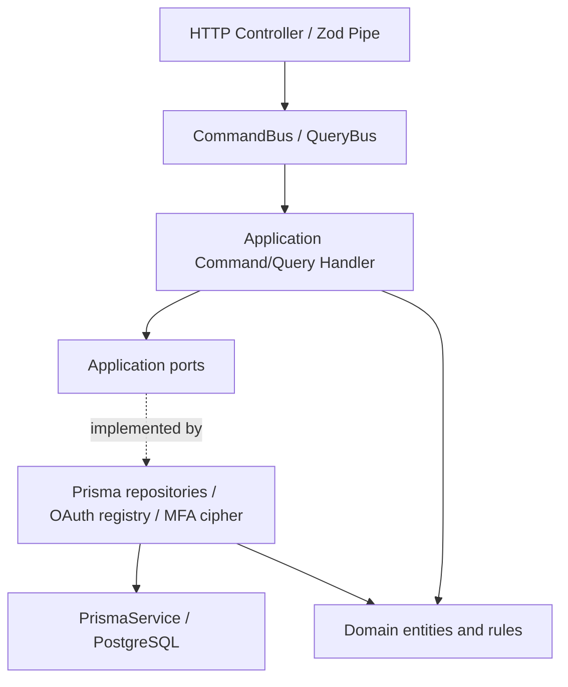
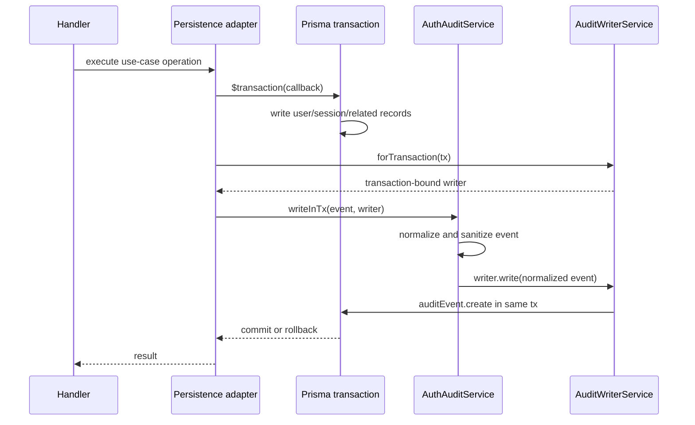

# LCSP Auth — Ports and Adapters

**Scope:** Authentication module and the Admin Account Lifecycle integration.

**Baseline for MFA transactional follow-up:** commit `341b8051a` (2026-10-24).

**Status:** implementation in the LCSP-999 refactor branch; not an approval to merge or deploy.

## Architecture

The Auth API continues to use NestJS modules, CQRS command/query handlers,
Domain Entities, and Prisma persistence. Commands and queries depend on
application-facing ports rather than feature-specific infrastructure classes.

### Main ports

| Port                             | Implementation                  | Responsibility                                                              |
| -------------------------------- | ------------------------------- | --------------------------------------------------------------------------- |
| `AUTH_USER_REPOSITORY`           | `PrismaUserRepository`          | User access and scoped account updates                                      |
| `AUTH_SESSION_REPOSITORY`        | `PrismaSessionRepository`       | Session state and owner-checked revocation                                  |
| `AUTH_READ_REPOSITORY`           | `PrismaAuthReadRepository`      | Auth profile, session lists, step-up metadata                               |
| `AUTH_SIGN_UP_PERSISTENCE`       | `PrismaSignUpPersistence`       | Atomic create of user, initial session and audit                            |
| `AUTH_SECURITY_PERSISTENCE`      | `PrismaAuthSecurityPersistence` | Atomic recovery and MFA-disable commands                                    |
| `AUTH_MFA_LIFECYCLE_PERSISTENCE` | `PrismaMfaLifecyclePersistence` | Atomic MFA enrollment, code rotation, OTP/recovery proof and business audit |
| `AUTH_AUDIT_EVENT_WRITER`        | `AuditWriterService`            | Normalized, sanitized event writes                                          |
| `AUTH_MFA_SECRET_CIPHER`         | `MfaSecretCipherService`        | Encryption/decryption of MFA secret; keys remain in infrastructure          |
| `AUTH_OAUTH_PROVIDER_RESOLVER`   | `OAuthProviderRegistry`         | Resolve configured OAuth providers                                          |

Provider tokens are registered in `auth.module.ts` or the auth persistence
provider collection. The application does not import `PrismaService`,
`@prisma/client`, or feature-specific implementation paths.

### Transactional audit boundary

The application audit service does **not** receive `Prisma.TransactionClient`.
The infrastructure writer binds the audit write to the already opened
transaction. A failed audit write rejects the same transaction, preventing
partial success for atomic flows.

### MFA lifecycle transaction and concurrency

The MFA lifecycle port owns these atomic operations:

1. **Enrollment:** Account status and session/access-version are revalidated
   inside a transaction after row locks. TOTP enrollment, failed-attempt reset,
   used-OTP cleanup, conditional first backup batch, and all corresponding
   business audit events commit or roll back together. A stale enrollment
   ciphertext is rejected rather than overwritten.
2. **Recovery-code rotation:** Requires a currently verified session and
   matching verified enrollment. Invalidating old codes, issuing replacements
   and both generation/view audit events share one transaction.
3. **OTP or backup-code verification:** Consumes the OTP (unique lookup key) or
   backup code (conditional one-time update) together with session step-up,
   account MFA flags, rate-limit reset and success audit. Audit failure causes
   the consumed proof and all related state updates to roll back.

Database row lock order is **User → Session**, matching Disable MFA. The
cryptographic verification and code generation work occur before opening a
transaction. API/HTTP failure telemetry may still be recorded separately
after rollback; business audit atomicity does not suppress error logging.

### Repository modules

The compatibility barrel `infrastructure/persistence/prisma-auth.repositories.ts`
continues to re-export the same 10 concrete repository classes. Implementations
are separated into:

- `prisma-user.repository.ts`
- `prisma-session.repository.ts`
- `prisma-mfa.repositories.ts`
- `prisma-recovery.repository.ts`
- `prisma-oauth.repositories.ts`
- `prisma-audit-event.repository.ts`

### Security and OAuth boundaries

- Pure TOTP functions are in `platform/security/totp.utils.ts`.
- Recovery-code generation/normalization is in
  `auth/application/security/mfa-recovery-code.utils.ts`.
- MFA secret encryption and key access remain in infrastructure behind
  `MfaSecretCipher`.
- OAuth handlers use `OAuthProviderResolver`; the Google OAuth implementation
  is unchanged in infrastructure.
- Previous feature-infrastructure utility/module paths remain as compatibility
  exports where required by existing imports and tests.

## Import dependency gate

`scripts/check-import-policy.mjs` rejects production files under
`apps/api/src/modules/auth/application` that import Auth infrastructure,
the Prisma infrastructure directory, or `@prisma/client`. Test fixtures are
excluded from this additional scoped boundary rule.

## Regression evidence

The following targeted verification completed on a **disposable local
PostgreSQL instance**, not the production database:

| Suite                                                                        | Verified result                                                |
| ---------------------------------------------------------------------------- | -------------------------------------------------------------- |
| Auth + Sign Up + OAuth E2E, including six new MFA rollback/concurrency cases | 72/72 passed                                                   |
| Account Lifecycle E2E                                                        | 17/17 passed                                                   |
| API unit/integration Jest suite                                              | 1,024 passed, 34 skipped (151 suites passed, 8 suites skipped) |
| Web test runner                                                              | 324/324 passed in the final test group                         |
| TypeScript build, ESLint, formatting and import/contract checks              | Passed                                                         |

The full repository-wide E2E suite (including unrelated runtime dependencies),
deployment behavior and production load/performance were not asserted by this
change. The full API Jest unit suite and Web tests were run independently.
A Jest open-handle warning was observed despite unit tests passing; investigate
in a separate test-harness maintenance task. E2E results should be rerun in CI
on the final pushed branch.

## Remaining technical considerations

1. Application handlers still use shared platform HTTP exception helpers. A
   stricter domain-error boundary can be considered in a separate change.
2. Failed MFA attempts intentionally update rate limits and emit rejection
   audit events outside a successful proof transaction. Their failure-path
   policy should be reviewed separately for availability under audit outages,
   rather than resetting security controls as part of this change.
3. Deprecated import facades should remain until all consuming modules are
   migrated and tests prove they can be removed safely.
