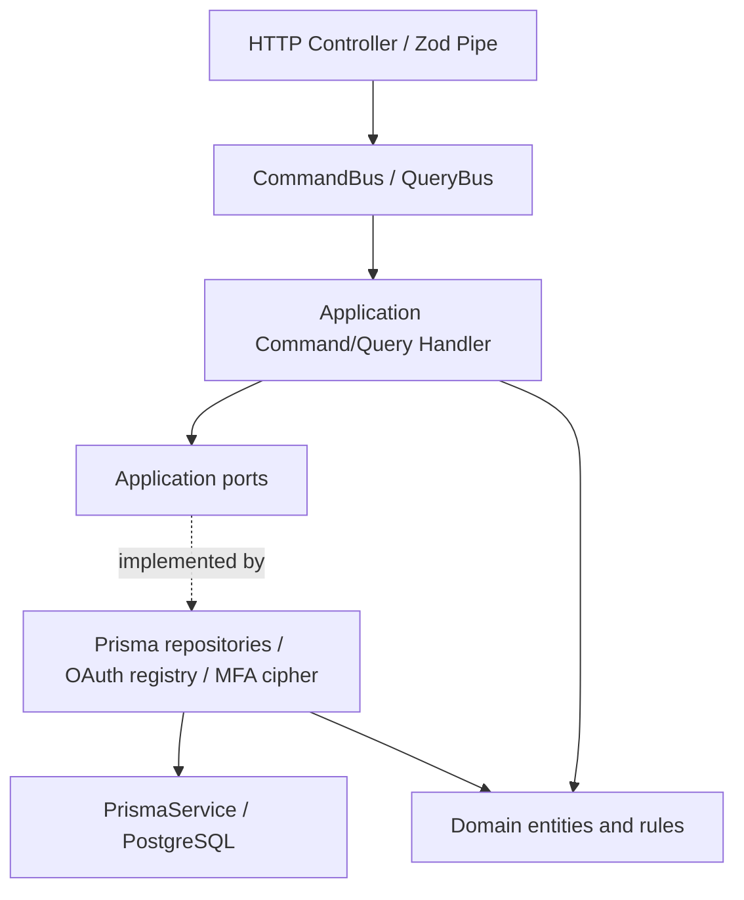
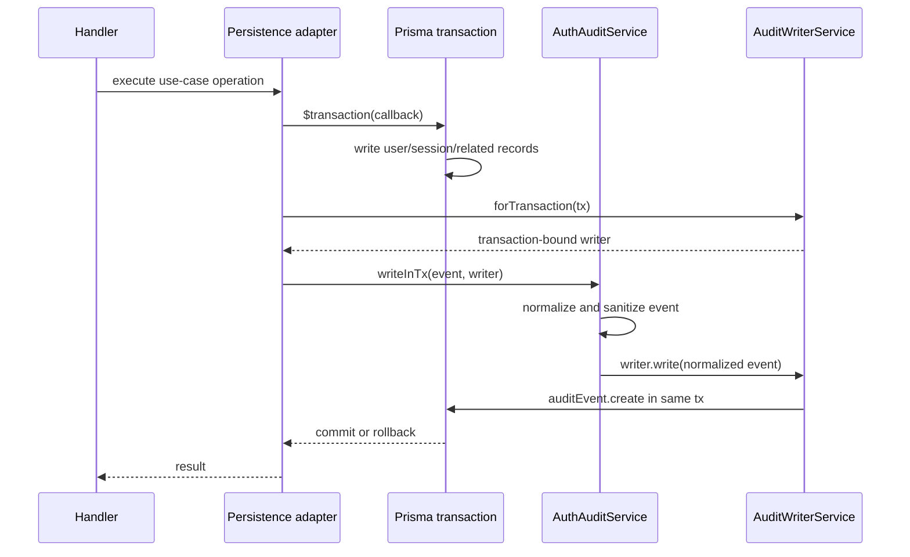

# LCSP Auth — Ports and Adapters

**Scope:** Authentication module and the Admin Account Lifecycle integration.

**Baseline for MFA transactional follow-up:** commit `341b8051a` (2026-10-24).

**Baseline for Auth Error Boundary:** commit `6c82e008a` (2026-10-24).

**Status:** implementation in the LCSP-999 refactor branch; not an approval to merge or deploy.

## Architecture

The Auth API continues to use NestJS modules, CQRS command/query handlers,
Domain Entities, and Prisma persistence. Commands and queries depend on
application-facing ports rather than feature-specific infrastructure classes.

### Main ports

| Port                             | Implementation                  | Responsibility                                                              |
| -------------------------------- | ------------------------------- | --------------------------------------------------------------------------- |
| `AUTH_USER_REPOSITORY`           | `PrismaUserRepository`          | User access and scoped account updates                                      |
| `AUTH_SESSION_REPOSITORY`        | `PrismaSessionRepository`       | Session state and owner-checked revocation                                  |
| `AUTH_READ_REPOSITORY`           | `PrismaAuthReadRepository`      | Auth profile, session lists, step-up metadata                               |
| `AUTH_SIGN_UP_PERSISTENCE`       | `PrismaSignUpPersistence`       | Atomic create of user, initial session and audit                            |
| `AUTH_SECURITY_PERSISTENCE`      | `PrismaAuthSecurityPersistence` | Atomic recovery and MFA-disable commands                                    |
| `AUTH_MFA_LIFECYCLE_PERSISTENCE` | `PrismaMfaLifecyclePersistence` | Atomic MFA enrollment, code rotation, OTP/recovery proof and business audit |
| `AUTH_AUDIT_EVENT_WRITER`        | `AuditWriterService`            | Normalized, sanitized event writes                                          |
| `AUTH_MFA_SECRET_CIPHER`         | `MfaSecretCipherService`        | Encryption/decryption of MFA secret; keys remain in infrastructure          |
| `AUTH_OAUTH_PROVIDER_RESOLVER`   | `OAuthProviderRegistry`         | Resolve configured OAuth providers                                          |

Provider tokens are registered in `auth.module.ts` or the auth persistence
provider collection. The application does not import `PrismaService`,
`@prisma/client`, or feature-specific implementation paths.

### Transactional audit boundary

The application audit service does **not** receive `Prisma.TransactionClient`.
The infrastructure writer binds the audit write to the already opened
transaction. A failed audit write rejects the same transaction, preventing
partial success for atomic flows.

### MFA lifecycle transaction and concurrency

The MFA lifecycle port owns these atomic operations:

1. **Enrollment:** Account status and session/access-version are revalidated
   inside a transaction after row locks. TOTP enrollment, failed-attempt reset,
   used-OTP cleanup, conditional first backup batch, and all corresponding
   business audit events commit or roll back together. A stale enrollment
   ciphertext is rejected rather than overwritten.
2. **Recovery-code rotation:** Requires a currently verified session and
   matching verified enrollment. Invalidating old codes, issuing replacements
   and both generation/view audit events share one transaction.
3. **OTP or backup-code verification:** Consumes the OTP (unique lookup key) or
   backup code (conditional one-time update) together with session step-up,
   account MFA flags, rate-limit reset and success audit. Audit failure causes
   the consumed proof and all related state updates to roll back.

Database row lock order is **User → Session**, matching Disable MFA. The
cryptographic verification and code generation work occur before opening a
transaction. API/HTTP failure telemetry may still be recorded separately
after rollback; business audit atomicity does not suppress error logging.

### Repository modules

The compatibility barrel `infrastructure/persistence/prisma-auth.repositories.ts`
continues to re-export the same 10 concrete repository classes. Implementations
are separated into:

- `prisma-user.repository.ts`
- `prisma-session.repository.ts`
- `prisma-mfa.repositories.ts`
- `prisma-recovery.repository.ts`
- `prisma-oauth.repositories.ts`
- `prisma-audit-event.repository.ts`

### Security and OAuth boundaries

- Pure TOTP functions are in `platform/security/totp.utils.ts`.
- Recovery-code generation/normalization is in
  `auth/application/security/mfa-recovery-code.utils.ts`.
- MFA secret encryption and key access remain in infrastructure behind
  `MfaSecretCipher`.
- OAuth handlers use `OAuthProviderResolver`; the Google OAuth implementation
  is unchanged in infrastructure.
- Previous feature-infrastructure utility/module paths remain as compatibility
  exports where required by existing imports and tests.

## Application failure → HTTP boundary

Production files in `auth/application` throw `AuthApplicationError` from
`application/errors/auth-application.error.ts`. This is a framework-free
application error derived from the reusable
`common/errors/application.error.ts` class. It carries a stable shared
error `code`, `correlationId`, optional `requiredAction` and safe `meta`,
and, only when the default shared catalog is insufficient, a semantic
`reason` (not an HTTP status).

The global `HttpExceptionFilter` is the single HTTP adapter for these
errors. It calls the same `problemResult` factory used for existing NestJS
exceptions, keeps the standard `{ ok: false, problem: ... }` envelope and
copies the response correlation metadata for HTTP logging.

| Application reason / default                       | HTTP mapping                                         | Behavior preserved                                     |
| -------------------------------------------------- | ---------------------------------------------------- | ------------------------------------------------------ |
| `resourceAlreadyExists` (duplicate sign-up email)  | 409                                                  | `EMAIL_ALREADY_EXISTS`                                 |
| `resourceNotFound` (owned session missing)         | 404                                                  | `SESSION_INVALID`                                      |
| `authenticationRequired` (profile session missing) | 401                                                  | `SESSION_INVALID`                                      |
| `accessDenied` (suspended account session)         | 403                                                  | `ACCOUNT_SUSPENDED`                                    |
| No explicit reason                                 | Status from shared `PROBLEM_DEFAULTS`, otherwise 400 | Existing auth error catalog                            |
| `TEMPORARY_LOCKED` with metadata                   | 429                                                  | Retry timestamp, retry-after seconds, `wait_and_retry` |

The filter also preserves explicit `requiredAction` overrides and fills an
empty correlation ID using the authenticated request/header/fallback rule.
Zod validation continues to use the existing HTTP pipe and factory.
Other modules' NestJS exceptions and the generic 500 fail-safe are not
converted into Auth application errors.

## Import dependency gate

`scripts/check-import-policy.mjs` rejects production files under
`apps/api/src/modules/auth/application` that import Auth infrastructure,
the Prisma infrastructure directory, the HTTP transport package or
`@prisma/client`, and also prohibits importing NestJS HTTP status/exception
classes into Auth Application code. NestJS DI decorators remain allowed. Test
fixtures are excluded from this additional scoped boundary rule. Intentional
invalid-import probes verified both categories are blocked.

## Cross-module regression: Outbox retry timezones

The repository-wide E2E check exposed a separate bug in
`platform/outbox/outbox.repository.ts`. Prisma stores
`OutboxMessage.nextAttemptAt` as a UTC-valued PostgreSQL
`timestamp without time zone`. Comparing this directly against the
`timestamptz` returned by `NOW()` can make a future retry appear
overdue when PostgreSQL uses a non-UTC timezone.

The pending-batch query now compares against `NOW() AT TIME ZONE 'UTC'`
so both operands have the same timestamp-without-zone interpretation.
An Outbox integration regression test explicitly sets the session timezone
to `Pacific/Auckland`, independent of the test runner's default timezone.

This is a separate Outbox fix, not a change to the Auth API or error contract.

## Regression evidence — 2026-10-24

The following runs used disposable local databases, not production:

| Verification                                               | Recorded result                                    |
| ---------------------------------------------------------- | -------------------------------------------------- |
| Auth + Sign Up + OAuth E2E                                 | 72/72 pass                                         |
| Account Lifecycle and role retirement E2E                  | 18/18 pass                                         |
| Outbox E2E with UTC regression                             | 5/5 pass                                           |
| Focused Auth/filter unit suite                             | 34/34 pass                                         |
| Complete API Jest unit/integration suite                   | 1,028 pass, 34 skipped; 151 suites pass, 8 skipped |
| Web tests                                                  | 324/324 pass                                       |
| TypeScript, ESLint, formatting, import and contract checks | Pass                                               |

**Repository-wide API E2E, run together in one Jest process:** 20 suites pass,
2 suites fail, 1 opt-in suite skipped; 185 tests pass, 2 fail, 3 skipped
(out of 190). The two failing cases are:

- `admin-release-gate.e2e-spec.ts`: revoke Admin session returned 403 rather
  than 201 when run as part of the suite. The entire suite **passed 9/9 when
  rerun independently**, which points to a test-order/environment issue but
  does not yet identify the exact shared state.
- `assessment-list.e2e-spec.ts`: expected 8 assessments, observed 7 in the
  combined run. The entire suite **passed 8/8 independently**; cross-suite
  state isolation remains unproven.

**Separate opt-in canonical read-isolation test:** ran on its required fresh
`127.0.0.1:55441/lcsp_canonical_read_isolation` database (not included in
the main E2E aggregate). One test passed; two failed because the requested
SSE stream supplied no frame and unauthorized history returned 404 where
the test expected 200. This is an Assessment read-model/API contract
investigation, not evidence of an Auth application-error regression.

The API unit suite required Jest `--forceExit` due to pre-existing open
handles. Test assertions all passed, but resource cleanup still warrants
a separate harness check. The entire E2E suite is **not a clean release gate**;
rerun in CI after addressing isolation and Assessment contract issues. No
production load or deployment validation is claimed.

## Remaining technical considerations

1. Auth Application handlers no longer import the HTTP problem factory.
   `PrismaSessionRepository` still uses the transport factory for persistence
   failures; if strict isolation of Infrastructure is required, migrate those
   errors through a separate repository error adapter and verify its API mapping.
2. Failed MFA attempts intentionally update rate limits and emit rejection
   audit events outside a successful proof transaction. Their failure-path
   policy should be reviewed separately for availability under audit outages,
   rather than resetting security controls as part of this change.
3. Deprecated import facades should remain until all consuming modules are
   migrated and tests prove they can be removed safely.
