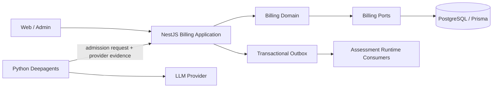
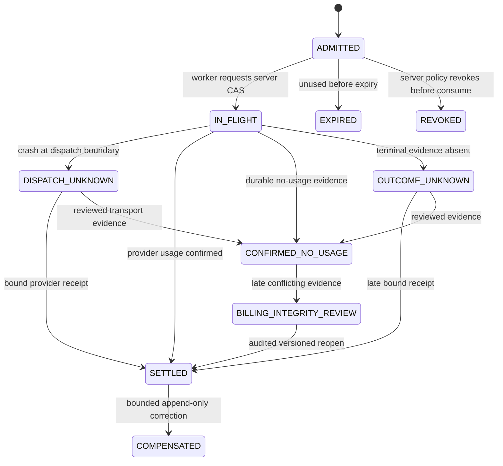

# Architecture Spine — LCSP Shared Wallet and Governed Model Usage

## Design Paradigm

Hexagonal financial authority with server-issued capability admission:



Only the NestJS Billing domain may authorize or mutate customer financial state. Deepagents executes provider calls, consumes admission and reports provider evidence through strict contracts.

## Inherited Invariants

| Inherited                                                 | From parent                         | Binds here                                                                                                 |
| --------------------------------------------------------- | ----------------------------------- | ---------------------------------------------------------------------------------------------------------- |
| Modular NestJS synchronous control plane                  | `docs/architecture/architecture.md` | Financial commands, RBAC and transactional state live in `apps/api`.                                       |
| Python Worker Platform owns asynchronous domain workloads | `docs/project-context.md`           | Provider dispatch and usage evidence collection remain in `deepagents`.                                    |
| RBAC owner/resource scope; no organization authority      | PRD and project context             | Wallet uses `wallet.userId`; assessment uses `assessment.ownerId`; ADMIN needs explicit action permission. |
| RabbitMQ plus outbox                                      | Project context                     | Financial state is committed before downstream notification/checkpoint processing.                         |
| One `WORKER_API_KEY`                                      | Approved Prompt 8 constraint        | Key authenticates the worker channel only; immutable admission supplies financial authority.               |

## Invariants & Rules

### AD-1 — NestJS owns all financial authority [ADOPTED]

- **Binds:** FR-083..FR-094, all financial writes.
- **Prevents:** Worker callbacks, role labels or provider payloads choosing a wallet, tariff or charge.
- **Rule:** Only the NestJS Billing application may issue admission, publish tariffs, append financial ledger entries, mutate signed wallet projections, close reconciliation or append compensation. Worker input is evidence, never amount authority.

### AD-2 — One shared signed-microcredit wallet per customer [ADOPTED]

- **Binds:** FR-083, FR-084, FR-090, NFR-036, NFR-039.
- **Prevents:** Per-assessment balances, floating-point drift and legacy-unit reinterpretation.
- **Rule:** One owner-scoped wallet carries a signed integer-microcredit projection; customer views derive `spendable=max(balance,0)` and `outstanding=max(-balance,0)`. One public credit equals `1,000,000` microcredits, and one public credit represents one VND of confirmed pre-tax service value.

### AD-3 — Published customer tariff is immutable runtime authority [ADOPTED]

- **Binds:** FR-085..FR-087, G-01, G-05.
- **Prevents:** Runtime FX/markup/tax drift and mutable historical charges.
- **Rule:** Admission pins one immutable `CustomerModelTariffSnapshot` resolved by a normalized provider/resolved-model scope key in the order exact model, provider default, optional global default. Publication and admission use database UTC and the same normalization. Nonnegative integer microcredit-per-token rates charge exactly `Σ(normalizedBucketTokens × pinnedBucketRate)` with checked arithmetic; a missing nonzero-bucket rate fails closed. Snapshot, effective assignment, audit and outbox publish atomically. Legacy `ModelPricingSnapshot` remains reference-cost data and cannot satisfy customer tariff resolution.

### AD-4 — Every physical invocation needs server admission [ADOPTED]

- **Binds:** FR-088, NFR-038, NFR-040, G-02, G-04, G-06.
- **Prevents:** Provider-call bypass, replay under another owner and unbounded monetary exposure.
- **Rule:** Before dispatch, the worker must prove possession of a high-entropy single-admission capability bound to job/run/lease, consume the admission by CAS, durably reach `IN_FLIGHT`, and only then send the first provider byte. The capability remains usable only for idempotent evidence delivery/recovery of that same admission until terminal acknowledgement, then is deleted. Retry/fallback uses a new request identity, physical invocation and admission; transport retry never replays a provider call.

### AD-5 — Runtime safety and wallet admission are independent [ADOPTED]

- **Binds:** FR-090, FR-094, NFR-033.
- **Prevents:** Payment granting runtime allowance or safety override creating money.
- **Rule:** Provider dispatch requires both runtime safety permission and wallet admission. Failure of either blocks dispatch. Top-up changes financial state only; Continue re-evaluates both authorities.

### AD-6 — Settlement is append-only, atomic and idempotent [ADOPTED]

- **Binds:** FR-089, NFR-036..NFR-038, AC-057.
- **Prevents:** Double debit, partial wallet state and mutable charge history.
- **Rule:** A settlement fingerprint is unique per immutable admission/invocation. One database transaction makes the usage receipt, model-usage debit, signed projection, terminal admission state, audit and outbox visible together or not at all. Same fingerprint replays the prior result; conflicting identity fails closed.

### AD-7 — Unknown usage is a durable state, never inferred zero [ADOPTED]

- **Binds:** FR-092, NFR-037, NFR-041, G-07.
- **Prevents:** Free usage, unsupported charges and accidental provider replay.
- **Rule:** Missing terminal provider evidence produces `OUTCOME_UNKNOWN`, retains bounded exposure and enters reconciliation. A late receipt settles the original invocation. No component replays the same provider invocation to discover usage.

### AD-8 — Compensation preserves the original debit [ADOPTED]

- **Binds:** FR-093, NFR-037, NFR-038, G-07.
- **Prevents:** Ledger rewriting and over-refund.
- **Rule:** Compensation is a new idempotent ledger entry referencing one original debit and cannot exceed its uncompensated amount. A no-debit unknown case closes without compensation; goodwill credit is a separate authority.

### AD-9 — RBAC is owner/resource scoped [ADOPTED]

- **Binds:** customer wallet reads, pricing publication, reconciliation and compensation.
- **Prevents:** BOLA and ADMIN-label authorization.
- **Rule:** Customer access scopes directly to `wallet.userId`/`assessment.ownerId`. Admin operations require explicit RBAC action permission and server-derived actor identity. No organization or PBAC dimension may be introduced.

### AD-10 — Expand, shadow, reconcile, then cut over [ADOPTED]

- **Binds:** NFR-039, NFR-042, G-01..G-07.
- **Prevents:** Mixed accounting authorities and enabling debit from unproven telemetry.
- **Rule:** Delivery order is contract RED, shadow microcredit/pricing, mandatory admission with debit off, shadow settlement/reconciliation, UX/operations rehearsal, then production enablement. Debit remains off while any gate is RED or lacks evidence.

### AD-11 — Current telemetry contract remains non-financial during migration [ADOPTED]

- **Binds:** `SettledUsagePayload`, `BillingUsageKernel`, compatibility rollout.
- **Prevents:** Existing worker telemetry silently becoming a debit callback.
- **Rule:** The current usage endpoint continues to record non-billable telemetry. New versioned admission and settlement contracts are separate; no monetary field is added to the legacy callback and no legacy record becomes authoritative by inference.

### AD-12 — No per-assessment concurrency balance or fixed global slot [ADOPTED]

- **Binds:** FR-083, G-04.
- **Prevents:** Hidden assessment allocation and an arbitrary concurrency value masquerading as cost safety.
- **Rule:** Assessments share one wallet without allocation. Concurrency and maximum exposure are versioned operational policies, not wallet partitions; G-04 must approve their numeric values from evidence before debit enablement.

### AD-13 — Funding principal is explicit [ADOPTED]

- **Binds:** all provider-call paths, including system-owned preparation.
- **Prevents:** Ownerless internal calls bypassing admission or being charged to an arbitrary customer.
- **Rule:** Every admission declares `CUSTOMER_WALLET` or `PLATFORM_SPONSORED`. Customer funding binds an owner/wallet and `CustomerModelTariffSnapshot`. Platform sponsorship binds a distinct immutable `PlatformSponsorshipPolicySnapshot` for provider-cost/exposure control and never resolves a customer tariff or writes customer ledger debit. An ownerless call without approved sponsorship fails before dispatch.

### AD-14 — Admission retry and crash evidence are canonical [ADOPTED]

- **Binds:** admission request, consume, dispatch, recovery and retry.
- **Prevents:** Duplicate admissions, duplicate provider calls and stranded exposure hidden as safe denial.
- **Rule:** A stable admission-request identity/fingerprint returns the same invocation/admission on retry. `IN_FLIGHT` is committed in NestJS/PostgreSQL before provider bytes. Crash after that boundary becomes `DISPATCH_UNKNOWN`; it is reconciled and never auto-reissued under the same physical invocation.

### AD-15 — Usage normalization is non-overlapping [ADOPTED]

- **Binds:** provider receipts, pricing calculator and settlement.
- **Prevents:** Inclusive cache/input totals or aggregate totals being charged twice.
- **Rule:** `packages/contracts` owns a versioned provider-mapping output containing only non-overlapping billable buckets. Inclusive/aggregate fields such as `inputTokensIncludingCache` and `totalTokens` are evidence only. Ambiguous overlap, unknown mapping or missing nonzero-bucket tariff enters integrity review without debit.

### AD-16 — Financial identity and accounting authority are singular [ADOPTED]

- **Binds:** settlement, wallet reads, compensation and repair.
- **Prevents:** Fingerprint drift, competing balance authorities and concurrent over-compensation.
- **Rule:** Shared contracts own canonical fingerprint fields/serialization and test vectors. The append-only microcredit ledger is accounting authority; wallet balance/version is its transactionally maintained projection. Projection mismatch blocks financial writes. Compensation locks/versions the original debit aggregate and updates ledger/projection atomically.

### AD-17 — Rollout is one monotonic server mode [ADOPTED]

- **Binds:** feature rollout, admission and settlement.
- **Prevents:** Independent booleans or stale processes enabling debit without eligible admission.
- **Rule:** NestJS owns `TELEMETRY_ONLY → SHADOW_PRICING → ADMISSION_REQUIRED → SHADOW_SETTLEMENT → DEBIT_ENABLED`. Admission pins the mode/version; only admission issued under eligible `DEBIT_ENABLED` authority can debit. Unknown/skewed mode fails closed.

### AD-18 — Financial contract compatibility is expand-only [ADOPTED]

- **Binds:** contracts, NestJS and deepagents.
- **Prevents:** Cross-runtime payload drift and compatibility adapters inventing financial authority.
- **Rule:** `packages/contracts` owns version/discriminator, strict schemas, canonical constants and fingerprint helpers. Unsupported versions fail before mutation. Legacy telemetry stays a separate non-financial contract; compatibility mapping cannot synthesize admission, tariff or charge.

### AD-19 — Admission availability fails closed [ADOPTED]

- **Binds:** every provider boundary.
- **Prevents:** Offline/local fallback bypassing wallet or pricing authority.
- **Rule:** Admission timeout/unavailability blocks new provider dispatch and cannot be replaced by locally issued authority. Already `IN_FLIGHT` work may deliver/recover evidence through the durable recovery path without a second provider dispatch.

### AD-20 — Financial outbox and late evidence are monotonic [ADOPTED]

- **Binds:** payment-required checkpointing, reconciliation and downstream consumers.
- **Prevents:** Duplicate/stale events regressing assessment state or late callbacks silently rewriting reviewed outcomes.
- **Rule:** Every financial event carries immutable event ID, aggregate ID/version, event type/version, assessment/run/lease, invocation and correlation identity. Consumers are idempotent by event ID/version and re-check the current run boundary. Late evidence after `CONFIRMED_NO_USAGE` enters `BILLING_INTEGRITY_REVIEW`; debit requires an explicit versioned reopen and preserves the original decision history.

### AD-21 — Financial RBAC actions are canonical [ADOPTED]

- **Binds:** pricing, reconciliation, compensation and sponsorship commands.
- **Prevents:** One broad Admin label granting unrelated financial mutations.
- **Rule:** Shared contracts define separate actions for pricing draft, pricing publish/supersede, platform sponsorship, reconciliation decision, compensation and goodwill credit. Each command resolves database-owned resource relationships before authorization and mutation.

## Consistency Conventions

| Concern         | Convention                                                                                                                                                                                                                                                                 |
| --------------- | -------------------------------------------------------------------------------------------------------------------------------------------------------------------------------------------------------------------------------------------------------------------------- |
| Monetary values | Canonical base-10 decimal strings on wire; integer microcredits/BigInt internally; no exponent or JS number.                                                                                                                                                               |
| Time            | Database UTC; pricing assignments use half-open `[effectiveFrom,effectiveTo)` intervals.                                                                                                                                                                                   |
| Identity        | Stable caller admission-request ID plus fingerprint; server invocation/admission UUID; server stores capability digest only; worker recovery journal may retain only an encrypted capability envelope until terminal deletion; versioned canonical settlement fingerprint. |
| Contracts       | `packages/contracts` owns SCREAMING_SNAKE_CASE constants and strict schemas; no Prisma types cross API/worker boundaries.                                                                                                                                                  |
| Errors          | Shared Result Envelope/RFC 7807 problem contracts; no raw provider/database error details.                                                                                                                                                                                 |
| Audit           | Server-derived actor/time, policy/version, owner/resource, correlation ID and safe refs; never prompt/output or internal secrets.                                                                                                                                          |
| Events          | `command.<domain>.<action>.v1` / `event.<domain>.<fact>.v1`; financial write precedes outbox publication.                                                                                                                                                                  |
| Lock order      | Wallet or sponsorship aggregate → admission → original debit/reconciliation case → projection/outbox.                                                                                                                                                                      |

## Stack

| Name   | Version        |
| ------ | -------------- |
| NestJS | `^11.0.1`      |
| Prisma | `7.8.0`        |
| Zod    | `4.6.6`        |
| Python | `>=3.11,<3.14` |

## Structural Seed

```text
packages/contracts/src/billing/          # canonical pricing/admission/settlement contracts
apps/api/src/modules/billing/            # sole financial application/domain authority
apps/api/prisma/                          # financial persistence and database constraints
deepagents/middleware/                    # provider boundary; admission consumption and evidence capture
deepagents/tools/common/capabilities/     # strict API transport adapters
apps/web/src/features/billing/            # customer/admin projections and commands
```



## Capability → Architecture Map

| Capability / Area             | Lives in                                | Governed by                            |
| ----------------------------- | --------------------------------------- | -------------------------------------- |
| Shared wallet/top-up          | Contracts + NestJS Billing + PostgreSQL | AD-1, AD-2, AD-6, AD-9                 |
| Pricing draft/publish/resolve | Contracts + NestJS Billing + PostgreSQL | AD-1, AD-3, AD-9                       |
| Provider-call admission       | NestJS Billing + Deepagents boundary    | AD-4, AD-5, AD-10, AD-13, AD-14, AD-19 |
| Usage settlement              | NestJS Billing + PostgreSQL             | AD-1, AD-6, AD-11, AD-15, AD-16        |
| Payment-required/Continue     | NestJS outbox/runtime consumer + Web    | AD-2, AD-5, AD-6                       |
| Reconciliation/compensation   | NestJS Billing operations + Web Admin   | AD-7, AD-8, AD-9, AD-16, AD-20, AD-21  |
| Migration/enablement          | Billing operations + CI evidence        | AD-10, AD-11, AD-12, AD-17, AD-18      |

## Deferred

- Initial ACTIVE tariff values and exact cost-source approvals: close at `G-01`.
- Numeric maximum exposure and concurrency policy: close at `G-04`; no arbitrary default becomes authority.
- Paid-tool billing: separate product/architecture decision after tool-specific units and refund semantics exist.
- Provider/package infrastructure versions: retained brownfield platform ownership; this feature spine does not repin them.
