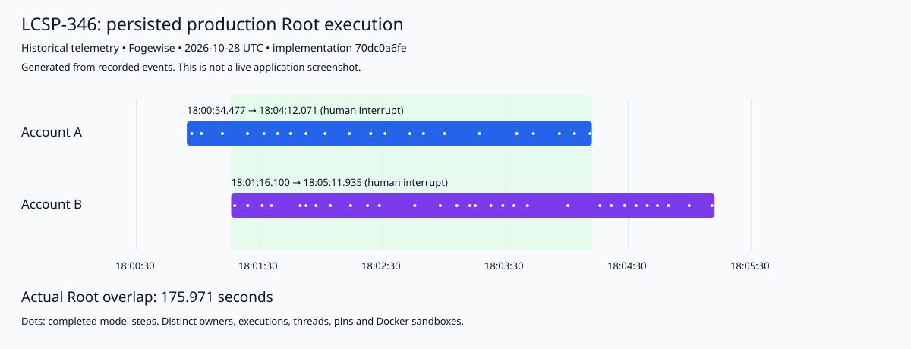

# LCSP-346 — production evidence for 70dc0a6fe

**Real, bounded, cross-account Root overlap is proven. Overall acceptance remains BLOCKED.** The initial turns reached native human interrupts. Customer replies are now recorded, and both native resumes are queued behind two other active Roots at the configured cap of two. Production Stop/Continue, complete Assessments/reports and monetary billing reconciliation remain outstanding. No unexecuted scenario is reported as PASS.

Implementation PR: [#440](https://github.com/khov4nfs/LCSP/pull/440), Draft, unmerged, `REVIEW_REQUIRED`.
Local implementation / remote PR / VPS: **`70dc0a6fe40c618bdf47d532f9baa5230e52faf1`**.
This separate evidence branch supplies immutable links in the PR conversation without advancing the implementation HEAD.

## A. Implementation summary

The existing RabbitMQ → bounded boundary executor → Agent Server → API lease → native Assessment Root path now supports two independent Roots. The change adds bounded lifetime executor admission and shared broker channel credit, makes explicit worker capacity authoritative, copies Contexts for worker submissions and caps both new and recovered server runs. The native read-only researcher remains serial within each Root.

## B. Root cause and fix

**Root cause:** The single Root consumer had default prefetch 1 despite four boundary threads. One unacknowledged delivery therefore serialized independent Assessment execution. `max(prefetch, configured_workers)` could also silently raise a requested worker cap. The standard executor queue could accumulate submissions across reconnects or timeouts while previous work was still executing.

**Fix:** Default workers are two, with prefetch defaulting to that capacity. Per-consumer and shared channel QoS bound outstanding work; a nonblocking semaphore bounds executor submissions for its entire lifetime. Explicit worker limits stay authoritative. A still-running future retains its slot after timeout or reconnect. Existing confirmed durable broker deferral handles saturation without consuming a failure attempt. Delivery-local settlement remains scheduled on its original connection/channel thread. Native server recovery uses the same capacity ceiling.

Short API row transactions, per-thread advisory locks, profile compilation locks and atomic usage-journal transactions remain intentional. No global lock covers all Root inference. API/outbox publication is short sequential dispatch, not serialization for the lifetime of an Assessment.

## C. Architecture and limits

`Assessment Created → API preparation/pins → idempotent Outbox → RabbitMQ → bounded bridge executor → native server request/thread → API lease → fresh Root + pinned sandbox → canonical LangGraph checkpoints → governed decisions → Completion Gate → report`

| Production boundary                                                      | Verified setting/behavior                                                |
| ------------------------------------------------------------------------ | ------------------------------------------------------------------------ |
| Broker vhost                                                             | `lcsp-sync-20261028`                                                     |
| Root consumers                                                           | 1                                                                        |
| All bridge consumers on shared channel                                   | 15                                                                       |
| Effective boundary workers / prefetch / server workers                   | **2 / 2 / 2**                                                            |
| Worker override                                                          | `LCSP_AGENT_RUNTIME_BOUNDARY_WORKERS`, 1–64; authoritative               |
| Prefetch override                                                        | `LCSP_AGENT_RUNTIME_RABBITMQ_PREFETCH`, 1–65535; zero/unlimited rejected |
| Shared channel unacknowledged bound                                      | `min(W, P × boundary consumer count)` = 2                                |
| Single Root queue concurrent admission                                   | `min(W, P, server capacity)` = 2                                         |
| Submitted bridge work, including retained work across reconnect/timeouts | At most W = 2                                                            |
| Native server execution                                                  | `min(jobs default 8, W 2)` = 2                                           |
| Actual simultaneous real Roots                                           | 2, using native execution intervals below                                |
| Native researcher concurrency per Root                                   | 1                                                                        |

Admission to the executor never ACKs execution. Successful dispatch settles only after the native server turn ends. Capacity deferral first confirms the durable broker copy, then settles the original delivery; failed publication leaves it NACKed/requeued. This is deferral, not successful Assessment completion. Closing a channel leaves unsettled work for broker redelivery.

FIFO and bounded credit permit finite eligible backlogs to progress. The real-broker fixture lets B finish and queued C progress while A stays slow, with active work never exceeding the cap. This is not weighted per-account scheduling or a waiting-time guarantee under unlimited offered load.

Research concurrency above one is deliberately disabled. Native isolated child messages alone do not prove safety for the shared Root SearchTrace's consuming `snapshot_and_reset`, mutable caches and provider-route state. Native batching is tested at cap one and returns candidates without accepting evidence/decisions. No child researcher tasks occurred in these two live runs; production task-level parallelism is not claimed.

## D. Code changes

Implementation commit: `70dc0a6fe40c618bdf47d532f9baa5230e52faf1`, committed/pushed/PR-created using the authorized NHI session identity.

| Files                                                                                        | Meaningful change                                                                                                  |
| -------------------------------------------------------------------------------------------- | ------------------------------------------------------------------------------------------------------------------ |
| `deepagents/tools/common/capabilities/agent_runtime/rabbitmq_consumer.py`                    | Capacity/config validation, lifetime bounded submissions, copied Contexts, shared QoS, confirmed capacity deferral |
| `deepagents/tools/common/capabilities/agent_runtime/local_server.py`                         | Cap restored and new graph execution                                                                               |
| `deepagents/assessment_root/agent.py`, `instructions.md`                                     | Explicit native researcher cap one/read-only authority                                                             |
| `deepagents/tests/test_assessment_concurrency.py`, `test_assessment_concurrency_rabbitmq.py` | Observable native overlap, capacity, Context isolation, broker credit, settlement, reconnect and SIGTERM           |
| `test_agent_runtime_rabbitmq_consumer.py`, `test_paid_admission.py`                          | Configuration and concurrent admission/usage regressions                                                           |
| `.env.example`, `.github/workflows/test.yml`                                                 | Document supported overrides; RabbitMQ 4 Python CI service                                                         |
| `docs/developer/bounded-assessment-concurrency.md`, predeployment acceptance README          | Bounds, authority, deployment and failed-attempt history                                                           |

No LCSP-345 multi-repository model, LCSP-347 rule selection, legal-semantic authority, retired EngineeringRule/dispatcher/ScannerStep or unrelated release work was introduced.

## E. PR, CI and automated tests

Exact-head checks: **34 SUCCESS, 4 intentional SKIPPED, no failures/pending**, [check records](pr-state.json). The [Tests workflow](https://github.com/khov4nfs/LCSP/actions/runs/40734739962) independently records `head_sha=70dc0a6fe40c618bdf47d532f9baa5230e52faf1` in [ci-run.json](ci-run.json).

| Executed evidence                                                                      | Result                                                        | Artifact                                                                      |
| -------------------------------------------------------------------------------------- | ------------------------------------------------------------- | ----------------------------------------------------------------------------- |
| Exact-head CI Python                                                                   | 2002 passed / 22 skipped                                      | [CI log](ci-python.log)                                                       |
| Exact-head CI API unit/integration                                                     | 185 suites / 1479 tests passed; 14 suites / 129 tests skipped | [CI log](ci-api-unit.log)                                                     |
| Exact-head CI API E2E                                                                  | 21 suites / 176 tests passed; 3 suites / 21 tests skipped     | [CI log](ci-api-e2e.log)                                                      |
| Exact-head workspace static checks                                                     | Passed                                                        | [CI log](ci-static.log)                                                       |
| Fogewise provider-free concurrency/broker lifecycle                                    | 24 passed, 11.21s; zero skip/failure/error                    | [VPS JUnit](fogewise-controlled-tests.xml)                                    |
| Supplemental simultaneous native Root Stop/Continue probe, exact PR source on Fogewise | 1 passed, 4.75s; API/model are deterministic stand-ins        | [test](test_native_stop_isolation.py), [VPS JUnit](native-stop-isolation.xml) |
| Saved-evidence invariants                                                              | PASS                                                          | [checker](verify_evidence.py), [result](verification.json)                    |

Earlier local runs recorded 2002 Python passes, 1493 API unit/integration passes and 175 API E2E passes, plus one separately executed PostgreSQL native request/checkpoint reconnect-and-owned-erasure test. Local and CI API totals remain 1608 and 197 respectively; environment-gated tests differ in their skip selection. Typecheck, business-doc checker/tests, imports/contracts, retired-authority/billing gates, formatting, launcher and semantic-oracle checks passed. See the committed [predeployment history](../README.md).

The local temporary directory disappeared during the session break. Its raw local logs are unavailable; they are not fabricated here. Current publication uses recoverable exact-head CI logs, original durable VPS XML reports, surviving raw screenshots and fresh read-only production observations. The implementation HEAD and production state were rechecked after recovery.

Python skips include six opt-in Docker fixtures, one production image fixture, thirteen frontier PostgreSQL fixtures and two other owned/disposable database fixtures; the native recovery DB case ran separately. Skips are not counted as executed. Initial environment-sensitive/Prisma/test-fixture setup failures and their corrections remain visible in the predeployment history. Saved CI logs are sanitized copies; original logs remain at their CI URLs.

### Mandatory matrix mapping

| Requirements                                                                   | Executed architecture/regression evidence                                                                                                                                               |
| ------------------------------------------------------------------------------ | --------------------------------------------------------------------------------------------------------------------------------------------------------------------------------------- |
| 1–6: actual overlap, workers 1/2, excess backlog, slow A, different accounts   | Native two-Root inference barrier; worker-cap/out-of-order fixture; real broker credit/slow-A progression; real production owners/intervals below                                       |
| 7: duplicate Root prevention                                                   | Existing API claim/lease/idempotency and held-lease/stale-delivery boundary tests                                                                                                       |
| 8–9: delivery-local/out-of-order settlement                                    | Thread-affine ACK/NACK and out-of-order completion fixtures                                                                                                                             |
| 10–11: retry, redelivery, reconnect                                            | Confirmed publication/exhaustion tests; 100-delivery reconnect/tag-reuse fixture                                                                                                        |
| 12–13: SIGTERM and failure isolation                                           | Actual broker child-process SIGTERM/redelivery; worker Context failure/reuse and independent native Roots                                                                               |
| 14–15: Stop A while B remains active, canonical Continue A                     | Supplemental simultaneous native graph probe; existing Root/native control tests                                                                                                        |
| 16–17: no unnecessary replay or stale late effects                             | Native resume/reconstruction tests; nonabortable model/late tool cancellation/write-fence tests; supplemental fact effect occurs once after Continue                                    |
| 18–19: human identity and stale revision fencing                               | Native interrupt replay and API human/decision revision E2E                                                                                                                             |
| 20–21: invocation IDs and bounded fallback                                     | Concurrent admission and retry/credential/fallback admission suites                                                                                                                     |
| 22–24: provider failure isolation, no double counting, token/cache attribution | Run-scoped disabled/sticky-route fixture; concurrent paid admission, usage-journal recovery and API settlement tests; live reconciliation below                                         |
| 25: stream, task, model and tool identity                                      | TaskLineage/Root telemetry scope tests; actual disjoint model/tool IDs and owner-scoped stream below                                                                                    |
| 26–28: read-only researcher, failure isolation, deterministic outcomes         | Native task batch explicitly serial at cap one; researcher lacks governed mutation tools; candidates never become accepted findings. Above-one research is not enabled or claimed safe. |
| 29: all required pinned Rule Set pages                                         | Existing reliability test consumes 243 rules in pages of 25; 243 production coverage rows per Assessment                                                                                |
| 30: Completion Gate/report contract                                            | Existing semantic/coverage/finalization/report regressions; live terminal/report scenario is blocked                                                                                    |

## F. Production deployment

Previous VPS revision: clean `develop` **`70ddc3c086678edabb6b7a9f6627685841afbafb`**, PR #439 after #438.
Verified checkout: `/srv/apps/LCSP`. Safely fetched, switched and normally pulled `--ff-only` onto the feature branch. No destructive Git cleanup, environment replacement, migration, manual lifecycle edit or production data deletion ran.

Actual rebuild used `deepagents/Dockerfile.dev` with the committed frozen lock; synchronized the host virtualenv inexactly to retain unmanaged extras; rebuilt wheel/bytecode and the sandbox image. Only `lcsp-agent-runtime` restarted at **2026-10-28T17:40:40Z**; API/Web PIDs were unchanged.

- Image: **`sha256:c4b9c49555981880f203d6a9cc77bc71f0aae6d3b750ac43c912c7f1e61e4de1`**.
- Image revision label: exact PR SHA. Four changed runtime/instruction file hashes match the implementation Git objects and current production checkout.
- Rebuilt wheel SHA-256, recorded during deployment: `55669f374e8766853764e0e697b9a23b332384a0fd9c156b46c4a8915c6d3e07`.
- Deep Agents 0.7.17 / LangGraph 1.2.18 / SDK 0.4.10 matched the frozen lock at rebuild.
- Pre-restart protection recorded zero live API leases, active Preparations or pending/running durable native requests; historical expired RUNNING/QUEUED labels were preserved. 136 applied migrations, zero incomplete; no migration executed.
- Fresh recovered observation: same clean feature branch and exact SHA; API 8080, native server 2024 and Web 3002 health 200; connected Root consumer prefetch 2. Environment/PM2 fingerprints and actual process settings are recorded without secrets.
- API domain and native checkpoint databases were independently located from actual process environments; no credential is exported.
- This remains an unmerged PR acceptance deployment, **not a finalized production release**. No unrelated process was restarted or unrelated image/data pruned.

See [fresh production observation](production-observation.json.gz), [implementation identity/hashes](implementation-identity.json), [recovered rebuild log](sandbox-build.log) and the original [deployment checkpoint comment](https://github.com/khov4nfs/LCSP/pull/440#issuecomment-6476578722).

## G. Real Assessment execution matrix

All timestamps below are **2026-10-28 UTC**, from actual native `BOUNDARY_STARTED`/`BOUNDARY_COMPLETED` events. The end marks a Root turn yielding to a human interrupt, not Assessment completion.

| Account/owner                             | Repository and pinned commit                                                                                          | Assessment ID                          | Root execution ID                      | Start        | End          | Result                                                                                |
| ----------------------------------------- | --------------------------------------------------------------------------------------------------------------------- | -------------------------------------- | -------------------------------------- | ------------ | ------------ | ------------------------------------------------------------------------------------- |
| A: `2e723a25-b79c-4aac-a094-5771f3fbc590` | [AI-Proctored-System](https://github.com/shreeram312/AI-Proctored-System), `9ddb361e4cd52aafe4e1d0763f57005a607efae6` | `db6266b2-4e16-4ced-8595-7ffe9e33f3ab` | `1fe90257-e296-48cb-a2d0-b1de79384092` | 18:00:54.477 | 18:04:12.071 | WAITING_FOR_HUMAN / INTERRUPTED; 3 questions; 0 decisions; no report                  |
| B: `d3f2f078-78f1-4480-8a8d-9e134a356da1` | [credit_score_engine](https://github.com/Kowshik-18/credit_score_engine), `132b5d796b32bf2f4454990b64df7d0435e28161`  | `06ad978f-0ada-46f9-b648-e2c86aee37c1` | `aca38bac-2091-4b24-8fc2-3a6de9f141d5` | 18:01:16.100 | 18:05:11.935 | WAITING_FOR_HUMAN / INTERRUPTED; 5 questions; 6 interim accepted decisions; no report |

**Actual concurrent Root execution: 175.971 seconds**, 18:01:16.100–18:04:12.071. Interleaved model/tool events and canonical checkpoint writes corroborate both active graphs. This is not inferred from queue submissions, successful futures, lease intervals or API labels.

| Dispatch measurement                              | A            | B            |
| ------------------------------------------------- | ------------ | ------------ |
| Root command published                            | 18:00:36.005 | 18:00:36.017 |
| Published → persisted native transport request    | 0.028410 s   | 0.036436 s   |
| Published → API Root claim                        | 0.565 s      | 0.967 s      |
| Published → actual Root / first Root stream event | 18.472 s     | 40.083 s     |
| Published → first model step                      | 19.255 s     | 40.879 s     |
| First model timestamp                             | 18:00:55.260 | 18:01:16.896 |
| Root active interval                              | 197.594 s    | 235.835 s    |
| Native checkpoint rows                            | 439          | 628          |
| Model steps / distinct tool calls                 | 21 / 46      | 30 / 33      |

Published-to-transport includes broker/dispatch latency, not an isolated queue-wait measure. Broker callback/worker-acquisition timestamps were not captured separately; API claim time is labelled explicitly. Hydration/indexing precedes Root inference.

| Production scenario | Outcome                                                                                                                                                                                         |
| ------------------- | ----------------------------------------------------------------------------------------------------------------------------------------------------------------------------------------------- |
| P1                  | PASS: two actual independent customer Roots overlap, with separate state and pins                                                                                                               |
| P2                  | Real B inference starts while A is active; controlled slow-A/B/C broker fixture PASS. No additional intentionally staggered paid submission was launched; callback-level timing is unavailable. |
| P3                  | Provider-free private real-broker queues on Fogewise PASS: cap respected, excess pending, B/C progress while A is slow, no success ACK on executor admission                                    |
| P4                  | BLOCKED: both turns reached genuine human waits before the live Stop scenario. Passing controlled native Stop/Continue is separate evidence.                                                    |
| P5                  | Controlled failure/reconnect/SIGTERM isolation PASS. Natural A quota failure/fallback is also observed before B's graph starts; it is not misrepresented as a failure during their overlap.     |
| P6                  | PASS for captured interleaved run/model/tool telemetry, cross-owner denial, owner-scoped SSE and refresh retention; no production child task occurred                                           |
| P7                  | BLOCKED: no completed Assessment or report exists. No manual report/status mutation was made.                                                                                                   |

## H. Stop/Continue and isolation

A thread `665548a2-14a9-4c2c-a3ce-45502e39f996`, checkpoint `1f1d2f9f-a4fe-646e-81a4-f05d307d11f8`.
B thread `c5c87467-678e-4199-8b49-422b2c0d9029`, checkpoint `1f1d2fa1-dc3f-66a3-8261-c2ac99e833f5`.
All 1,067 checkpoint metadata rows match their Assessment, execution, snapshot and commit. Distinct thread-hash Docker containers use the exact rebuilt image; repository marker pins match their API cases. Neither container shares a repository mount.

Both authorized Customer accounts were restored through normal sign-in after the local browser reset. Each account's Assessment/events/human-request GETs return 200; the other account's corresponding three GETs return 404 `ASSESSMENT_NOT_FOUND` in both directions. Reconnected SSE returns 200 `text/event-stream`, includes its own Assessment and excludes the other test customer's ID. Checkpoints, human waits and invocation counts remain unchanged after refresh and the session break. [Browser evidence](browser-isolation.json).

Live Stop/Continue has **not** run. Qualified benchmark replies are recorded: existing A replies were preserved and the remaining B replies were submitted through the supported UI. Text requests are recorded as answered, while the verbatim answers retain unknown operational facts. No affirmative operator/deployment assertion was invented. After all replies, the API automatically published same-thread continuations; both await capacity. The disabled Continue control is not bypassed. The supplemental provider-free probe stops A before a fact effect, confirms B's inference/checkpoint remain active, resumes A from its own canonical checkpoint and accepts its queued fact effect exactly once.

### Native continuation checkpoint — 2026-10-29

- A's final reply committed at 02:35:18.127 UTC; continuation published 02:35:18.610 UTC.
- B's final reply committed at 02:36:41 UTC; continuation published 02:36:42.028 UTC.
- Both retain their canonical checkpoint/execution IDs. New human context advances case revisions to 6/7. B's six earlier decisions are invalidated by the existing case-revision rule and preserved in history.
- At 02:40:33 UTC, two other Assessments hold the two live leases. Both made 24 usage records in the preceding five minutes and continue renewing leases. RabbitMQ has two unacknowledged active deliveries and two ready continuations. These targets are waiting, not executing Roots.
- [Human answer provenance](human-answer-provenance.json), [post-answer state](post-hitl-observation.json.gz), [capacity/progress](capacity-wait.json). Other customer identities/content are excluded from the capacity observation.
- Initial screenshot waits for active Roots timed out while the continuations were queued. Those attempts issued no additional model calls and establish no resumed overlap.
- Read-only browser inspection independently confirms the two user-specified grading Assessments occupy both slots: [capacity holder 1](screenshots/capacity-holder-1.png), [capacity holder 2](screenshots/capacity-holder-2.png), [IDs/runtime/usage](confirmed-capacity-holders.json). Both are owned by Account A; these screenshots are not presented as cross-account P1 proof. Their Stop controls were not used.

## I. Usage and LCSP-360 governance

| Attribution                    | A         | B         |
| ------------------------------ | --------- | --------- |
| Distinct physical attempts     | 22        | 30        |
| SETTLED / UNAVAILABLE          | 21 / 1    | 30 / 0    |
| Uncached input                 | 457,562   | 407,819   |
| Cached input                   | 1,441,802 | 2,488,205 |
| Output, including reasoning    | 27,128    | 39,966    |
| Reasoning subset, not additive | 20,205    | 32,574    |
| Reported total                 | 1,926,492 | 2,935,990 |

Successful journal records reconcile exactly to API aggregates. All 104 STARTED/terminal callback rows were delivered and project idempotently to 52 physical invocation records. No invocation, model-step, tool-call or checkpoint identity crosses accounts. No extra model work appeared during the session break.

A's credential slot 01 received HTTP **402** `free_tier_quota_exceeded` at 18:01:08.360 on logical invocation `8e10ed1e-3e1a-4215-a902-bd5a6dc02e2b`. Failed physical attempt `39619adb-e1c8-4538-8110-b64f725a5119` retains FAILED / `PROVIDER_USAGE_METADATA_MISSING` with absent tokens. Existing bounded credential fallback resolves that same logical step through safe slot 02 after exactly two physical attempts, completing 18:01:11.830. B has 30 independently settled attempts. Missing usage is never invented as zero.

The existing `INCEPTION / mercury-3` production records are **UNPRICED / MODEL_PRICE**, with null pricing/reservation IDs and provider cost. Zero customer-charge aggregates do not establish free inference or monetary settlement. Token attribution/recovery PASS; production monetary reservation reconciliation is **BLOCKED** by the existing route/policy. Atomic paid-admission/fallback/recovery regression tests pass separately. LCSP-346 did not alter pricing, add a budget policy or relabel the legacy journal as bounded paid admission.

LCSP-360 source/claim provenance, evidence validation, paginated pinned coverage, native interrupts, checkpointed Continue, deterministic Completion Gate and report authority remain unchanged and covered by regressions. B's six structurally accepted interim decisions are not independent legal certification: real operator/deployment facts remain unresolved. No final semantic/report integrity PASS is claimed for incomplete cases.

## J. Evidence, history and limits

- [Read-only production trace/usage/checkpoint/pin/journal data](production-observation.json.gz), [deterministic consistency result](verification.json), [checker](verify_evidence.py).
- [A already human-interrupted at the first capture](screenshots/A-snapshot-180511.png), [B still actively running at 18:05:11](screenshots/B-concurrent-running.png).
- [Original A checkpoint UI](screenshots/A-checkpoint-human-wait.png), [original B checkpoint UI](screenshots/B-checkpoint-human-wait.png), [restored A session](screenshots/A-recovered-checkpoint.png), [restored B session](screenshots/B-recovered-checkpoint.png).
- The paired two-active UI PNG capture was missed: A had interrupted before the first screenshot. The historical overlap chart is explicitly generated from telemetry, never presented as a live UI capture.
- Stop-A/B-continues and completed-report screenshots do not exist because those scenarios did not execute. Machine-readable exact-version deployment health evidence exists; no fabricated screenshot substitutes for a missing scenario.
- Native stream correlation IDs are `unknown` on this existing path; Assessment/run/model/tool identities are explicit and disjoint.
- Requested Jira-site access remains unavailable through the connected connector; no Jira state was modified. User-provided mission text supplied scope.
- Earlier local setup failures are retained in the committed history. One environment-sensitive local test echoed a database credential to tool output; publication artifacts are sanitized and operator credential rotation remains outstanding.
- Current production disk/resource measurements are recorded, not hidden. No unrelated data/cache/image cleanup was performed.

## K. Verdict

| Status                     | Result  | Evidence / required remainder                                                                                |
| -------------------------- | ------- | ------------------------------------------------------------------------------------------------------------ |
| IMPLEMENTATION             | PASS    | Bounded executor/channel/server, actual two-Root execution                                                   |
| AUTOMATED_TESTS            | PASS    | Exact-head CI Python/API/E2E/static, explicit skips, 25 provider-free VPS tests; local DB recovery recorded  |
| PR_CI                      | PASS    | Draft #440, exact HEAD, 34 success / 4 skipped; review still required                                        |
| PRODUCTION_DEPLOYMENT      | PASS    | Exact SHA/image/source parity, real rebuild, healthy services                                                |
| REAL_CONCURRENCY           | PASS    | Actual cross-owner overlap 175.971 s; distinct checkpoints/sandboxes/pins                                    |
| STOP_CONTINUE              | BLOCKED | Answers recorded; live P4 awaits worker capacity and resumed Roots                                           |
| STREAM_ISOLATION           | PASS    | Interleaved telemetry, cross-owner denial, scoped SSE and restored sessions                                  |
| USAGE_ACCOUNTING           | BLOCKED | Token attribution/recovery PASS; monetary route UNPRICED with no reservations                                |
| LEGAL_SEMANTICS_REGRESSION | BLOCKED | Automated governance PASS; final real semantic/report acceptance incomplete                                  |
| OVERALL                    | BLOCKED | Queued continuations, live Stop/Continue, terminal reports, monetary reconciliation and required screenshots |

Gates A/B/C/D/F pass within the recorded evidence. Gate E remains BLOCKED. Controlled tests and a healthy deployment do not replace unexecuted real scenarios. The PR has not merged and this acceptance deployment is not a finalized release.
