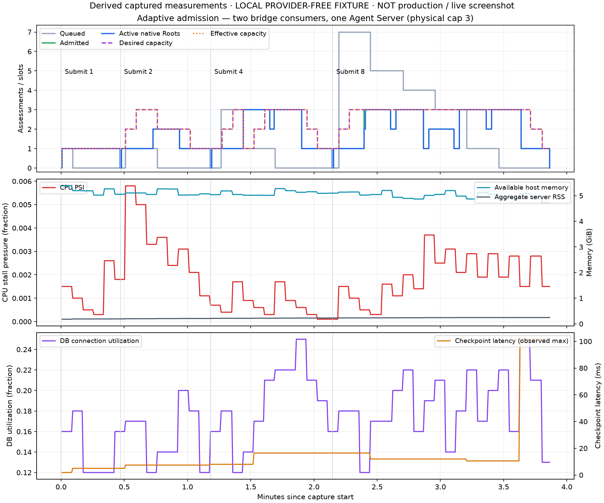

# LCSP-364 engineering report — A–K

Verdict: **BLOCKED for production acceptance and merge**. Implementation is in
[draft PR #442](https://github.com/khov4nfs/LCSP/pull/442), targeting develop.
This report distinguishes provider-free local proof from unexecuted production
canaries. Jira remains In Progress; no merge or Done transition is authorized here.

## A. Baseline and implementation

Initially verified develop was `e19048e1285c224085690cc344efb059c49bdf49`
(merged LCSP-346 #440). Before publication the feature was rebased onto actual
latest develop `9d677b8fc308bdc4ac7ce27addb74e796b58b880`.
The implementation extends the existing API/PostgreSQL lease and outbox stack;
RabbitMQ remains the durable delivery authority and one native Root owns each
Assessment's legal decisions. Native researcher concurrency remains one.

The supported server is one authoritative PM2 process. Bridge replicas can share
it. A fixed authorized physical executor ceiling bounds submissions, while the
API adjusts the effective admission ceiling automatically. Executor internals are
never mutated and Agent Server replicas are not enabled.

## B. Root cause

Startup-sized pools and broker credit were process-local, static bounds. Increasing
consumers did not establish a global cap, and low CPU/backlog alone could not prove
memory, database, checkpoint, sandbox or provider headroom. The server's local
polling/cancellation dictionaries also made horizontal server replication unsafe.

Logical Stop/finish/lease expiry could precede the end of unabortable calls and
late accounting. A timed-out operational report could arrive after a newer
reservation. These are physical-ownership hazards, not legal scheduling decisions.

## C. Architecture

[ADR](../../docs/adr/LCSP-364-adaptive-root-admission.md) records the authority,
scaling mechanism, rejected alternatives and failure limits. A row lock serializes
admission/control across API replicas. A partial unique index prevents two live
physical reservations for one Assessment. Native Root claim binds the exact
reserved run and current server incarnation before issuing its lease.

The host process lock prevents overlapping supported server processes. Registration
and reports compare a durable authority version. Reservations/releases advance
that version, so a delayed snapshot cannot reconcile away newer work. Lease expiry
never frees physical capacity. Future completion plus drained model/accounting
callbacks, or a consistent fenced reconciliation, proves quiescence.

Demand attaches atomically to the existing Root outbox command. Owner rotation
uses last admission then oldest eligible command, including Continue and guarded
human-crash recovery. A new Continue cannot reattach and ACK the preceding still
running command. Root DLQ discard retains a cancelled audit tombstone; explicit
replay reopens only quiescent intent and does not clear accepted work.

## D. Changes and commits

- `456b4d2059b7208566c6ac7def6c929ed7819067`: core global admission/controller,
  measurements, lifecycle, contracts, migration, controls and integration fixtures.
- `67fbc7fcc4ad857f973040e547acf07cf91b7116`: serialize direct fixture snapshots.
- `0dac9150cbd5215e70f0f51187eed06f4279eb42`: repository autofix bot formatting/type cleanup.
- Follow-up source/content identity is recorded in [automated-receipts.json](automated-receipts.json).
  Final pushed SHA and CI receipts are maintained on the PR and Jira acceptance comment.

The additive migration introduces capacity, command-admission, execution-slot and
decision-history tables. It does not rewrite historical Assessments, accepted
decisions, legal pins, checkpoints, reports or usage. New Nest controllers use the
shared envelope, worker authentication and existing ADMIN RBAC. [Runbook](../../docs/runbooks/assessment-root-capacity.md)
covers policy seeding, audited controls, drain, disable, first upgrade and rollback.

## E. Automated tests

Captured local verification includes:

| Receipt | Observed result | Scope |
|---|---|---|
| Admission/policy/outbox/routes | 105 passed | Real PostgreSQL pools/worker HTTP, cap, fairness, generation fencing, delayed report, DLQ, overrides and policy |
| Runtime focused | 90 passed, 1 skipped | Physical late-call drain, SDK/Continue identity, broker settlement, restart, inherited cgroup limits and the image fixture handshake |
| Full Python | 2,026 passed, 25 skipped | Current worker regression; skipped integrations are not PASS |
| Full API | 1,554 passed, 127 skipped | Earlier broad regression; later affected tests and exact-head CI required for follow-up changes |
| Assessment vertical | 148 checks | Real API/PG/native Root, scripted model, pins/negative controls/final report and artifact isolation |
| Human resolution | 80 checks plus separate checkpoint DB PASS | Same-thread Stop/Continue, crash, answers, no checkpoint table in API DB |
| Unresolvable human facts | 72 checks | Separate processes/native checkpoints; unknown facts remain unresolved |
| Real RabbitMQ | 3 passed | Bounded credit/overlap, delivery-thread settlement and SIGTERM redelivery |
| Drain script | 4 passed | Authenticated drain/resume and fail-closed invalid/unsupported responses |
| Source gates | PASS | Imports, contracts, retired-authority check, typecheck and business documentation |
| Changed API ESLint and affected fixture suites | 11 files clean; 58 tests passed | Exact changed-file lint command and admission/stream/lease fixtures after CI type corrections |

See [machine-readable receipts](automated-receipts.json). CI runs real PostgreSQL
admission separately from schema-resetting test suites, and the Assessment vertical
job runs the real broker/native 1/2/4/8 matrix. Final exact-HEAD CI is a separate gate.

Two initial CI typing failures in the test helper were fixed by adding its project
include and keeping the serialization tail typed as a void promise. An optional
credential-index regression was test-database interference: it passed against the
separate migrated database, and the broad API rerun passed with isolated databases.
No assertion or financial/semantic gate was relaxed.
CI's separate changed-file ESLint step also identified promise-only mocks marked
async and untyped HTTP test responses. The mocks now return promises explicitly,
and the Nest application carries its HTTP server type. The same lint command passes
locally without rule suppression or relaxed response assertions.

The initial Docker image check found a fixture integration gap: its snapshot-only
API stub lacked the new startup registration/report protocol, and the slim image
had no machine-id. The fixture now supplies an explicit read-only host identity
and authenticated, versioned handshake with **zero Root capacity**. It still checks
the unrelated native health boundary, sandbox hydration and persisted thread state
across image restart. Its HTTP protocol unit check passes; the rebuilt candidate
image must pass the final exact-HEAD Docker CI job. No production admission bypass
was added.

## F. Production deployment

**NOT DEPLOYED.** Read-only Fogewise preflight at `2026-10-30T06:26:58.309814+00:00` found:

- Deployed/rollback revision: `44dba336f332d566d3fee9fc0d32642a402d024e`.
- Checkout `/srv/apps/LCSP`, preserved clean source/configuration and unrelated services.
- CPU count 4; available memory approximately 5.14 GB; swap used approximately 846 MB.
- Free disk **1,861,111,808 bytes**, below the normal 4 GiB headroom.
- Six persistent repository sandboxes; their 2 GiB/2-CPU configuration is a limit, not measured per-Root consumption.
- API database `lcsp_dev`; checkpoint/runtime store `lcsp360_cheatshield_acceptance_20261026`, verified from actual process environments.
- PostgreSQL used 9 of 100 connections; checkpoint read probe approximately 38 ms.
- Five expired RUNNING rows in each domain copy were not treated as live executions or altered.
  Native persisted transports were terminal (37 success, 2 error); broker occupancy was captured.
- API/runtime health 200, web redirect 307. These are preflight observations, not canary PASS.

Existing sandbox image digest:
`sha256:0039d8bc2a963bf5d517e7732297c30ef9d8ffd7c56caeacc29378e9852e14e5`.
Its revision remains the previous deployment. **New PR image/build identity and
migration activation are BLOCKED**, not inferred from the old image. Environment
fingerprints and exact observations are in [production-preflight-current.json](production-preflight-current.json).

No production rebuild, service restart, migration, paid Assessment, sandbox deletion,
prune or unrelated cleanup was performed. The old server lacks the new drain
endpoint; first activation also requires the documented maintenance/quiescence
bootstrap. The deployment script refuses unsupported drain and never falls back
to killing the whole PM2 daemon.

## G. Actual load/concurrency evidence

**LOCAL PROVIDER-FREE NATIVE INTEGRATION, NOT PRODUCTION.** Two real broker consumer
connections used one HTTP Agent Server, real API global admission, native
Assessment Root/tools and PostgreSQL checkpoints. Only the model and local
repository backend were fixtures. The separately audited small-fixture envelope
uses 512 MiB per Root, 2 GiB memory headroom and 1 GiB disk headroom, with physical
cap 3. It performs no repository clone, image build or Docker sandbox workload.
Production retains its 4 GiB disk threshold. The normal threshold actually refused
the local host's roughly 2.37 GB free disk; [refusal receipt](local-disk-refusal.json).

Queue timings below are controlled batch broker-publish start to authoritative
Root claim. Throughput ends after all submitted Roots complete and physically
release. Submitted count is not simultaneous authorized capacity.

| Submitted | Completed | Peak claimed Root overlap | Wait p50 ms | Wait p95 ms | Elapsed s | Roots/min |
|---|---|---|---|---|---|---|
| 1 | 1 | 1 | 142.5 | 142.5 | 28.12 | 2.13 |
| 2 | 2 | 2 | 7607.1 | 14354.9 | 42.81 | 2.80 |
| 4 | 4 | 3 | 15216.5 | 27944.4 | 57.80 | 4.15 |
| 8 | 8 | 3 | 37744.9 | 70085.0 | 103.11 | 4.66 |

The load asserted exactly one authoritative runtime turn per Assessment despite
duplicate deliveries, cap <= 3 and tenant rotation (7:1 in the eight-request case).
All 15 Assessments completed on
15 canonical threads with
45 distinct accepted decisions. A read-only
post-run query verified 2100 canonical
checkpoints and parent ancestry within each thread/namespace. There were 15 physical
reservations and zero live reservations after completion. API admission deferrals:
19; recovered slots in this healthy load:
0. Counts are API observations, not invented broker ACK totals.

[Raw timeline and native spans](native-load.json) and [controller/checkpoint receipts](controller-receipts.json)
include actual capacity changes, CPU/RAM, DB utilization, checkpoint latency,
broker ready/unacked, source timestamps and policy snapshots. Provider calls in
this fixture were zero; provider token/price receipts remain **UNKNOWN/null**.
All Root repository pins were the explicitly synthetic `c…c` fixture pin, not an
actual public repository commit. No public benchmark or real-world operator was invented.

## H. Stop/Continue, HITL and isolation

The native scripted verticals preserve canonical thread/checkpoint identity across
separate processes, Stop/Continue, human answers and crash replay. Waiting human
state alone does not release capacity: actual quiescence is required. Continued
work competes again and cannot consume the previous command's result. API tests
reject stale/cross-Assessment reservations; existing customer timeline/event and
artifact denial checks remain in the vertical/regression suites.

Real native production Stop A while B continues, per-load fault/Stop matrices and
all production failure scenarios remain **BLOCKED**. Component tests, provider-free
native tests and historical LCSP-346 evidence are not substitutes for that canary.

## I. Resource, provider and monetary governance

The controller considers CPU/I/O pressure, available host and inherited cgroup
memory/CPU constraints, aggregate and Root-associated sandbox memory, physical
server slots, unrelated boundaries, DB connections/latency, checkpoint failures,
broker demand/age, usage outcomes, 429s and budget denials. Unknown/stale critical
measurements suspend admission; unknown provider limits/outcomes prohibit expansion
beyond the conservative initial envelope. Minimum normal capacity does not force
unsafe admission. Cooling/hysteresis state persists across API restart.

Per-Root Python RSS cannot be attributed reliably to threads and remains unavailable;
aggregate server RSS and measured sandbox samples are reported. A conservative
per-Root reserve budgets that unknown use. Hidden cgroup ancestry remains unknown,
not unlimited. The existing paid-call admission/journal remains authoritative;
scaling grants no budget or legal bypass. No paid-production accounting or
LCSP-346 outstanding semantic/monetary acceptance disposition was revalidated here.

## J. Charts, traces and rollback

[SVG](capacity-timeline.svg) is exportable. Both charts are derived from captured
measurements and explicitly labelled **not live/production screenshots**. Reproduce
with `scripts/plot-assessment-root-capacity.py` and matplotlib (capture used 3.11.2).
Production UI/operator screenshots are **BLOCKED**; none were fabricated.

Policy disable/override/emergency and return to bounded two-slot mode are tested
through the real SQL authority. The actual local server was drained to effective
zero after native completion. Production disable/binary rollback is **unexecuted**.
The runbook preserves the previous SHA/image, additive tables, accepted work and
existing data, and requires physical drain before replacement.

## K. Acceptance and final verdict

| Gate | Captured local evidence | Production/release status |
|---|---|---|
| Architecture | Single canonical Root, API row-lock authority, fixed physical ceiling | BLOCKED: new revision not activated |
| Adaptive control | Automatic 1/2/3 capacity, deterministic 1→2→N→2→1, measured refusal | BLOCKED |
| Global cap | Concurrent PG pools, two real bridge consumers, peak <= 3 | BLOCKED |
| Resource safety | Pressure/unknown tests and actual local disk refusal; Docker telemetry code | BLOCKED: production/Docker load not proven |
| Stability | Cooldown, hysteresis, bounded steps and persisted state tests | BLOCKED |
| Fairness | Owner rotation, skewed native backlog, out-of-order broker/SQL completion | BLOCKED |
| Broker correctness | Real credit/settlement/SIGTERM and duplicate/reconnect unit contracts | BLOCKED: new-revision production traces absent |
| Agent Server lifecycle | Single-instance lock, bounded futures, physical drain and fenced recovery tests | BLOCKED: production recovery not exercised |
| Stop/Continue | Native scripted same-thread restoration, separate checkpoint DB | BLOCKED |
| HITL | Quiescence retention/re-admission and native human-resolution checks | BLOCKED |
| Legal semantics | Contract/negative-control regression; no semantic authority change | BLOCKED: real semantic acceptance not revalidated |
| Usage accounting | Existing regression plus retained late accounting scope | BLOCKED: real provider reconciliation not run |
| Automated tests | Scoped local receipts above | BLOCKED until final exact-HEAD CI complete |
| Load matrix | Local 1/2/4/8 native fixture recorded | BLOCKED for full Docker/provider/fault matrix |
| Production canary A–G | Not executed | BLOCKED by resource preflight/activation |
| Rollback H | Local policy/drain checks only | BLOCKED: production rollback unexecuted |
| PR CI | Exact final HEAD checks must be inspected on PR | BLOCKED at report capture |
| Independent review | Required normal repository review | BLOCKED; no approval/merge/Done claimed |

This is a reviewable implementation with measured provider-free evidence. It is
**not an accepted production release**. Resolve resource/first-activation gates,
validate the exact pushed revision through A–H, reconcile real semantics/accounting,
and complete normal review before merge or Done.
