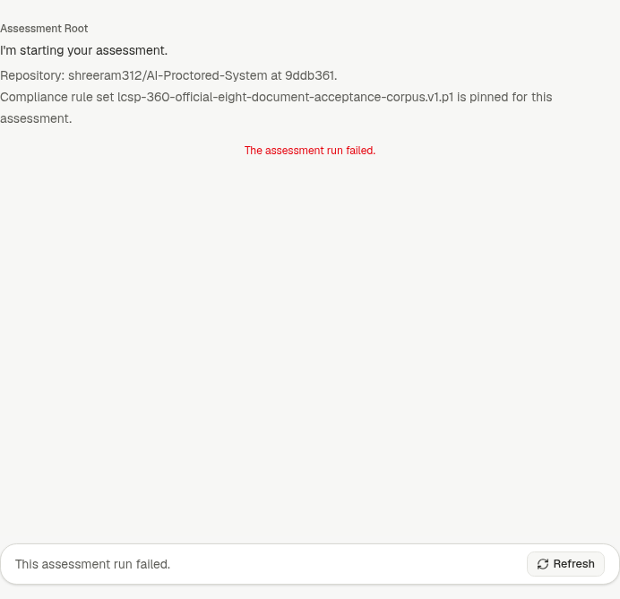
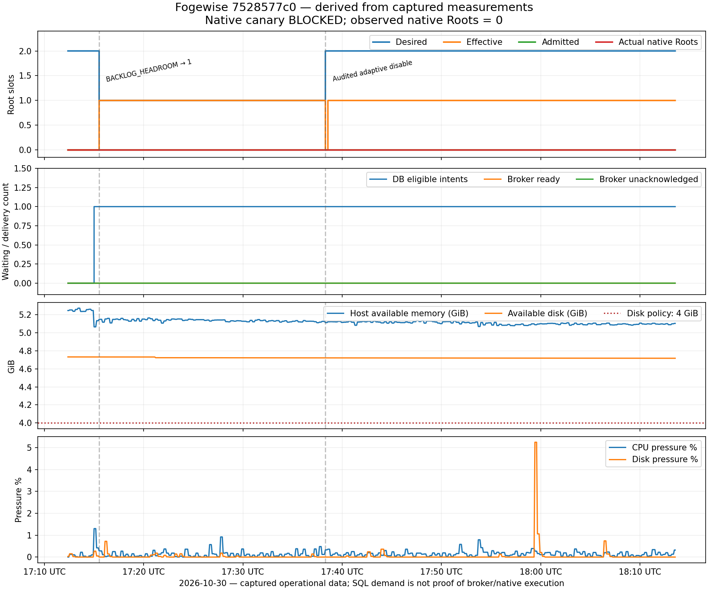

# Fogewise activation, failed canary and verified rollback

All times below are UTC on 2026-10-30 (the local rollout date is 2026-10-31,
Asia/Ho_Chi_Minh). This evidence is bound to implementation
`7528577c08e23e991f62223558407d529d22babd`. The final VPS revision is the rollback
target `44dba336f332d566d3fee9fc0d32642a402d024e`.

**Verdict: deployment and idle binary rollback executed; native production
acceptance remains BLOCKED.** The owner confirmed another instance outside the
VPS uses the production database. Its location, version and quiescence are not
yet verified. A global safety claim cannot be made for that mixed topology.

## A. Baseline and implementation

Fresh [initial preflight](rollout-initial-preflight.json) at 16:41:49 found a clean
LCSP-346 checkout, 4 CPUs, 1,826,795,520 bytes free disk, one genuinely active
Root, one unacknowledged Root delivery and one running repository sandbox.
The active Root finished naturally before maintenance began; it was not killed.
Five older RUNNING labels had expired leases and were preserved.

The exact PR implementation at rollout time was `7528577c0`; all 43 reported
checks on that SHA were successful. Later evidence-only commits do not change
the tested runtime source or turn the failed production scenario into a PASS.

## B. Root cause and disposition

The historical disk blocker was confirmed by measurement. Disposable tool and
registry caches occupied enough space to recover the 4 GiB policy headroom.

Canary A transitioned QUEUED → RUNNING → FAILED at 17:14:53–17:14:58. Its API
turn named a native runtime ID absent from the new Fogewise server/store, and
the global authority contained no physical slot for it. No corresponding claim
request was found in the new API's HTTP log. Another database client was observed,
and the owner subsequently confirmed an instance outside the VPS.

**Inference:** an older external writer is a plausible explanation for those
inconsistent observations. It is not a proven root cause; the originating process
must be identified before replay. The canary customer's available credit balance
was also non-positive, a separate paid-validation prerequisite. No credit,
provider limit, lease, historical decision or checkpoint was fabricated or reset.

## C. Architecture and topology gate

The supported topology remains API-owned PostgreSQL admission, one authoritative
Agent Server and bounded RabbitMQ bridges. Fogewise used physical worker/server
ceiling 2 and prefetch 2. No Agent Server replica or higher physical capacity was
started. Native researcher concurrency was unchanged.

The first-activation checks proved **VPS-local** quiescence, not quiescence of
every production writer. The later external-instance discovery prevents treating
those checks as global first-activation acceptance. No external connection was
terminated and no unidentified process was stopped.

## D. Cleanup, source and build identity

Targeted cleanup removed four unused old VS Code Server versions, one unused
`npx` cache and registry download caches. Process command, executable, working
directory, memory mappings and open descriptors were checked before removal.
The newest editor version, existing database backups, customer data, repository
sandboxes and all Docker images were retained. No Docker prune was performed.

The measured reclaimed cache space was 5,258,346,496 bytes, approximately 4.90 GiB.
Receipts: [first cleanup](rollout-cleanup-receipt.json),
[registry cache](rollout-build-cache-cleanup.json),
[additional editor version](rollout-additional-cache-cleanup.json).

The image build temporarily reduced headroom below 4 GiB. The next build step
refused to proceed; additional targeted cleanup restored headroom before the
remaining build/activation. The threshold was not lowered. Prisma generate
initially lacked deployment environment variables; it passed after loading the
existing `.env.pm2`, with no source patch.

The clean target checkout was fetched with NHI credentials and the previous branch
was preserved. [Build receipt](rollout-build-receipt.json): locked dependencies,
API/shared package/Web builds and source bytecode checks; Web build ID
`E6kAYpDvkM7zmXhL2ML3v`. The established deployment's
`deepagents/Dockerfile.dev` was reused, as in LCSP-346.

Candidate image digest:
`sha256:28f9aafc97f5884aff5b7ccd7ee9438c04f9cc3956d0b51d7dde4f5aa4a74ee0`.
Its OCI revision label matched the exact PR SHA.

## E. Automated verification

The implementation's 43 successful checks are recorded separately from this
rollout. They include the 10,001-command real PostgreSQL/RabbitMQ regression,
concurrent compatibility-route/drain regression, native fixture load and Docker
E2E. They do not establish production native execution.

This round changes evidence only. Operational self-checks verified archive hashes,
exact source/image identity, clean checkout, resource thresholds, migration state,
process exit, and matching domain fingerprints across binary rollback.

## F. Production deployment

At 16:55:35–16:55:55, repeated observations found no live API Root lease, running
native transport, ready or unacknowledged delivery. The API was paused first,
the state was checked again, and only the three LCSP applications were stopped.
All 10 owned processes/children exited; boundary consumers became zero.
[First-activation receipt](rollout-first-quiescence.jsonl).

The candidate activated at 17:08:45 with 139 completed migrations, none unfinished,
and healthy API/Web/Runtime. The environment changed only bounded worker/server
settings, private RabbitMQ management origin, and disabling automatic sandbox
reaping for the rollout. Other environment values and unrelated PM2 process IDs
were preserved. [Activation receipt](rollout-activation-receipt.json).

Private off-host archives preserve both databases and the old build/config,
with checksum-only [database](rollout-database-backup-receipt.json) and
[build/config](rollout-rollback-backup-receipt.json) receipts. Archives contain
credentials/customer data and are deliberately excluded from publication.

## G. Actual capacity and canary observations

The [720 captured samples](rollout-capacity-timeline.jsonl), 17:12:22–18:13:31,
show effective capacity **0 → 1** automatically with `BACKLOG_HEADROOM`.
RAM then limited the effective ceiling to 1 despite low CPU and physical cap 2.
Provider envelopes/unknown outcomes remained unknown; no invented healthy limit
enabled expansion. The [summary](rollout-telemetry-summary.json) retains the
operator controls and metric provenance.

**Observed admitted Roots = 0; observed native Roots = 0.** An SQL eligible-intent
count of 1 coexisted with zero broker ready/unacknowledged messages. It is not
evidence of a waiting broker delivery or an executing Root. End-to-end throughput,
queue latency percentiles and Root overlap are inconclusive for this rollout.

| Canary | Public target | Exact commit | Disposition |
| --- | --- | --- | --- |
| A | shreeram312/AI-Proctored-System | `9ddb361e4cd52aafe4e1d0763f57005a607efae6` | Submitted once; API FAILED; no new-server native execution proved |
| B | Kowshik-18/credit_score_engine | `132b5d796b32bf2f4454990b64df7d0435e28161` | Created, connected and pinned only; execution deliberately not submitted after A failed |

Neither target was given fabricated operator, jurisdiction or deployment facts.
There was no automatic replay of A and no additional paid load matrix.

## H. Stop/Continue, HITL and isolation

The original Root reached quiescence naturally before first activation. The new
canary failed before a checkpoint or HITL state was established, so new-revision
Stop/Continue, HITL slot handoff and cross-owner native concurrency are **BLOCKED**.
The failed A and prepared B remain intact for investigation. Existing unrelated
Assessments and the original sandbox were not deleted or repurposed.

## I. Resource, provider and monetary governance

The final [post-rollback preflight](rollout-after-binary-rollback-preflight.json)
at 19:34:29 measured about **4.362 GiB free**, above the unchanged 4 GiB threshold.
No higher-than-two production concurrency was attempted or claimed.

The canary API reported invocationCount 0. This is not paid-provider reconciliation
or proof that unknown provider costs are zero. Customer funds were not injected,
historical unknown usage was not settled artificially, and financial admission was
not bypassed. Paid semantic/accounting acceptance remains **BLOCKED**.

## J. Screenshot, traces and rollback

The screenshot is the actual production canary conversation area, without
credentials, private reasoning or other customers' content.

The chart is **derived from captured measurements, not a live screenshot**.
[SVG export](rollout-capacity-derived.svg). It distinguishes desired/effective
capacity, admitted/native Roots, SQL intent, broker delivery counts and resource
pressure. It explicitly records the failed native acceptance gate.

Adaptive disable was accepted through the authenticated administrator API with
actor/reason audit at version 113. It restored the bounded 2-slot policy while
resource safety still allowed only 1; no override bypassed RAM constraints.

At 19:30:24 the [authenticated drain](rollout-authenticated-drain.jsonl) returned
quiescent=true, activeNativeRuns=0 and reservedRootRuns=0. Repeated checks then
preceded graceful API/runtime/Web stop, with no live old child remaining.

At 19:33:09 the [binary rollback](rollout-rollback-receipt.json) restored exact
revision `44dba336f`, the original environment fingerprint and old image digest
`sha256:0039d8bc2a963bf5d517e7732297c30ef9d8ffd7c56caeacc29378e9852e14e5`.
API/Web/Runtime health passed. Unrelated process IDs were unchanged. Fingerprints
of the 9 recorded domain tables matched before/after. No database restore, down
migration, reset or Assessment mutation was used; all 139 additive migrations
remain applied. Both old and candidate builds/images are preserved.

## K. Acceptance and next gate

| Gate | Actual result |
| --- | --- |
| Targeted cleanup / 4 GiB headroom | PASS at final capture |
| VPS-local first-activation quiescence | PASS; not global-writer quiescence |
| Exact PR source/image activation | PASS on `7528577c0` |
| Fresh operational metrics / automatic decision | Observed 0 → 1; no native execution proof |
| Resource safety refusal above safe RAM ceiling | Observed ceiling 1 under physical maximum 2 |
| Audited disable / idle drain / binary rollback | PASS for the recorded idle scenario |
| Global admission across all actual instances | BLOCKED: external instance version/routing/quiescence unknown |
| Native concurrency, Stop/Continue and HITL | BLOCKED: canary A failed; B not started |
| Paid semantic and usage reconciliation | BLOCKED: no validated native run; canary wallet not funded |
| Independent review / merge / Done | Not approved or performed |

Before retry: identify and safely drain/update the external API/worker; ensure all
writers enforce the reviewed API admission contract and bridges route to the one
Fogewise server; verify financial authorization/funds; repeat complete global
quiescence and exact-revision activation. Do not clear A's history or manually
release leases/slots to make that gate green. Jira remains In Progress.
